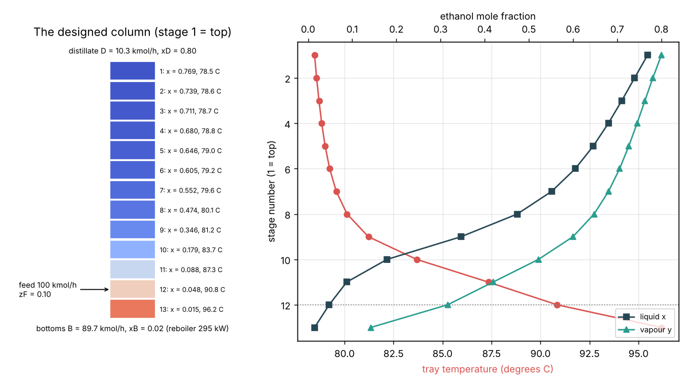
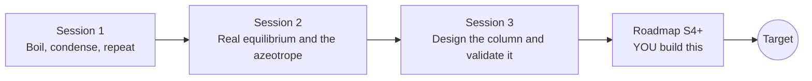

# opendistillation

[](https://github.com/KrunalPanchal1995/pan-iit-oss/actions/workflows/tests.yml)   [](https://colab.research.google.com/github/KrunalPanchal1995/pan-iit-oss/blob/main/opendistillation/sessions/session-01/lesson.ipynb) [](https://krunalpanchal1995.github.io/pan-iit-oss/opendistillation/)

**Separate ethanol and water with a distillation column, in three sessions.**

opendistillation teaches how a column of stages separates a mixture by boiling-point differences, from one boil-and-condense step to the real ethanol-water equilibrium, the azeotrope and a McCabe-Thiele column design, using only Python and a browser.

- **Start from zero.** Session 1 needs only fractions, percentages and a log key: vapour is richer in ethanol, and stages multiply that.
- **See the column.** Every session ships a slider app that runs in the browser, with a column picture and labelled x-y and T-x-y diagrams.
- **Know you got it right.** Each session ends with a checkpoint that prints PASS or FAIL against hand calculations, material balances and known limits.
- **Build the missing half.** The repo stops at Session 3 on purpose; the roadmap shows the path to the Target.

[Target](#the-target) · [Who is this for](#who-is-this-for) · [Quick start](#quick-start) · [Sessions](#sessions) · [Roadmap](#roadmap) · [Contribute](#contribute) · [Explainer PDF](docs/explainer.pdf)

> **This repo is incomplete on purpose.** Sessions 1 to 3 are here and fully working. The finished Target below is a preview of what the community can build next. We show you the path, not the code. Sessions 4 and up are yours.

## The Target

A distillery column comes to life. Starting cold and full of wash, the column heats up tray by tray: the reboiler boils, vapour climbs, the condenser sends reflux back, and each tray's temperature and composition settle over time until the column reaches the steady profile designed in Session 3: 13 stages, feed on stage 12, 78.5 C at the top and 96.2 C at the bottom, a top product of 0.80 ethanol from a 0.10 wash. Your goal over the coming sessions: build that dynamic column yourself, with tray hold-ups, energy balances and a temperature controller, and see how long a real column takes to start up and how it answers a change in feed.



*Target: the designed ethanol-water column with each stage's composition and temperature, and the tray profiles (the steady state the dynamic model must reach)*

Try it live:

- [Session 3 app: design an ethanol-water column](https://krunalpanchal1995.github.io/pan-iit-oss/opendistillation/session-03/)
- [Math Visual Studio](https://krunalpanchal1995.github.io/studio/)

How the Target was made is shown only as a path in [promo/roadmap.md](promo/roadmap.md).

## Who is this for
**diploma / undergraduate to advanced undergraduate (levels 5-6).** Topic area: Chemical, Environmental and Process Engineering.

Prerequisites:

- School arithmetic, percentages, logarithms and straight lines y = m x + c; the idea of boiling and vapour.
- Python 3.10 or newer; if `python --version` works, you are ready. PRIMER.md explains the rest.
- No prior GitHub, thermodynamics or mass-transfer course is needed; Sessions 2 and 3 explain each numerical step they use.

New to Python? Read [PRIMER.md](PRIMER.md) first (10 minutes).

## Quick start

No installation knowledge needed. You need [Git](https://git-scm.com/downloads) and [Python 3.10+](https://www.python.org/downloads/) (Windows: tick "Add Python to PATH"). On Mac and Linux type `python3` wherever this page says `python`.

```bash
git clone https://github.com/KrunalPanchal1995/pan-iit-oss.git
cd pan-iit-oss/opendistillation
python start.py 1
```

`start.py` creates a private environment, installs what is needed and runs Session 1 with its checkpoint. Next: `python start.py 2`, `python start.py 3`, or `python start.py test` to check everything. Only a checkpoint: `python start.py check 1`.

<!-- friendly-help -->
<details>
<summary><b>Not working? Common fixes (no Git, "python not found", no internet)</b></summary>

- **No Git?** You do not need it. On the main page of this collection click the green **Code** button, then **Download ZIP**, unzip it, open a terminal inside the folder `pan-iit-oss-main/opendistillation` and run `python start.py 1`. The ZIP holds every project, so it is large; the live apps need no download at all.
- **"python is not recognized" or "command not found".** On Windows try `py start.py 1`. On Mac and Linux try `python3 start.py 1`. If neither works, install Python from [python.org](https://www.python.org/downloads/) and tick "Add Python to PATH".
- **Needs internet once.** The first run downloads NumPy and Matplotlib into a private folder (`.venv`); after that it works offline.
- **Rather not install anything?** Open the [live apps](https://krunalpanchal1995.github.io/pan-iit-oss/opendistillation/) in your browser, or use the Colab badge at the top of this page.
- **Still stuck?** [Open an issue](https://github.com/KrunalPanchal1995/pan-iit-oss/issues/new?title=%5Bopendistillation%5D%20) with your operating system and the message you see. Questions from beginners are welcome.

</details>

Four lines turn the idea of Session 1 into a result (they work as they are): Save it as `try.py` and run it with `python start.py run try.py` (this uses the private environment, where NumPy is installed):

```python
import numpy as np
alpha, xD, xB = 2.5, 0.80, 0.02                       # relative volatility, top and bottom purity
print(np.round(alpha * 0.2 / (1 + (alpha - 1) * 0.2), 3))   # -> 0.385  vapour above a 0.20 liquid
print(np.round(np.log((xD / (1 - xD)) / (xB / (1 - xB))) / np.log(alpha), 2))   # -> 5.76  minimum stages
```

Every session also opens in your browser with sliders (no install): [live apps](https://krunalpanchal1995.github.io/pan-iit-oss/opendistillation/). Or use the Colab badge above for the notebook.

## Sessions

| # | Session | Model level | Time | Live app |
|---|---|---|---|---|
| 1 | [Boil, condense, repeat](sessions/session-01/README.md) | Level 1: conceptual interactive model | 60 min | [open](https://krunalpanchal1995.github.io/pan-iit-oss/opendistillation/session-01/) |
| 2 | [Real equilibrium and the azeotrope](sessions/session-02/README.md) | Level 2: mathematical engineering model | 75 min | [open](https://krunalpanchal1995.github.io/pan-iit-oss/opendistillation/session-02/) |
| 3 | [Design the column and validate it](sessions/session-03/README.md) | Level 3: simulation and validation | 90 min | [open](https://krunalpanchal1995.github.io/pan-iit-oss/opendistillation/session-03/) |

Each session follows the same six steps: A real-world problem, B concept and theory, C visual explanation, D interactive simulation, E worked example and experiment, F assessment and design challenge. Each ends with `checkpoint.py`, which prints `PASS` or `FAIL` against reference numbers. Session 3 also contains the real-world mini-project: **Choose the reflux ratio of a distillery column**.

## Architecture



| Folder or file | What is inside |
|---|---|
| `sessions/` | three sessions: README (A-F), `lesson.py`, notebook, live app, exercises, activity sheet, checkpoint |
| `promo/` | the Target: media, live links, and the roadmap (path only) |
| `docs/` | `explainer.tex` and the built `explainer.pdf` |
| `tests/` | runs every lesson and checkpoint headless |
| `start.py` | one command to set up and run anything |
| `QUALITY.md`, `RUBRIC.md` | the quality checklist and the scoring rubric |
| `.github/` | CI, PDF build, Pages deploy, issue and PR templates |

## Roadmap

| Milestone | What you will build | Difficulty |
|---|---|---|
| Session 4: Energy balances on every tray | Replace constant molar overflow with tray enthalpy balances (Ponchon-Savarit idea, or a simple heat-of-mixing correction). | intermediate |
| Session 5: Tray efficiency and real trays | A Murphree efficiency in the stepping, so each step goes only part of the way to the curve. | intermediate |
| Session 6: Breaking the azeotrope | Pressure-swing or molecular-sieve drying after the column to reach fuel-grade ethanol. | intermediate |
| Session 7: A dynamic column | Tray hold-ups and ODEs in time: start-up from cold and the response to a feed change. | advanced |
| Session 8: Controlling the column | A PI controller on a tray temperature that holds xD when the feed changes. | advanced |

Full detail with a checkpoint per milestone: [promo/roadmap.md](promo/roadmap.md).

## Contribute
New to GitHub? Read [CONTRIBUTING.md](CONTRIBUTING.md); it starts from zero. Pick an issue labelled `good first issue`. Translations into Hindi, Telugu, Tamil and Malayalam are welcome.

<details>
<summary>Development</summary>

```bash
python start.py test        # runs every lesson and checkpoint
```
Lessons use `# %%` cell markers so they open as notebooks in VS Code. See [QUALITY.md](QUALITY.md) for the standard every session meets.
</details>

## License
MIT. See [LICENSE](LICENSE). Media in `promo/media` is (c) Krunal Panchal, CC BY 4.0.

## Acknowledgments
Part of the [PAN IIT OSS](https://hellofoss.tech-iitb.org/projects) open-source teaching collection, modelled on the structure of [openspline](https://github.com/openspline/openspline). Built on ideas from the Math Visual Studio at https://krunalpanchal1995.github.io/studio/.
