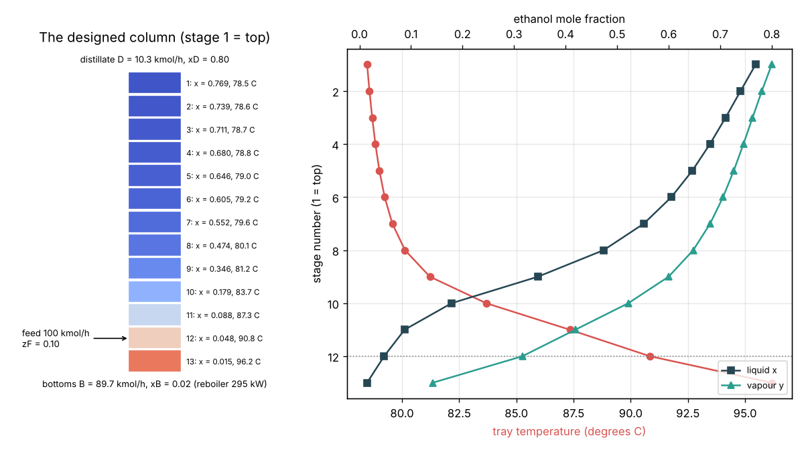

# What you are building toward

A distillery column comes to life. Starting cold and full of wash, the column heats up tray by tray: the reboiler boils, vapour climbs, the condenser sends reflux back, and each tray's temperature and composition settle over time until the column reaches the steady profile designed in Session 3: 13 stages, feed on stage 12, 78.5 C at the top and 96.2 C at the bottom, a top product of 0.80 ethanol from a 0.10 wash. Your goal over the coming sessions: build that dynamic column yourself, with tray hold-ups, energy balances and a temperature controller, and see how long a real column takes to start up and how it answers a change in feed.

*Target: the designed ethanol-water column with each stage's composition and temperature, and the tray profiles (the steady state the dynamic model must reach)*

The dynamic results come from a private reference build. The code is not published; the roadmap shows the path so you can build your own.

Live links:

- [Session 3 app: design an ethanol-water column](https://krunalpanchal1995.github.io/pan-iit-oss/opendistillation/session-03/)
- [Math Visual Studio](https://krunalpanchal1995.github.io/studio/)
