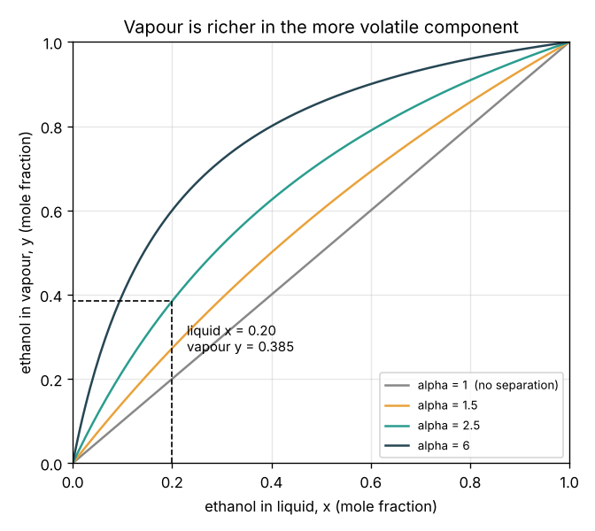
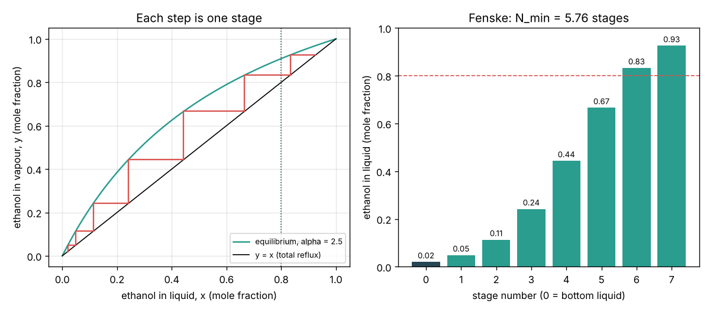

# Session 1: Boil, condense, repeat

*Level 1 (conceptual interactive model) · about 60 minutes · opendistillation*

> This is a simplified educational model. It is not a validated design tool and must not be used for real structures, electrical installations, vehicles, industrial processes or medical decisions. Ethanol vapour is flammable: never heat ethanol over an open flame or distil it at home; in India, distilling alcohol needs a licence.

**Prerequisites**

- School arithmetic, fractions and percentages; the idea of a natural logarithm (a calculator key is enough).
- You have read PRIMER.md and run `python start.py 1` once.

**Learning objectives.** After this session you can:

- Use mole fractions x (liquid) and y (vapour) and explain why the vapour is richer in ethanol.
- Compute the vapour in equilibrium with a liquid from the relative volatility alpha.
- Write the two material balances of a column and find the distillate and bottoms flows and the recovery.
- Explain why a column is a stack of stages and find the minimum number of stages with the Fenske equation.

## A. Real-world problem
A sugar-cane molasses distillery ferments a "wash" that is about 10 percent ethanol by moles (about 22 percent by mass) and 90 percent water. Ethanol boils at 78.3 C and water at 100 C, so when the wash boils the vapour carries more ethanol than the liquid. But one boil is not enough to make a strong product. How much richer is the vapour after one boil, how many boil-and-condense steps do you need to reach 80 percent ethanol, and how much of the feed comes out as product? (General education only: this is a simplified model, not a plant design method.)

## B. Concept and theory
We describe a mixture by **mole fractions**: x is the share of ethanol molecules in the liquid, y the share in the vapour. When a liquid boils in a closed space and settles, its vapour and liquid are in **equilibrium**, and the vapour is richer in the more volatile component (the one with the lower boiling point). The simplest model says the vapour's ethanol-to-water ratio (the "odds") is alpha times the liquid's; alpha is the **relative volatility**. Alpha = 1 means no separation; a larger alpha means an easier job. Condensing that vapour gives a new liquid that is richer still, and boiling it again enriches it more: each boil-and-condense is one **stage**, and a distillation column is a tower of stages stacked so the vapour rises and the liquid falls through them. A column splits a feed F (composition zF) into a top **distillate** D (xD) and a **bottoms** stream B (xB). Total moles and ethanol moles both balance. If all the condensed liquid at the top is sent back down (total reflux), each stage multiplies the odds by alpha, which gives the smallest possible number of stages, the **Fenske** equation.

| Symbol | Meaning | Unit |
|---|---|---|
| x, y | ethanol mole fraction in the liquid, in the vapour | no unit |
| alpha | relative volatility of ethanol to water | no unit |
| F, D, B | feed, distillate and bottoms amounts (or flows) | mol (or kmol/h) |
| zF, xD, xB | ethanol mole fraction in feed, distillate, bottoms | no unit |
| N_min | minimum number of equilibrium stages (total reflux) | stages |

**Assumptions**

- Alpha is one constant number (Session 2 shows that for ethanol-water it is not).
- Each stage reaches equilibrium; nothing is lost; steady operation.
- Total reflux for N_min: nothing is drawn off, so this is a limit, not a real operating point.

$$ y = \frac{\alpha x}{1 + (\alpha - 1)x},\qquad \frac{y}{1-y} = \alpha\,\frac{x}{1-x} $$

$$ F = D + B,\qquad F z_F = D x_D + B x_B $$

$$ D = F\,\frac{z_F - x_B}{x_D - x_B},\qquad \text{recovery} = \frac{D x_D}{F z_F} $$

$$ N_{\min} = \frac{\ln\!\left[\dfrac{x_D/(1-x_D)}{x_B/(1-x_B)}\right]}{\ln \alpha} $$

## C. Visual explanation
The first figure shows equilibrium curves y(x) for alpha = 1, 1.5, 2.5 and 6. At alpha = 1 the curve is the diagonal y = x: boiling does nothing. The further the curve bows above the diagonal, the bigger each enrichment step. The marked point is the worked example: liquid x = 0.20 with alpha = 2.5 gives vapour y = 0.385. The second figure steps up a column at total reflux with alpha = 2.5: starting from xB = 0.02 the liquid goes 0.049, 0.113, 0.242, 0.444, 0.666, 0.833, so 6 whole stages reach 0.80 (Fenske gives 5.76).

*Equilibrium curves for several relative volatilities; liquid 0.20 gives vapour 0.385 at alpha = 2.5.*

*Stepping stages at total reflux from 0.02 to above 0.80 with alpha = 2.5; Fenske gives 5.76.*

## D. Interactive simulation
Run the lesson (`python start.py 1`), then open the live app: [Session 1: boil, condense, repeat](https://krunalpanchal1995.github.io/pan-iit-oss/opendistillation/session-01/) (or `app.html` in this folder). Change alpha and the bottom and top compositions. Watch the column picture fill up stage by stage, then open the x-y view and see the staircase. The readout gives N_min, the distillate flow and the recovery.

**Challenge.** Reach xD of at least 0.80 from xB = 0.02 or lower with at most 5 stages.

## E. Worked example and experiment
**Problem.** (a) Liquid with x = 0.20 is in equilibrium with its vapour; alpha = 2.5. Find y. (b) A column takes F = 100 mol of wash with zF = 0.10 and makes xD = 0.80 and xB = 0.02. Find D, B and the ethanol recovery. (c) Find the minimum number of stages at alpha = 2.5.

1. Odds in the liquid = 0.20 / 0.80 = 0.25. Odds in the vapour = 2.5 x 0.25 = 0.625, so y = 0.625 / 1.625 = 0.385 (same as 2.5 x 0.2 / (1 + 1.5 x 0.2) = 0.5 / 1.3).
2. D = 100 x (0.10 - 0.02) / (0.80 - 0.02) = 100 x 0.08 / 0.78 = 10.26 mol; B = 100 - 10.26 = 89.74 mol.
3. Check the ethanol: 10.26 x 0.80 + 89.74 x 0.02 = 8.21 + 1.79 = 10.00 mol = 100 x 0.10. It balances.
4. Recovery = 8.21 / 10.00 = 0.821: 82 percent of the ethanol leaves at the top; the rest is lost in the bottoms.
5. Odds at the top = 0.80 / 0.20 = 4; at the bottom = 0.02 / 0.98 = 0.0204. Their ratio is 196. N_min = ln 196 / ln 2.5 = 5.278 / 0.916 = 5.76, so at least 6 whole stages.

**Answer.** y = 0.385; D = 10.26 mol, B = 89.74 mol, recovery 0.821; N_min = 5.76 (6 stages).

**Experiment.** In a school chemistry lab, with a teacher, a simple distillation of a dilute ethanol-water mixture (one stage) gives a first distillate that smells and burns more strongly than the feed; a packed (fractionating) column on the same flask gives a stronger one. Measure the density of each distillate with a hydrometer and look up its strength. The model predicts the direction correctly; real numbers differ because alpha is not constant, the flask is not at equilibrium and heat leaks out. Ethanol vapour is flammable: use an electric heating mantle, never a flame.

## F. Assessment and design challenge
**Question type A: Conceptual.** Why does one boil-and-condense step not give pure ethanol, even though ethanol boils 22 degrees lower than water?

Hint

At the boiling temperature of the mixture, does water have zero vapour pressure?

Step-by-step solution

At the mixture's boiling point both liquids have a vapour pressure, so both evaporate. The vapour is richer in ethanol (alpha is above 1) but still contains water. The odds improve by a factor alpha per stage, never by an infinite factor, so pure ethanol would need infinitely many stages even without the azeotrope of Session 2.

**Question type B: Numerical.** A liquid with x = 0.10 boils with alpha = 3. Find y, and check that the answer is reasonable.

Hint

y = alpha x / (1 + (alpha - 1) x).

Step-by-step solution

y = 3 x 0.10 / (1 + 2 x 0.10) = 0.30 / 1.20 = 0.25. Check: y is above x (enrichment) and below 1; the odds go from 0.111 to 0.333, a factor of 3 = alpha.

**Question type C: Graph and simulation interpretation.** In the stage figure the steps are short at the bottom, long in the middle and short again near the top. Why? What happens to the number of stages if you ask for xB = 0.01 instead of 0.02?

Hint

Each stage multiplies the odds by the same factor; how big is a fixed change in odds near x = 0 or x = 1?

Step-by-step solution

A constant factor on the odds is a small change in x when x is close to 0 or 1 and a large change near x = 0.5, because the odds curve x / (1 - x) is steep only near the ends. Halving xB doubles the odds ratio (196 to about 396), adding ln 2 / ln 2.5 = 0.76 stage: N_min goes from 5.76 to 6.53, so 7 whole stages.

**Question type D: Design and optimisation challenge.** Design: the distillery now wants xD = 0.90 and xB = 0.01 from the same 100 mol of wash (zF = 0.10, alpha = 2.5). Find N_min, D and the recovery. What alpha would allow only 5 stages for the original job (0.80 and 0.02)?

Hint

Use min_stages and split; for alpha, solve ln 196 / ln alpha = 5.

Step-by-step solution

N_min = ln[(0.9 / 0.1) / (0.01 / 0.99)] / ln 2.5 = ln 891 / 0.916 = 7.41, so 8 stages. D = 100 x 0.09 / 0.89 = 10.11 mol; recovery = 10.11 x 0.90 / 10 = 0.910. For 5 stages, alpha = 196^(1/5) = 2.87. Trade-off: purer products and better recovery cost stages; and at total reflux there is no product at all, so a real column needs more than N_min (Session 3).

Score yourself with [RUBRIC.md](../../RUBRIC.md). Print the [activity sheet](activity_sheet.md) to work on paper.

## Common misconceptions
| Common misconception | What is actually true |
|---|---|
| Heat the mixture to 78.3 C and only ethanol boils off. | A mixture boils between the two boiling points and both components evaporate; the vapour is only richer in ethanol. |
| Mole percent and percent by volume or by mass are the same. | They differ a lot: x = 0.10 is about 22 percent by mass because a water molecule is much lighter than an ethanol molecule. |
| More stages always give pure product. | Each stage multiplies the odds by alpha, so purity approaches 1 only slowly; for real ethanol-water a wall (the azeotrope) stops it near 0.89. |
| The distillate flow can be chosen freely. | Once zF, xD and xB are fixed, the material balance fixes D and B. |

## Glossary
- **mole fraction**: the share of molecules that are ethanol, between 0 and 1
- **relative volatility (alpha)**: how much more easily ethanol escapes into the vapour than water
- **equilibrium stage**: a place where vapour and liquid touch long enough to reach equilibrium
- **reflux**: condensed top product sent back down the column
- **Fenske equation**: the minimum number of stages, reached at total reflux

## Finish
1. Do the three coding tasks in [exercises.md](exercises.md).
2. Run `python start.py 1` again after your changes. It ends with the checkpoint; when it prints `PASS`, you are done. (Checkpoint only: `python start.py check 1`.)

Next: [Session 2](../session-02/README.md)
