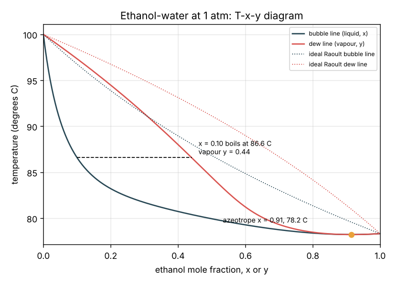
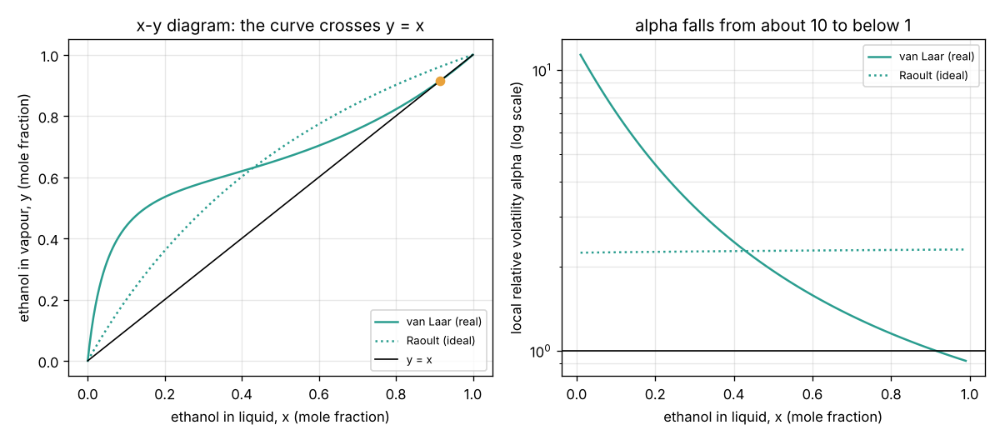

# Session 2: Real equilibrium and the azeotrope

*Level 2 (mathematical engineering model) · about 75 minutes · opendistillation*

> This is a simplified educational model. It is not a validated design tool and must not be used for real structures, electrical installations, vehicles, industrial processes or medical decisions. Ethanol vapour is flammable: never heat ethanol over an open flame or distil it at home; in India, distilling alcohol needs a licence.

**Prerequisites**

- Session 1: mole fractions, relative volatility and stages.
- Powers of 10 and logarithms (log10); the idea of vapour pressure is explained in Section B.

**Learning objectives.** After this session you can:

- Compute the vapour pressure of ethanol and water from the Antoine equation and find their boiling points.
- Use Raoult's law with activity coefficients (van Laar) to find the bubble temperature and the vapour composition of a mixture.
- Draw and read the T-x-y and x-y diagrams of ethanol-water and locate the azeotrope.
- Explain why ordinary distillation at 1 atm cannot pass about 89 mol percent (95.6 percent by mass) ethanol, and do a single-stage flash with the lever rule.

## A. Real-world problem
Session 1 treated alpha as one number. Real ethanol-water mixtures behave very differently at the dilute end and near the top: rectified spirit and fuel ethanol from a plain column stop at about 95 percent by mass, and anhydrous fuel ethanol for blending into petrol (as in India's E20 programme) needs an extra drying step. At what temperature does the wash boil, what vapour comes off, and why is there a wall that no ordinary column at atmospheric pressure can pass? (Simplified textbook model; not a plant design method.)

## B. Concept and theory
The **vapour pressure** Psat of a pure liquid is the pressure of its vapour in equilibrium with it; it rises steeply with temperature and is given by the Antoine equation. A liquid boils when its vapour pressure equals the pressure above it: 760 mmHg (101.325 kPa) at sea level. In an **ideal** mixture each component's partial pressure is its liquid mole fraction times its vapour pressure (**Raoult's law**). Ethanol and water are not ideal: their molecules attract their own kind more than each other, so each escapes more easily than Raoult predicts. We multiply by an **activity coefficient** gamma (here from the two-constant **van Laar** model, which gives gamma = 1 for a pure liquid and the largest gamma for a component at infinite dilution: about 5.4 for ethanol in water). The **bubble point** of a liquid x at pressure P is the temperature where the partial pressures add up to P; we find it by bisection. The vapour composition is then y = x gamma Psat / P. The local relative volatility alpha = (y / (1 - y)) / (x / (1 - x)) is about 10 for dilute ethanol and falls to 1 at the **azeotrope**, where vapour and liquid have the same composition and boiling no longer separates anything. Ethanol-water has a minimum-boiling azeotrope at about x = 0.894 and 78.15 C (measured); our model puts it at 0.915 and 78.22 C. A single equilibrium stage, a **flash**, splits a feed z into vapour V and liquid L, and the ethanol balance gives the lever rule.

| Symbol | Meaning | Unit |
|---|---|---|
| Psat1, Psat2 | vapour pressures of ethanol and water | mmHg |
| A, B, C | Antoine constants (T in degrees C, P in mmHg) | as given |
| gamma1, gamma2 | activity coefficients of ethanol and water | no unit |
| A12, A21 | van Laar constants: 1.6798 and 0.9227 | no unit |
| P, T | total pressure and temperature | mmHg, degrees C |
| V/F | fraction of the feed that leaves as vapour in a flash | no unit |

**Assumptions**

- Vapour is an ideal gas mixture; total pressure 760 mmHg unless stated.
- Antoine constants (ethanol 8.20417, 1642.89, 230.300; water 8.07131, 1730.63, 233.426) and van Laar constants (1.6798, 0.9227) are common textbook values; they shift the azeotrope by about 0.02 in x.
- Equilibrium is reached; a flash is one stage.

$$ \log_{10} P^{\mathrm{sat}} = A - \frac{B}{T + C} $$

$$ y_i P = x_i\,\gamma_i\,P_i^{\mathrm{sat}}(T)\qquad\text{(modified Raoult's law)} $$

$$ \ln\gamma_1 = A_{12}\left(\frac{A_{21}x_2}{A_{12}x_1 + A_{21}x_2}\right)^2,\qquad \ln\gamma_2 = A_{21}\left(\frac{A_{12}x_1}{A_{12}x_1 + A_{21}x_2}\right)^2 $$

$$ x_1\gamma_1 P_1^{\mathrm{sat}}(T) + x_2\gamma_2 P_2^{\mathrm{sat}}(T) = P\quad\text{(bubble point)} $$

$$ \alpha = \frac{y/(1-y)}{x/(1-x)},\qquad \frac{V}{F} = \frac{z - x}{y - x}\quad\text{(lever rule)} $$

## C. Visual explanation
The T-x-y figure has two lines: the lower **bubble line** (where a liquid of composition x starts to boil) and the upper **dew line** (where a vapour of composition y starts to condense). A horizontal tie line joins a liquid to the vapour it is in equilibrium with: the wash at x = 0.10 boils at 86.6 C and gives vapour y = 0.44. The dotted lines show what Raoult's ideal law would predict: the wash would boil at 96.8 C with only y = 0.20, and there would be no azeotrope. The real lines touch at the azeotrope near x = 0.91, 78.2 C, below the boiling point of pure ethanol. The x-y figure shows the curve crossing the diagonal there, and the local alpha falling from about 10.7 at x = 0.02 to 1.08 at x = 0.85 and below 1 beyond the azeotrope.

*T-x-y diagram of ethanol-water at 1 atm with the ideal Raoult lines and the azeotrope.*

*Left: x-y diagram crossing the diagonal at the azeotrope. Right: local relative volatility against x.*

## D. Interactive simulation
Run the lesson (`python start.py 2`), then open the live app: [Session 2: real ethanol-water equilibrium](https://krunalpanchal1995.github.io/pan-iit-oss/opendistillation/session-02/) (or `app.html` in this folder). Move the liquid composition and watch the tie line on the T-x-y diagram, the partial pressures and the local alpha. Switch non-ideality off to see Raoult's law, and lower the pressure to see the boiling points fall and the azeotrope move.

**Challenge.** Find a liquid composition whose vapour is at least 0.55 ethanol while alpha is still at least 3 (real mixture, 760 mmHg).

## E. Worked example and experiment
**Problem.** The wash has x = 0.10 at 760 mmHg. Find its bubble temperature, the activity coefficients, the vapour composition and the local alpha, and compare with Raoult's ideal law.

1. van Laar: denominator = 1.6798 x 0.10 + 0.9227 x 0.90 = 0.998; ln gamma1 = 1.6798 x (0.8304 / 0.998)^2 = 1.163, so gamma1 = 3.197; ln gamma2 = 0.9227 x (0.168 / 0.998)^2 = 0.0261, so gamma2 = 1.027.
2. Try T = 86.6 C: Psat1 = 10^(8.20417 - 1642.89 / 316.89) = 1046.4 mmHg; Psat2 = 10^(8.07131 - 1730.63 / 320.03) = 460.6 mmHg.
3. Partial pressures: ethanol 0.10 x 3.197 x 1046.4 = 334.5 mmHg; water 0.90 x 1.027 x 460.6 = 425.5 mmHg; sum 760.0 mmHg, so 86.6 C is the bubble point.
4. y = 334.5 / 760 = 0.440. Alpha = (0.440 / 0.560) / (0.10 / 0.90) = 0.786 / 0.111 = 7.08.
5. Raoult (gamma = 1) would give a bubble point of 96.8 C and y = 0.20: the ideal model badly underestimates how easy the dilute end is.

**Answer.** T = 86.6 C, gamma = 3.197 and 1.027, y = 0.440, alpha = 7.08 (ideal: 96.8 C, y = 0.20).

**Experiment.** With a teacher, heat a 10 mol percent ethanol-water mixture (about 22 percent by mass) slowly on an electric mantle with a thermometer in the liquid: it boils near 86 to 87 C, not at 78 C and not at 100 C. Compare with pure water in the same setup. The model differs from your reading because of thermometer error, local pressure (lower at altitude) and superheating; check the barometric pressure and use it in `bubble_point`.

## F. Assessment and design challenge
**Question type A: Conceptual.** Why can ordinary distillation of ethanol-water at 1 atm never go beyond the azeotrope, however many stages you use?

Hint

What is y - x at the azeotrope, and what does a stage do if y = x?

Step-by-step solution

A stage enriches the liquid only because its vapour is richer (y > x). At the azeotrope y = x, so condensing the vapour gives back exactly the same liquid: alpha = 1 and the stage does nothing. Approaching from below, the steps get smaller and smaller, so infinitely many stages would be needed even to reach it. Above it, the vapour is poorer than the liquid. To pass it you need another method: a pressure change, an entrainer (azeotropic distillation) or molecular-sieve drying.

**Question type B: Numerical.** Find the bubble temperature and vapour composition of a liquid with x = 0.30 at 760 mmHg. Use gamma1 = 1.699, gamma2 = 1.194 and check that the partial pressures add up.

Hint

Try T = 81.7 C: compute both vapour pressures with Antoine.

Step-by-step solution

At 81.7 C: Psat1 = 868.3 mmHg and Psat2 = 379.8 mmHg. Ethanol: 0.30 x 1.699 x 868.3 = 442.6 mmHg; water: 0.70 x 1.194 x 379.8 = 317.4 mmHg; total 760.0 mmHg, so T = 81.7 C. y = 442.6 / 760 = 0.582. Alpha = (0.582 / 0.418) / (0.30 / 0.70) = 3.25: still a good separation, but well below the 7.08 of the wash.

**Question type C: Graph and simulation interpretation.** On the T-x-y diagram the gap between the bubble and dew lines is wide at x = 0.1 and nearly closed at x = 0.85. What does the width of the gap tell you, and what happens to the number of stages needed near the top of the column?

Hint

The tie line runs from the bubble line to the dew line at one temperature.

Step-by-step solution

The gap is y - x, the enrichment one stage gives. At x = 0.1 the vapour is 0.44, a jump of 0.34; at x = 0.85 alpha is 1.08 and y - x is only about 0.01. So the top of an ethanol column needs many stages for small gains, and the curve's closeness to the diagonal there is what limits how high xD can be set (Session 3).

**Question type D: Design and optimisation challenge.** Design: a one-stage still (flash) takes the wash (z = 0.10) and must give a vapour of 0.30 ethanol. Find the liquid left behind, the fraction vaporised and the temperature. Then explain whether lowering the pressure helps break the azeotrope, and at what cost.

Hint

Find x where y(x) = 0.30 (use flash_from_liquid in a small loop), then V/F = (z - x) / (y - x). Use azeotrope(p) at lower pressures.

Step-by-step solution

Bisection gives x = 0.0436 at 91.4 C, and V/F = (0.10 - 0.0436) / (0.30 - 0.0436) = 0.220: 22 percent of the feed boils off. In the model the azeotrope moves from x = 0.915 at 760 mmHg to 0.933 at 400 mmHg and 0.972 at 100 mmHg; measurements show the same trend and that it disappears only at very low pressure (roughly 10 kPa or below). Trade-off: vacuum lowers the temperatures and shifts the wall, but needs very large columns (vapour volume grows as pressure falls), a vacuum system and cold cooling water, so industry usually uses molecular sieves or an entrainer instead. The vacuum numbers are from a simplified model.

Score yourself with [RUBRIC.md](../../RUBRIC.md). Print the [activity sheet](activity_sheet.md) to work on paper.

## Common misconceptions
| Common misconception | What is actually true |
|---|---|
| A mixture boils at the average of the two boiling points. | The wash (x = 0.10) boils at 86.6 C, much nearer ethanol's 78.3 C, because the non-ideal mixture pushes ethanol out strongly. |
| Raoult's law is good enough for ethanol and water. | It predicts y = 0.20 for the wash instead of about 0.44 and no azeotrope at all. |
| The azeotrope is a property of ethanol alone. | It belongs to the pair at a given pressure; it moves when the pressure changes. |
| At the azeotrope the mixture boils at 78.3 C like pure ethanol. | It boils slightly lower (about 78.15 C): a minimum-boiling azeotrope. |

## Glossary
- **vapour pressure**: the pressure of a pure liquid's vapour in equilibrium with it at a given temperature
- **Raoult's law**: partial pressure = liquid mole fraction x vapour pressure (ideal mixture)
- **activity coefficient**: the factor by which a component escapes more (or less) easily than Raoult's law says
- **bubble point**: the temperature at which a liquid of given composition starts to boil
- **azeotrope**: a composition where vapour and liquid are the same, so boiling cannot separate them

## Finish
1. Do the three coding tasks in [exercises.md](exercises.md).
2. Run `python start.py 2` again after your changes. It ends with the checkpoint; when it prints `PASS`, you are done. (Checkpoint only: `python start.py check 2`.)

Next: [Session 3](../session-03/README.md)
