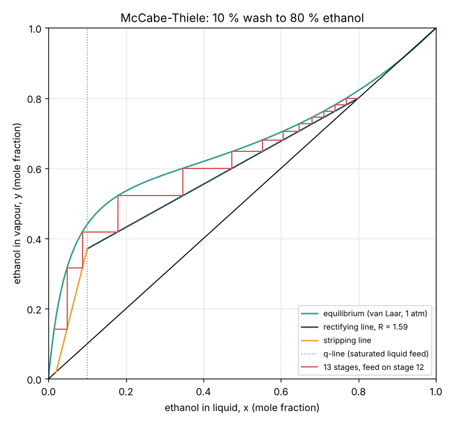
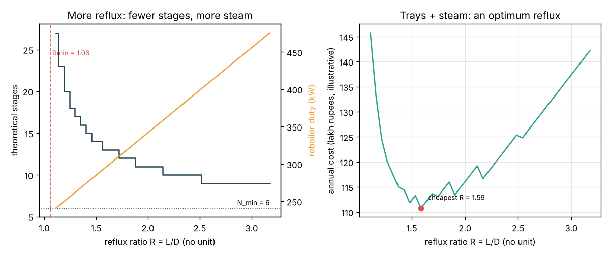
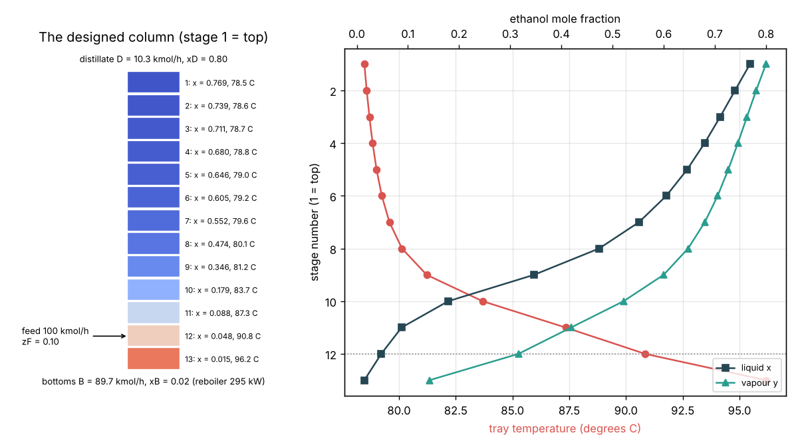

# Session 3: Design the column and validate it

*Level 3 (simulation and validation) · about 90 minutes · opendistillation*

> This is a simplified educational model. It is not a validated design tool and must not be used for real structures, electrical installations, vehicles, industrial processes or medical decisions. Ethanol vapour is flammable: never heat ethanol over an open flame or distil it at home; in India, distilling alcohol needs a licence.

**Prerequisites**

- Session 1: material balances, stages and the Fenske equation.
- Session 2: the real ethanol-water equilibrium curve and the azeotrope.
- Straight lines y = m x + c; the idea of repeating a calculation in a loop (explained in Section B).

**Learning objectives.** After this session you can:

- Write the rectifying and stripping operating lines and the q-line for a column with reflux.
- Step off equilibrium stages on the real x-y curve (McCabe-Thiele) and find the number of stages and the feed stage.
- Validate the stepping against Fenske (total reflux) and the material balances, and find the minimum reflux, including a tangent pinch.
- Choose a reflux ratio by trading the number of trays against the reboiler steam, and explain why the azeotrope caps the product.

## A. Real-world problem
A small distillery has 100 kmol/h of fermented wash with 10 mol percent ethanol. It wants a top product of 80 mol percent ethanol (about 91 percent by mass) and wants to discard a bottom stream (stillage) with only 2 mol percent. How many stages does the column need, on which stage should the feed enter, how much liquid must be sent back down as reflux, how much steam will the reboiler use, and which reflux ratio is cheapest overall? (A simplified teaching model, not a design tool.)

## B. Concept and theory
A real column takes product off the top, so only part of the condensed vapour returns as reflux: the **reflux ratio** R = L / D. With **constant molar overflow** (ethanol and water have nearly equal molar latent heats, about 40 kJ/mol) the liquid L and vapour V flows are the same on every stage of a section. A mole balance around the top of the column gives the **rectifying operating line**, a straight line through (xD, xD) with slope R / (R + 1). Below the feed the liquid grows by qF and the vapour changes by (1 - q)F, giving the **stripping line** through (xB, xB); q is the liquid fraction of the feed (q = 1 for a liquid at its bubble point). The lines cross on the **q-line**. **McCabe-Thiele** stepping: start at y1 = xD (total condenser), take the liquid in equilibrium, x = x_eq(y), then the vapour from the stage below from the operating line, and repeat; switch to the stripping line once x passes the crossing (that is the optimal **feed stage**), stop when x <= xB (the last stage is the reboiler). As R grows the operating line approaches y = x and the number of stages falls to the Fenske minimum. As R falls the line swings towards the equilibrium curve; when it touches it the steps become infinitely small: a **pinch** and the **minimum reflux** Rmin. For a 0.80 product the touch is at the feed, but because the ethanol-water curve sags towards the diagonal near the top, a higher xD touches tangentially above the feed: a **tangent pinch** with a larger Rmin. The reboiler must boil the vapour V', costing steam: duty Q = V' x latent heat. More reflux means fewer trays (capital) but more steam (energy), so there is a cheapest R, usually 1.2 to 1.5 times Rmin.

| Symbol | Meaning | Unit |
|---|---|---|
| R | reflux ratio L / D | no unit |
| L, V | liquid and vapour flows above the feed | kmol/h |
| L', V' | liquid and vapour flows below the feed | kmol/h |
| q | liquid fraction of the feed (1 = saturated liquid) | no unit |
| Rmin | minimum reflux ratio (pinch, infinite stages) | no unit |
| Q_R | reboiler duty V' x 40 kJ/mol | kW |
| E | overall tray efficiency (real trays = stages / E) | no unit |

**Assumptions**

- Equilibrium stages, constant molar overflow, total condenser, the reboiler counts as one stage.
- Saturated-liquid feed (q = 1), pressure 1 atm, steady state, real equilibrium curve from Session 2.
- Tray efficiency 0.6 and the costs (2.0 lakh rupees per tray per year, 0.24 lakh rupees per kW of steam per year) are illustrative.

$$ y_{n+1} = \frac{R}{R+1}\,x_n + \frac{x_D}{R+1}\quad\text{(rectifying line)} $$

$$ y_{m+1} = \frac{L'}{V'}\,x_m - \frac{B\,x_B}{V'},\qquad L' = L + qF,\quad V' = V - (1-q)F $$

$$ y = \frac{q}{q-1}\,x - \frac{z_F}{q-1}\quad\text{(q-line; } x = z_F \text{ for } q = 1) $$

$$ R_{\min} = \frac{x_D - y^*}{y^* - x^*}\quad\text{at the pinch point } (x^*, y^*) $$

$$ Q_R = V'\,\lambda,\qquad \text{cost} = c_{\mathrm{tray}}\,\left\lceil \frac{N-1}{E} \right\rceil + c_{\mathrm{steam}}\,Q_R $$

## C. Visual explanation
Figure 1 is the McCabe-Thiele diagram for the design at R = 1.5 Rmin = 1.587: 13 steps between the equilibrium curve and the operating lines, with the switch from the rectifying to the stripping line on stage 12. Notice the many short steps between x = 0.6 and 0.8, where the curve hugs the diagonal. Figure 2 shows the trade-off: stages drop from 27 near Rmin to 9 at R = 3.2 (never below the total-reflux minimum of 6), while the reboiler duty rises in a straight line; the illustrative annual cost has its minimum at R = 1.59. Figure 3 draws the designed column: liquid, vapour and temperature on every stage, from 78.5 C at the top to 96.2 C at the bottom.

*McCabe-Thiele diagram: 13 stages, feed on stage 12, for a 10 % wash to 80 % ethanol.*

*More reflux means fewer stages but more steam; the illustrative cost is lowest near 1.5 Rmin.*

*The designed column with each stage's composition and temperature.*

## D. Interactive simulation
Run the lesson (`python start.py 3`), then open the live app: [Session 3: design an ethanol-water column](https://krunalpanchal1995.github.io/pan-iit-oss/opendistillation/session-03/) (or `app.html` in this folder). Move the reflux ratio as a multiple of Rmin and the product purities and watch the staircase change. Open the column view to see the tray temperatures, and the trade-off view to find the cheapest reflux. Push xD towards 0.9 to meet the azeotrope wall.

**Challenge.** Make xD at least 0.80 with xB at most 0.02 in at most 12 stages while the reboiler duty stays below 330 kW.

## E. Worked example and experiment
**Problem.** Design the distillery column: F = 100 kmol/h, zF = 0.10 (saturated liquid), xD = 0.80, xB = 0.02, 1 atm. Find Rmin, the stages and feed stage at R = 1.5 Rmin, and the reboiler duty.

1. Material balance (Session 1): D = 100 x 0.08 / 0.78 = 10.26 kmol/h, B = 89.74 kmol/h.
2. Pinch at the feed: the wash's vapour (Session 2) is y* = 0.440, so Rmin = (0.80 - 0.440) / (0.440 - 0.10) = 1.058. (A scan over all x from 0.10 to 0.80 confirms the feed point is the tightest.)
3. R = 1.5 x 1.058 = 1.587. Rectifying line: y = 0.6135 x + 0.3092. L = 16.28, V = 26.53 kmol/h; with q = 1, L' = 116.28 and V' = 26.53 kmol/h.
4. Step from the top: x1 = 0.769, x2 = 0.739, ... x11 = 0.088 crosses zF, so stage 12 is the feed stage; x12 = 0.048, x13 = 0.015 <= 0.02. 13 stages including the reboiler, so 12 trays in theory, 20 real trays at 60 percent efficiency.
5. Reboiler duty = 26.53 kmol/h x 40 kJ/mol x 1000 / 3600 = 294.8 kW.

**Answer.** Rmin = 1.058; at R = 1.587 the column needs 13 stages (12 theoretical trays plus the reboiler, 20 real trays), feed on stage 12, reboiler duty 295 kW.

**Experiment.** In a unit-operations lab, run a small sieve-tray or packed column on an ethanol-water mixture at total reflux, then at a set reflux ratio. Measure the top and bottom compositions with a refractometer or hydrometer and count the theoretical stages on the x-y diagram. Compare with the number of real trays: the ratio is the overall tray efficiency, often 0.5 to 0.8. The model differs from reality because trays are not at equilibrium, heat leaks from the column, the molar overflow is not exactly constant and the measured equilibrium curve differs slightly from the van Laar model.

## Real-world application and mini-project: Choose the reflux ratio of a distillery column
The distillery column of Section E has to be built and run for years. Each real tray costs 2.0 lakh rupees per year (build cost spread over its life) and each kW of reboiler steam costs 0.24 lakh rupees per year. The tray efficiency is 0.6. Use `design` from Session 3 for reflux ratios from 1.05 to 3.0 times Rmin in steps of 0.05. These costs are illustrative numbers, not quotes.

**Deliverable:** A script that prints, for each reflux ratio, the theoretical stages, the real trays, the reboiler duty and the annual cost, finds the cheapest design, and saves a figure of cost against R with the minimum marked.

**Success looks like:** The cheapest design is R = 1.5 Rmin = 1.587 with 13 stages (20 real trays), 295 kW and 110.8 lakh rupees per year; 1.1 Rmin costs 133.2 (37 trays) and 3.0 Rmin costs 142.2 (476 kW); the report explains both ends of the curve.

## F. Assessment and design challenge
**Question type A: Conceptual.** Why does the column need more and more stages as the reflux ratio approaches Rmin, and why can it not run below Rmin at all?

Hint

What happens to the size of a step where the operating line meets the equilibrium curve?

Step-by-step solution

Each step lives between the operating line and the equilibrium curve. As R falls, the rectifying line rises towards the curve, the gap shrinks and the steps get shorter, so more of them are needed. At Rmin the line touches the curve: near the touching point the steps become infinitely small (a pinch), so infinitely many stages are needed. Below Rmin the line would cross the curve and the staircase cannot get past the crossing: the separation is impossible at any number of stages.

**Question type B: Numerical.** For the same column at R = 1.5 Rmin = 1.587, find L, V, L' and V' in kmol/h. Check that V' = L' - B and that the two operating lines meet at x = zF = 0.10.

Hint

L = R D, V = L + D, L' = L + F, V' = V for q = 1.

Step-by-step solution

D = 10.26, L = 1.587 x 10.26 = 16.28, V = 26.53 kmol/h. L' = 16.28 + 100 = 116.28, V' = 26.53 kmol/h, and L' - B = 116.28 - 89.74 = 26.53 = V'. At x = 0.10 the rectifying line gives 0.6135 x 0.10 + 0.3092 = 0.3706; the stripping line gives (116.28 / 26.53) x 0.10 - (89.74 x 0.02) / 26.53 = 0.4383 - 0.0677 = 0.3706. They meet on the q-line, as they must.

**Question type C: Graph and simulation interpretation.** In the trade-off figure the number of stages falls in steps while the duty rises smoothly, and the cost curve is jagged. Why? Why does the cost rise sharply below about 1.2 Rmin?

Hint

Stages are whole numbers; duty is (R + 1) D times the latent heat.

Step-by-step solution

You cannot build 12.4 stages, so the stage count jumps by whole stages while the duty, (R + 1) x 10.26 kmol/h x 40 kJ/mol, rises in a straight line. The cost adds a staircase to a straight line, so it is jagged. Near Rmin the stage count explodes (23 stages at 1.1 Rmin, infinite at Rmin) while the duty saves only a little, so the tray cost dominates and the total rises steeply.

**Question type D: Design and optimisation challenge.** Design: a richer wash with zF = 0.20 arrives (same xD = 0.80, xB = 0.02, 100 kmol/h). The hand formula with y* = y_eq(0.20) = 0.535 gives Rmin = 0.789. Use `min_reflux` to check it, then design at 1.5 Rmin. What changes, and why?

Hint

min_reflux scans every x between zF and xD; compare where it finds the pinch.

Step-by-step solution

`min_reflux(0.20, 0.80)` gives Rmin = 0.942 with the pinch at x = 0.597: a tangent pinch above the feed, so the feed-point formula (0.789) would under-design the column. At R = 1.5 x 0.942 = 1.413 the column needs 14 stages with the feed on stage 13; D = 23.08 kmol/h and the reboiler duty is 619 kW, about twice as much because twice as much ethanol is distilled. Trade-off: always check the whole curve for a tangent pinch with ethanol-water; and a product above about 0.89 is impossible however you design it, because of the azeotrope. All costs and efficiencies are illustrative.

Score yourself with [RUBRIC.md](../../RUBRIC.md). Print the [activity sheet](activity_sheet.md) to work on paper.

## Common misconceptions
| Common misconception | What is actually true |
|---|---|
| A simulation is right because the picture looks right. | It must be validated: here stepping at total reflux matches Fenske, every stage sits on the curve and both material balances close. |
| Minimum reflux always comes from the feed point. | For ethanol-water with a high xD the line first touches the curve tangentially above the feed; the feed formula then gives too low an Rmin. |
| More reflux always gives a better column. | It needs fewer trays but more steam; past the optimum the energy bill dominates. |
| More stages can push the product past the azeotrope. | At the azeotrope y = x and stages stop working; pure ethanol needs a different method. |

## Glossary
- **reflux ratio**: liquid returned to the column divided by the distillate taken off
- **operating line**: the straight line linking the liquid leaving a stage with the vapour coming up from the stage below
- **McCabe-Thiele method**: stepping between the operating line and the equilibrium curve to count stages
- **pinch**: where the operating line touches the equilibrium curve; infinite stages are needed
- **reboiler**: the heater at the bottom of the column that boils the vapour V'

## Finish
1. Do the three coding tasks in [exercises.md](exercises.md).
2. Run `python start.py 3` again after your changes. It ends with the checkpoint; when it prints `PASS`, you are done. (Checkpoint only: `python start.py check 3`.)

Next: the [roadmap](../../promo/roadmap.md). Session 4 is yours to build.
