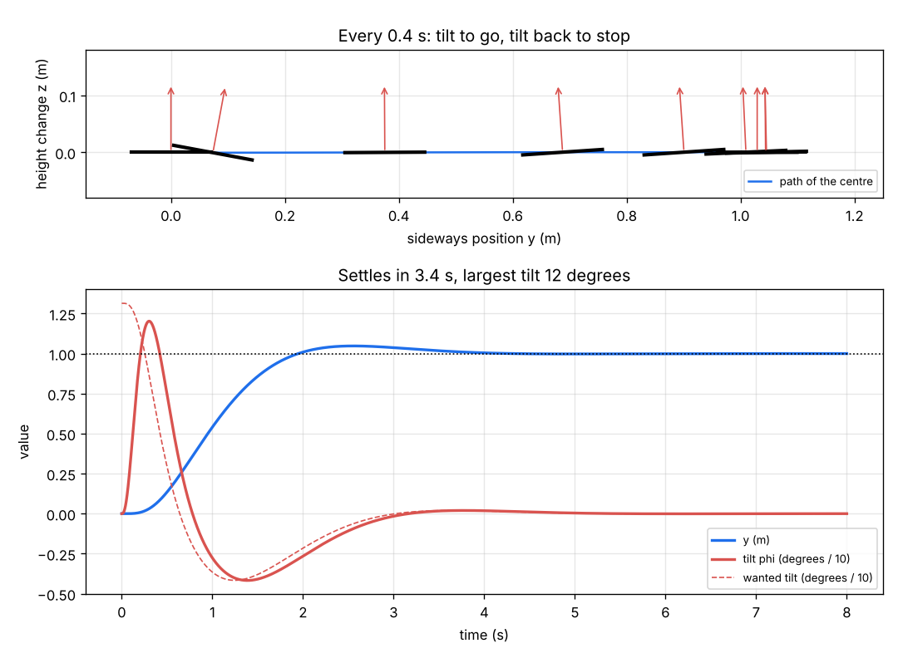
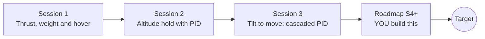

# opendronecontrol

[](https://github.com/KrunalPanchal1995/pan-iit-oss/actions/workflows/tests.yml)   [](https://colab.research.google.com/github/KrunalPanchal1995/pan-iit-oss/blob/main/opendronecontrol/sessions/session-01/lesson.ipynb) [](https://krunalpanchal1995.github.io/pan-iit-oss/opendronecontrol/)

**Make a quadrotor hover and hold its attitude with PID control, in three sessions.**

opendronecontrol teaches how a multicopter stays in the air, from thrust and weight to a PID altitude hold and a cascaded attitude controller that tilts the drone to move, using only Python and a browser.

- **Start from zero.** Session 1 needs only school physics: weight, thrust and F = m a.
- **Feel the feedback.** Every session ships a slider app that runs in the browser: tune Kp, Ki and Kd and watch the drone respond.
- **Know you got it right.** Each session ends with a checkpoint that prints PASS or FAIL against hand calculations and the textbook formulas for overshoot and stability.
- **Build the missing half.** The repo stops at Session 3 on purpose; the roadmap shows the path to the Target.

[Target](#the-target) · [Who is this for](#who-is-this-for) · [Quick start](#quick-start) · [Sessions](#sessions) · [Roadmap](#roadmap) · [Contribute](#contribute) · [Explainer PDF](docs/explainer.pdf)

> **This repo is incomplete on purpose.** Sessions 1 to 3 are here and fully working. The finished Target below is a preview of what the community can build next. We show you the path, not the code. Sessions 4 and up are yours.

## The Target

A full 3-D quadrotor (roll, pitch, yaw and four motors) takes off, flies a square of 2 m sides at 1.5 m height and lands, while a sideways gust hits it halfway. A cascaded PID (position, then attitude, then body rate) keeps the path within 10 cm, with a live 3-D view, the four motor speeds and the tilt angles traced against time. The Session 3 result below is the first step: the same cascade in a flat world, flying 1 m sideways, leaning to go and leaning back to stop. Your goal over the coming sessions: add the third dimension, the rate loop, sensor noise and wind, and fly the square yourself.



*Target, first step: a planar quadrotor flies 1 m sideways with a cascaded PID; drone drawn every 0.4 s, with position and tilt against time*

Try it live:

- [Math Visual Studio: ordinary differential equations (Atlas S16)](https://krunalpanchal1995.github.io/studio/#atlas?ch=S16&ex=1)
- [Math Visual Studio: Newton's laws of motion (Atlas S36)](https://krunalpanchal1995.github.io/studio/#atlas?ch=S36&ex=1)

How the Target is built is shown only as a path in [promo/roadmap.md](promo/roadmap.md).

## Who is this for
**higher secondary to advanced undergraduate (levels 4-6).** Topic area: Aerospace, Automotive and Transportation.

Prerequisites:

- School physics: force, mass, weight, Newton's second law, and torque = force x distance.
- Square roots, sine and cosine, and the exponential function on a calculator.
- Python 3.10 or newer; if `python --version` works, you are ready. PRIMER.md explains the rest.
- No prior GitHub, control-theory or calculus experience is needed; Sessions 2 and 3 explain the rates, integrals and numerical steps they use.

New to Python? Read [PRIMER.md](PRIMER.md) first (10 minutes).

## Quick start

No installation knowledge needed. You need [Git](https://git-scm.com/downloads) and [Python 3.10+](https://www.python.org/downloads/) (Windows: tick "Add Python to PATH"). On Mac and Linux type `python3` wherever this page says `python`.

```bash
git clone https://github.com/KrunalPanchal1995/pan-iit-oss.git
cd pan-iit-oss/opendronecontrol
python start.py 1
```

`start.py` creates a private environment, installs what is needed and runs Session 1 with its checkpoint. Next: `python start.py 2`, `python start.py 3`, or `python start.py test` to check everything. Only a checkpoint: `python start.py check 1`.

<!-- friendly-help -->
<details>
<summary><b>Not working? Common fixes (no Git, "python not found", no internet)</b></summary>

- **No Git?** You do not need it. On the main page of this collection click the green **Code** button, then **Download ZIP**, unzip it, open a terminal inside the folder `pan-iit-oss-main/opendronecontrol` and run `python start.py 1`. The ZIP holds every project, so it is large; the live apps need no download at all.
- **"python is not recognized" or "command not found".** On Windows try `py start.py 1`. On Mac and Linux try `python3 start.py 1`. If neither works, install Python from [python.org](https://www.python.org/downloads/) and tick "Add Python to PATH".
- **Needs internet once.** The first run downloads NumPy and Matplotlib into a private folder (`.venv`); after that it works offline.
- **Rather not install anything?** Open the [live apps](https://krunalpanchal1995.github.io/pan-iit-oss/opendronecontrol/) in your browser, or use the Colab badge at the top of this page.
- **Still stuck?** [Open an issue](https://github.com/KrunalPanchal1995/pan-iit-oss/issues/new?title=%5Bopendronecontrol%5D%20) with your operating system and the message you see. Questions from beginners are welcome.

</details>

Four lines turn the idea of Session 2 into a result (they work as they are): Save it as `try.py` and run it with `python start.py run try.py` (this uses the private environment, where NumPy is installed):

```python
import numpy as np
kp, kd, m = 4.0, 3.0, 1.4                                # gains (N/m, N s/m) and mass (kg)
zeta = kd / (2 * np.sqrt(kp * m))                        # damping ratio -> 0.634
print(np.round(np.exp(-zeta * np.pi / np.sqrt(1 - zeta**2)), 3))   # -> 0.076  overshoot of a climb
```

Every session also opens in your browser with sliders (no install): [live apps](https://krunalpanchal1995.github.io/pan-iit-oss/opendronecontrol/). Or use the Colab badge above for the notebook.

## Sessions

| # | Session | Model level | Time | Live app |
|---|---|---|---|---|
| 1 | [Thrust, weight and hover](sessions/session-01/README.md) | Level 1: conceptual interactive model | 60 min | [open](https://krunalpanchal1995.github.io/pan-iit-oss/opendronecontrol/session-01/) |
| 2 | [Altitude hold with a PID controller](sessions/session-02/README.md) | Level 2: mathematical engineering model | 75 min | [open](https://krunalpanchal1995.github.io/pan-iit-oss/opendronecontrol/session-02/) |
| 3 | [Tilt to move: attitude control and cascaded PID](sessions/session-03/README.md) | Level 3: simulation and validation | 90 min | [open](https://krunalpanchal1995.github.io/pan-iit-oss/opendronecontrol/session-03/) |

Each session follows the same six steps: A real-world problem, B concept and theory, C visual explanation, D interactive simulation, E worked example and experiment, F assessment and design challenge. Each ends with `checkpoint.py`, which prints `PASS` or `FAIL` against reference numbers. Session 3 also contains the real-world mini-project: **Tune the attitude loop of a camera drone**.

## Architecture



| Folder or file | What is inside |
|---|---|
| `sessions/` | three sessions: README (A-F), `lesson.py`, notebook, live app, exercises, activity sheet, checkpoint |
| `promo/` | the Target: media, live links, and the roadmap (path only) |
| `docs/` | `explainer.tex` and the built `explainer.pdf` |
| `tests/` | runs every lesson and checkpoint headless |
| `start.py` | one command to set up and run anything |
| `QUALITY.md`, `RUBRIC.md` | the quality checklist and the scoring rubric |
| `.github/` | CI, PDF build, Pages deploy, issue and PR templates |

## Roadmap

| Milestone | What you will build | Difficulty |
|---|---|---|
| Session 4: The rate loop and gyroscope noise | A third, innermost loop on the roll rate, with noisy gyro readings and a low-pass filter on the D term. | intermediate |
| Session 5: Integrator wind-up and wind gusts | Anti-wind-up for the I terms and a gust model; hold position against a steady side wind. | intermediate |
| Session 6: The full 3-D quadrotor | Roll, pitch and yaw, four motors, a 4x4 mixer and yaw torque from rotor drag. | advanced |
| Session 7: Estimating the state | A complementary filter that fuses a gyroscope and an accelerometer into a tilt estimate. | advanced |
| Session 8: Fly a square mission | Waypoints, a smooth path and the whole cascade flying the Target square. | advanced |

Full detail with a checkpoint per milestone: [promo/roadmap.md](promo/roadmap.md).

## Contribute
New to GitHub? Read [CONTRIBUTING.md](CONTRIBUTING.md); it starts from zero. Pick an issue labelled `good first issue`. Translations into Hindi, Telugu, Tamil and Malayalam are welcome.

<details>
<summary>Development</summary>

```bash
python start.py test        # runs every lesson and checkpoint
```
Lessons use `# %%` cell markers so they open as notebooks in VS Code. See [QUALITY.md](QUALITY.md) for the standard every session meets.
</details>

## License
MIT. See [LICENSE](LICENSE). Media in `promo/media` is (c) Krunal Panchal, CC BY 4.0.

## Acknowledgments
Part of the [PAN IIT OSS](https://hellofoss.tech-iitb.org/projects) open-source teaching collection, modelled on the structure of [openspline](https://github.com/openspline/openspline). Built on ideas from the Math Visual Studio at https://krunalpanchal1995.github.io/studio/.
