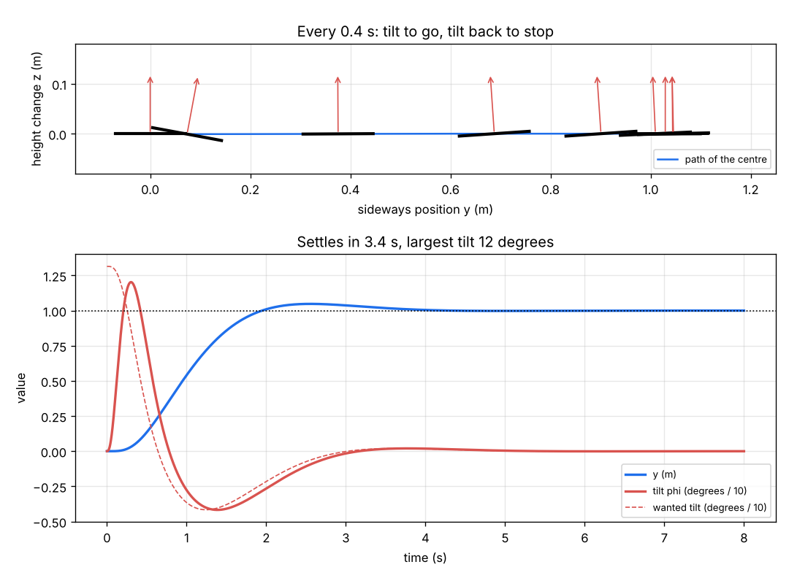

# What you are building toward

A full 3-D quadrotor (roll, pitch, yaw and four motors) takes off, flies a square of 2 m sides at 1.5 m height and lands, while a sideways gust hits it halfway. A cascaded PID (position, then attitude, then body rate) keeps the path within 10 cm, with a live 3-D view, the four motor speeds and the tilt angles traced against time. The Session 3 result below is the first step: the same cascade in a flat world, flying 1 m sideways, leaning to go and leaning back to stop. Your goal over the coming sessions: add the third dimension, the rate loop, sensor noise and wind, and fly the square yourself.

*Target, first step: a planar quadrotor flies 1 m sideways with a cascaded PID; drone drawn every 0.4 s, with position and tilt against time*

The figure comes from Session 3 (`python start.py 3`). The full 3-D Target is not published as code; the roadmap shows the path so you can build your own.

Live links:

- [Math Visual Studio: ordinary differential equations (Atlas S16)](https://krunalpanchal1995.github.io/studio/#atlas?ch=S16&ex=1)
- [Math Visual Studio: Newton's laws of motion (Atlas S36)](https://krunalpanchal1995.github.io/studio/#atlas?ch=S36&ex=1)
