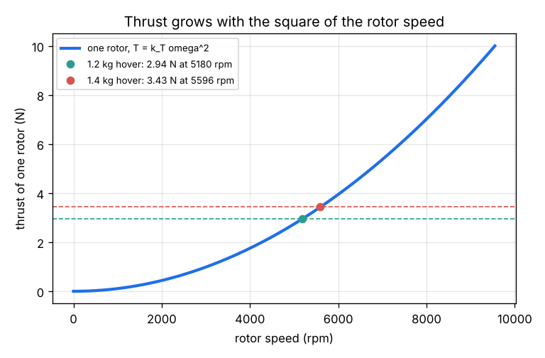
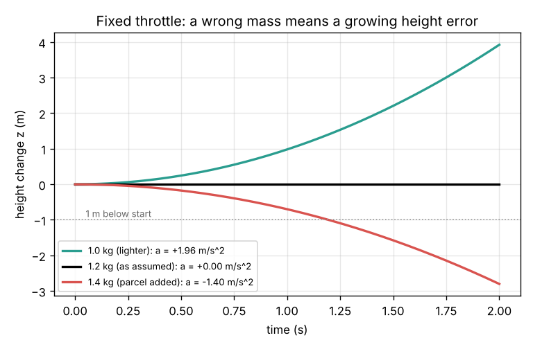

# Session 1: Thrust, weight and hover

*Level 1 (conceptual interactive model) · about 60 minutes · opendronecontrol*

> This is a simplified educational model. It is not a validated design tool and must not be used for real structures, electrical installations, vehicles, industrial processes or medical decisions.

**Prerequisites**

- School physics: force, mass, weight and Newton's second law F = m a.
- Squares and square roots; the idea of revolutions per minute (rpm).
- You have read PRIMER.md and run `python start.py 1` once.

**Learning objectives.** After this session you can:

- Compute the weight of a drone and the thrust each rotor must give to hover.
- Use the rotor law T = k_T omega^2 to find the hover speed in rad/s and rpm.
- Compute the thrust-to-weight ratio and say why it must be well above 1.
- Use Newton's second law to predict how a drone drifts when the throttle is fixed and the mass is wrong, and explain why this calls for feedback.

## A. Real-world problem
A 1.2 kg delivery drone must hover still above a doorstep. Its four rotors push air down and the air pushes the drone up. How fast must the rotors spin to hover? And if someone clips on a 0.2 kg parcel and nobody touches the throttle, what happens in the next two seconds? (General education only: this is a simplified model, not a drone design method. Real drones have sharp spinning propellers; never test near people or without the safety rules of your local aviation authority.)

## B. Concept and theory
Gravity pulls the drone down with its weight W = m g. Each propeller throws air downwards, and by Newton's third law the air pushes the propeller up. For a given propeller in still air the thrust grows with the square of the spin speed: T = k_T omega^2, where omega is in radians per second and k_T (here 1.0e-5 N per (rad/s)^2, typical of a 10-inch propeller) lumps together the propeller's size, shape and the air density. To hover, the n rotors together must carry the weight, so each spins at omega_hover = sqrt(m g / (n k_T)). The thrust-to-weight ratio, the largest total thrust divided by the weight, tells you how much spare push is left to climb, fight a gust or correct a tilt; builders aim for at least 2. Taking up as positive, Newton's second law gives m a = T_total - m g. With the throttle held fixed, a is constant and a drone that starts at rest moves z = a t^2 / 2: a small thrust mistake grows into a large height mistake because time is squared. Hovering also costs power even when nothing moves: momentum theory gives an ideal induced power P = T^1.5 / sqrt(2 rho A) per rotor of disc area A.

| Symbol | Meaning | Unit |
|---|---|---|
| m | mass of the drone (plus any payload) | kg |
| g | gravitational acceleration, 9.81 | m/s^2 |
| W | weight m g | N |
| T | thrust of one rotor; T_total for all rotors | N |
| omega | rotor spin speed (1 rad/s = 9.549 rpm) | rad/s |
| k_T | rotor thrust coefficient | N/(rad/s)^2 |
| n | number of rotors (4 for a quadrotor) | no unit |
| a, z | vertical acceleration and height change, up positive | m/s^2, m |
| rho, A | air density (1.225) and rotor disc area | kg/m^3, m^2 |

**Assumptions**

- All four rotors are identical and spin at the same speed, so the drone stays level.
- Thrust follows T = k_T omega^2 with a constant k_T (still air, sea level, no ground effect).
- No air drag on the body; the drone starts at rest.
- The power formula is the ideal (best possible) value; real rotors need roughly 1.5 times more.

$$ W = m g,\qquad T = k_T\,\omega^2 $$

$$ \omega_{\mathrm{hover}} = \sqrt{\frac{m g}{n\,k_T}},\qquad \text{rpm} = \omega\,\frac{60}{2\pi} $$

$$ \frac{T}{W}\bigg|_{\max} = \frac{n\,k_T\,\omega_{\max}^2}{m g} $$

$$ m\,\ddot z = T_{\mathrm{total}} - m g,\qquad z(t) = \tfrac12 a t^2 $$

$$ P_{\mathrm{ideal}} = \frac{T^{3/2}}{\sqrt{2\rho A}} $$

## C. Visual explanation
The first figure shows the thrust of one rotor against its speed: a parabola. The 1.2 kg drone needs 2.94 N per rotor, reached at 5180 rpm; with the parcel (1.4 kg) it needs 3.43 N at 5596 rpm. Because thrust grows with the square of speed, 17 percent more mass needs only 8 percent more speed. The second figure shows what happens when the throttle stays at the 1.2 kg hover setting: the real 1.2 kg drone stays put, a 1.0 kg drone climbs 3.92 m in 2 s and a 1.4 kg drone sinks 2.80 m in 2 s. The curves bend away because the error grows with t squared.

*Thrust of one rotor against rotor speed, with the hover points of a 1.2 kg and a 1.4 kg drone.*

*Height with the throttle fixed at the 1.2 kg hover thrust, for three real masses.*

## D. Interactive simulation
Run the lesson (`python start.py 1`), then open the live app: [Session 1: thrust, weight and hover](https://krunalpanchal1995.github.io/pan-iit-oss/opendronecontrol/session-01/) (or `app.html` in this folder). Change the drone mass, add a parcel and set the rotor speed. Watch the force arrows grow, find the hover point on the thrust curve, and see how far the drone drifts in 2 s with your throttle setting.

**Challenge.** Add a 0.2 kg parcel to the 1.2 kg drone and set the rotor speed so it drifts less than 10 cm in 2 s.

## E. Worked example and experiment
**Problem.** A 1.2 kg quadrotor has rotors with k_T = 1.0e-5 N/(rad/s)^2 and a top speed of 1000 rad/s. Find its weight, the hover speed in rad/s and rpm, and its thrust-to-weight ratio. Then a 0.2 kg parcel is added with the throttle unchanged: find the acceleration and how long the drone takes to sink 1 m.

1. Weight: W = 1.2 x 9.81 = 11.772 N, so each rotor carries 11.772 / 4 = 2.943 N.
2. Hover speed: omega = sqrt(2.943 / 1.0e-5) = sqrt(294300) = 542.5 rad/s; rpm = 542.5 x 60 / (2 pi) = 5180 rpm.
3. Top thrust: 4 x 1.0e-5 x 1000^2 = 40 N, so thrust-to-weight = 40 / 11.772 = 3.40 (enough spare push).
4. With the parcel: m = 1.4 kg, thrust still 11.772 N, so a = 11.772 / 1.4 - 9.81 = 8.409 - 9.81 = -1.40 m/s^2 (downwards).
5. Time to sink 1 m: 1 = 0.5 x 1.40 x t^2, so t = sqrt(2 / 1.40) = 1.19 s.

**Answer.** W = 11.77 N, hover at 542.5 rad/s (5180 rpm), thrust-to-weight 3.40; with the parcel the drone accelerates down at 1.40 m/s^2 and sinks 1 m in 1.19 s.

**Experiment.** Hold a small hand-held fan (with a guard) pointing down on a kitchen scale and read the scale at its low and high settings: the change in reading is the fan's thrust. If you know the two speeds, check whether the thrust ratio is close to the square of the speed ratio. Real fans differ from the model because the airflow is disturbed by the scale and the fan housing, and k_T changes a little with speed.

## F. Assessment and design challenge
**Question type A: Conceptual.** A pilot finds the exact throttle at which the drone hovers, then lets go of the stick. Give three reasons why the drone will still drift up or down after a while.

Hint

What in m a = T - m g, or in T = k_T omega^2, could change during the flight without the throttle moving?

Step-by-step solution

Any change that breaks T = m g makes a nonzero acceleration, and the height error then grows like t squared. Examples: (1) the battery voltage falls as it drains, so the motors spin slower at the same throttle and thrust drops; (2) the mass changes (a parcel, rain, a camera); (3) the air changes: a warmer day or a higher place has lower density, which lowers k_T, and gusts or ground effect change the thrust. Since we never know these exactly, the throttle must be corrected all the time from a measurement: feedback.

**Question type B: Numerical.** A smaller 0.9 kg quadrotor uses the same rotors (k_T = 1.0e-5 N/(rad/s)^2, top speed 1000 rad/s). Find the thrust per rotor to hover, the hover speed in rad/s and rpm, and its thrust-to-weight ratio. Check the units and that the answer is reasonable.

Hint

T per rotor = m g / 4, then omega = sqrt(T / k_T), then rpm = omega x 60 / (2 pi).

Step-by-step solution

T = 0.9 x 9.81 / 4 = 2.207 N per rotor. omega = sqrt(2.207 / 1.0e-5) = sqrt(220700) = 469.8 rad/s = 4486 rpm. Thrust-to-weight = 40 / 8.829 = 4.53. Sanity check: the lighter drone hovers at a lower speed than the 1.2 kg one (5180 rpm), and the ratio of speeds 4486 / 5180 = 0.866 equals sqrt(0.9 / 1.2) = 0.866, as the square-root law says.

**Question type C: Graph and simulation interpretation.** On the thrust curve, by what factor does the thrust grow when the rotor speed goes from 4000 to 8000 rpm? On the drift graph, the 1.4 kg drone has sunk 2.80 m after 2 s. How far had it sunk after 1 s, and why is that not half?

Hint

T is proportional to omega^2, and z is proportional to t^2.

Step-by-step solution

Doubling the speed multiplies the thrust by 2^2 = 4. For the drift, z = a t^2 / 2, so halving the time divides the drop by 4: 2.80 / 4 = 0.70 m after 1 s. It is not half because the drone keeps speeding up: its downward speed grows steadily, so each second it falls further than in the second before.

**Question type D: Design and optimisation challenge.** Design: you want the 1.2 kg drone to have a thrust-to-weight ratio of at least 2. What top rotor speed (rpm) is needed with k_T = 1.0e-5? What top speed is needed if it must also carry a 0.4 kg parcel? With the real top speed of 1000 rad/s, what is the largest payload that keeps the ratio at 2?

Hint

Ratio 2 means each rotor must reach 2 m g / 4. The largest total thrust at 1000 rad/s is 40 N.

Step-by-step solution

Empty: each rotor needs 2 x 11.772 / 4 = 5.886 N, so omega = sqrt(588600) = 767.2 rad/s = 7326 rpm. With 0.4 kg: m = 1.6 kg, each rotor needs 2 x 15.696 / 4 = 7.848 N, omega = 885.9 rad/s = 8460 rpm. At 1000 rad/s the total is 40 N, so the weight may be at most 20 N, m at most 2.04 kg and the payload at most 0.84 kg. Trade-off: more payload means less spare thrust for climbing and correcting, and much more power (it grows as mass^1.5).

Score yourself with [RUBRIC.md](../../RUBRIC.md). Print the [activity sheet](activity_sheet.md) to work on paper.

## Common misconceptions
| Common misconception | What is actually true |
|---|---|
| Twice the rotor speed gives twice the thrust. | Thrust grows with the square of speed: twice the speed gives four times the thrust. |
| Once the hover throttle is found, the drone will stay put. | Any small change in mass, battery voltage or air density leaves a net force, and the height error grows with t squared. |
| A hovering drone uses no power because it does no work against gravity. | The rotors keep accelerating air downwards, which costs power; the ideal value is T^1.5 / sqrt(2 rho A) per rotor. |
| Thrust-to-weight of just above 1 is enough. | It only just hovers; there is no spare thrust to climb, brake a fall or correct a tilt. Builders aim for 2 or more. |

## Glossary
- **thrust**: the upward push of the air on a spinning rotor, in newtons
- **hover**: flying with zero acceleration: total thrust equals weight
- **thrust-to-weight ratio**: largest total thrust divided by weight; the spare push available
- **rad/s and rpm**: two units of spin speed; 1 rad/s = 60 / (2 pi) = 9.549 rpm
- **open loop**: control without measuring the result, such as a fixed throttle
- **feedback**: measuring the result and correcting the input from the error

## Finish
1. Do the three coding tasks in [exercises.md](exercises.md).
2. Run `python start.py 1` again after your changes. It ends with the checkpoint; when it prints `PASS`, you are done. (Checkpoint only: `python start.py check 1`.)

Next: [Session 2](../session-02/README.md)
