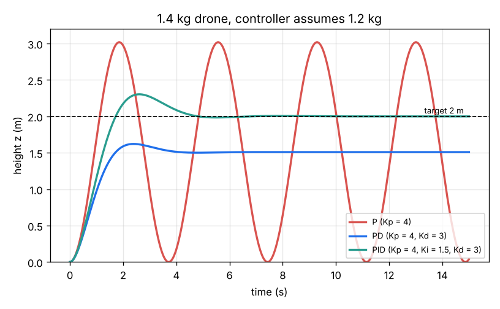
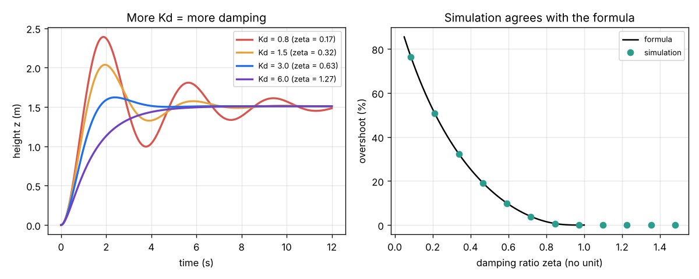

# Session 2: Altitude hold with a PID controller

*Level 2 (mathematical engineering model) · about 75 minutes · opendronecontrol*

> This is a simplified educational model. It is not a validated design tool and must not be used for real structures, electrical installations, vehicles, industrial processes or medical decisions.

**Prerequisites**

- Session 1: weight, thrust and m a = T - m g.
- The idea of a rate of change (speed is how fast height changes) and of adding up small pieces (an integral); both are explained in Section B.
- Square roots and the exponential function exp(x) on a calculator.

**Learning objectives.** After this session you can:

- Explain the feedback loop: error, controller, thrust, drone, measurement.
- Say what each of P, I and D does and predict the response from Kp, Ki and Kd.
- Compute the natural frequency, damping ratio, overshoot and steady-state error of an altitude loop by hand.
- Simulate the loop step by step, check it against the formulas, and tune gains to meet a specification.

## A. Real-world problem
In Session 1 a fixed throttle let the drone sink as soon as a 0.2 kg parcel was added. A flight controller instead measures the height (with a barometer, a downward range sensor or GPS) many times per second and corrects the thrust. How should the correction depend on the error so that the drone climbs to 2 m quickly, without a big overshoot, and ends up exactly at 2 m even though the controller still believes the drone weighs 1.2 kg when it really weighs 1.4 kg? (Simplified one-dimensional model; not a flight-controller design method.)

## B. Concept and theory
Every time step the controller computes the error e = z_ref - z between the wanted and the measured height. It sets the total thrust T = m_nom g + u: the first part is a feed-forward guess of the hover thrust using the mass it believes, and u is the feedback correction. A PID controller builds u from three parts: u = Kp e + Ki (integral of e dt) - Kd (dz/dt). The **P** term pushes back in proportion to the error, like a spring. The **D** term opposes the climb rate, like a damper or shock absorber; we use the measured rate dz/dt instead of de/dt so that a sudden change of target does not kick the thrust. The **I** term adds up the error over time and keeps growing while any error remains. Putting T into m z'' = T - m g gives a mass-spring-damper: m z'' + Kd z' + Kp z = Kp z_ref + (m_nom - m) g. Its natural frequency is wn = sqrt(Kp / m), its damping ratio is zeta = Kd / (2 sqrt(Kp m)), and for 0 < zeta < 1 a step overshoots by exp(-zeta pi / sqrt(1 - zeta^2)) and settles (within 2 percent) in about 4 / (zeta wn). With P alone zeta = 0 and the drone bounces for ever. When the true mass differs from m_nom, gravity is not fully cancelled and P or PD control settles short by the steady-state error e_ss = (m - m_nom) g / Kp. Integral action removes it, but makes the loop third order, m s^3 + Kd s^2 + Kp s + Ki = 0, which by the Routh test is stable only when Kd Kp > m Ki. Real rotors cannot push down or exceed their maximum, so the thrust is limited to 0 to 40 N.

| Symbol | Meaning | Unit |
|---|---|---|
| z, z_ref | measured and wanted height | m |
| e | error z_ref - z | m |
| m, m_nom | true mass, and the mass the controller believes | kg |
| u | feedback correction to the thrust | N |
| Kp | proportional gain | N/m |
| Ki | integral gain | N/(m s) |
| Kd | derivative gain | N s/m |
| wn | natural frequency | rad/s |
| zeta | damping ratio | no unit |
| e_ss | steady-state error | m |

**Assumptions**

- Motion is up and down only; the drone stays level.
- Height and climb rate are measured perfectly every 0.01 s; the thrust changes instantly (motor lag comes in Session 3).
- The formulas ignore the thrust limit; the simulation includes it.
- Gains are illustrative, chosen for a 1.2 kg drone.

$$ e = z_{\mathrm{ref}} - z,\qquad T = m_{\mathrm{nom}}\,g + K_p e + K_i\!\int e\,dt - K_d\,\dot z $$

$$ \omega_n = \sqrt{\frac{K_p}{m}},\qquad \zeta = \frac{K_d}{2\sqrt{K_p m}} $$

$$ M_p = \exp\!\left(\frac{-\zeta\pi}{\sqrt{1-\zeta^2}}\right),\qquad t_s \approx \frac{4}{\zeta\,\omega_n} $$

$$ e_{ss} = \frac{(m - m_{\mathrm{nom}})\,g}{K_p}\quad(\text{P or PD}),\qquad e_{ss} = 0\quad(\text{PID}) $$

$$ m s^3 + K_d s^2 + K_p s + K_i = 0\ \text{stable} \iff K_d K_p > m K_i $$

## C. Visual explanation
Figure 1 flies the 1.4 kg drone (controller believes 1.2 kg) to 2 m with three controllers. P alone (Kp = 4 N/m) bounces between 0 and 3 m and never settles. PD (Kd = 3 N s/m added) is smooth, overshoots only 7 percent, but settles at 1.509 m: 0.49 m short, exactly the predicted steady-state error. PID (Ki = 1.5 added) ends at 2.000 m; the integral costs a little more overshoot (15 percent). Figure 2 shows the effect of Kd and checks the simulation against the overshoot formula for twelve values of Kd: the dots sit on the curve.

*P, PD and PID control of a 1.4 kg drone whose controller assumes 1.2 kg.*

*Left: more Kd gives more damping. Right: simulated overshoot against the formula.*

## D. Interactive simulation
Run the lesson (`python start.py 2`), then open the live app: [Session 2: altitude hold with PID](https://krunalpanchal1995.github.io/pan-iit-oss/opendronecontrol/session-02/) (or `app.html` in this folder). Try the presets P only, PD and PID, then move the sliders. Watch the height curve, the thrust curve (which hits its 0 and 40 N limits with large gains) and the readout, which compares the formula overshoot with the simulated one and runs the Routh test.

**Challenge.** With the 0.2 kg parcel: overshoot below 10 percent, settled within 4 s and final error below 2 cm.

## E. Worked example and experiment
**Problem.** A PD altitude controller with Kp = 4 N/m and Kd = 3 N s/m believes the drone weighs 1.2 kg, but it really weighs 1.4 kg. Find wn, zeta, the overshoot and the settling time of a climb to 2 m, and the final height. Then add Ki = 1.5 N/(m s) and check it is stable.

1. Natural frequency: wn = sqrt(4 / 1.4) = sqrt(2.857) = 1.690 rad/s.
2. Damping ratio: zeta = 3 / (2 sqrt(4 x 1.4)) = 3 / (2 x 2.366) = 0.634.
3. Overshoot: sqrt(1 - 0.634^2) = 0.773; exp(-0.634 x 3.1416 / 0.773) = exp(-2.576) = 0.076, so 7.6 percent. Settling time about 4 / (0.634 x 1.690) = 3.7 s.
4. Steady-state error: (1.4 - 1.2) x 9.81 / 4 = 1.962 / 4 = 0.4905 m, so the drone settles at 2 - 0.49 = 1.51 m.
5. With Ki = 1.5: Kd Kp = 12 is larger than m Ki = 2.1, so the PID loop is stable and the error goes to zero; at rest the thrust is the true weight 1.4 x 9.81 = 13.73 N.

**Answer.** wn = 1.69 rad/s, zeta = 0.63, overshoot 7.6 percent, settling about 3.7 s, PD settles at 1.51 m (0.49 m short). The simulation gives 7.4 percent, 3.5 s and 1.509 m. PID is stable and settles at 2.000 m.

**Experiment.** Balance a ruler upright on your palm with your eyes open, then try it while looking only at your hand. You are the controller: watching the error and how fast it changes (P and D) works; reacting late or only to the error makes you overshoot and wobble. If you have a small drone with an altitude-hold mode, hover it at 1 m (outdoors, away from people) and hang a light key ring from it: it dips, then climbs back as the integral term catches up. Real drones differ from the model because sensors are noisy and delayed, and the motors take time to speed up.

## F. Assessment and design challenge
**Question type A: Conceptual.** Why does a PD controller leave the heavier drone below its target, and how does adding the I term fix it? What does the I term cost?

Hint

At rest z' = 0, so the D term is zero. What must the P term supply on its own?

Step-by-step solution

At rest the drone must make thrust equal to its true weight. The feed-forward supplies m_nom g, which is 1.96 N too little. With z' = 0 the D term is zero, so the P term must supply the missing 1.96 N, and it can only do that if an error remains: Kp e = 1.96 N, so e = 0.49 m. The I term keeps adding up the error, so it keeps growing until it supplies the 1.96 N by itself; then the error can be zero. The cost: the integral builds up during the climb and makes the drone overshoot more (15 percent instead of 7 percent), and too much Ki (above Kd Kp / m) makes the loop unstable.

**Question type B: Numerical.** For the 1.4 kg drone choose Kp = 8 N/m. What Kd gives zeta = 0.7? Find wn, the overshoot, the settling time and the PD steady-state error. Check that the answers are reasonable compared with the worked example.

Hint

Kd = 2 zeta sqrt(Kp m); then use the formulas of Section B.

Step-by-step solution

sqrt(8 x 1.4) = 3.347, so Kd = 2 x 0.7 x 3.347 = 4.69 N s/m. wn = sqrt(8 / 1.4) = 2.390 rad/s. Overshoot = exp(-0.7 pi / 0.714) = 0.046, so 4.6 percent. Settling about 4 / (0.7 x 2.390) = 2.4 s. Steady-state error 1.962 / 8 = 0.245 m. Reasonable: doubling Kp halved the error and made the drone faster, and the extra Kd kept the overshoot small. The simulation gives 4.3 percent, 2.5 s and 1.755 m.

**Question type C: Graph and simulation interpretation.** In Figure 2 (left), Kd = 0.8, 1.5, 3 and 6 N s/m. Predict the overshoot of each from the formula and say which curve has none. Why is the Kd = 6 curve the slowest to rise even though it has the most "control"?

Hint

zeta = Kd / (2 sqrt(4 x 1.4)) = Kd / 4.733.

Step-by-step solution

zeta = 0.17, 0.32, 0.63 and 1.27, so overshoot = 58, 35, 7.6 and 0 percent. Kd = 6 is overdamped (zeta above 1): no overshoot. It rises slowest because the D term opposes any climb rate: a strong damper brakes the drone even while it is still far below the target. Good tuning usually sits near zeta = 0.6 to 0.8, a balance between overshoot and speed.

**Question type D: Design and optimisation challenge.** Design: the drone (1.4 kg, controller believes 1.2 kg) must reach 2 m with overshoot below 10 percent, settle within 4 s, and end within 2 cm of the target. The thrust is limited to 40 N. Choose Kp, Ki and Kd and justify them. What is the largest Ki the Routh test allows for your Kp and Kd?

Hint

Start from a PD with zeta near 0.7 and wn near 3 rad/s, then add a small Ki and check Kd Kp > m Ki. Use the app's challenge.

Step-by-step solution

One good design: Kp = 12 N/m gives wn = sqrt(12 / 1.4) = 2.93 rad/s; Kd = 5.7 N s/m gives zeta = 5.7 / (2 sqrt(16.8)) = 0.695 (about 5 percent overshoot as a PD). Add Ki = 2 N/(m s) to remove the 0.16 m PD error. Routh: Ki must stay below Kd Kp / m = 68.4 / 1.4 = 48.9, so Ki = 2 is far from the limit. The simulation gives 4.6 percent overshoot, settling in 2.1 s, final height 2.000 m, and a peak thrust of 35.8 N, inside the 40 N limit. Trade-off: larger Kp is faster but asks for more thrust at the start; with Kp much above 12 the thrust saturates and the formulas no longer hold.

Score yourself with [RUBRIC.md](../../RUBRIC.md). Print the [activity sheet](activity_sheet.md) to work on paper.

## Common misconceptions
| Common misconception | What is actually true |
|---|---|
| A bigger Kp always makes a better controller. | Bigger Kp is faster and has less steady-state error, but without enough Kd it overshoots and oscillates, and it saturates the motors. |
| The D term reacts to the error, so it pushes towards the target. | The D term opposes motion: it brakes the drone whichever way it moves, which adds damping. |
| PD control reaches the target if you wait long enough. | With a wrong mass it stops short by (m - m_nom) g / Kp for ever; only integral action removes this. |
| More Ki is always better because it removes the error faster. | Too much Ki causes overshoot and, above Kd Kp / m, an unstable loop that grows. |

## Glossary
- **error**: wanted value minus measured value
- **feedback**: correcting the input from a measurement of the output
- **feed-forward**: the part of the input computed from a model, without measurement (here m_nom g)
- **PID controller**: a controller whose correction is Proportional to the error, its Integral and its Derivative
- **damping ratio**: zeta; below 1 the response overshoots, above 1 it creeps in without overshoot
- **steady-state error**: the error left when everything has stopped changing
- **saturation**: the input hitting its physical limit (here 0 or 40 N of thrust)

## Finish
1. Do the three coding tasks in [exercises.md](exercises.md).
2. Run `python start.py 2` again after your changes. It ends with the checkpoint; when it prints `PASS`, you are done. (Checkpoint only: `python start.py check 2`.)

Next: [Session 3](../session-03/README.md)
