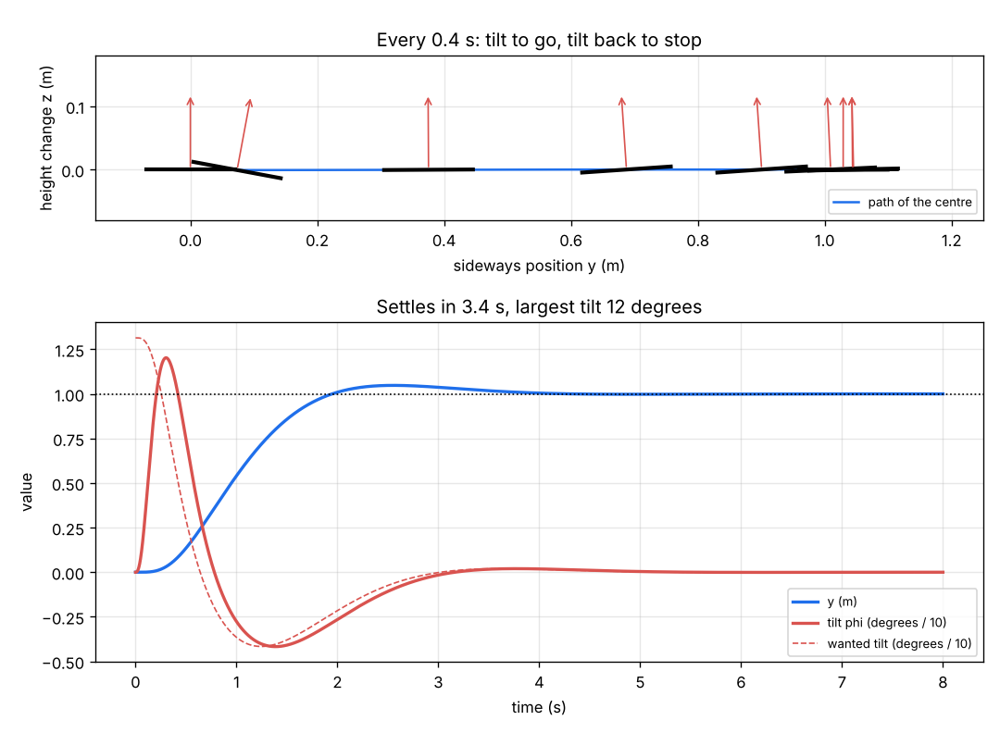
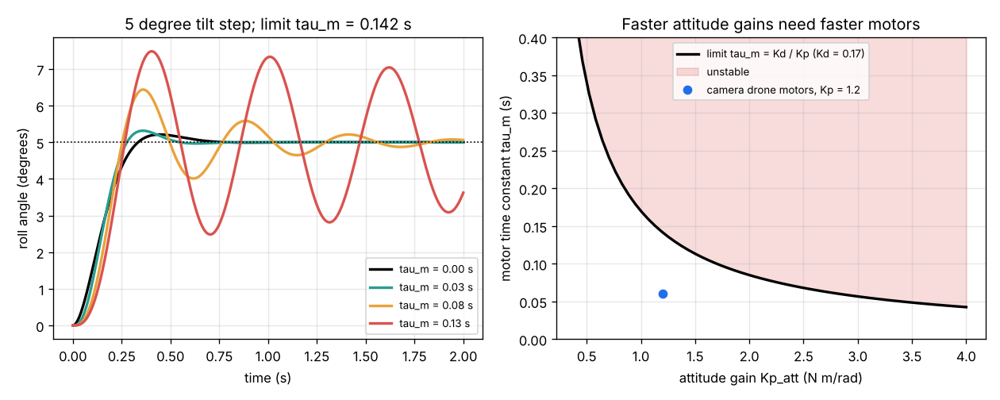
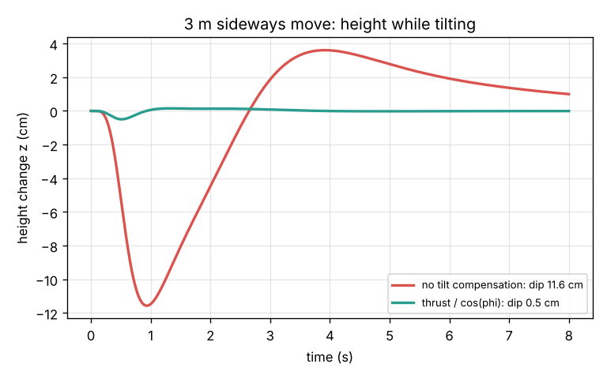

# Session 3: Tilt to move: attitude control and cascaded PID

*Level 3 (simulation and validation) · about 90 minutes · opendronecontrol*

> This is a simplified educational model. It is not a validated design tool and must not be used for real structures, electrical installations, vehicles, industrial processes or medical decisions.

**Prerequisites**

- Session 1: thrust, weight and Newton's second law.
- Session 2: the PID controller, wn, zeta and the overshoot formula.
- Sine and cosine of an angle; torque = force x distance. Moment of inertia is explained in Section B.

**Learning objectives.** After this session you can:

- Write the equations of a planar quadrotor and use a mixer to turn a thrust and a torque into rotor forces.
- Design the inner attitude loop with the second-order formulas and explain why it must be faster than the outer position loop.
- Find the motor-lag stability limit tau_m < Kd_att / Kp_att and confirm it in simulation.
- Fly a cascaded controller, validate it against hand calculations and limits, and tune it for a camera drone.

## A. Real-world problem
A drone has no sideways propeller. To move 1 m to the right it must lean right so part of its thrust points sideways, and then lean left to stop. It leans by spinning the rotors on one side faster than on the other. The rotors cannot change speed instantly, and while the drone leans, less thrust points up. How do we build a controller that flies a camera drone 1 m sideways in a few seconds, keeps its height, never tilts more than the camera can cope with, and stays stable with real, slow motors? (A simplified teaching model, not a flight-controller design tool.)

## B. Concept and theory
Look at the drone from behind: it has a sideways position y, a height z and a roll angle phi (positive = leaning right). The left and right rotor pairs give forces F_l and F_r. Their sum is the thrust T along the drone's own "up" axis; their difference, times the arm length L, is the roll torque tau = (F_l - F_r) L. Newton's laws give m y'' = T sin(phi), m z'' = T cos(phi) - m g and I phi'' = tau, where I is the moment of inertia: the rotational version of mass, which measures how hard the drone is to spin. A **mixer** inverts this: F_l = T / 2 + tau / (2L), F_r = T / 2 - tau / (2L). The controller is a **cascade** of loops. The outer position loop asks for an acceleration a_y = Kp_y (y_ref - y) - Kd_y vy, and since y'' is about g phi for small angles it asks the inner loop for a tilt phi_des = a_y / g, limited to 30 degrees. The inner attitude loop is a PD: tau = Kp_att (phi_des - phi) - Kd_att p, with p the roll rate. Since I phi'' = tau is the same "push a mass" problem as Session 2, it has wn_att = sqrt(Kp_att / I) and zeta_att = Kd_att / (2 sqrt(Kp_att I)). The height loop is Session 2's PID; dividing its thrust by cos(phi) (**tilt compensation**) keeps the vertical part of the thrust right while leaning. A rule of thumb is to make the inner loop 5 to 10 times faster than the outer loop, so the outer loop can treat the tilt as instant. Real motors lag: a first-order model dF/dt = (F_cmd - F) / tau_m makes the attitude loop third order, I tau_m s^3 + I s^2 + Kd_att s + Kp_att = 0, and the Routh test gives the stability limit tau_m < Kd_att / Kp_att. A stiffer attitude loop therefore needs faster motors.

| Symbol | Meaning | Unit |
|---|---|---|
| y, z | sideways position and height change | m |
| phi, p | roll angle and roll rate | rad (degrees in plots), rad/s |
| F_l, F_r | forces of the left and right rotor pairs | N |
| T, tau | total thrust and roll torque | N, N m |
| L | arm from the centre to each rotor pair, 0.2 | m |
| I | roll moment of inertia, 0.012 | kg m^2 |
| Kp_att, Kd_att | attitude gains | N m/rad, N m s/rad |
| Kp_y, Kd_y | position gains (per unit mass) | 1/s^2, 1/s |
| tau_m | motor time constant | s |

**Assumptions**

- A flat (planar) drone: one tilt angle, no pitch or yaw; m = 1.2 kg.
- Perfect measurements of position, angle and rates; still air; no drag.
- Each rotor pair is limited to 0 to 20 N; the motor lag is first order with time constant tau_m.
- Position gains Kp_y = 2.25 1/s^2 and Kd_y = 2.1 1/s (wn = 1.5 rad/s, zeta = 0.7); height gains as in Session 2, per unit mass (Kp_z = 4, Ki_z = 1, Kd_z = 3).

$$ m\ddot y = T\sin\phi,\qquad m\ddot z = T\cos\phi - m g,\qquad I\ddot\phi = (F_l - F_r)L $$

$$ F_{l,r} = \frac{T}{2} \pm \frac{\tau}{2L},\qquad T = \frac{m(g + a_z)}{\cos\phi} $$

$$ \phi_{\mathrm{des}} = \frac{K_{p,y}(y_{\mathrm{ref}} - y) - K_{d,y}\dot y}{g},\qquad \tau = K_{p,\mathrm{att}}(\phi_{\mathrm{des}} - \phi) - K_{d,\mathrm{att}}\,\dot\phi $$

$$ \omega_{n,\mathrm{att}} = \sqrt{\frac{K_{p,\mathrm{att}}}{I}},\qquad \zeta_{\mathrm{att}} = \frac{K_{d,\mathrm{att}}}{2\sqrt{K_{p,\mathrm{att}} I}} $$

$$ \tau_m\frac{dF}{dt} = F_{\mathrm{cmd}} - F,\qquad \text{stable} \iff \tau_m < \frac{K_{d,\mathrm{att}}}{K_{p,\mathrm{att}}} $$

## C. Visual explanation
Figure 1 shows the 1 m sideways move with the default gains (Kp_att = 1.2, Kd_att = 0.17, motors tau_m = 0.02 s). The drone is drawn every 0.4 s: it leans right (up to 12 degrees), then leans left to brake, and ends level at y = 1.000 m after 3.4 s with a 5 cm overshoot. The dashed line is the tilt the outer loop asks for; the solid line follows it a moment later. Figure 2 shows a 5 degree tilt step for four motor time constants: with tau_m = 0 the overshoot is 4.2 percent, as the formula predicts; with 0.08 s it rings; with 0.13 s, close to the limit 0.142 s, it barely settles. The right panel maps the stable and unstable region. Figure 3 shows a larger 3 m move: without tilt compensation the drone dips 11.6 cm while leaning 31 degrees; dividing the thrust by cos(phi) cuts the dip to 0.5 cm.

*A 1 m sideways move: the drone leans to go, leans back to stop, and ends level at y = 1 m.*

*Left: a 5 degree tilt step with slower and slower motors. Right: the stability limit tau_m = Kd / Kp.*

*Height during a 3 m sideways move with and without tilt compensation.*

## D. Interactive simulation
Run the lesson (`python start.py 3`), then open the live app: [Session 3: tilt to move](https://krunalpanchal1995.github.io/pan-iit-oss/opendronecontrol/session-03/) (or `app.html` in this folder). Drag the time slider to watch the drone lean and the two rotor forces change. Then change the attitude gains, the motor time constant and the position gain, and read the position and tilt graphs. The readout runs the motor-lag stability test.

**Challenge.** With motors of 0.10 s or slower: settle within 4 s, tilt at most 15 degrees, and keep Kd_att / Kp_att at least twice the motor time constant.

## E. Worked example and experiment
**Problem.** The drone (m = 1.2 kg, I = 0.012 kg m^2, L = 0.2 m) uses Kp_att = 1.2 N m/rad and Kd_att = 0.17 N m s/rad. Find the attitude wn, zeta and overshoot, and the motor-lag limit. At the start of a 1 m move with Kp_y = 2.25 1/s^2, find the tilt the outer loop asks for, the first roll torque and the two rotor forces.

1. Attitude loop: wn = sqrt(1.2 / 0.012) = sqrt(100) = 10 rad/s; zeta = 0.17 / (2 sqrt(1.2 x 0.012)) = 0.17 / (2 x 0.12) = 0.708.
2. Overshoot = exp(-0.708 pi / sqrt(1 - 0.708^2)) = exp(-0.708 x 3.1416 / 0.706) = exp(-3.15) = 0.043, so 4.3 percent.
3. Motor-lag limit: tau_m < 0.17 / 1.2 = 0.142 s. Motors with 0.02 s or 0.06 s are fine; 0.15 s would make the drone shake.
4. Wanted tilt at the start: phi_des = 2.25 x (1 - 0) / 9.81 = 0.229 rad = 13.1 degrees.
5. First torque: tau = 1.2 x 0.229 = 0.275 N m. With T = 11.772 N: F_l = 5.886 + 0.275 / 0.4 = 6.574 N and F_r = 5.886 - 0.688 = 5.198 N. The left rotors push harder, so the drone rolls right.

**Answer.** wn = 10 rad/s, zeta = 0.71, overshoot 4.3 percent (simulated 4.2 percent), lag limit 0.142 s; the drone asks for 13.1 degrees and commands 6.57 N left and 5.20 N right. The full simulation settles at y = 1.000 m in 3.4 s with a 5 cm overshoot and a largest tilt of 12 degrees.

**Experiment.** Hold a broom upright on your palm and walk it 1 m sideways without dropping it. You will find yourself first moving your hand the wrong way to tip the broom towards the target, then moving under it, then tipping it back to stop: an inner loop (keep the broom up) inside an outer loop (get to the target). If you can fly a small drone in a safe, open space, switch it to angle mode and push the stick sideways: it tilts first, then moves. Real drones differ from the model because they have three rotation axes, noisy gyroscopes, flexible frames, drag and gusts.

## Real-world application and mini-project: Tune the attitude loop of a camera drone
A camera drone (the Session 3 model) must move 1 m sideways and settle within 4 s, dip less than 1 cm, and never tilt more than 15 degrees so its camera gimbal can cope. Its motors have a time constant of 0.06 s, and the designer wants a safety factor of 2 on the lag limit: tau_m must be at most Kd_att / (2 Kp_att). Four candidate attitude tunings are offered, all with zeta = 0.7: A soft (wn = 4 rad/s: Kp_att = 0.192, Kd_att = 0.0672), B medium (wn = 6: 0.432, 0.1008), C default (wn = 10: 1.2, 0.17) and D stiff (wn = 20: 4.8, 0.336). Use `check_design` from Session 3. These limits are illustrative, not a product specification.

**Deliverable:** A script that prints, for each candidate, the lag limit, the settling time, the height dip, the largest tilt and whether all requirements are met, and saves a figure of y(t) and phi(t) for the four candidates with the limits marked.

**Success looks like:** A fails (too slow: settles in 7.1 s, the outer loop outruns a slow inner loop); D fails (lag limit 0.070 s is below 2 x 0.06 s, and it tilts 18.5 degrees); B and C both meet everything (B settles in 2.9 s with 12.4 degrees, C in 3.4 s with 14.5 degrees). The report explains that B also tolerates slower motors (limit 0.233 s), so it is the more robust choice.

## F. Assessment and design challenge
**Question type A: Conceptual.** Why must the inner attitude loop be much faster than the outer position loop? What happens if it is too slow, and what happens if you make it very fast?

Hint

The outer loop assumes the tilt it asks for appears at once. Look at candidates A and D in the mini-project.

Step-by-step solution

The outer loop computes the tilt it needs as if the drone tilted instantly. If the inner loop is slow (candidate A, wn = 4 rad/s against the outer 1.5 rad/s), the real tilt lags the wanted tilt, the drone keeps accelerating too long, overshoots and swings back and forth (it settles in 7.1 s). If the inner loop is very fast (candidate D, wn = 20 rad/s), it needs a big Kp_att; then the motor lag matters: the limit Kd/Kp falls to 0.070 s, close to the real 0.06 s, and the tilt overshoots to 18.5 degrees. So the inner loop should be faster than the outer loop by about 5 to 10 times, but no faster than the motors allow.

**Question type B: Numerical.** For candidate B (Kp_att = 0.432 N m/rad, Kd_att = 0.1008 N m s/rad, I = 0.012 kg m^2) find wn, zeta, the overshoot and the motor-lag limit. Is it safe with 0.06 s motors and a safety factor of 2? With 0.10 s motors?

Hint

wn = sqrt(Kp / I), zeta = Kd / (2 sqrt(Kp I)), limit = Kd / Kp.

Step-by-step solution

wn = sqrt(0.432 / 0.012) = sqrt(36) = 6 rad/s. sqrt(0.432 x 0.012) = 0.072, so zeta = 0.1008 / 0.144 = 0.70. Overshoot = exp(-0.7 pi / 0.714) = 0.046, 4.6 percent. Limit = 0.1008 / 0.432 = 0.233 s. With 0.06 s motors: 2 x 0.06 = 0.12 s is below 0.233 s, safe. With 0.10 s motors: 0.20 s is still below 0.233 s, safe. (Candidate C, limit 0.142 s, would fail the safety factor with 0.10 s motors.)

**Question type C: Graph and simulation interpretation.** In Figure 2 (left), describe how the tilt response changes as tau_m goes from 0 to 0.13 s. Why does the motor lag make the tilt overshoot more, even though the gains did not change?

Hint

When the controller asks the right rotors to slow down, when does the force actually change?

Step-by-step solution

At tau_m = 0 the tilt rises smoothly with a small 4 percent overshoot. At 0.03 s it is almost the same; at 0.08 s it overshoots to about 6.4 degrees and rings; at 0.13 s it swings to about 7.5 degrees and keeps oscillating for a long time. The lag means the braking torque that the D term asks for arrives late, so the drone is still rotating when it passes the target. The effect is like a delay added to the loop; when the lag reaches Kd/Kp = 0.142 s the oscillation no longer dies out.

**Question type D: Design and optimisation challenge.** Design: the motors are replaced by cheaper ones with tau_m = 0.10 s. Choose Kp_att and Kd_att so that the 1 m move settles within 4 s, the tilt stays at or below 15 degrees, and the lag limit has a safety factor of 2. Justify your choice and state the trade-off.

Hint

The safety factor needs Kd / Kp at least 0.20 s. Try the app's challenge with tau_m = 0.10 s.

Step-by-step solution

Kd / Kp must be at least 2 x 0.10 = 0.20 s, which rules out the default (0.142 s). Candidate B (0.432, 0.1008; limit 0.233 s) meets the margin; one slider-friendly choice in the app is Kp_att = 0.4 and Kd_att = 0.10 (limit 0.25 s, wn = 5.8 rad/s, zeta = 0.72). The simulation then settles in about 2.9 s with a largest tilt of about 13.5 degrees and a dip of about 0.5 cm. Trade-off: a softer attitude loop is more tolerant of slow motors, but if it is made too soft (below about wn = 4 rad/s) the outer loop outruns it and the move gets slower and swings. All numbers come from the simplified planar model.

Score yourself with [RUBRIC.md](../../RUBRIC.md). Print the [activity sheet](activity_sheet.md) to work on paper.

## Common misconceptions
| Common misconception | What is actually true |
|---|---|
| A drone moves sideways by pushing sideways. | It has no sideways rotor: it tilts so part of its thrust points sideways, then tilts the other way to stop. |
| To roll right, spin the right rotors faster. | Spinning the left rotors faster (F_l > F_r) gives a torque that rolls the drone to the right. |
| The stiffer the attitude loop, the better. | A stiff loop needs fast motors; once tau_m reaches Kd_att / Kp_att the drone oscillates and can flip. |
| A tilted drone keeps its height if the throttle is unchanged. | Only T cos(phi) holds it up; without tilt compensation it sinks while leaning (11.6 cm in the 3 m move). |

## Glossary
- **roll angle**: how far the drone leans sideways, phi
- **moment of inertia**: the rotational version of mass; how hard it is to start or stop a spin
- **mixer**: the step that turns a wanted thrust and torque into the force of each rotor
- **cascade control**: an outer loop that sets the target of a faster inner loop
- **tilt compensation**: dividing the thrust by cos(phi) so its vertical part stays right while leaning
- **motor time constant**: the time a motor needs to reach about 63 percent of a new commanded force

## Finish
1. Do the three coding tasks in [exercises.md](exercises.md).
2. Run `python start.py 3` again after your changes. It ends with the checkpoint; when it prints `PASS`, you are done. (Checkpoint only: `python start.py check 3`.)

Next: the [roadmap](../../promo/roadmap.md). Session 4 is yours to build.
