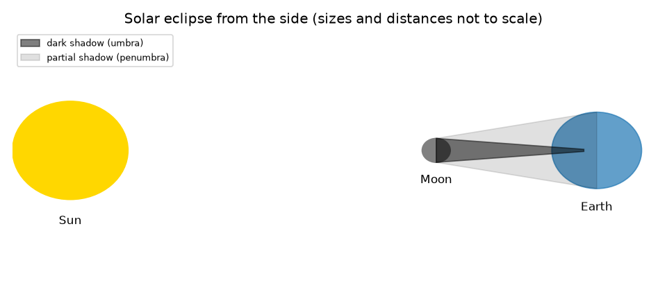
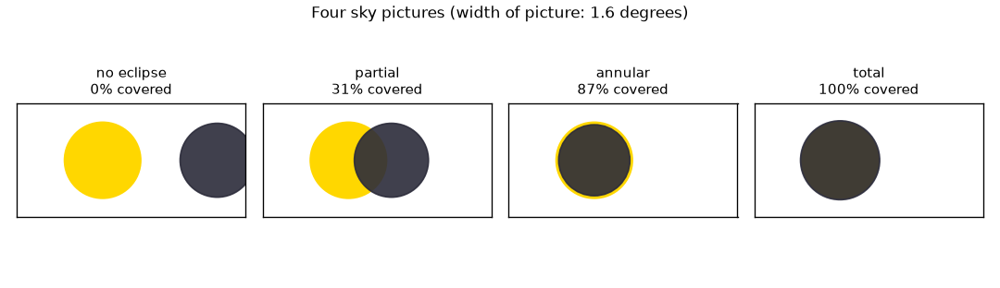

# सत्र 1: आकाश में दो चकतियाँ, ज़मीन पर एक छाया

*स्तर 1 (वैचारिक इंटरैक्टिव मॉडल) · लगभग 60 मिनट · openeclipse*

> यह एक सरलीकृत शैक्षिक मॉडल है। यह कोई प्रमाणित डिज़ाइन उपकरण नहीं है और इसका उपयोग वास्तविक संरचनाओं, बिजली की स्थापनाओं, वाहनों, औद्योगिक प्रक्रियाओं या चिकित्सा निर्णयों के लिए नहीं किया जाना चाहिए।

**पूर्वापेक्षाएँ (Prerequisites)**

- स्कूल की त्रिकोणमिति: किसी कोण का स्पर्शज्या (tangent)।
- आपने PRIMER.md पढ़ लिया है और `python start.py 1` एक बार चला लिया है।
- सुरक्षा: इस repo के लिए आपको कभी भी सूर्य की ओर देखने की ज़रूरत नहीं है।

**सीखने के उद्देश्य।** इस सत्र के बाद आप:

- सूर्य ग्रहण (solar eclipse) (चंद्रमा की छाया पृथ्वी पर पड़ती है) और चंद्र ग्रहण (lunar eclipse) (चंद्रमा पृथ्वी की छाया में प्रवेश करता है) का वर्णन कर सकेंगे।
- गणना कर सकेंगे कि आकाश में सूर्य और चंद्रमा कितने बड़े दिखते हैं और देख सकेंगे कि वे लगभग बराबर हैं।
- दोनों चकतियाँ कितनी अच्छी तरह एक सीध में आती हैं, इससे तय कर सकेंगे कि ग्रहण आंशिक (partial), पूर्ण (total) या वलयाकार (annular) है।
- चंद्रमा की वह दूरी ज्ञात कर सकेंगे जो पूर्ण ग्रहण को वलयाकार ग्रहण से अलग करती है।

## A. वास्तविक दुनिया की समस्या
साल में एक या दो बार, पृथ्वी पर कहीं न कहीं, दिन का आकाश कुछ मिनटों के लिए अँधेरा हो जाता है। सूर्य चंद्रमा से लगभग 400 गुना चौड़ा है, तो चंद्रमा उसे पूरी तरह कैसे छिपा सकता है? और यह ज़मीन पर केवल एक पतली पट्टी के साथ ही क्यों होता है? सुरक्षा: प्रमाणित ग्रहण चश्मे के बिना सूर्य को देखने से आँखों को नुक़सान होता है, तब भी जब सूर्य का अधिकांश भाग ढका हो। इस repo में सब कुछ गणना है; आपको कभी भी सूर्य की ओर देखने की ज़रूरत नहीं है। स्वास्थ्य टिप्पणी: यह केवल सामान्य शिक्षा है।

## B. अवधारणा और सिद्धांत
सूर्य ग्रहण तब होता है जब चंद्रमा सूर्य और पृथ्वी के बीच से गुज़रता है, जिससे चंद्रमा की छाया ज़मीन पर से होकर गुज़रती है। चंद्र ग्रहण तब होता है जब चंद्रमा पृथ्वी की छाया में चला जाता है। दृश्य को जो तय करता है वह है हर चकती का कोणीय आकार (angular size): दूरी d पर त्रिज्या r वाली गेंद एक ऐसा कोण घेरती है जिसके लिए tan(angle) = r/d। सूर्य चंद्रमा से 400.7 गुना चौड़ा है पर 389.2 गुना दूर है, इसलिए दोनों लगभग 0.5 डिग्री चौड़े दिखते हैं: सूर्य 0.533 डिग्री और अपनी औसत दूरी पर चंद्रमा 0.518 डिग्री। कोणीय त्रिज्याओं को rs (सूर्य) और rm (चंद्रमा) कहिए और दोनों चकतियों के केंद्रों के बीच की दूरी को sep। यदि sep कम से कम rs + rm है तो कोई ग्रहण नहीं; यदि चंद्रमा बड़ी चकती है और sep अधिकतम rm - rs है तो सूर्य पूरी तरह छिप जाता है; यदि चंद्रमा छोटी चकती है और sep अधिकतम rs - rm है तो एक चमकीला छल्ला बचता है (वलयाकार); इनके बीच का कुछ भी आंशिक है। चंद्रमा सूर्य से बड़ा केवल तभी होता है जब वह 373,355 km से निकट हो।

| प्रतीक | अर्थ | इकाई |
|---|---|---|
| r | सूर्य या चंद्रमा की त्रिज्या (696000 km, 1737 km) | km |
| d | सूर्य या चंद्रमा की दूरी | km |
| rs, rm | सूर्य की, चंद्रमा की कोणीय त्रिज्या | डिग्री |
| sep | दोनों केंद्रों के बीच कोणीय दूरी | डिग्री |
| v | चंद्रमा की कक्षीय चाल (1.023 km/s) | km/s |

**मान्यताएँ (Assumptions)**

- सूर्य और चंद्रमा पृथ्वी के केंद्र से देखे गए गोले हैं।
- जब तक अलग से न कहा जाए, सूर्य 1.496e8 km और चंद्रमा 384400 km दूर है।
- कोण छोटे हैं, इसलिए चकतियाँ एक सपाट आकाश चित्र में वृत्तों के रूप में बनाई गई हैं।

$$ \tan\alpha=\frac{r}{d} $$

$$ \text{total: } r_m\ge r_s \text{ and } \mathrm{sep}\le r_m-r_s;\qquad \text{annular: } r_s>r_m \text{ and } \mathrm{sep}\le r_s-r_m $$

$$ d_{\mathrm{crit}}=\frac{R_{\mathrm{Moon}}}{\tan r_s} $$

## C. दृश्य व्याख्या
पहला चित्र सूर्य, चंद्रमा और पृथ्वी को बगल से, गहरी छाया (प्रच्छाया, umbra) और आंशिक छाया (उपच्छाया, penumbra) के साथ दिखाता है; यह पैमाने पर नहीं है। दूसरा चित्र एक ही 1.6 डिग्री फ़्रेम में चार आकाश चित्र दिखाता है: कोई ग्रहण नहीं, एक आंशिक ग्रहण (सूर्य के क्षेत्रफल का 31 प्रतिशत ढका), 400000 km पर एक वलयाकार ग्रहण (87.1 प्रतिशत) और 360000 km पर एक पूर्ण ग्रहण (100 प्रतिशत)।

*बगल से सूर्य ग्रहण (पैमाने पर नहीं): गहरी प्रच्छाया और आंशिक छाया।*

*चार आकाश चित्र: कोई ग्रहण नहीं, आंशिक, वलयाकार और पूर्ण।*

## D. इंटरैक्टिव सिमुलेशन
पाठ चलाइए (`python start.py 1`), फिर लाइव ऐप खोलिए: [सत्र 1: आकाश में दो चकतियाँ](https://krunalpanchal1995.github.io/pan-iit-oss/openeclipse/session-01/) (या इसी फ़ोल्डर में `app.html`)। केंद्रों की दूरी और चंद्रमा की दूरी के स्लाइडर खिसकाइए और चकतियों को देखिए; केंद्रों के बीच की दूरी के सापेक्ष ढका हुआ अंश देखने के लिए ग्राफ़ पर जाइए।

**चुनौती।** एक पूर्ण ग्रहण बनाइए: चंद्रमा की ऐसी दूरी और ऐसा संरेखण (alignment) चुनिए जो पूरे सूर्य को छिपा दे।

## E. हल किया गया उदाहरण और प्रयोग
**समस्या।** चंद्रमा अपनी औसत दूरी 384400 km पर है और उसका केंद्र सूर्य के केंद्र से 0.30 डिग्री दूर है। यह किस प्रकार का ग्रहण है और सूर्य के क्षेत्रफल का कितना भाग छिपा है?

1. सूर्य: rs = arctan(696000 / 1.496e8) = 0.2666 डिग्री। चंद्रमा: rm = arctan(1737 / 384400) = 0.259 डिग्री।
2. rs + rm = 0.525 डिग्री। चूँकि sep = 0.30 इससे छोटा है, चकतियाँ एक-दूसरे पर चढ़ती हैं: किसी न किसी प्रकार का ग्रहण।
3. rm, rs से छोटा है और sep, rs - rm = 0.008 डिग्री से बड़ा है, इसलिए सूर्य पूरी तरह नहीं छिपता और कोई छल्ला नहीं बनता: आंशिक।
4. दो वृत्तों का अतिव्यापन (overlap) सूर्य के क्षेत्रफल का 0.306 ढका अंश देता है (लगभग 31 प्रतिशत)।

**उत्तर।** एक आंशिक ग्रहण, जिसमें सूर्य के क्षेत्रफल का लगभग 31 प्रतिशत ढका है।

**प्रयोग।** जिस रात चंद्रमा निकला हो, एक सिक्के को हाथ की पूरी लंबाई पर पकड़कर चंद्रमा की चौड़ाई से तुलना कीजिए (सूर्य के साथ ऐसा कभी न करें): 2.3 m पर रखा 20 mm का सिक्का 0.5 डिग्री चौड़ा दिखता है; बहुत से लोग हैरान होते हैं कि चंद्रमा कितना छोटा है। मॉडल बनाम वास्तविकता: मॉडल पूर्ण गोले और पृथ्वी के केंद्र पर बैठा प्रेक्षक मानता है, जबकि वास्तविक प्रेक्षक केंद्र से 6378 km तक दूर होता है, जिससे चकतियाँ लगभग 1 डिग्री तक खिसक जाती हैं। सत्र 2 में यह शामिल है।

## F. मूल्यांकन और डिज़ाइन चुनौती
**प्रश्न प्रकार A: वैचारिक।** सूर्य चंद्रमा से लगभग 400 गुना चौड़ा है। फिर भी चंद्रमा उसे क्यों छिपा सकता है?

संकेत

व्यासों के अनुपात की तुलना दूरियों के अनुपात से कीजिए।

चरण-दर-चरण हल

आभासी आकार, आकार को दूरी से भाग देने पर निर्भर करता है। व्यासों का अनुपात 400.7 है और दूरियों का अनुपात 389.2, लगभग समान, इसलिए दोनों चकतियाँ लगभग बराबर चौड़ी दिखती हैं: 0.533 डिग्री और 0.518 डिग्री। क्योंकि चंद्रमा की दूरी बदलती रहती है, वह कभी सूर्य से थोड़ा बड़ा (पूर्ण ग्रहण) और कभी थोड़ा छोटा (वलयाकार) होता है।

**प्रश्न प्रकार B: संख्यात्मक।** चंद्रमा 400000 km पर है और उसका केंद्र ठीक सूर्य के केंद्र पर है। rm और सूर्य के क्षेत्रफल का ढका अंश ज्ञात कीजिए।

संकेत

rm = arctan(1737 / d); यदि छोटी चकती पूरी तरह बड़ी के अंदर है, तो अंश (छोटी त्रिज्या / बड़ी त्रिज्या) का वर्ग है।

चरण-दर-चरण हल

rm = arctan(1737 / 400000) = 0.2488 डिग्री। चूँकि rm, rs = 0.2666 से छोटा है, चंद्रमा सूर्य की चकती के अंदर रहता है: वलयाकार। ढका अंश = (0.2488 / 0.2666)^2 = 0.871, यानी 87.1 प्रतिशत। समझदारी जाँच: यह 100 प्रतिशत से कम है, क्योंकि सूर्य का एक छल्ला बचा रहता है।

**प्रश्न प्रकार C: ग्राफ़ और सिमुलेशन की व्याख्या।** औसत चंद्रमा के लिए केंद्र-दूरी के सापेक्ष ढके अंश के ग्राफ़ पर, वक्र लगभग किस दूरी पर शून्य पर पहुँचता है? 360000 km पर चंद्रमा के लिए वक्र बाएँ सिरे पर 'सपाट' क्यों है?

संकेत

कोणीय त्रिज्याओं का योग उपयोग कीजिए; दूसरे भाग के लिए rm - rs की तुलना सपाट हिस्से से कीजिए।

चरण-दर-चरण हल

यह sep = rs + rm = 0.525 डिग्री पर शून्य पर पहुँचता है, जब किनारे बस छूते हैं। 360000 km पर चंद्रमा सूर्य से 0.0099 डिग्री बड़ा है, इसलिए 0 से 0.0099 डिग्री तक किसी भी sep के लिए पूरा सूर्य छिपा रहता है और वक्र 1 (100 प्रतिशत) पर बना रहता है।

**प्रश्न प्रकार D: डिज़ाइन और अनुकूलन (optimisation) चुनौती।** डिज़ाइन: एक फ़ोटोग्राफ़र ऐसे स्थान से पूर्ण ग्रहण चाहता है जहाँ चकतियाँ बिल्कुल एक सीध में हों। चंद्रमा की दूरी को कौन-सी शर्त पूरी करनी चाहिए, और यदि चंद्रमा 360000 km पर हो तो चकतियों को कितनी अच्छी तरह संरेखित होना चाहिए?

संकेत

पूर्ण ग्रहण के लिए rm कम से कम rs होना चाहिए; फिर sep, rm - rs से अधिक नहीं होना चाहिए।

चरण-दर-चरण हल

चंद्रमा 373,355 km से निकट होना चाहिए, ताकि rm कम से कम rs हो। 360000 km पर rm - rs = 0.0099 डिग्री, इसलिए केंद्र एक-दूसरे से 0.0099 डिग्री के भीतर होने चाहिए। समझौता (trade-off): निकट चंद्रमा अधिक गुंजाइश देता है, इसलिए पूर्ण चरण लंबा होता है और पट्टी चौड़ी (सत्र 2)।

[RUBRIC.md](../../RUBRIC.md) से स्वयं को अंक दीजिए। काग़ज़ पर काम करने के लिए [गतिविधि पत्रक](activity_sheet.md) प्रिंट कीजिए।

## सामान्य भ्रांतियाँ
| सामान्य भ्रांति | वास्तव में क्या सच है |
|---|---|
| चंद्रमा सूर्य को इसलिए ढकता है क्योंकि वह उतने ही आकार का है। | चंद्रमा लगभग 400 गुना छोटा है; वह लगभग 389 गुना निकट भी है, इसलिए आकाश में उतना ही बड़ा दिखता है। |
| हर पूर्ण ग्रहण एक जैसा दिखता है। | दूर वाले चंद्रमा पर (पूर्ण ग्रहण के लिए 373,355 km से कम चाहिए) चंद्रमा बहुत छोटा होता है और एक छल्ला छोड़ देता है: वलयाकार ग्रहण। |
| आंशिक ग्रहण को देखना सुरक्षित है। | प्रमाणित ग्रहण चश्मे के बिना सूर्य को कभी न देखें, तब भी जब उसका अधिकांश भाग ढका हो। |
| चंद्र ग्रहण और सूर्य ग्रहण एक ही चीज़ हैं जो अलग-अलग जगहों से दिखती है। | सूर्य ग्रहण में चंद्रमा की छाया पृथ्वी पर पड़ती है; चंद्र ग्रहण में चंद्रमा पृथ्वी की छाया के अंदर होता है, और रात वाले हिस्से में हर कोई उसे देखता है। |

## शब्दावली
- **कोणीय आकार (angular size)**: आकाश में कोई चकती जितना कोण घेरती है, डिग्री में
- **प्रच्छाया (umbra)**: छाया का सबसे गहरा भाग, जहाँ सूर्य पूरी तरह छिपा होता है
- **उपच्छाया (penumbra)**: छाया का हल्का भाग, जहाँ सूर्य आंशिक रूप से छिपा होता है
- **वलयाकार ग्रहण (annular eclipse)**: ऐसा ग्रहण जिसमें चंद्रमा के चारों ओर सूर्य का एक चमकीला छल्ला बचा रहता है
- **पूर्णता (totality)**: वह समय जिसके दौरान सूर्य पूरी तरह छिपा रहता है

## समापन
1. [exercises.md](exercises.md) में दिए तीन कोडिंग कार्य कीजिए।
2. अपने बदलावों के बाद `python start.py 1` फिर से चलाइए। यह चेकपॉइंट (checkpoint) पर समाप्त होता है; जब यह `PASS` छापे, तो आपका काम पूरा है। (केवल चेकपॉइंट: `python start.py check 1`।)

अगला: [सत्र 2](../session-02/README.md)
