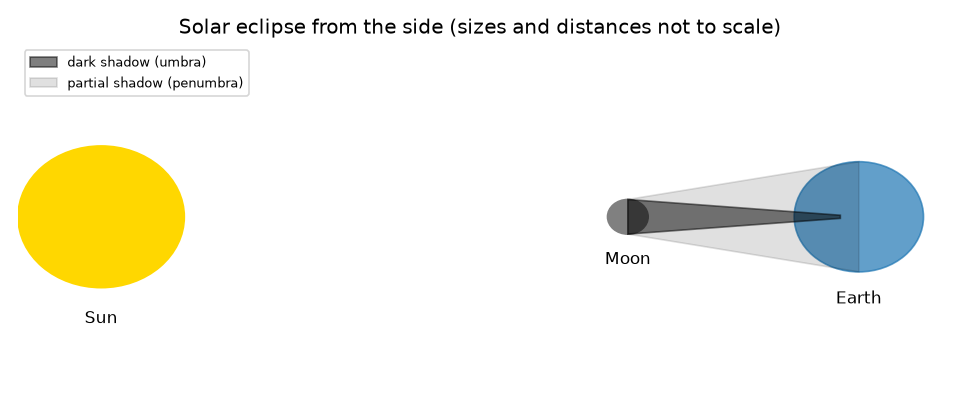
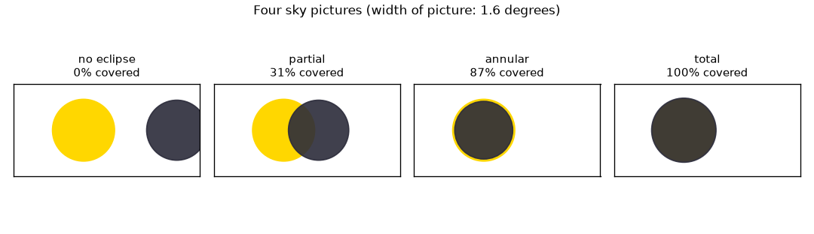

# സെഷൻ 1: ആകാശത്ത് രണ്ട് ഡിസ്കുകൾ, നിലത്ത് ഒരു നിഴൽ

[Session 1 — हिन्दी](README.hi.md)

*ലെവൽ 1 (ആശയപരമായ ഇന്ററാക്ടീവ് മോഡൽ) · ഏകദേശം 60 മിനിറ്റ് · openeclipse*

> ഇത് ലളിതമാക്കിയ ഒരു വിദ്യാഭ്യാസ മോഡൽ ആണ്. ഇത് സാധൂകരിച്ച (validated) ഡിസൈൻ ഉപകരണമല്ല; യഥാർത്ഥ നിർമിതികൾ, വൈദ്യുത ഇൻസ്റ്റലേഷനുകൾ, വാഹനങ്ങൾ, വ്യാവസായിക പ്രക്രിയകൾ അല്ലെങ്കിൽ വൈദ്യശാസ്ത്ര തീരുമാനങ്ങൾ എന്നിവയ്ക്ക് ഇത് ഉപയോഗിക്കരുത്.

**മുൻകൂട്ടി അറിയേണ്ടവ (Prerequisites)**

- സ്കൂൾ ത്രികോണമിതി: ഒരു കോണിന്റെ ടാൻജന്റ് (tangent).
- നിങ്ങൾ PRIMER.md വായിച്ചിട്ടുണ്ട്, `python start.py 1` ഒരിക്കൽ റൺ ചെയ്തിട്ടുണ്ട്.
- സുരക്ഷ: ഈ റിപ്പോയ്ക്കായി നിങ്ങൾ ഒരിക്കലും സൂര്യനെ നോക്കേണ്ടതില്ല.

**പഠന ലക്ഷ്യങ്ങൾ (Learning objectives).** ഈ സെഷനു ശേഷം നിങ്ങൾക്ക്:

- സൂര്യഗ്രഹണവും (solar eclipse; ചന്ദ്രന്റെ നിഴൽ ഭൂമിയിൽ വീഴുന്നു) ചന്ദ്രഗ്രഹണവും (lunar eclipse; ചന്ദ്രൻ ഭൂമിയുടെ നിഴലിൽ പ്രവേശിക്കുന്നു) വിവരിക്കാം.
- ആകാശത്ത് സൂര്യനും ചന്ദ്രനും എത്ര വലുതായി കാണപ്പെടുന്നു എന്ന് കണക്കാക്കി അവ ഏകദേശം തുല്യമാണെന്ന് കാണാം.
- രണ്ട് ഡിസ്കുകളും എത്ര നന്നായി നിരക്കുന്നു എന്നതിൽ നിന്ന് ഭാഗികം, പൂർണ്ണം അല്ലെങ്കിൽ വലയം (annular) എന്ന് തീരുമാനിക്കാം.
- പൂർണ്ണ ഗ്രഹണങ്ങളെ വലയ ഗ്രഹണങ്ങളിൽ നിന്ന് വേർതിരിക്കുന്ന ചന്ദ്ര ദൂരം കണ്ടെത്താം.

## A. യഥാർത്ഥ ലോക പ്രശ്നം
വർഷത്തിൽ ഒന്നോ രണ്ടോ തവണ, ഭൂമിയിൽ എവിടെയെങ്കിലും, പകൽ ആകാശം ഏതാനും മിനിറ്റുകൾ ഇരുണ്ടുപോകുന്നു. സൂര്യന് ചന്ദ്രനേക്കാൾ ഏകദേശം 400 മടങ്ങ് വീതിയുണ്ട്, അപ്പോൾ ചന്ദ്രന് അതിനെ എങ്ങനെ പൂർണ്ണമായി മറയ്ക്കാനാകും? എന്തുകൊണ്ടാണ് ഇത് നിലത്ത് ഒരു നേർത്ത പാതയിൽ മാത്രം സംഭവിക്കുന്നത്? സുരക്ഷ: സാക്ഷ്യപ്പെടുത്തിയ ഗ്രഹണ കണ്ണടകൾ ഇല്ലാതെ സൂര്യനെ നോക്കുന്നത്, സൂര്യൻ ഏറെക്കുറെ മറഞ്ഞിരിക്കുമ്പോൾ പോലും, കണ്ണുകൾക്ക് കേടുവരുത്തും. ഈ റിപ്പോയിലെ എല്ലാം കണക്കുകൂട്ടലാണ്; നിങ്ങൾ ഒരിക്കലും സൂര്യനെ നോക്കേണ്ടതില്ല. ആരോഗ്യ കുറിപ്പ്: ഇത് പൊതുവായ വിദ്യാഭ്യാസം മാത്രമാണ്.

## B. ആശയവും സിദ്ധാന്തവും
ചന്ദ്രൻ സൂര്യനും ഭൂമിക്കും ഇടയിലൂടെ കടന്നുപോകുമ്പോൾ ഒരു സൂര്യഗ്രഹണം സംഭവിക്കുന്നു, അതിനാൽ ചന്ദ്രന്റെ നിഴൽ നിലത്തുകൂടി നീങ്ങുന്നു. ചന്ദ്രൻ ഭൂമിയുടെ നിഴലിലേക്ക് കടക്കുമ്പോൾ ഒരു ചന്ദ്രഗ്രഹണം സംഭവിക്കുന്നു. കാഴ്ച തീരുമാനിക്കുന്നത് ഓരോ ഡിസ്കിന്റെയും കോണീയ വലിപ്പമാണ് (angular size): d ദൂരത്തിലുള്ള r ആരമുള്ള ഒരു ഗോളം tan(angle) = r/d ആകുന്ന ഒരു കോൺ ഉൾക്കൊള്ളുന്നു. സൂര്യന് ചന്ദ്രനേക്കാൾ 400.7 മടങ്ങ് വീതിയുണ്ട്, എന്നാൽ 389.2 മടങ്ങ് അകലെയാണ്, അതിനാൽ രണ്ടും ഏകദേശം 0.5 ഡിഗ്രി വീതിയുള്ളതായി കാണപ്പെടുന്നു: സൂര്യന് 0.533 ഡിഗ്രി, ശരാശരി ദൂരത്തിലുള്ള ചന്ദ്രന് 0.518 ഡിഗ്രി. കോണീയ ആരങ്ങളെ rs (സൂര്യൻ), rm (ചന്ദ്രൻ) എന്നും രണ്ട് ഡിസ്ക് കേന്ദ്രങ്ങൾ തമ്മിലുള്ള ദൂരത്തെ sep എന്നും വിളിക്കുക. sep കുറഞ്ഞത് rs + rm ആണെങ്കിൽ ഗ്രഹണമില്ല; ചന്ദ്രൻ വലിയ ഡിസ്കും sep പരമാവധി rm - rs-ഉം ആണെങ്കിൽ സൂര്യൻ പൂർണ്ണമായി മറയുന്നു; ചന്ദ്രൻ ചെറിയ ഡിസ്കും sep പരമാവധി rs - rm-ഉം ആണെങ്കിൽ തിളങ്ങുന്ന ഒരു വലയം ബാക്കിയാകുന്നു (വലയം, annular); ഇവയ്ക്കിടയിലുള്ളതെല്ലാം ഭാഗികം. ചന്ദ്രൻ 373,355 km-നേക്കാൾ അടുത്തായിരിക്കുമ്പോൾ മാത്രമേ സൂര്യനേക്കാൾ വലുതാകൂ.

| ചിഹ്നം | അർത്ഥം | യൂണിറ്റ് |
|---|---|---|
| r | സൂര്യന്റെയോ ചന്ദ്രന്റെയോ ആരം (696000 km, 1737 km) | km |
| d | സൂര്യനിലേക്കോ ചന്ദ്രനിലേക്കോ ഉള്ള ദൂരം | km |
| rs, rm | സൂര്യന്റെ, ചന്ദ്രന്റെ കോണീയ ആരം | ഡിഗ്രി |
| sep | രണ്ട് കേന്ദ്രങ്ങൾ തമ്മിലുള്ള കോണീയ ദൂരം | ഡിഗ്രി |
| v | ചന്ദ്രന്റെ പരിക്രമണ വേഗത (1.023 km/s) | km/s |

**അനുമാനങ്ങൾ (Assumptions)**

- സൂര്യനും ചന്ദ്രനും ഭൂമിയുടെ കേന്ദ്രത്തിൽ നിന്ന് കാണുന്ന ഗോളങ്ങളാണ്.
- മറ്റൊന്ന് പറഞ്ഞില്ലെങ്കിൽ സൂര്യൻ 1.496e8 km അകലെയും ചന്ദ്രൻ 384400 km അകലെയുമാണ്.
- കോണുകൾ ചെറുതാണ്, അതിനാൽ ഡിസ്കുകൾ പരന്ന ആകാശ ചിത്രത്തിൽ വൃത്തങ്ങളായി വരയ്ക്കുന്നു.

$$ \tan\alpha=\frac{r}{d} $$

$$ \text{total: } r_m\ge r_s \text{ and } \mathrm{sep}\le r_m-r_s;\qquad \text{annular: } r_s>r_m \text{ and } \mathrm{sep}\le r_s-r_m $$

$$ d_{\mathrm{crit}}=\frac{R_{\mathrm{Moon}}}{\tan r_s} $$

## C. ദൃശ്യ വിശദീകരണം
ആദ്യ ചിത്രം സൂര്യൻ, ചന്ദ്രൻ, ഭൂമി എന്നിവയെ വശത്തുനിന്ന് ഇരുണ്ട നിഴലും (പ്രച്ഛായ, umbra) ഭാഗിക നിഴലും (ഉപച്ഛായ, penumbra) സഹിതം വരയ്ക്കുന്നു; ഇത് സ്കെയിലിലല്ല. രണ്ടാമത്തെ ചിത്രം ഒരേ 1.6 ഡിഗ്രി ഫ്രെയിമുള്ള നാല് ആകാശ ചിത്രങ്ങൾ കാണിക്കുന്നു: ഗ്രഹണമില്ല, ഒരു ഭാഗിക ഗ്രഹണം (സൂര്യന്റെ വിസ്തീർണ്ണത്തിന്റെ 31 ശതമാനം മറഞ്ഞത്), 400000 km-ൽ ഒരു വലയ ഗ്രഹണം (87.1 ശതമാനം), 360000 km-ൽ ഒരു പൂർണ്ണ ഗ്രഹണം (100 ശതമാനം).

*വശത്തുനിന്നുള്ള സൂര്യഗ്രഹണം (സ്കെയിലിലല്ല): ഇരുണ്ട പ്രച്ഛായയും ഭാഗിക നിഴലും.*

*നാല് ആകാശ ചിത്രങ്ങൾ: ഗ്രഹണമില്ല, ഭാഗികം, വലയം, പൂർണ്ണം.*

## D. ഇന്ററാക്ടീവ് സിമുലേഷൻ
പാഠം റൺ ചെയ്യുക (`python start.py 1`), തുടർന്ന് ലൈവ് ആപ്പ് തുറക്കുക: [സെഷൻ 1: ആകാശത്ത് രണ്ട് ഡിസ്കുകൾ](https://krunalpanchal1995.github.io/pan-iit-oss/openeclipse/session-01/) (അല്ലെങ്കിൽ ഈ ഫോൾഡറിലെ `app.html`). കേന്ദ്ര ദൂരവും ചന്ദ്ര ദൂരവും സ്ലൈഡ് ചെയ്ത് ഡിസ്കുകൾ നിരീക്ഷിക്കുക; കേന്ദ്രങ്ങൾ തമ്മിലുള്ള ദൂരത്തിനെതിരെ മറഞ്ഞ ഭാഗം കാണാൻ ഗ്രാഫിലേക്ക് മാറുക.

**വെല്ലുവിളി.** ഒരു പൂർണ്ണ ഗ്രഹണം ഉണ്ടാക്കുക: സൂര്യനെ മുഴുവനായി മറയ്ക്കുന്ന ഒരു ചന്ദ്ര ദൂരവും ഒരു നിരക്കലും തിരഞ്ഞെടുക്കുക.

## E. ഉദാഹരണവും പരീക്ഷണവും
**പ്രശ്നം.** ചന്ദ്രൻ അതിന്റെ ശരാശരി ദൂരമായ 384400 km-ലാണ്, അതിന്റെ കേന്ദ്രം സൂര്യന്റെ കേന്ദ്രത്തിൽ നിന്ന് 0.30 ഡിഗ്രി അകലെയാണ്. ഇത് ഏത് തരം ഗ്രഹണമാണ്, സൂര്യന്റെ വിസ്തീർണ്ണത്തിന്റെ എത്ര ഭാഗം മറഞ്ഞിരിക്കുന്നു?

1. സൂര്യൻ: rs = arctan(696000 / 1.496e8) = 0.2666 ഡിഗ്രി. ചന്ദ്രൻ: rm = arctan(1737 / 384400) = 0.259 ഡിഗ്രി.
2. rs + rm = 0.525 ഡിഗ്രി. sep = 0.30 അതിനേക്കാൾ ചെറുതായതിനാൽ ഡിസ്കുകൾ ഓവർലാപ്പ് ചെയ്യുന്നു: ഏതെങ്കിലും തരത്തിലുള്ള ഒരു ഗ്രഹണം.
3. rm, rs-നേക്കാൾ ചെറുതാണ്, sep, rs - rm = 0.008 ഡിഗ്രിയേക്കാൾ വലുതാണ്, അതിനാൽ സൂര്യൻ പൂർണ്ണമായി മറയുന്നില്ല, വലയവും ഉണ്ടാകുന്നില്ല: ഭാഗികം.
4. രണ്ട് വൃത്തങ്ങളുടെ ഓവർലാപ്പ് സൂര്യന്റെ വിസ്തീർണ്ണത്തിന്റെ 0.306 മറഞ്ഞ ഭാഗം നൽകുന്നു (ഏകദേശം 31 ശതമാനം).

**ഉത്തരം.** സൂര്യന്റെ വിസ്തീർണ്ണത്തിന്റെ ഏകദേശം 31 ശതമാനം മറഞ്ഞ ഒരു ഭാഗിക ഗ്രഹണം.

**പരീക്ഷണം.** ചന്ദ്രൻ ഉദിച്ചിരിക്കുന്ന ഒരു രാത്രിയിൽ കൈനീളത്തിൽ ഒരു നാണയം പിടിച്ച് ചന്ദ്രന്റെ വീതിയുമായി താരതമ്യം ചെയ്യുക (സൂര്യനുമായി ഒരിക്കലും ഇത് ചെയ്യരുത്): 2.3 m-ലുള്ള 20 mm നാണയം 0.5 ഡിഗ്രി വീതിയുള്ളതായി കാണപ്പെടുന്നു; ചന്ദ്രൻ എത്ര ചെറുതാണെന്ന് കണ്ട് പലരും അത്ഭുതപ്പെടുന്നു. മോഡലും യാഥാർത്ഥ്യവും: മോഡൽ തികഞ്ഞ ഗോളങ്ങളും ഭൂമിയുടെ കേന്ദ്രത്തിലുള്ള ഒരു നിരീക്ഷകനെയും ഉപയോഗിക്കുന്നു, എന്നാൽ യഥാർത്ഥ നിരീക്ഷകൻ കേന്ദ്രത്തിൽ നിന്ന് 6378 km വരെ അകലെയാണ്, ഇത് ഡിസ്കുകളെ ഏകദേശം 1 ഡിഗ്രി വരെ നീക്കുന്നു. സെഷൻ 2 അത് ഉൾപ്പെടുത്തുന്നു.

## F. വിലയിരുത്തലും ഡിസൈൻ വെല്ലുവിളിയും
**ചോദ്യ തരം A: ആശയപരം.** സൂര്യന് ചന്ദ്രനേക്കാൾ ഏകദേശം 400 മടങ്ങ് വീതിയുണ്ട്. എന്നിട്ടും ചന്ദ്രന് അതിനെ മറയ്ക്കാനാകുന്നത് എന്തുകൊണ്ട്?

സൂചന

വ്യാസങ്ങളുടെ അനുപാതത്തെ ദൂരങ്ങളുടെ അനുപാതവുമായി താരതമ്യം ചെയ്യുക.

ഘട്ടം ഘട്ടമായുള്ള പരിഹാരം

കാണപ്പെടുന്ന വലിപ്പം വലിപ്പത്തെ ദൂരം കൊണ്ട് ഹരിച്ചതിനെ ആശ്രയിച്ചിരിക്കുന്നു. വ്യാസ അനുപാതം 400.7 ഉം ദൂര അനുപാതം 389.2 ഉം ആണ്, ഏകദേശം ഒന്നുതന്നെ, അതിനാൽ രണ്ട് ഡിസ്കുകളും ഏകദേശം തുല്യ വീതിയുള്ളതായി കാണപ്പെടുന്നു: 0.533 ഡിഗ്രിയും 0.518 ഡിഗ്രിയും. ചന്ദ്രന്റെ ദൂരം മാറുന്നതിനാൽ, അത് ചിലപ്പോൾ സൂര്യനേക്കാൾ അൽപ്പം വലുതും (പൂർണ്ണ ഗ്രഹണം) ചിലപ്പോൾ അൽപ്പം ചെറുതുമാണ് (വലയം).

**ചോദ്യ തരം B: സംഖ്യാപരം.** ചന്ദ്രൻ 400000 km-ലാണ്, അതിന്റെ കേന്ദ്രം കൃത്യമായി സൂര്യന്റെ കേന്ദ്രത്തിൽ. rm-ഉം സൂര്യന്റെ വിസ്തീർണ്ണത്തിന്റെ മറഞ്ഞ ഭാഗവും കണ്ടെത്തുക.

സൂചന

rm = arctan(1737 / d); ചെറിയ ഡിസ്ക് പൂർണ്ണമായി വലിയതിനുള്ളിലാണെങ്കിൽ, ഭാഗം (ചെറിയ ആരം / വലിയ ആരം) വർഗ്ഗം ആണ്.

ഘട്ടം ഘട്ടമായുള്ള പരിഹാരം

rm = arctan(1737 / 400000) = 0.2488 ഡിഗ്രി. rm, rs = 0.2666-നേക്കാൾ ചെറുതായതിനാൽ ചന്ദ്രൻ സൂര്യന്റെ ഡിസ്കിനുള്ളിലാണ്: വലയം. മറഞ്ഞ ഭാഗം = (0.2488 / 0.2666)^2 = 0.871, അതായത് 87.1 ശതമാനം. യുക്തി പരിശോധന: സൂര്യന്റെ ഒരു വലയം ബാക്കിയുള്ളതിനാൽ ഇത് 100 ശതമാനത്തിന് താഴെയാണ്.

**ചോദ്യ തരം C: ഗ്രാഫും സിമുലേഷനും വ്യാഖ്യാനിക്കൽ.** ശരാശരി ചന്ദ്രനുള്ള, കേന്ദ്ര ദൂരത്തിനെതിരെ മറഞ്ഞ ഭാഗത്തിന്റെ ഗ്രാഫിൽ, ഏകദേശം ഏത് ദൂരത്തിലാണ് വക്രം പൂജ്യത്തിലെത്തുന്നത്? 360000 km-ലുള്ള ചന്ദ്രന് ഇടത് അറ്റത്ത് വക്രം 'പരന്നത്' ആകുന്നത് എന്തുകൊണ്ട്?

സൂചന

കോണീയ ആരങ്ങളുടെ തുക ഉപയോഗിക്കുക; രണ്ടാം ഭാഗത്തിന് rm - rs-നെ പരന്ന ഭാഗവുമായി താരതമ്യം ചെയ്യുക.

ഘട്ടം ഘട്ടമായുള്ള പരിഹാരം

അരികുകൾ കഷ്ടിച്ച് തൊടുമ്പോൾ, sep = rs + rm = 0.525 ഡിഗ്രിയിൽ അത് പൂജ്യത്തിലെത്തുന്നു. 360000 km-ലുള്ള ചന്ദ്രന് ചന്ദ്രൻ സൂര്യനേക്കാൾ 0.0099 ഡിഗ്രി വലുതാണ്, അതിനാൽ 0 മുതൽ 0.0099 ഡിഗ്രി വരെയുള്ള ഏത് sep-നും സൂര്യൻ മുഴുവൻ മറയുന്നു, വക്രം 1-ൽ (100 ശതമാനം) തുടരുന്നു.

**ചോദ്യ തരം D: ഡിസൈനും ഒപ്റ്റിമൈസേഷനും വെല്ലുവിളി.** ഡിസൈൻ: ഡിസ്കുകൾ കൃത്യമായി നിരക്കുന്ന ഒരു സ്ഥലത്ത് നിന്ന് ഒരു ഫോട്ടോഗ്രാഫർക്ക് പൂർണ്ണ ഗ്രഹണം വേണം. ചന്ദ്രന്റെ ദൂരം എന്ത് വ്യവസ്ഥ പാലിക്കണം, ചന്ദ്രൻ 360000 km-ലാണെങ്കിൽ ഡിസ്കുകൾ എത്ര നന്നായി നിരക്കണം?

സൂചന

പൂർണ്ണത്തിന് rm കുറഞ്ഞത് rs ആയിരിക്കണം; തുടർന്ന് sep, rm - rs-നേക്കാൾ കൂടരുത്.

ഘട്ടം ഘട്ടമായുള്ള പരിഹാരം

rm കുറഞ്ഞത് rs ആകാൻ ചന്ദ്രൻ 373,355 km-നേക്കാൾ അടുത്തായിരിക്കണം. 360000 km-ൽ rm - rs = 0.0099 ഡിഗ്രി, അതിനാൽ കേന്ദ്രങ്ങൾ പരസ്പരം 0.0099 ഡിഗ്രിക്കുള്ളിൽ ആയിരിക്കണം. വിട്ടുവീഴ്ച (trade-off): അടുത്തുള്ള ചന്ദ്രൻ വലിയ മാർജിൻ നൽകുന്നു, അതിനാൽ പൂർണ്ണ ഘട്ടം കൂടുതൽ നീളുന്നു, പാത വീതിയേറുന്നു (സെഷൻ 2).

[RUBRIC.md](../../RUBRIC.md) ഉപയോഗിച്ച് സ്വയം സ്കോർ ചെയ്യുക. പേപ്പറിൽ ചെയ്യാൻ [ആക്ടിവിറ്റി ഷീറ്റ്](activity_sheet.md) പ്രിന്റ് ചെയ്യുക.

## സാധാരണ തെറ്റിദ്ധാരണകൾ
| സാധാരണ തെറ്റിദ്ധാരണ | യഥാർത്ഥത്തിൽ ശരിയായത് |
|---|---|
| ചന്ദ്രൻ സൂര്യനെ മറയ്ക്കുന്നത് അത് ഒരേ വലിപ്പമായതിനാലാണ്. | ചന്ദ്രൻ ഏകദേശം 400 മടങ്ങ് ചെറുതാണ്; അത് ഏകദേശം 389 മടങ്ങ് അടുത്തുമാണ്, അതിനാൽ ആകാശത്ത് ഒരേ വലിപ്പമായി കാണപ്പെടുന്നു. |
| എല്ലാ പൂർണ്ണ ഗ്രഹണങ്ങളും ഒരുപോലെ കാണപ്പെടുന്നു. | കൂടുതൽ അകലെയുള്ള ചന്ദ്രനിൽ (പൂർണ്ണത്തിന് 373,355 km-ന് താഴെ വേണം) ചന്ദ്രൻ വളരെ ചെറുതാണ്, ഒരു വലയം ബാക്കിയാക്കുന്നു: ഒരു വലയ ഗ്രഹണം. |
| ഒരു ഭാഗിക ഗ്രഹണം നോക്കുന്നത് സുരക്ഷിതമാണ്. | സൂര്യന്റെ ഭൂരിഭാഗവും മറഞ്ഞിരിക്കുമ്പോൾ പോലും, സാക്ഷ്യപ്പെടുത്തിയ ഗ്രഹണ കണ്ണടകൾ ഇല്ലാതെ ഒരിക്കലും സൂര്യനെ നോക്കരുത്. |
| ചന്ദ്രഗ്രഹണവും സൂര്യഗ്രഹണവും വ്യത്യസ്ത സ്ഥലങ്ങളിൽ നിന്ന് കാണുന്ന ഒരേ കാര്യമാണ്. | സൂര്യഗ്രഹണത്തിൽ ചന്ദ്രന്റെ നിഴൽ ഭൂമിയിൽ വീഴുന്നു; ചന്ദ്രഗ്രഹണത്തിൽ ചന്ദ്രൻ ഭൂമിയുടെ നിഴലിനുള്ളിലാണ്, രാത്രി വശത്തുള്ള എല്ലാവരും അത് കാണുന്നു. |

## പദാവലി (Glossary)
- **കോണീയ വലിപ്പം (angular size)**: ഒരു ഡിസ്ക് ആകാശത്ത് ഉൾക്കൊള്ളുന്ന കോൺ, ഡിഗ്രിയിൽ
- **പ്രച്ഛായ (umbra)**: സൂര്യൻ പൂർണ്ണമായി മറഞ്ഞിരിക്കുന്ന, നിഴലിന്റെ ഏറ്റവും ഇരുണ്ട ഭാഗം
- **ഉപച്ഛായ (penumbra)**: സൂര്യൻ ഭാഗികമായി മറഞ്ഞിരിക്കുന്ന, നിഴലിന്റെ ഇളം ഭാഗം
- **വലയ ഗ്രഹണം (annular eclipse)**: ചന്ദ്രന് ചുറ്റും സൂര്യന്റെ തിളങ്ങുന്ന ഒരു വലയം ബാക്കിയാകുന്ന ഗ്രഹണം
- **പൂർണ്ണത (totality)**: സൂര്യൻ പൂർണ്ണമായി മറഞ്ഞിരിക്കുന്ന സമയം

## പൂർത്തിയാക്കുക
1. [exercises.md](exercises.md)-ലെ മൂന്ന് കോഡിംഗ് ടാസ്കുകൾ ചെയ്യുക.
2. നിങ്ങളുടെ മാറ്റങ്ങൾക്ക് ശേഷം `python start.py 1` വീണ്ടും റൺ ചെയ്യുക. അത് ചെക്ക്‌പോയിന്റോടെ അവസാനിക്കുന്നു; അത് `PASS` പ്രിന്റ് ചെയ്യുമ്പോൾ നിങ്ങൾ പൂർത്തിയാക്കി. (ചെക്ക്‌പോയിന്റ് മാത്രം: `python start.py check 1`.)

അടുത്തത്: [സെഷൻ 2](../session-02/README.md)
