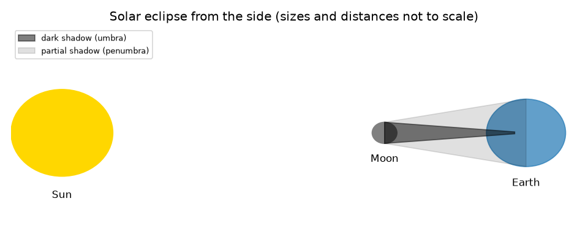
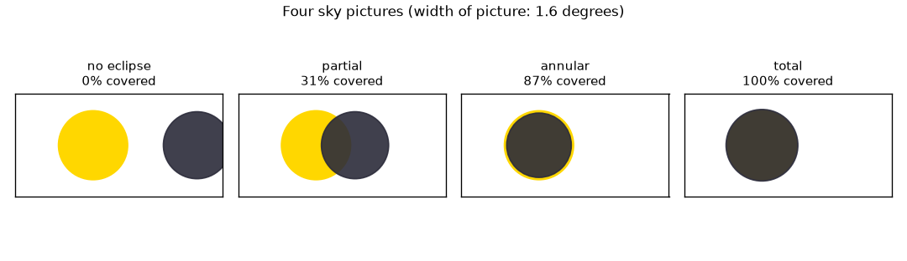

# அமர்வு 1: வானில் இரண்டு வட்டுகள், தரையில் ஒரு நிழல்

[Session 1 — हिन्दी](README.hi.md)

*நிலை 1 (கருத்தியல் ஊடாடும் மாதிரி) · சுமார் 60 நிமிடங்கள் · openeclipse*

> இது எளிமைப்படுத்தப்பட்ட ஒரு கல்வி மாதிரி. இது சரிபார்க்கப்பட்ட (validated) வடிவமைப்புக் கருவி அல்ல; உண்மையான கட்டமைப்புகள், மின் நிறுவல்கள், வாகனங்கள், தொழிற்சாலை செயல்முறைகள் அல்லது மருத்துவ முடிவுகளுக்கு இதைப் பயன்படுத்தக் கூடாது.

**முன்தேவைகள் (Prerequisites)**

- பள்ளி முக்கோணவியல்: ஒரு கோணத்தின் டேன்ஜென்ட் (tangent).
- நீங்கள் PRIMER.md படித்து, `python start.py 1` ஒருமுறை இயக்கியுள்ளீர்கள்.
- பாதுகாப்பு: இந்த ரெப்போவுக்காக நீங்கள் ஒருபோதும் சூரியனைப் பார்க்க வேண்டியதில்லை.

**கற்றல் நோக்கங்கள் (Learning objectives).** இந்த அமர்வுக்குப் பிறகு நீங்கள்:

- சூரிய கிரகணத்தையும் (solar eclipse; சந்திரனின் நிழல் பூமியில் விழுகிறது) சந்திர கிரகணத்தையும் (lunar eclipse; சந்திரன் பூமியின் நிழலுக்குள் நுழைகிறது) விவரிக்கலாம்.
- வானில் சூரியனும் சந்திரனும் எவ்வளவு பெரியதாகத் தோன்றுகின்றன என்று கணக்கிட்டு, அவை கிட்டத்தட்ட சமம் என்பதைக் காணலாம்.
- இரண்டு வட்டுகளும் எவ்வளவு நன்றாக ஒரே கோட்டில் வருகின்றன என்பதிலிருந்து பகுதி, முழு அல்லது வளைய (annular) கிரகணம் என்று தீர்மானிக்கலாம்.
- முழு கிரகணங்களை வளைய கிரகணங்களிலிருந்து பிரிக்கும் சந்திரத் தூரத்தைக் கண்டறியலாம்.

## A. நிஜ உலகப் பிரச்சினை
ஆண்டுக்கு ஒன்று அல்லது இரண்டு முறை, பூமியில் எங்காவது, பகல் வானம் சில நிமிடங்கள் இருளாகிறது. சூரியன் சந்திரனை விடச் சுமார் 400 மடங்கு அகலமானது, அப்படியிருக்க சந்திரன் அதை எவ்வாறு முழுமையாக மறைக்க முடியும்? அது ஏன் தரையில் ஒரு குறுகிய பாதையில் மட்டுமே நிகழ்கிறது? பாதுகாப்பு: சான்றளிக்கப்பட்ட கிரகணக் கண்ணாடிகள் இல்லாமல் சூரியனைப் பார்ப்பது, சூரியன் பெரும்பாலும் மறைக்கப்பட்டிருந்தாலும் கூட, கண்களைச் சேதப்படுத்தும். இந்த ரெப்போவில் உள்ள அனைத்தும் கணக்கீடு; நீங்கள் ஒருபோதும் சூரியனைப் பார்க்க வேண்டியதில்லை. சுகாதாரக் குறிப்பு: இது பொதுக் கல்வி மட்டுமே.

## B. கருத்தும் கோட்பாடும்
சந்திரன் சூரியனுக்கும் பூமிக்கும் இடையே கடக்கும்போது சூரிய கிரகணம் நிகழ்கிறது, எனவே சந்திரனின் நிழல் தரை முழுவதும் நகர்கிறது. சந்திரன் பூமியின் நிழலுக்குள் செல்லும்போது சந்திர கிரகணம் நிகழ்கிறது. காட்சியைத் தீர்மானிப்பது ஒவ்வொரு வட்டின் கோண அளவு (angular size): d தூரத்திலுள்ள r ஆரம் கொண்ட ஒரு கோளம் tan(angle) = r/d ஆகும் ஒரு கோணத்தை உள்ளடக்குகிறது. சூரியன் சந்திரனை விட 400.7 மடங்கு அகலமானது, ஆனால் 389.2 மடங்கு தொலைவில் உள்ளது, எனவே இரண்டும் சுமார் 0.5 பாகை அகலமாகத் தோன்றுகின்றன: சூரியனுக்கு 0.533 பாகை, சராசரித் தூரத்திலுள்ள சந்திரனுக்கு 0.518 பாகை. கோண ஆரங்களை rs (சூரியன்), rm (சந்திரன்) என்றும், இரண்டு வட்டு மையங்களுக்கு இடையேயான தூரத்தை sep என்றும் அழைப்போம். sep குறைந்தது rs + rm ஆக இருந்தால் கிரகணம் இல்லை; சந்திரன் பெரிய வட்டாகவும் sep அதிகபட்சம் rm - rs ஆகவும் இருந்தால் சூரியன் முழுமையாக மறைகிறது; சந்திரன் சிறிய வட்டாகவும் sep அதிகபட்சம் rs - rm ஆகவும் இருந்தால் ஒளிரும் வளையம் எஞ்சுகிறது (வளையம், annular); இடையில் உள்ள அனைத்தும் பகுதி. சந்திரன் 373,355 km-ஐ விட அருகில் இருக்கும்போது மட்டுமே சூரியனை விடப் பெரியதாக இருக்கிறது.

| குறியீடு | பொருள் | அலகு |
|---|---|---|
| r | சூரியன் அல்லது சந்திரனின் ஆரம் (696000 km, 1737 km) | km |
| d | சூரியன் அல்லது சந்திரனுக்கான தூரம் | km |
| rs, rm | சூரியனின், சந்திரனின் கோண ஆரம் | பாகை |
| sep | இரண்டு மையங்களுக்கு இடையேயான கோணத் தூரம் | பாகை |
| v | சந்திரனின் சுற்றுப்பாதை வேகம் (1.023 km/s) | km/s |

**அனுமானங்கள் (Assumptions)**

- சூரியனும் சந்திரனும் பூமியின் மையத்திலிருந்து பார்க்கப்படும் கோளங்கள்.
- வேறு கூறப்படாவிட்டால் சூரியன் 1.496e8 km தொலைவிலும், சந்திரன் 384400 km தொலைவிலும் உள்ளன.
- கோணங்கள் சிறியவை, எனவே வட்டுகள் தட்டையான வானப் படத்தில் வட்டங்களாக வரையப்படுகின்றன.

$$ \tan\alpha=\frac{r}{d} $$

$$ \text{total: } r_m\ge r_s \text{ and } \mathrm{sep}\le r_m-r_s;\qquad \text{annular: } r_s>r_m \text{ and } \mathrm{sep}\le r_s-r_m $$

$$ d_{\mathrm{crit}}=\frac{R_{\mathrm{Moon}}}{\tan r_s} $$

## C. காட்சி விளக்கம்
முதல் படம் சூரியன், சந்திரன், பூமியை இருண்ட நிழல் (கரு நிழல், umbra) மற்றும் பகுதி நிழல் (புற நிழல், penumbra) உடன் பக்கவாட்டிலிருந்து வரைகிறது; இது அளவுக்கேற்ப இல்லை. இரண்டாவது படம் அதே 1.6 பாகைச் சட்டகத்துடன் நான்கு வானப் படங்களைக் காட்டுகிறது: கிரகணம் இல்லை, ஒரு பகுதி கிரகணம் (சூரியனின் பரப்பில் 31 சதவீதம் மறைக்கப்பட்டது), 400000 km-இல் ஒரு வளைய கிரகணம் (87.1 சதவீதம்), 360000 km-இல் ஒரு முழு கிரகணம் (100 சதவீதம்).

*பக்கவாட்டிலிருந்து சூரிய கிரகணம் (அளவுக்கேற்ப இல்லை): இருண்ட கரு நிழலும் பகுதி நிழலும்.*

*நான்கு வானப் படங்கள்: கிரகணம் இல்லை, பகுதி, வளையம் மற்றும் முழு.*

## D. ஊடாடும் உருவகப்படுத்தல் (Interactive simulation)
பாடத்தை இயக்கவும் (`python start.py 1`), பின்னர் நேரடிச் செயலியைத் திறக்கவும்: [அமர்வு 1: வானில் இரண்டு வட்டுகள்](https://krunalpanchal1995.github.io/pan-iit-oss/openeclipse/session-01/) (அல்லது இந்தக் கோப்புறையிலுள்ள `app.html`). மையத் தூரத்தையும் சந்திரத் தூரத்தையும் நகர்த்தி வட்டுகளைக் கவனிக்கவும்; மையங்களுக்கு இடையேயான தூரத்திற்கு எதிராக மறைக்கப்பட்ட பகுதியைக் காண வரைபடத்திற்கு மாறவும்.

**சவால்.** ஒரு முழு கிரகணத்தை உருவாக்கவும்: முழுச் சூரியனையும் மறைக்கும் ஒரு சந்திரத் தூரத்தையும் ஒரு சீரமைப்பையும் தேர்ந்தெடுக்கவும்.

## E. தீர்க்கப்பட்ட எடுத்துக்காட்டும் சோதனையும்
**பிரச்சினை.** சந்திரன் அதன் சராசரித் தூரமான 384400 km-இல் உள்ளது, அதன் மையம் சூரியனின் மையத்திலிருந்து 0.30 பாகை தொலைவில் உள்ளது. இது எந்த வகைக் கிரகணம், சூரியனின் பரப்பில் எவ்வளவு மறைக்கப்பட்டுள்ளது?

1. சூரியன்: rs = arctan(696000 / 1.496e8) = 0.2666 பாகை. சந்திரன்: rm = arctan(1737 / 384400) = 0.259 பாகை.
2. rs + rm = 0.525 பாகை. sep = 0.30 அதை விடச் சிறியதால், வட்டுகள் ஒன்றின் மேல் ஒன்று படிகின்றன: ஏதோ ஒரு வகைக் கிரகணம்.
3. rm, rs-ஐ விடச் சிறியது, sep, rs - rm = 0.008 பாகையை விடப் பெரியது, எனவே சூரியன் முழுமையாக மறையவில்லை, வளையமும் உருவாகவில்லை: பகுதி.
4. இரண்டு வட்டங்களின் மேற்படிவு சூரியனின் பரப்பில் 0.306 மறைக்கப்பட்ட பகுதியைத் தருகிறது (சுமார் 31 சதவீதம்).

**விடை.** சூரியனின் பரப்பில் சுமார் 31 சதவீதம் மறைக்கப்பட்ட ஒரு பகுதி கிரகணம்.

**சோதனை.** சந்திரன் உதித்திருக்கும் ஓர் இரவில் கை நீளத்தில் ஒரு நாணயத்தைப் பிடித்து சந்திரனின் அகலத்துடன் ஒப்பிடவும் (சூரியனுடன் இதை ஒருபோதும் செய்ய வேண்டாம்): 2.3 m-இல் உள்ள 20 mm நாணயம் 0.5 பாகை அகலமாகத் தோன்றும்; சந்திரன் எவ்வளவு சிறியது என்று பலர் வியக்கிறார்கள். மாதிரியும் நிஜமும்: மாதிரி முழுமையான கோளங்களையும் பூமியின் மையத்திலுள்ள ஒரு பார்வையாளரையும் பயன்படுத்துகிறது, ஆனால் உண்மையான பார்வையாளர் மையத்திலிருந்து 6378 km வரை தொலைவில் இருக்கிறார், இது வட்டுகளைச் சுமார் 1 பாகை வரை நகர்த்துகிறது. அமர்வு 2 அதைச் சேர்க்கிறது.

## F. மதிப்பீடும் வடிவமைப்புச் சவாலும்
**கேள்வி வகை A: கருத்தியல்.** சூரியன் சந்திரனை விடச் சுமார் 400 மடங்கு அகலமானது. இருந்தும் சந்திரனால் அதை ஏன் மறைக்க முடிகிறது?

குறிப்பு

விட்டங்களின் விகிதத்தைத் தூரங்களின் விகிதத்துடன் ஒப்பிடவும்.

படிப்படியான தீர்வு

தோற்ற அளவு அளவை தூரத்தால் வகுத்ததைப் பொறுத்தது. விட்ட விகிதம் 400.7, தூர விகிதம் 389.2, கிட்டத்தட்ட ஒன்றே, எனவே இரண்டு வட்டுகளும் சுமார் சம அகலமாகத் தோன்றுகின்றன: 0.533 பாகை மற்றும் 0.518 பாகை. சந்திரனின் தூரம் மாறுவதால், அது சில நேரம் சூரியனை விடச் சற்றுப் பெரியதாகவும் (முழு கிரகணம்) சில நேரம் சற்றுச் சிறியதாகவும் (வளையம்) இருக்கிறது.

**கேள்வி வகை B: எண்ணியல்.** சந்திரன் 400000 km-இல், அதன் மையம் சரியாகச் சூரியனின் மையத்தில் உள்ளது. rm-ஐயும் சூரியனின் பரப்பில் மறைக்கப்பட்ட பகுதியையும் கண்டறியவும்.

குறிப்பு

rm = arctan(1737 / d); சிறிய வட்டு முழுமையாகப் பெரியதற்குள் இருந்தால், பகுதி (சிறிய ஆரம் / பெரிய ஆரம்) வர்க்கம்.

படிப்படியான தீர்வு

rm = arctan(1737 / 400000) = 0.2488 பாகை. rm, rs = 0.2666-ஐ விடச் சிறியதால் சந்திரன் சூரியனின் வட்டுக்குள் அமர்கிறது: வளையம். மறைக்கப்பட்ட பகுதி = (0.2488 / 0.2666)^2 = 0.871, அதாவது 87.1 சதவீதம். நியாயச் சரிபார்ப்பு: சூரியனின் ஒரு வளையம் எஞ்சுவதால் இது 100 சதவீதத்திற்குக் கீழே உள்ளது.

**கேள்வி வகை C: வரைபடம் மற்றும் உருவகப்படுத்தல் விளக்கம்.** சராசரிச் சந்திரனுக்கு மையத் தூரத்திற்கு எதிரான மறைக்கப்பட்ட பகுதியின் வரைபடத்தில், சுமார் எந்தத் தூரத்தில் வளைவு பூஜ்ஜியத்தை அடைகிறது? 360000 km-இல் உள்ள சந்திரனுக்கு இடது முனையில் வளைவு ஏன் 'தட்டையாக' உள்ளது?

குறிப்பு

கோண ஆரங்களின் கூட்டுத்தொகையைப் பயன்படுத்தவும்; இரண்டாம் பகுதிக்கு rm - rs-ஐத் தட்டையான பகுதியுடன் ஒப்பிடவும்.

படிப்படியான தீர்வு

விளிம்புகள் தொட்டுக்கொள்ளும்போது, sep = rs + rm = 0.525 பாகையில் அது பூஜ்ஜியத்தை அடைகிறது. 360000 km-இல் உள்ள சந்திரனுக்கு, சந்திரன் சூரியனை விட 0.0099 பாகை பெரியது, எனவே 0 முதல் 0.0099 பாகை வரையிலான எந்த sep-க்கும் முழுச் சூரியனும் மறைக்கப்படுகிறது, வளைவு 1-இல் (100 சதவீதம்) நிலைக்கிறது.

**கேள்வி வகை D: வடிவமைப்பு மற்றும் உகப்பாக்கச் (optimisation) சவால்.** வடிவமைப்பு: வட்டுகள் சரியாக ஒரே கோட்டில் வரும் ஓர் இடத்திலிருந்து ஒரு புகைப்படக் கலைஞர் முழு கிரகணத்தை விரும்புகிறார். சந்திரனின் தூரம் எந்த நிபந்தனையை நிறைவு செய்ய வேண்டும், சந்திரன் 360000 km-இல் இருந்தால் வட்டுகள் எவ்வளவு துல்லியமாகச் சீரமைக்கப்பட வேண்டும்?

குறிப்பு

முழுமைக்கு rm குறைந்தது rs ஆக இருக்க வேண்டும்; பின்னர் sep, rm - rs-ஐ விட அதிகமாகக் கூடாது.

படிப்படியான தீர்வு

rm குறைந்தது rs ஆக இருக்கச் சந்திரன் 373,355 km-ஐ விட அருகில் இருக்க வேண்டும். 360000 km-இல், rm - rs = 0.0099 பாகை, எனவே மையங்கள் ஒன்றுக்கொன்று 0.0099 பாகைக்குள் இருக்க வேண்டும். சமரசம் (trade-off): அருகிலுள்ள சந்திரன் பெரிய வரம்பைத் தருகிறது, எனவே முழுக் கட்டம் நீண்டது, பாதை அகலமானது (அமர்வு 2).

[RUBRIC.md](../../RUBRIC.md) மூலம் உங்களை நீங்களே மதிப்பிடுங்கள். தாளில் செய்ய [செயல்பாட்டுத் தாளை](activity_sheet.md) அச்சிடவும்.

## பொதுவான தவறான கருத்துகள்
| பொதுவான தவறான கருத்து | உண்மையில் சரியானது |
|---|---|
| சந்திரன் சூரியனை மறைப்பது அது அதே அளவு என்பதால். | சந்திரன் சுமார் 400 மடங்கு சிறியது; அது சுமார் 389 மடங்கு அருகிலும் உள்ளது, எனவே வானில் அதே அளவாகத் தோன்றுகிறது. |
| ஒவ்வொரு முழு கிரகணமும் ஒரே மாதிரி தோன்றும். | தொலைவான சந்திரனில் (முழுமைக்கு 373,355 km-க்குக் கீழே தேவை) சந்திரன் மிகச் சிறியது, ஒரு வளையத்தை விட்டுச் செல்கிறது: ஒரு வளைய கிரகணம். |
| ஒரு பகுதி கிரகணத்தைப் பார்ப்பது பாதுகாப்பானது. | பெரும்பகுதி மறைக்கப்பட்டிருந்தாலும் கூட, சான்றளிக்கப்பட்ட கிரகணக் கண்ணாடிகள் இல்லாமல் சூரியனை ஒருபோதும் பார்க்க வேண்டாம். |
| சந்திர கிரகணமும் சூரிய கிரகணமும் வெவ்வேறு இடங்களிலிருந்து பார்க்கப்படும் ஒரே நிகழ்வு. | சூரிய கிரகணத்தில் சந்திரனின் நிழல் பூமியில் விழுகிறது; சந்திர கிரகணத்தில் சந்திரன் பூமியின் நிழலுக்குள் இருக்கிறது, இரவுப் பக்கத்திலுள்ள அனைவரும் அதைப் பார்க்கிறார்கள். |

## சொற்களஞ்சியம் (Glossary)
- **கோண அளவு (angular size)**: ஒரு வட்டு வானில் உள்ளடக்கும் கோணம், பாகையில்
- **கரு நிழல் (umbra)**: சூரியன் முழுமையாக மறைக்கப்படும், நிழலின் மிக இருண்ட பகுதி
- **புற நிழல் (penumbra)**: சூரியன் பகுதியாக மறைக்கப்படும், நிழலின் வெளிர் பகுதி
- **வளைய கிரகணம் (annular eclipse)**: சந்திரனைச் சுற்றிச் சூரியனின் ஒளிரும் வளையம் எஞ்சும் கிரகணம்
- **முழுமை (totality)**: சூரியன் முழுமையாக மறைக்கப்பட்டிருக்கும் நேரம்

## நிறைவு
1. [exercises.md](exercises.md)-இல் உள்ள மூன்று நிரலாக்கப் பணிகளைச் செய்யவும்.
2. உங்கள் மாற்றங்களுக்குப் பிறகு `python start.py 1` மீண்டும் இயக்கவும். அது சோதனைச் சாவடியுடன் (checkpoint) முடிகிறது; அது `PASS` அச்சிடும்போது நீங்கள் முடித்துவிட்டீர்கள். (சோதனைச் சாவடி மட்டும்: `python start.py check 1`.)

அடுத்து: [அமர்வு 2](../session-02/README.md)
