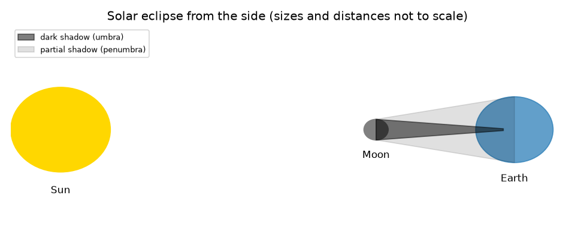
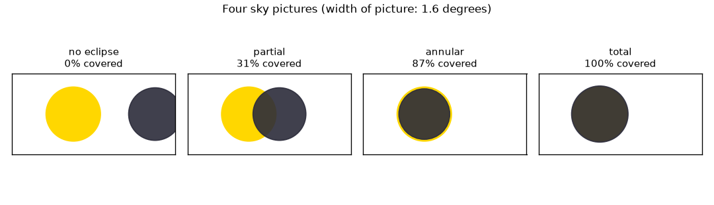

# సెషన్ 1: ఆకాశంలో రెండు బింబాలు, నేలపై ఒక నీడ

[Session 1 — हिन्दी](README.hi.md)

*స్థాయి 1 (భావనాత్మక ఇంటరాక్టివ్ నమూనా) · సుమారు 60 నిమిషాలు · openeclipse*

> ఇది సరళీకరించిన విద్యా నమూనా. ఇది ధృవీకరించబడిన (validated) డిజైన్ సాధనం కాదు; నిజమైన నిర్మాణాలు, విద్యుత్ ఇన్‌స్టలేషన్లు, వాహనాలు, పారిశ్రామిక ప్రక్రియలు లేదా వైద్య నిర్ణయాల కోసం దీనిని ఉపయోగించకూడదు.

**ముందస్తు అవసరాలు (Prerequisites)**

- పాఠశాల త్రికోణమితి: ఒక కోణం యొక్క టాంజెంట్ (tangent).
- మీరు PRIMER.md చదివి, `python start.py 1` ఒకసారి రన్ చేశారు.
- భద్రత: ఈ రెపో కోసం మీరు ఎప్పుడూ సూర్యుడిని చూడాల్సిన అవసరం లేదు.

**అభ్యసన లక్ష్యాలు (Learning objectives).** ఈ సెషన్ తర్వాత మీరు:

- సూర్యగ్రహణం (solar eclipse; చంద్రుడి నీడ భూమిపై పడుతుంది) మరియు చంద్రగ్రహణం (lunar eclipse; చంద్రుడు భూమి నీడలోకి ప్రవేశిస్తాడు) ను వర్ణించగలరు.
- ఆకాశంలో సూర్యుడు మరియు చంద్రుడు ఎంత పెద్దగా కనిపిస్తారో లెక్కించి, అవి దాదాపు సమానమని చూడగలరు.
- రెండు బింబాలు ఎంత బాగా ఒకే రేఖలోకి వస్తాయో దాని నుండి పాక్షిక, సంపూర్ణ లేదా కంకణ (annular) గ్రహణమో నిర్ణయించగలరు.
- సంపూర్ణ గ్రహణాలను కంకణ గ్రహణాల నుండి వేరు చేసే చంద్ర దూరాన్ని కనుగొనగలరు.

## A. వాస్తవ ప్రపంచ సమస్య
సంవత్సరానికి ఒకటి లేదా రెండుసార్లు, భూమిపై ఎక్కడో, పగటి ఆకాశం కొన్ని నిమిషాలు చీకటిగా మారుతుంది. సూర్యుడు చంద్రుడి కంటే సుమారు 400 రెట్లు వెడల్పుగా ఉంటాడు, మరి చంద్రుడు అతన్ని ఎలా పూర్తిగా దాచగలడు? మరియు అది నేలపై ఒక సన్నని మార్గంలో మాత్రమే ఎందుకు జరుగుతుంది? భద్రత: ధృవీకరించబడిన గ్రహణ కళ్ళద్దాలు లేకుండా సూర్యుడిని చూడటం, సూర్యుడు చాలావరకు కప్పబడి ఉన్నప్పుడు కూడా, కళ్ళను దెబ్బతీస్తుంది. ఈ రెపోలోని ప్రతిదీ లెక్కింపు; మీరు ఎప్పుడూ సూర్యుడిని చూడాల్సిన అవసరం లేదు. ఆరోగ్య గమనిక: ఇది సాధారణ విద్య మాత్రమే.

## B. భావన మరియు సిద్ధాంతం
చంద్రుడు సూర్యుడు మరియు భూమి మధ్య నుండి వెళ్ళినప్పుడు సూర్యగ్రహణం జరుగుతుంది, కాబట్టి చంద్రుడి నీడ నేల మీదుగా కదులుతుంది. చంద్రుడు భూమి నీడలోకి వెళ్ళినప్పుడు చంద్రగ్రహణం జరుగుతుంది. దృశ్యాన్ని నిర్ణయించేది ప్రతి బింబం యొక్క కోణీయ పరిమాణం (angular size): d దూరంలో ఉన్న r వ్యాసార్థం గల గోళం tan(angle) = r/d అయ్యే కోణాన్ని ఆక్రమిస్తుంది. సూర్యుడు చంద్రుడి కంటే 400.7 రెట్లు వెడల్పు కానీ 389.2 రెట్లు దూరంగా ఉంటాడు, కాబట్టి రెండూ సుమారు 0.5 డిగ్రీల వెడల్పుగా కనిపిస్తాయి: సూర్యుడికి 0.533 డిగ్రీలు, సగటు దూరంలో చంద్రుడికి 0.518 డిగ్రీలు. కోణీయ వ్యాసార్థాలను rs (సూర్యుడు) మరియు rm (చంద్రుడు) అని, రెండు బింబ కేంద్రాల మధ్య దూరాన్ని sep అని పిలుద్దాం. sep కనీసం rs + rm అయితే గ్రహణం ఉండదు; చంద్రుడు పెద్ద బింబం మరియు sep గరిష్టంగా rm - rs అయితే సూర్యుడు పూర్తిగా దాగుతాడు; చంద్రుడు చిన్న బింబం మరియు sep గరిష్టంగా rs - rm అయితే ప్రకాశవంతమైన ఉంగరం మిగులుతుంది (కంకణ, annular); మధ్యలో ఉన్నవన్నీ పాక్షికం. చంద్రుడు 373,355 km కంటే దగ్గరగా ఉన్నప్పుడు మాత్రమే సూర్యుడి కంటే పెద్దగా ఉంటాడు.

| గుర్తు | అర్థం | ప్రమాణం |
|---|---|---|
| r | సూర్యుడి లేదా చంద్రుడి వ్యాసార్థం (696000 km, 1737 km) | km |
| d | సూర్యుడు లేదా చంద్రుడికి దూరం | km |
| rs, rm | సూర్యుడి, చంద్రుడి కోణీయ వ్యాసార్థం | డిగ్రీలు |
| sep | రెండు కేంద్రాల మధ్య కోణీయ దూరం | డిగ్రీలు |
| v | చంద్రుడి కక్ష్యా వేగం (1.023 km/s) | km/s |

**ఊహలు (Assumptions)**

- సూర్యుడు మరియు చంద్రుడు భూమి కేంద్రం నుండి చూసే గోళాలు.
- వేరే చెప్పకపోతే సూర్యుడు 1.496e8 km దూరంలో మరియు చంద్రుడు 384400 km దూరంలో ఉన్నారు.
- కోణాలు చిన్నవి, కాబట్టి బింబాలను చదునైన ఆకాశ చిత్రంలో వృత్తాలుగా గీస్తాము.

$$ \tan\alpha=\frac{r}{d} $$

$$ \text{total: } r_m\ge r_s \text{ and } \mathrm{sep}\le r_m-r_s;\qquad \text{annular: } r_s>r_m \text{ and } \mathrm{sep}\le r_s-r_m $$

$$ d_{\mathrm{crit}}=\frac{R_{\mathrm{Moon}}}{\tan r_s} $$

## C. దృశ్య వివరణ
మొదటి చిత్రం సూర్యుడు, చంద్రుడు మరియు భూమిని చీకటి నీడ (ప్రచ్ఛాయ, umbra) మరియు పాక్షిక నీడ (ఉపచ్ఛాయ, penumbra) తో పక్క నుండి గీస్తుంది; ఇది స్కేల్ ప్రకారం లేదు. రెండవ చిత్రం అదే 1.6 డిగ్రీల ఫ్రేమ్‌తో నాలుగు ఆకాశ చిత్రాలను చూపిస్తుంది: గ్రహణం లేదు, ఒక పాక్షిక గ్రహణం (సూర్యుడి వైశాల్యంలో 31 శాతం కప్పబడింది), 400000 km వద్ద ఒక కంకణ గ్రహణం (87.1 శాతం) మరియు 360000 km వద్ద ఒక సంపూర్ణ గ్రహణం (100 శాతం).

*పక్క నుండి సూర్యగ్రహణం (స్కేల్ ప్రకారం కాదు): చీకటి ప్రచ్ఛాయ మరియు పాక్షిక నీడ.*

*నాలుగు ఆకాశ చిత్రాలు: గ్రహణం లేదు, పాక్షిక, కంకణ మరియు సంపూర్ణ.*

## D. ఇంటరాక్టివ్ సిమ్యులేషన్
పాఠాన్ని రన్ చేయండి (`python start.py 1`), తర్వాత లైవ్ యాప్‌ను తెరవండి: [సెషన్ 1: ఆకాశంలో రెండు బింబాలు](https://krunalpanchal1995.github.io/pan-iit-oss/openeclipse/session-01/) (లేదా ఈ ఫోల్డర్‌లోని `app.html`). కేంద్ర దూరాన్ని మరియు చంద్ర దూరాన్ని స్లైడ్ చేసి బింబాలను గమనించండి; కేంద్రాల మధ్య దూరానికి వ్యతిరేకంగా కప్పబడిన భాగాన్ని చూడటానికి గ్రాఫ్‌కు మారండి.

**సవాలు.** సంపూర్ణ గ్రహణాన్ని తయారు చేయండి: సూర్యుడిని పూర్తిగా దాచే చంద్ర దూరాన్ని మరియు అమరికను ఎంచుకోండి.

## E. సాధించిన ఉదాహరణ మరియు ప్రయోగం
**సమస్య.** చంద్రుడు తన సగటు దూరం 384400 km వద్ద ఉన్నాడు మరియు అతని కేంద్రం సూర్యుడి కేంద్రం నుండి 0.30 డిగ్రీల దూరంలో ఉంది. ఇది ఏ రకమైన గ్రహణం మరియు సూర్యుడి వైశాల్యంలో ఎంత దాగి ఉంది?

1. సూర్యుడు: rs = arctan(696000 / 1.496e8) = 0.2666 డిగ్రీలు. చంద్రుడు: rm = arctan(1737 / 384400) = 0.259 డిగ్రీలు.
2. rs + rm = 0.525 డిగ్రీలు. sep = 0.30 దాని కంటే చిన్నది కాబట్టి, బింబాలు ఒకదానిపై ఒకటి పడతాయి: ఏదో ఒక రకమైన గ్రహణం.
3. rm, rs కంటే చిన్నది మరియు sep, rs - rm = 0.008 డిగ్రీల కంటే పెద్దది, కాబట్టి సూర్యుడు పూర్తిగా దాగడు మరియు ఉంగరం ఏర్పడదు: పాక్షికం.
4. రెండు వృత్తాల అతివ్యాప్తి సూర్యుడి వైశాల్యంలో 0.306 కప్పబడిన భాగాన్ని ఇస్తుంది (సుమారు 31 శాతం).

**సమాధానం.** సూర్యుడి వైశాల్యంలో సుమారు 31 శాతం కప్పబడిన పాక్షిక గ్రహణం.

**ప్రయోగం.** చంద్రుడు ఉన్న రాత్రి చేతి పొడవులో ఒక నాణేన్ని పట్టుకుని చంద్రుడి వెడల్పుతో పోల్చండి (సూర్యుడితో ఇది ఎప్పుడూ చేయవద్దు): 2.3 m వద్ద 20 mm నాణెం 0.5 డిగ్రీల వెడల్పుగా కనిపిస్తుంది; చంద్రుడు ఎంత చిన్నవాడో చూసి చాలామంది ఆశ్చర్యపోతారు. నమూనా మరియు వాస్తవం: నమూనా పరిపూర్ణ గోళాలను మరియు భూమి కేంద్రంలో ఉన్న పరిశీలకుడిని ఉపయోగిస్తుంది, కానీ నిజమైన పరిశీలకుడు కేంద్రం నుండి 6378 km వరకు దూరంలో ఉంటాడు, ఇది బింబాలను సుమారు 1 డిగ్రీ వరకు జరుపుతుంది. సెషన్ 2 దానిని చేర్చుతుంది.

## F. మూల్యాంకనం మరియు డిజైన్ సవాలు
**ప్రశ్న రకం A: భావనాత్మక.** సూర్యుడు చంద్రుడి కంటే సుమారు 400 రెట్లు వెడల్పు. అయినా చంద్రుడు అతన్ని ఎందుకు దాచగలడు?

సూచన

వ్యాసాల నిష్పత్తిని దూరాల నిష్పత్తితో పోల్చండి.

దశలవారీ పరిష్కారం

కనిపించే పరిమాణం పరిమాణాన్ని దూరంతో భాగించిన దానిపై ఆధారపడి ఉంటుంది. వ్యాస నిష్పత్తి 400.7 మరియు దూర నిష్పత్తి 389.2, దాదాపు ఒకటే, కాబట్టి రెండు బింబాలు సుమారు సమాన వెడల్పుగా కనిపిస్తాయి: 0.533 డిగ్రీలు మరియు 0.518 డిగ్రీలు. చంద్రుడి దూరం మారుతూ ఉంటుంది కాబట్టి, అతను కొన్నిసార్లు సూర్యుడి కంటే కొంచెం పెద్దగా (సంపూర్ణ గ్రహణం) మరియు కొన్నిసార్లు కొంచెం చిన్నగా (కంకణ) ఉంటాడు.

**ప్రశ్న రకం B: సంఖ్యాత్మక.** చంద్రుడు 400000 km వద్ద ఉన్నాడు, అతని కేంద్రం సరిగ్గా సూర్యుడి కేంద్రంపై ఉంది. rm ను మరియు సూర్యుడి వైశాల్యంలో కప్పబడిన భాగాన్ని కనుగొనండి.

సూచన

rm = arctan(1737 / d); చిన్న బింబం పూర్తిగా పెద్దదాని లోపల ఉంటే, భాగం (చిన్న వ్యాసార్థం / పెద్ద వ్యాసార్థం) వర్గం.

దశలవారీ పరిష్కారం

rm = arctan(1737 / 400000) = 0.2488 డిగ్రీలు. rm, rs = 0.2666 కంటే చిన్నది కాబట్టి చంద్రుడు సూర్య బింబం లోపల ఉంటాడు: కంకణ. కప్పబడిన భాగం = (0.2488 / 0.2666)^2 = 0.871, అంటే 87.1 శాతం. సహేతుకత తనిఖీ: సూర్యుడి ఉంగరం మిగిలి ఉంది కాబట్టి ఇది 100 శాతం కంటే తక్కువ.

**ప్రశ్న రకం C: గ్రాఫ్ మరియు సిమ్యులేషన్ వ్యాఖ్యానం.** సగటు చంద్రుడికి కేంద్ర దూరానికి వ్యతిరేకంగా కప్పబడిన భాగం గ్రాఫ్‌లో, సుమారు ఏ దూరం వద్ద వక్రం సున్నాకు చేరుతుంది? 360000 km వద్ద ఉన్న చంద్రుడికి ఎడమ చివర వక్రం ఎందుకు 'చదునుగా' ఉంటుంది?

సూచన

కోణీయ వ్యాసార్థాల మొత్తాన్ని ఉపయోగించండి; రెండవ భాగానికి rm - rs ను చదునైన భాగంతో పోల్చండి.

దశలవారీ పరిష్కారం

అంచులు సరిగ్గా తాకినప్పుడు, sep = rs + rm = 0.525 డిగ్రీల వద్ద అది సున్నాకు చేరుతుంది. 360000 km వద్ద ఉన్న చంద్రుడికి చంద్రుడు సూర్యుడి కంటే 0.0099 డిగ్రీలు పెద్దవాడు, కాబట్టి 0 నుండి 0.0099 డిగ్రీల వరకు ఏ sep కైనా సూర్యుడు పూర్తిగా దాగుతాడు మరియు వక్రం 1 (100 శాతం) వద్ద ఉంటుంది.

**ప్రశ్న రకం D: డిజైన్ మరియు ఆప్టిమైజేషన్ (optimisation) సవాలు.** డిజైన్: బింబాలు సరిగ్గా ఒకే రేఖలోకి వచ్చే ప్రదేశం నుండి ఒక ఫోటోగ్రాఫర్ సంపూర్ణ గ్రహణాన్ని కోరుకుంటున్నాడు. చంద్రుడి దూరం ఏ షరతును సంతృప్తిపరచాలి, మరియు చంద్రుడు 360000 km వద్ద ఉంటే బింబాలు ఎంత ఖచ్చితంగా అమరాలి?

సూచన

సంపూర్ణానికి rm కనీసం rs ఉండాలి; తర్వాత sep, rm - rs ను మించకూడదు.

దశలవారీ పరిష్కారం

rm కనీసం rs కావడానికి చంద్రుడు 373,355 km కంటే దగ్గరగా ఉండాలి. 360000 km వద్ద, rm - rs = 0.0099 డిగ్రీలు, కాబట్టి కేంద్రాలు ఒకదానికొకటి 0.0099 డిగ్రీల లోపల ఉండాలి. రాజీ (trade-off): దగ్గరి చంద్రుడు పెద్ద మార్జిన్ ఇస్తాడు, కాబట్టి సంపూర్ణ దశ ఎక్కువసేపు ఉంటుంది మరియు మార్గం వెడల్పుగా ఉంటుంది (సెషన్ 2).

[RUBRIC.md](../../RUBRIC.md) తో మిమ్మల్ని మీరు స్కోర్ చేసుకోండి. కాగితంపై చేయడానికి [కార్యాచరణ పత్రాన్ని](activity_sheet.md) ప్రింట్ చేయండి.

## సాధారణ అపోహలు
| సాధారణ అపోహ | వాస్తవంగా నిజమైనది |
|---|---|
| చంద్రుడు సూర్యుడిని కప్పుతాడు ఎందుకంటే అతను అదే పరిమాణంలో ఉన్నాడు. | చంద్రుడు సుమారు 400 రెట్లు చిన్నవాడు; అతను సుమారు 389 రెట్లు దగ్గరగా కూడా ఉన్నాడు, కాబట్టి ఆకాశంలో అదే పరిమాణంలో కనిపిస్తాడు. |
| ప్రతి సంపూర్ణ గ్రహణం ఒకేలా కనిపిస్తుంది. | దూరంగా ఉన్న చంద్రుడి వద్ద (సంపూర్ణానికి 373,355 km కంటే తక్కువ అవసరం) చంద్రుడు చాలా చిన్నవాడు మరియు ఒక ఉంగరాన్ని వదిలేస్తాడు: కంకణ గ్రహణం. |
| పాక్షిక గ్రహణాన్ని చూడటం సురక్షితం. | చాలావరకు కప్పబడి ఉన్నప్పుడు కూడా, ధృవీకరించబడిన గ్రహణ కళ్ళద్దాలు లేకుండా సూర్యుడిని ఎప్పుడూ చూడవద్దు. |
| చంద్రగ్రహణం మరియు సూర్యగ్రహణం వేర్వేరు ప్రదేశాల నుండి చూసే ఒకే విషయం. | సూర్యగ్రహణంలో చంద్రుడి నీడ భూమిపై పడుతుంది; చంద్రగ్రహణంలో చంద్రుడు భూమి నీడ లోపల ఉంటాడు, మరియు రాత్రి వైపు ఉన్న అందరూ దానిని చూస్తారు. |

## పదకోశం (Glossary)
- **కోణీయ పరిమాణం (angular size)**: ఒక బింబం ఆకాశంలో ఆక్రమించే కోణం, డిగ్రీలలో
- **ప్రచ్ఛాయ (umbra)**: సూర్యుడు పూర్తిగా దాగి ఉండే, నీడ యొక్క అత్యంత చీకటి భాగం
- **ఉపచ్ఛాయ (penumbra)**: సూర్యుడు పాక్షికంగా దాగి ఉండే, నీడ యొక్క లేత భాగం
- **కంకణ గ్రహణం (annular eclipse)**: చంద్రుడి చుట్టూ సూర్యుడి ప్రకాశవంతమైన ఉంగరం మిగిలే గ్రహణం
- **సంపూర్ణత (totality)**: సూర్యుడు పూర్తిగా దాగి ఉండే సమయం

## ముగింపు
1. [exercises.md](exercises.md) లోని మూడు కోడింగ్ పనులను చేయండి.
2. మీ మార్పుల తర్వాత `python start.py 1` మళ్ళీ రన్ చేయండి. అది చెక్‌పాయింట్‌తో ముగుస్తుంది; అది `PASS` ప్రింట్ చేసినప్పుడు మీరు పూర్తి చేశారు. (చెక్‌పాయింట్ మాత్రమే: `python start.py check 1`.)

తర్వాత: [సెషన్ 2](../session-02/README.md)
