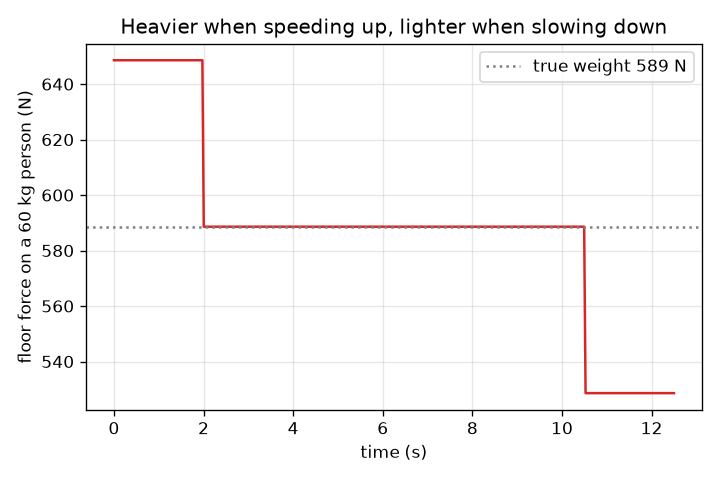
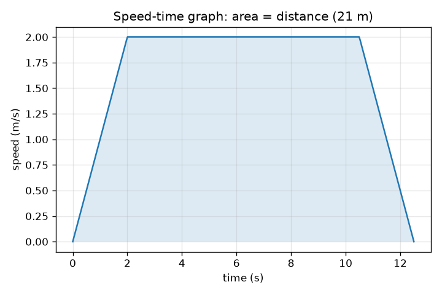

# सत्र 1: ऊपर-नीचे जाती लिफ़्ट: चाल, ग्राफ़ और आप भारी क्यों महसूस करते हैं

*स्तर 1 (अवधारणात्मक इंटरैक्टिव मॉडल) · लगभग 60 मिनट · openelevator*

> यह एक सरलीकृत शैक्षिक मॉडल है। यह कोई प्रमाणित डिज़ाइन उपकरण नहीं है और इसका उपयोग वास्तविक संरचनाओं, विद्युत संस्थापनों, वाहनों, औद्योगिक प्रक्रियाओं या चिकित्सा निर्णयों के लिए नहीं किया जाना चाहिए।

**पूर्वापेक्षाएँ (Prerequisites)**

- चाल और त्वरण (acceleration), और चाल-समय ग्राफ़ पढ़ना।
- आपने PRIMER.md पढ़ लिया है और `python start.py 1` एक बार चला लिया है।

**सीखने के उद्देश्य (Learning objectives)।** इस सत्र के बाद आप:

- चाल-समय ग्राफ़ (speed-time graph) पर लिफ़्ट की यात्रा को त्वरण, एकसमान चाल (cruise), मंदन के रूप में वर्णित कर सकेंगे।
- ग्राफ़ के ढाल (slope) से त्वरण और क्षेत्रफल से दूरी पढ़ सकेंगे।
- आभासी भार (apparent weight) N = m (g + a) का उपयोग करके बता सकेंगे कि आप कब भारी या हल्का महसूस करते हैं।
- दूरी, अधिकतम चाल और त्वरण से यात्रा का समय ज्ञात कर सकेंगे।

## A. वास्तविक दुनिया की समस्या
आप लिफ़्ट में कदम रखते हैं और जैसे ही वह ऊपर उठना शुरू करती है, फ़र्श आपके पैरों पर ज़्यादा ज़ोर से धकेलता लगता है। जब वह ऊपर पहुँचते समय धीमी होती है तो आप थोड़ा हल्का महसूस करते हैं। आपमें कुछ नहीं बदला, और गुरुत्व भी नहीं बदला। तो क्या बदला? और एक डिज़ाइनर यात्रा को तेज़ कैसे बना सकता है, बिना पैरों पर धक्के को असहज बनाए?

## B. अवधारणा और सिद्धांत
लिफ़्ट की यात्रा का वर्णन चाल-समय ग्राफ़ से सबसे सरल है। लिफ़्ट एक स्थिर त्वरण a से तब तक तेज़ होती है जब तक वह अधिकतम चाल v तक न पहुँच जाए, v से चलती है, फिर उसी दर से धीमी होती है। ग्राफ़ एक समलंब (trapezoid) है। ग्राफ़ का ढाल त्वरण है और उसके नीचे का क्षेत्रफल दूरी है। v तक तेज़ होने में v / a सेकंड लगते हैं और v^2 / (2 a) मीटर तय होते हैं, धीमे होने में भी यही, इसलिए d दूरी की यात्रा में d / v + v / a सेकंड लगते हैं, बशर्ते d कम से कम v^2 / a हो। यदि दूरी कम है, तो लिफ़्ट कभी v तक नहीं पहुँचती। आप अपने पैरों पर फ़र्श का बल महसूस करते हैं, यही आभासी भार N है। आपके लिए न्यूटन का दूसरा नियम कहता है कि कुल बल = द्रव्यमान x त्वरण, और कुल बल ऊपर की ओर N में से नीचे की ओर आपका भार m g घटाकर है, इसलिए N = m (g + a)। जब लिफ़्ट ऊपर की ओर त्वरित होती है (ऊपर जाते हुए तेज़ होना, या नीचे जाते हुए धीमा होना) तो a धनात्मक होता है और आप भारी महसूस करते हैं। जब त्वरण नीचे की ओर हो तो आप हल्का महसूस करते हैं। स्थिर चाल पर a = 0 और N = m g। केवल त्वरण मायने रखता है, चाल कभी नहीं।

| प्रतीक | अर्थ | इकाई |
|---|---|---|
| d | तय की गई दूरी | m |
| v | अधिकतम (क्रूज़) चाल | m/s |
| a | लिफ़्ट का त्वरण, ऊपर धनात्मक | m/s^2 |
| m | व्यक्ति का द्रव्यमान | kg |
| g | गुरुत्वीय त्वरण, 9.81 | m/s^2 |
| N | व्यक्ति पर फ़र्श का बल (आभासी भार) | N |
| T | यात्रा का कुल समय | s |

**मान्यताएँ (Assumptions)**

- लिफ़्ट एक सीधी ऊर्ध्वाधर रेखा में चलती है और चाल में बदलाव सीधी रेखा जैसे होते हैं (त्वरण तुरंत बदल जाता है)।
- व्यक्ति फ़र्श पर स्थिर खड़ा है।
- वायु प्रतिरोध और घर्षण नगण्य माने गए हैं।
- इस सत्र में आराम का आकलन केवल त्वरण के आकार से किया जाता है।

$$ T=\frac{d}{v}+\frac{v}{a}\qquad (d\ge v^2/a) $$

$$ d_{\text{accelerate}}=\frac{v^2}{2a},\qquad t_{\text{accelerate}}=\frac{v}{a} $$

$$ N-mg=ma\;\Rightarrow\;N=m\,(g+a) $$

## C. दृश्य व्याख्या
पहला चित्र 2 m/s अधिकतम चाल और 1 m/s^2 त्वरण वाली 21 m की यात्रा का चाल-समय ग्राफ़ है: एक समलंब जिसमें 2 s की चढ़ाई, 8.5 s का सपाट शीर्ष और 2 s की उतराई है, कुल 12.5 s, और जिसका छायांकित क्षेत्रफल 21 m है। दूसरा चित्र उसी यात्रा में 60 kg के व्यक्ति पर फ़र्श का बल दिखाता है: तेज़ होते समय 649 N (589 N के वास्तविक भार से अधिक), क्रूज़ करते समय 589 N और धीमे होते समय 529 N।

*60 kg के व्यक्ति पर फ़र्श का बल: तेज़ होते समय भारी, धीमे होते समय हल्का।*

*21 m की यात्रा का चाल-समय ग्राफ़: ढाल त्वरण है, छायांकित क्षेत्रफल दूरी है।*

## D. इंटरैक्टिव सिमुलेशन
पाठ चलाएँ (`python start.py 1`), फिर लाइव ऐप खोलें: [सत्र 1: लिफ़्ट की यात्रा और आपके पैरों पर बल](https://krunalpanchal1995.github.io/pan-iit-oss/openelevator/session-01/) (या इस फ़ोल्डर में `app.html`)। यात्रा-प्रगति स्लाइडर खिसकाएँ और देखें कि केबिन शाफ़्ट में ऊपर उठता है और बल की पट्टी बढ़ती-घटती है। फिर चाल ग्राफ़ और बल ग्राफ़ खोलें और त्वरण बदलें।

**चुनौती।** 21 m की यात्रा को 12 s से कम में पूरा कराएँ, जबकि फ़र्श का बल कभी भी आपके भार से 15 प्रतिशत से अधिक न हो।

## E. हल किया गया उदाहरण और प्रयोग
**समस्या।** 60 kg का एक व्यक्ति ऐसी लिफ़्ट में है जो ऊपर की ओर 1.0 m/s^2 से तेज़ हो रही है। फ़र्श कितना बल लगाता है, और यह विराम पर व्यक्ति के भार की तुलना में कैसा है?

1. विराम पर भार: m g = 60 * 9.81 = 588.6 N।
2. तेज़ होते समय: N = m (g + a) = 60 * (9.81 + 1.0) = 60 * 10.81 = 648.6 N।
3. अनुपात: 648.6 / 588.6 = 1.10, इसलिए व्यक्ति 10 प्रतिशत भारी महसूस करता है।
4. उसी दर से धीमे होते समय (a = -1.0): N = 60 * 8.81 = 528.6 N, लगभग 10 प्रतिशत हल्का।

**उत्तर।** तेज़ होते समय N = 648.6 N (विराम पर 588.6 N, धीमे होते समय 528.6 N)।

**प्रयोग।** लिफ़्ट में एक बाथरूम तराज़ू पर खड़े हों (या त्वरण दिखाने वाले फ़ोन ऐप का उपयोग करें) और लिफ़्ट के चलने और रुकने पर पाठ्यांक देखें। a = 1 m/s^2 के लिए पाठ्यांक लगभग 10 प्रतिशत बढ़ना चाहिए और अंत में उतना ही घटना चाहिए, और स्थिर चाल पर आपके सामान्य भार पर लौट आना चाहिए। सामान्य लिफ़्टें 1 m/s^2 से कम त्वरण लेती हैं, इसलिए आपको दिखने वाले बदलाव छोटे होंगे। मॉडल और वास्तविकता में अंतर: वास्तविक तराज़ू धीरे प्रतिक्रिया करता है, वास्तविक त्वरण एक आदर्श सीढ़ी नहीं है, और लिफ़्ट थोड़ा हिल सकती है।

## F. मूल्यांकन और डिज़ाइन चुनौती
**प्रश्न प्रकार A: अवधारणात्मक।** एक लिफ़्ट स्थिर चाल से नीचे जा रही है और फिर भूतल पर रुकने के लिए धीमी होने लगती है। क्या आप भारी, हल्का या एक जैसा महसूस करते हैं? चाल शब्द का उपयोग किए बिना समझाइए।

संकेत

नीचे जाते हुए धीमा होने का अर्थ है कि वेग ऊपर की ओर बदल रहा है। त्वरण किस दिशा में है?

चरण-दर-चरण हल

आप भारी महसूस करते हैं। वेग नीचे की ओर है और घट रहा है, इसलिए वेग का बदलाव (त्वरण) ऊपर की ओर है। a ऊपर और धनात्मक होने से N = m (g + a), m g से बड़ा है। जो मायने रखता है वह त्वरण की दिशा है, गति की दिशा नहीं।

**प्रश्न प्रकार B: संख्यात्मक।** 75 kg का एक व्यक्ति ऐसी लिफ़्ट में खड़ा है जो ऊपर की ओर 1.5 m/s^2 से तेज़ हो रही है। फ़र्श का बल और विराम पर व्यक्ति के भार से प्रतिशत बदलाव ज्ञात कीजिए।

संकेत

N = m (g + a), जहाँ g = 9.81 m/s^2।

चरण-दर-चरण हल

N = 75 * (9.81 + 1.5) = 75 * 11.31 = 848.25 N, लगभग 848 N। विराम पर भार = 75 * 9.81 = 735.75 N। बदलाव = 848.25 / 735.75 = 1.153, यानी 15.3 प्रतिशत भारी। इकाई जाँच: kg * m/s^2 = N।

**प्रश्न प्रकार C: ग्राफ़ और सिमुलेशन की व्याख्या।** 21 m की यात्रा के चाल-समय ग्राफ़ पर (अधिकतम चाल 2 m/s, 2 s में चढ़ाई, 8.5 s तक सपाट), त्वरण क्या है और आप कैसे जाँच सकते हैं कि दूरी 21 m है?

संकेत

ढाल = ऊर्ध्व बदलाव भाग क्षैतिज बदलाव। क्षेत्रफल = दो त्रिभुज और एक आयत।

चरण-दर-चरण हल

चढ़ते भाग का ढाल = (2 - 0) / 2 = 1.0 m/s^2। क्षेत्रफल: 0.5 * 2 * 2 = 2 m के दो त्रिभुज (4 m) और एक आयत 2 m/s * 8.5 s = 17 m, कुल 21 m, जो दूरी से मेल खाता है।

**प्रश्न प्रकार D: डिज़ाइन और इष्टतमीकरण (optimisation) चुनौती।** डिज़ाइन: 21 m की यात्रा 11 s से कम में होनी चाहिए और फ़र्श का बल व्यक्ति के भार के 15 प्रतिशत के भीतर रहना चाहिए (a <= 1.47 m/s^2)। a और v चुनें, d >= v^2 / a जाँचें, और यात्रा का समय बताएँ। सीधे बहुत बड़ा v क्यों न चुन लें?

संकेत

T = d / v + v / a में a = 1.4 m/s^2 और v के कुछ मान आज़माएँ।

चरण-दर-चरण हल

a = 1.4 m/s^2 लें (a/g = 0.143, यानी 14.3 प्रतिशत)। v = 3 m/s के साथ: v^2 / a = 6.4 m, जो 21 m से कम है, इसलिए लिफ़्ट पूरी चाल तक पहुँचती है। T = 21 / 3 + 3 / 1.4 = 7.0 + 2.14 = 9.14 s, जो 11 s से कम है। बहुत बड़ा v मुफ़्त नहीं है: लिफ़्ट को अधिक शक्तिशाली मोटर चाहिए, सुरक्षित रूप से धीमा होने के लिए अधिक शाफ़्ट ऊँचाई चाहिए, और यात्रियों को बहुत ऊँची चाल पसंद नहीं। a = 1.4 के साथ समय 11 s से कम केवल लगभग 2.2 m/s से अधिक v के लिए रहता है, इसलिए 2.5 से 4 m/s का v एक समझदार सीमा है। मान्यताएँ: स्थिर त्वरण, कोई झटका (jerk) सीमा नहीं (सत्र 2 इसे जोड़ता है)।

[RUBRIC.md](../../RUBRIC.md) से स्वयं को अंक दें। काग़ज़ पर काम करने के लिए [गतिविधि पत्रक](activity_sheet.md) प्रिंट करें।

## आम भ्रांतियाँ (Common misconceptions)
| आम भ्रांति | वास्तव में क्या सही है |
|---|---|
| जब भी लिफ़्ट तेज़ चल रही हो, मैं भारी महसूस करता हूँ। | केवल त्वरण फ़र्श का बल बदलता है। किसी भी स्थिर चाल पर, तेज़ हो या धीमी, आप अपना सामान्य भार महसूस करते हैं। |
| लिफ़्ट में मेरा भार सच में बदल जाता है। | गुरुत्व आप पर उतने ही बल से खींचता है। जो बदलता है वह है आप पर फ़र्श का बल, यानी आभासी भार। |
| ऊपर जाना हमेशा भारी और नीचे जाना हमेशा हल्का लगता है। | यह त्वरण की दिशा पर निर्भर करता है: ऊपर जाते हुए तेज़ होना और नीचे जाते हुए धीमा होना, दोनों भारी लगते हैं। |
| बड़ी अधिकतम चाल हमेशा उसी अनुपात में समय बचाती है। | समय d / v + v / a है: उसका एक भाग तेज़ होने में जाता है, इसलिए v को दोगुना करने से समय आधा नहीं होता, ख़ासकर छोटी यात्राओं में। |

## शब्दावली (Glossary)
- **त्वरण (acceleration)**: चाल कितनी तेज़ी से बदलती है, m/s^2 में; चाल-समय ग्राफ़ का ढाल
- **आभासी भार (apparent weight)**: फ़र्श आप पर जो बल लगाता है; तराज़ू जो पढ़ता है
- **चाल-समय ग्राफ़ (speed-time graph)**: समय के सापेक्ष चाल का ग्राफ़; ढाल त्वरण है, क्षेत्रफल दूरी है
- **क्रूज़ (cruise)**: यात्रा का वह भाग जो स्थिर चाल पर होता है

## समापन
1. [exercises.md](exercises.md) में दिए तीन कोडिंग कार्य करें।
2. अपने बदलावों के बाद `python start.py 1` फिर से चलाएँ। यह चेकपॉइंट के साथ समाप्त होता है; जब यह `PASS` छापे, तो आपका काम पूरा है। (केवल चेकपॉइंट: `python start.py check 1`।)

आगे: [सत्र 2](../session-02/README.md)
