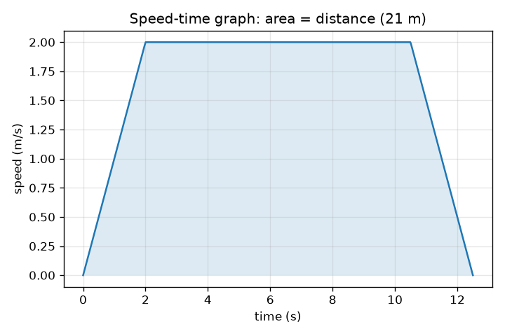
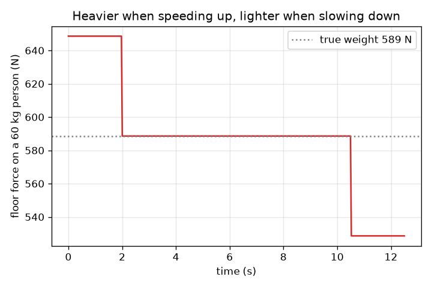

# സെഷൻ 1: മുകളിലേക്കും താഴേക്കും പോകുന്ന ലിഫ്റ്റ്: വേഗത, ഗ്രാഫുകൾ, നിങ്ങൾക്ക് ഭാരം കൂടുതൽ തോന്നുന്നത് എന്തുകൊണ്ട്

[Session 1 — हिन्दी](README.hi.md)

*ലെവൽ 1 (ആശയപരമായ ഇന്ററാക്ടീവ് മോഡൽ) · ഏകദേശം 60 മിനിറ്റ് · openelevator*

> ഇത് ഒരു ലളിതമാക്കിയ വിദ്യാഭ്യാസ മോഡൽ ആണ്. ഇത് സാധൂകരിക്കപ്പെട്ട ഒരു ഡിസൈൻ ഉപകരണമല്ല; യഥാർത്ഥ നിർമ്മിതികൾ, വൈദ്യുത ഇൻസ്റ്റലേഷനുകൾ, വാഹനങ്ങൾ, വ്യാവസായിക പ്രക്രിയകൾ അല്ലെങ്കിൽ വൈദ്യപരമായ തീരുമാനങ്ങൾ എന്നിവയ്ക്ക് ഇത് ഉപയോഗിക്കരുത്.

**മുൻ അറിവ് (Prerequisites)**

- വേഗതയും (speed) ത്വരണവും (acceleration), ഒരു വേഗത-സമയ ഗ്രാഫ് വായിക്കലും.
- നിങ്ങൾ PRIMER.md വായിക്കുകയും `python start.py 1` ഒരു തവണ റൺ ചെയ്യുകയും ചെയ്തിട്ടുണ്ട്.

**പഠന ലക്ഷ്യങ്ങൾ (Learning objectives).** ഈ സെഷനു ശേഷം നിങ്ങൾക്ക് കഴിയും:

- ഒരു ലിഫ്റ്റ് യാത്രയെ ഒരു വേഗത-സമയ ഗ്രാഫിൽ ത്വരണം, ക്രൂയിസ് (cruise), മന്ദനം എന്നിങ്ങനെ വിവരിക്കാൻ.
- ഗ്രാഫിന്റെ ചരിവിൽ (slope) നിന്ന് ത്വരണവും വിസ്തീർണ്ണത്തിൽ (area) നിന്ന് ദൂരവും വായിക്കാൻ.
- നിങ്ങൾക്ക് ഭാരം കൂടുതലോ കുറവോ തോന്നുന്നത് എപ്പോഴാണെന്ന് പറയാൻ പ്രത്യക്ഷ ഭാരം (apparent weight) N = m (g + a) ഉപയോഗിക്കാൻ.
- ദൂരം, പരമാവധി വേഗത, ത്വരണം എന്നിവയിൽ നിന്ന് ഒരു യാത്രയുടെ സമയം കണ്ടെത്താൻ.

## A. യഥാർത്ഥ ലോക പ്രശ്നം
നിങ്ങൾ ഒരു ലിഫ്റ്റിൽ കയറുന്നു, അത് ഉയരാൻ തുടങ്ങുമ്പോൾ തറ നിങ്ങളുടെ കാലുകളിൽ കൂടുതൽ ശക്തിയായി തള്ളുന്നതായി തോന്നുന്നു. മുകളിലെത്താറാകുമ്പോൾ അത് വേഗത കുറയ്ക്കുമ്പോൾ നിങ്ങൾക്ക് അല്പം ഭാരം കുറഞ്ഞതായി തോന്നുന്നു. നിങ്ങളിൽ ഒന്നും മാറിയിട്ടില്ല, ഗുരുത്വാകർഷണവും മാറിയിട്ടില്ല. പിന്നെ എന്താണ് മാറിയത്? കാലുകളിലെ തള്ളൽ അസുഖകരമാക്കാതെ ഒരു ഡിസൈനർക്ക് യാത്ര എങ്ങനെ വേഗത്തിലാക്കാം?

## B. ആശയവും സിദ്ധാന്തവും
ഒരു ലിഫ്റ്റ് യാത്ര ഏറ്റവും ലളിതമായി വിവരിക്കാൻ ഒരു വേഗത-സമയ ഗ്രാഫ് ഉപയോഗിക്കാം. ലിഫ്റ്റ് പരമാവധി വേഗത v യിൽ എത്തുന്നതുവരെ സ്ഥിരമായ ത്വരണം a യിൽ വേഗത കൂട്ടുന്നു, v യിൽ സഞ്ചരിക്കുന്നു, തുടർന്ന് അതേ നിരക്കിൽ വേഗത കുറയ്ക്കുന്നു. ഗ്രാഫ് ഒരു ട്രപ്പീസിയം (trapezoid) ആണ്. ഗ്രാഫിന്റെ ചരിവ് ത്വരണവും അതിനു താഴെയുള്ള വിസ്തീർണ്ണം ദൂരവുമാണ്. v വരെ വേഗത കൂട്ടാൻ v / a സെക്കൻഡ് എടുക്കുകയും v^2 / (2 a) മീറ്റർ സഞ്ചരിക്കുകയും ചെയ്യുന്നു, വേഗത കുറയ്ക്കലും അതുപോലെ തന്നെ, അതിനാൽ d എങ്കിലും v^2 / a (v വരെ വേഗത കൂട്ടാനും വീണ്ടും കുറയ്ക്കാനും വേണ്ട ദൂരം) ആകുന്നിടത്തോളം d ദൂരമുള്ള ഒരു യാത്രയ്ക്ക് d / v + v / a സെക്കൻഡ് എടുക്കും. ദൂരം കുറവാണെങ്കിൽ, ലിഫ്റ്റ് ഒരിക്കലും v യിൽ എത്തുന്നില്ല: അത് പകുതി ദൂരം വേഗത കൂട്ടുകയും ബാക്കി പകുതി വേഗത കുറയ്ക്കുകയും ചെയ്യുന്നു, യാത്രയ്ക്ക് 2 sqrt(d / a) സെക്കൻഡ് എടുക്കുന്നു. നിങ്ങളുടെ കാലുകളിൽ തറയുടെ ബലം, അതായത് പ്രത്യക്ഷ ഭാരം N, നിങ്ങൾ അനുഭവിക്കുന്നു. നിങ്ങൾക്കുള്ള ന്യൂട്ടന്റെ രണ്ടാം നിയമം പറയുന്നത് ആകെ ബലം = പിണ്ഡം x ത്വരണം എന്നാണ്, ആകെ ബലം മുകളിലേക്കുള്ള N മൈനസ് താഴേക്കുള്ള നിങ്ങളുടെ ഭാരം m g ആണ്, അതിനാൽ N = m (g + a). ലിഫ്റ്റ് മുകളിലേക്ക് ത്വരിക്കുമ്പോൾ (മുകളിലേക്ക് പോകുമ്പോൾ വേഗത കൂട്ടുകയോ താഴേക്ക് പോകുമ്പോൾ വേഗത കുറയ്ക്കുകയോ ചെയ്യുമ്പോൾ) a പോസിറ്റീവ് ആണ്, നിങ്ങൾക്ക് ഭാരം കൂടുതൽ തോന്നുന്നു. ത്വരണം താഴേക്ക് ചൂണ്ടുമ്പോൾ നിങ്ങൾക്ക് ഭാരം കുറവ് തോന്നുന്നു. സ്ഥിര വേഗതയിൽ a = 0, N = m g. ത്വരണം മാത്രമാണ് പ്രധാനം, ഒരിക്കലും വേഗതയല്ല.

| ചിഹ്നം | അർത്ഥം | യൂണിറ്റ് |
|---|---|---|
| d | സഞ്ചരിച്ച ദൂരം | m |
| v | പരമാവധി (ക്രൂയിസ്) വേഗത | m/s |
| a | ലിഫ്റ്റിന്റെ ത്വരണം, മുകളിലേക്ക് പോസിറ്റീവ് | m/s^2 |
| m | വ്യക്തിയുടെ പിണ്ഡം | kg |
| g | ഗുരുത്വാകർഷണ ത്വരണം, 9.81 | m/s^2 |
| N | വ്യക്തിയിൽ തറയുടെ ബലം (പ്രത്യക്ഷ ഭാരം) | N |
| T | ആകെ യാത്രാ സമയം | s |

**അനുമാനങ്ങൾ (Assumptions)**

- ലിഫ്റ്റ് ഒരു നേരായ ലംബ രേഖയിൽ, നേർരേഖാ വേഗത മാറ്റങ്ങളോടെ ചലിക്കുന്നു (ത്വരണം തൽക്ഷണം ചാടുന്നു).
- വ്യക്തി തറയിൽ അനങ്ങാതെ നിൽക്കുന്നു.
- വായു പ്രതിരോധവും ഘർഷണവും അവഗണിക്കുന്നു.
- ഈ സെഷനിൽ സുഖം ത്വരണത്തിന്റെ വലിപ്പം കൊണ്ട് മാത്രം വിലയിരുത്തുന്നു.

$$ T=\frac{d}{v}+\frac{v}{a}\qquad (d\ge v^2/a) $$

$$ d_{\text{accelerate}}=\frac{v^2}{2a},\qquad t_{\text{accelerate}}=\frac{v}{a} $$

$$ N-mg=ma\;\Rightarrow\;N=m\,(g+a) $$

## C. ദൃശ്യ വിശദീകരണം
ആദ്യ ചിത്രം 2 m/s പരമാവധി വേഗതയും 1 m/s^2 ത്വരണവുമുള്ള 21 m യാത്രയുടെ വേഗത-സമയ ഗ്രാഫ് ആണ്: 2 s ഉയർച്ച, 8.5 s പരന്ന മുകൾഭാഗം, 2 s ഇറക്കം, ആകെ 12.5 s ഉള്ള ഒരു ട്രപ്പീസിയം, അതിന്റെ നിഴലിട്ട വിസ്തീർണ്ണം 21 m ആണ്. രണ്ടാമത്തെ ചിത്രം അതേ യാത്രയിൽ 60 kg വ്യക്തിയുടെ മേൽ തറയുടെ ബലം കാണിക്കുന്നു: വേഗത കൂട്ടുമ്പോൾ 649 N (589 N യഥാർത്ഥ ഭാരത്തിന് മുകളിൽ), ക്രൂയിസ് ചെയ്യുമ്പോൾ 589 N, വേഗത കുറയ്ക്കുമ്പോൾ 529 N.

*21 m യാത്രയുടെ വേഗത-സമയ ഗ്രാഫ്: ചരിവ് ത്വരണമാണ്, നിഴലിട്ട വിസ്തീർണ്ണം ദൂരമാണ്.*

*60 kg വ്യക്തിയുടെ മേൽ തറയുടെ ബലം: വേഗത കൂട്ടുമ്പോൾ ഭാരം കൂടുതൽ, വേഗത കുറയ്ക്കുമ്പോൾ ഭാരം കുറവ്.*

## D. ഇന്ററാക്ടീവ് സിമുലേഷൻ
പാഠം റൺ ചെയ്യുക (`python start.py 1`), തുടർന്ന് ലൈവ് ആപ്പ് തുറക്കുക: [സെഷൻ 1: ഒരു ലിഫ്റ്റ് യാത്രയും നിങ്ങളുടെ കാലുകളിലെ ബലവും](https://krunalpanchal1995.github.io/pan-iit-oss/openelevator/session-01/) (അല്ലെങ്കിൽ ഈ ഫോൾഡറിലെ `app.html`). യാത്രാ-പുരോഗതി സ്ലൈഡർ നീക്കി കാർ ഷാഫ്റ്റിൽ ഉയരുന്നതും ബല ബാർ വലുതാകുന്നതും ചെറുതാകുന്നതും നോക്കുക. തുടർന്ന് വേഗത ഗ്രാഫും ബല ഗ്രാഫും തുറന്ന് ത്വരണം മാറ്റുക.

**വെല്ലുവിളി (Challenge).** തറയുടെ ബലം ഒരിക്കലും നിങ്ങളുടെ ഭാരത്തിന് 15 ശതമാനത്തിൽ കൂടുതൽ മുകളിൽ പോകാതെ 21 m യാത്ര 12 s ൽ താഴെ സമയമെടുക്കുന്നതാക്കുക.

## E. ഉദാഹരണ പ്രശ്നവും പരീക്ഷണവും
**പ്രശ്നം.** 60 kg ഉള്ള ഒരു വ്യക്തി 1.0 m/s^2 ൽ മുകളിലേക്ക് വേഗത കൂട്ടുന്ന ഒരു ലിഫ്റ്റിലാണ്. തറ എന്ത് ബലം ചെലുത്തുന്നു, അത് വിശ്രമാവസ്ഥയിലെ വ്യക്തിയുടെ ഭാരവുമായി എങ്ങനെ താരതമ്യം ചെയ്യുന്നു?

1. വിശ്രമാവസ്ഥയിലെ ഭാരം: m g = 60 * 9.81 = 588.6 N.
2. വേഗത കൂട്ടുമ്പോൾ: N = m (g + a) = 60 * (9.81 + 1.0) = 60 * 10.81 = 648.6 N.
3. അനുപാതം: 648.6 / 588.6 = 1.10, അതിനാൽ വ്യക്തിക്ക് 10 ശതമാനം ഭാരം കൂടുതൽ തോന്നുന്നു.
4. അതേ നിരക്കിൽ വേഗത കുറയ്ക്കുമ്പോൾ (a = -1.0): N = 60 * 8.81 = 528.6 N, ഏകദേശം 10 ശതമാനം ഭാരം കുറവ്.

**ഉത്തരം.** വേഗത കൂട്ടുമ്പോൾ N = 648.6 N (വിശ്രമാവസ്ഥയിൽ 588.6 N, വേഗത കുറയ്ക്കുമ്പോൾ 528.6 N).

**പരീക്ഷണം.** ഒരു ലിഫ്റ്റിൽ ഒരു ബാത്ത്റൂം തുലാസിൽ നിൽക്കുക (അല്ലെങ്കിൽ ത്വരണം കാണിക്കുന്ന ഒരു ഫോൺ ആപ്പ് ഉപയോഗിക്കുക), ലിഫ്റ്റ് തുടങ്ങുമ്പോഴും നിൽക്കുമ്പോഴും റീഡിംഗ് നോക്കുക. ഒരു തുലാസ് പിണ്ഡം കാണിക്കുന്നു, അതിനാൽ അത് m (g + a) / g വായിക്കുന്നു: നിങ്ങളുടെ സാധാരണ പിണ്ഡം ഗുണം 1 + a / g. a = 1 m/s^2 ന് റീഡിംഗ് ഏകദേശം 10 ശതമാനം ഉയരുകയും അവസാനം അതേ അളവിൽ കുറയുകയും സ്ഥിര വേഗതയിൽ നിങ്ങളുടെ സാധാരണ ഭാരത്തിലേക്ക് തിരികെ വരികയും വേണം. സാധാരണ ലിഫ്റ്റുകൾ 1 m/s^2 ൽ കുറവായി ത്വരിക്കുന്നു, അതിനാൽ നിങ്ങൾ കാണുന്ന മാറ്റങ്ങൾ ചെറുതായിരിക്കും (a = 0.5 m/s^2 ന് ഏകദേശം 5 ശതമാനം). പൂരിപ്പിക്കാനുള്ള പട്ടികയും പ്രതീക്ഷിക്കുന്ന റീഡിംഗുകളുമുള്ള ഘട്ടം ഘട്ടമായുള്ള ഒരു ഷീറ്റ് [scale_experiment.md](scale_experiment.md) ൽ ഉണ്ട്; ഉപയോഗിക്കാൻ അനുവാദമുള്ള ലിഫ്റ്റുകളിൽ മാത്രം ഇത് ചെയ്യുക. മോഡലും യാഥാർത്ഥ്യവും തമ്മിലുള്ള വ്യത്യാസങ്ങൾ: യഥാർത്ഥ തുലാസ് പതുക്കെ പ്രതികരിക്കുന്നു, യഥാർത്ഥ ത്വരണം ഒരു തികഞ്ഞ പടിയല്ല, ലിഫ്റ്റ് അല്പം ആടിയേക്കാം.

## F. വിലയിരുത്തലും ഡിസൈൻ വെല്ലുവിളിയും
**ചോദ്യ തരം A: ആശയപരം.** ഒരു ലിഫ്റ്റ് സ്ഥിര വേഗതയിൽ താഴേക്ക് നീങ്ങുന്നു, തുടർന്ന് താഴത്തെ നിലയിൽ നിൽക്കാൻ വേഗത കുറയ്ക്കാൻ തുടങ്ങുന്നു. നിങ്ങൾക്ക് ഭാരം കൂടുതലോ, കുറവോ, അതോ ഒരുപോലെയോ തോന്നുന്നത്? വേഗത എന്ന വാക്ക് ഉപയോഗിക്കാതെ വിശദീകരിക്കുക.

സൂചന

താഴേക്ക് നീങ്ങുമ്പോൾ വേഗത കുറയ്ക്കുക എന്നാൽ പ്രവേഗം മുകളിലേക്ക് മാറുന്നു എന്നാണ്. ത്വരണം ഏത് ദിശയിലേക്ക് ചൂണ്ടുന്നു?

ഘട്ടം ഘട്ടമായുള്ള പരിഹാരം

നിങ്ങൾക്ക് ഭാരം കൂടുതൽ തോന്നുന്നു. പ്രവേഗം (velocity) താഴേക്കാണ്, ചുരുങ്ങുന്നു, അതിനാൽ പ്രവേഗത്തിലെ മാറ്റം (ത്വരണം) മുകളിലേക്ക് ചൂണ്ടുന്നു. a മുകളിലേക്കും പോസിറ്റീവും ആകുമ്പോൾ, N = m (g + a), m g യേക്കാൾ വലുതാണ്. പ്രധാനം ത്വരണത്തിന്റെ ദിശയാണ്, ചലനത്തിന്റെ ദിശയല്ല.

**ചോദ്യ തരം B: സംഖ്യാപരം.** 75 kg ഉള്ള ഒരു വ്യക്തി 1.5 m/s^2 ൽ മുകളിലേക്ക് വേഗത കൂട്ടുന്ന ഒരു ലിഫ്റ്റിൽ നിൽക്കുന്നു. തറയുടെ ബലവും വിശ്രമാവസ്ഥയിലെ വ്യക്തിയുടെ ഭാരത്തിൽ നിന്നുള്ള ശതമാന മാറ്റവും കണ്ടെത്തുക.

സൂചന

g = 9.81 m/s^2 ഉപയോഗിച്ച് N = m (g + a).

ഘട്ടം ഘട്ടമായുള്ള പരിഹാരം

N = 75 * (9.81 + 1.5) = 75 * 11.31 = 848.25 N, ഏകദേശം 848 N. വിശ്രമാവസ്ഥയിലെ ഭാരം = 75 * 9.81 = 735.75 N. മാറ്റം = 848.25 / 735.75 = 1.153, അതിനാൽ 15.3 ശതമാനം ഭാരം കൂടുതൽ. യൂണിറ്റ് പരിശോധന: kg * m/s^2 = N.

**ചോദ്യ തരം C: ഗ്രാഫ്, സിമുലേഷൻ വ്യാഖ്യാനം.** 21 m യാത്രയുടെ വേഗത-സമയ ഗ്രാഫിൽ (പരമാവധി വേഗത 2 m/s, 2 s ൽ ഉയർച്ച, 8.5 s പരന്നത്), ത്വരണം എന്താണ്, ദൂരം 21 m ആണെന്ന് എങ്ങനെ പരിശോധിക്കാം?

സൂചന

ചരിവ് = ഉയർച്ച / ഓട്ടം. വിസ്തീർണ്ണം = രണ്ട് ത്രികോണങ്ങളും ഒരു ദീർഘചതുരവും.

ഘട്ടം ഘട്ടമായുള്ള പരിഹാരം

ഉയരുന്ന ഭാഗത്തിന്റെ ചരിവ് = (2 - 0) / 2 = 1.0 m/s^2. വിസ്തീർണ്ണം: 0.5 * 2 * 2 = 2 m വീതമുള്ള രണ്ട് ത്രികോണങ്ങൾ (4 m) കൂടാതെ ഒരു ദീർഘചതുരം 2 m/s * 8.5 s = 17 m, ആകെ 21 m, ഇത് ദൂരവുമായി യോജിക്കുന്നു.

**ചോദ്യ തരം D: ഡിസൈൻ, ഒപ്റ്റിമൈസേഷൻ വെല്ലുവിളി.** ഡിസൈൻ: 21 m യാത്ര 11 s ൽ താഴെ എടുക്കണം, തറയുടെ ബലം വ്യക്തിയുടെ ഭാരത്തിന്റെ 15 ശതമാനത്തിനുള്ളിൽ നിൽക്കണം (a <= 1.47 m/s^2). a യും v യും തിരഞ്ഞെടുക്കുക, d >= v^2 / a പരിശോധിക്കുക, യാത്രാ സമയം നൽകുക. എന്തുകൊണ്ട് വളരെ വലിയ ഒരു v ലളിതമായി തിരഞ്ഞെടുത്തുകൂടാ?

സൂചന

a = 1.4 m/s^2 ഉം T = d / v + v / a യിൽ v യുടെ ചില മൂല്യങ്ങളും പരീക്ഷിക്കുക.

ഘട്ടം ഘട്ടമായുള്ള പരിഹാരം

a = 1.4 m/s^2 എടുക്കുക (a/g = 0.143, അതായത് 14.3 ശതമാനം). v = 3 m/s ഉപയോഗിച്ച്: v^2 / a = 6.4 m, ഇത് 21 m ൽ കുറവാണ്, അതിനാൽ ലിഫ്റ്റ് പൂർണ്ണ വേഗതയിൽ എത്തുന്നു. T = 21 / 3 + 3 / 1.4 = 7.0 + 2.14 = 9.14 s, 11 s ന് താഴെ. വളരെ വലിയ v സൗജന്യമല്ല: ലിഫ്റ്റിന് കൂടുതൽ ശക്തമായ മോട്ടോർ വേണം, സുരക്ഷിതമായി വേഗത കുറയ്ക്കാൻ കൂടുതൽ ഷാഫ്റ്റ് ഉയരം വേണം, യാത്രക്കാർക്ക് വളരെ ഉയർന്ന വേഗത ഇഷ്ടമല്ല. a = 1.4 ഉപയോഗിച്ച് ഏകദേശം 2.23 m/s ന് മുകളിലുള്ള v യ്ക്ക് മാത്രമേ സമയം 11 s ന് താഴെ നിൽക്കൂ (21 / v + v / 1.4 = 11 പരിഹരിക്കുക), അതിനാൽ 2.5 മുതൽ 4 m/s വരെയുള്ള v ഒരു യുക്തിസഹമായ പരിധിയാണ്. അനുമാനങ്ങൾ: സ്ഥിര ത്വരണം, ജെർക്ക് പരിധി (jerk limit) ഇല്ല (സെഷൻ 2 അത് ചേർക്കുന്നു).

[RUBRIC.md](../../RUBRIC.md) ഉപയോഗിച്ച് സ്വയം സ്കോർ ചെയ്യുക. പേപ്പറിൽ ചെയ്യാൻ [ആക്ടിവിറ്റി ഷീറ്റ്](activity_sheet.md) പ്രിന്റ് ചെയ്യുക.

## സാധാരണ തെറ്റിദ്ധാരണകൾ
| സാധാരണ തെറ്റിദ്ധാരണ | യഥാർത്ഥത്തിൽ ശരിയായത് |
|---|---|
| ലിഫ്റ്റ് വേഗത്തിൽ നീങ്ങുമ്പോഴെല്ലാം എനിക്ക് ഭാരം കൂടുതൽ തോന്നുന്നു. | ത്വരണം മാത്രമാണ് തറയുടെ ബലം മാറ്റുന്നത്. ഏത് സ്ഥിര വേഗതയിലും, വേഗമായാലും പതുക്കെയായാലും, നിങ്ങൾക്ക് സാധാരണ ഭാരം തോന്നുന്നു. |
| ലിഫ്റ്റിൽ എന്റെ ഭാരം ശരിക്കും മാറുന്നു. | ഗുരുത്വാകർഷണം നിങ്ങളെ അതേ ബലത്തിൽ വലിക്കുന്നു. മാറുന്നത് നിങ്ങളിൽ തറയുടെ ബലമാണ്, അതായത് പ്രത്യക്ഷ ഭാരം. |
| മുകളിലേക്ക് പോകുമ്പോൾ എപ്പോഴും ഭാരം കൂടുതലും താഴേക്ക് പോകുമ്പോൾ എപ്പോഴും ഭാരം കുറവും തോന്നുന്നു. | ഇത് ത്വരണത്തിന്റെ ദിശയെ ആശ്രയിച്ചിരിക്കുന്നു: മുകളിലേക്ക് പോകുമ്പോൾ വേഗത കൂട്ടുന്നതും താഴേക്ക് പോകുമ്പോൾ വേഗത കുറയ്ക്കുന്നതും രണ്ടും ഭാരം കൂടുതലായി തോന്നിക്കുന്നു. |
| വലിയ പരമാവധി വേഗത എപ്പോഴും അനുപാതത്തിൽ സമയം ലാഭിക്കുന്നു. | സമയം d / v + v / a ആണ്: അതിന്റെ ഒരു ഭാഗം വേഗത കൂട്ടാൻ ചെലവഴിക്കുന്നു, അതിനാൽ v ഇരട്ടിയാക്കിയാൽ സമയം പകുതിയാകുന്നില്ല, പ്രത്യേകിച്ച് ചെറിയ യാത്രകൾക്ക്. |

## പദാവലി (Glossary)
- **ത്വരണം (acceleration)**: വേഗത എത്ര വേഗത്തിൽ മാറുന്നു, m/s^2 ൽ; ഒരു വേഗത-സമയ ഗ്രാഫിന്റെ ചരിവ്
- **പ്രത്യക്ഷ ഭാരം (apparent weight)**: തറ നിങ്ങളിൽ ചെലുത്തുന്ന ബലം; ഒരു തുലാസ് വായിക്കുന്നത്
- **വേഗത-സമയ ഗ്രാഫ് (speed-time graph)**: സമയത്തിനെതിരെ വേഗതയുടെ ഗ്രാഫ്; ചരിവ് ത്വരണം, വിസ്തീർണ്ണം ദൂരം
- **ക്രൂയിസ് (cruise)**: സ്ഥിര വേഗതയിലുള്ള യാത്രയുടെ ഭാഗം

## പൂർത്തിയാക്കുക
1. [exercises.md](exercises.md) ലെ മൂന്ന് കോഡിംഗ് ടാസ്കുകൾ ചെയ്യുക.
2. നിങ്ങളുടെ മാറ്റങ്ങൾക്കു ശേഷം `python start.py 1` വീണ്ടും റൺ ചെയ്യുക. ഇത് ചെക്ക്‌പോയിന്റോടെ അവസാനിക്കുന്നു; അത് `PASS` എന്ന് പ്രിന്റ് ചെയ്യുമ്പോൾ നിങ്ങൾ പൂർത്തിയാക്കി. (ചെക്ക്‌പോയിന്റ് മാത്രം: `python start.py check 1`.)

അടുത്തത്: [സെഷൻ 2](../session-02/README.md)
