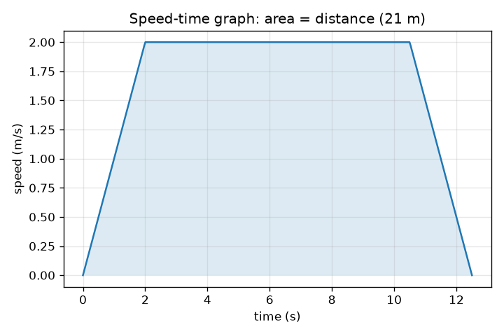
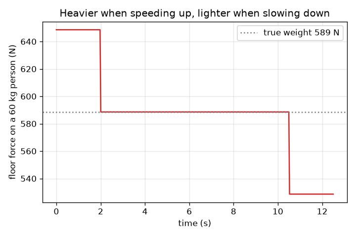

# அமர்வு 1: மேலும் கீழும் செல்லும் மின்தூக்கி: வேகம், வரைபடங்கள் மற்றும் நீங்கள் ஏன் கனமாக உணர்கிறீர்கள்

[Session 1 — हिन्दी](README.hi.md) · [Session 1 — മലയാളം](README.ml.md)

*நிலை 1 (கருத்தியல் ஊடாடும் மாதிரி) · சுமார் 60 நிமிடங்கள் · openelevator*

> இது ஒரு எளிமைப்படுத்தப்பட்ட கல்வி மாதிரி. இது சரிபார்க்கப்பட்ட வடிவமைப்புக் கருவி அல்ல; உண்மையான கட்டமைப்புகள், மின் நிறுவல்கள், வாகனங்கள், தொழில்துறை செயல்முறைகள் அல்லது மருத்துவ முடிவுகளுக்கு இதைப் பயன்படுத்தக் கூடாது.

**முன்தேவைகள் (Prerequisites)**

- வேகம் (speed) மற்றும் முடுக்கம் (acceleration), மேலும் வேக-நேர வரைபடத்தைப் படித்தல்.
- நீங்கள் PRIMER.md ஐப் படித்து, `python start.py 1` ஐ ஒரு முறை இயக்கியிருக்கிறீர்கள்.

**கற்றல் நோக்கங்கள் (Learning objectives).** இந்த அமர்வுக்குப் பிறகு உங்களால் முடியும்:

- ஒரு மின்தூக்கிப் பயணத்தை வேக-நேர வரைபடத்தில் முடுக்கம், சீரான ஓட்டம் (cruise), வேகக்குறைப்பு என விவரிக்க.
- வரைபடத்தின் சரிவிலிருந்து (slope) முடுக்கத்தையும் பரப்பிலிருந்து (area) தூரத்தையும் படிக்க.
- நீங்கள் எப்போது கனமாக அல்லது இலேசாக உணர்கிறீர்கள் என்று கூற தோற்ற எடை (apparent weight) N = m (g + a) ஐப் பயன்படுத்த.
- தூரம், உச்ச வேகம் மற்றும் முடுக்கத்திலிருந்து ஒரு பயணத்தின் நேரத்தைக் கண்டறிய.

## A. நிஜ உலகப் பிரச்சினை
நீங்கள் ஒரு மின்தூக்கியில் ஏறுகிறீர்கள், அது உயரத் தொடங்கும்போது தரை உங்கள் கால்களில் அதிகமாக அழுத்துவது போல் தோன்றுகிறது. மேலே அருகில் அது வேகம் குறையும்போது நீங்கள் சற்று இலேசாக உணர்கிறீர்கள். உங்களைப் பற்றி எதுவும் மாறவில்லை, ஈர்ப்பும் மாறவில்லை. பின் எது மாறியது? உங்கள் கால்களில் உள்ள அழுத்தத்தை விரும்பத்தகாததாக ஆக்காமல் ஒரு வடிவமைப்பாளர் பயணத்தை எப்படி விரைவாக்க முடியும்?

## B. கருத்தும் கோட்பாடும்
ஒரு மின்தூக்கிப் பயணத்தை வேக-நேர வரைபடம் மூலம் விவரிப்பது மிக எளிது. மின்தூக்கி உச்ச வேகம் v ஐ அடையும் வரை மாறா முடுக்கம் a இல் வேகம் கூடுகிறது, v இல் பயணிக்கிறது, பின்னர் அதே வீதத்தில் வேகம் குறைகிறது. வரைபடம் ஒரு சரிவகம் (trapezoid). வரைபடத்தின் சரிவு முடுக்கம், அதன் கீழ் உள்ள பரப்பு தூரம். v வரை வேகம் கூட்ட v / a வினாடிகள் ஆகிறது, v^2 / (2 a) மீட்டர்கள் கடக்கப்படுகிறது; வேகம் குறைப்பதும் அதே போல, எனவே d குறைந்தது v^2 / a (v வரை வேகம் கூட்டி மீண்டும் குறைக்கத் தேவையான தூரம்) ஆக இருக்கும் வரை, d தூரப் பயணத்துக்கு d / v + v / a வினாடிகள் ஆகிறது. தூரம் குறைவாக இருந்தால், மின்தூக்கி ஒருபோதும் v ஐ அடையாது: அது பாதி தூரம் வேகம் கூட்டி மீதிப் பாதி வேகம் குறைக்கிறது, பயணத்துக்கு 2 sqrt(d / a) வினாடிகள் ஆகிறது. உங்கள் கால்களில் தரையின் விசையை, அதாவது தோற்ற எடை N ஐ, நீங்கள் உணர்கிறீர்கள். உங்களுக்கான நியூட்டனின் இரண்டாம் விதி நிகர விசை = நிறை x முடுக்கம் என்கிறது, நிகர விசை மேல்நோக்கிய N கழித்தல் கீழ்நோக்கிய உங்கள் எடை m g, எனவே N = m (g + a). மின்தூக்கி மேல்நோக்கி முடுக்கும்போது (மேலே செல்லும்போது வேகம் கூடும்போது, அல்லது கீழே செல்லும்போது வேகம் குறையும்போது) a நேர்மறை, நீங்கள் கனமாக உணர்கிறீர்கள். முடுக்கம் கீழ்நோக்கி இருக்கும்போது நீங்கள் இலேசாக உணர்கிறீர்கள். மாறா வேகத்தில் a = 0, N = m g. முடுக்கம் மட்டுமே முக்கியம், ஒருபோதும் வேகம் அல்ல.

| குறியீடு | பொருள் | அலகு |
|---|---|---|
| d | பயணித்த தூரம் | m |
| v | உச்ச (சீரான ஓட்ட) வேகம் | m/s |
| a | மின்தூக்கியின் முடுக்கம், மேல்நோக்கி நேர்மறை | m/s^2 |
| m | நபரின் நிறை | kg |
| g | ஈர்ப்பு முடுக்கம், 9.81 | m/s^2 |
| N | நபர் மீது தரையின் விசை (தோற்ற எடை) | N |
| T | மொத்தப் பயண நேரம் | s |

**அனுமானங்கள் (Assumptions)**

- மின்தூக்கி நேர்கோட்டு வேக மாற்றங்களுடன் ஒரு நேரான செங்குத்துக் கோட்டில் நகர்கிறது (முடுக்கம் உடனடியாகத் தாவுகிறது).
- நபர் தரையில் அசையாமல் நிற்கிறார்.
- காற்றுத் தடையும் உராய்வும் புறக்கணிக்கப்படுகின்றன.
- இந்த அமர்வில் வசதி முடுக்கத்தின் அளவால் மட்டுமே மதிப்பிடப்படுகிறது.

$$ T=\frac{d}{v}+\frac{v}{a}\qquad (d\ge v^2/a) $$

$$ d_{\text{accelerate}}=\frac{v^2}{2a},\qquad t_{\text{accelerate}}=\frac{v}{a} $$

$$ N-mg=ma\;\Rightarrow\;N=m\,(g+a) $$

## C. காட்சி விளக்கம்
முதல் படம் 2 m/s உச்ச வேகமும் 1 m/s^2 முடுக்கமும் கொண்ட 21 m பயணத்தின் வேக-நேர வரைபடம்: 2 s ஏற்றம், 8.5 s தட்டையான மேற்பகுதி மற்றும் 2 s இறக்கம், மொத்தம் 12.5 s கொண்ட ஒரு சரிவகம், அதன் நிழலிட்ட பரப்பு 21 m. இரண்டாவது படம் அதே பயணத்தின்போது 60 kg நபர் மீது தரையின் விசையைக் காட்டுகிறது: வேகம் கூடும்போது 649 N (589 N உண்மை எடைக்கு மேல்), சீராக ஓடும்போது 589 N, வேகம் குறையும்போது 529 N.

*21 m பயணத்தின் வேக-நேர வரைபடம்: சரிவு முடுக்கம், நிழலிட்ட பரப்பு தூரம்.*

*60 kg நபர் மீது தரையின் விசை: வேகம் கூடும்போது கனமாக, வேகம் குறையும்போது இலேசாக.*

## D. ஊடாடும் உருவகப்படுத்துதல்
பாடத்தை இயக்கவும் (`python start.py 1`), பின்னர் நேரடிச் செயலியைத் திறக்கவும்: [அமர்வு 1: ஒரு மின்தூக்கிப் பயணமும் உங்கள் கால்களில் உள்ள விசையும்](https://krunalpanchal1995.github.io/pan-iit-oss/openelevator/session-01/) (அல்லது இந்தக் கோப்புறையில் உள்ள `app.html`). பயண-முன்னேற்ற நழுவியை நகர்த்தி, கூண்டு குழாய்வழியில் உயர்வதையும் விசைப் பட்டை வளர்ந்து சுருங்குவதையும் பாருங்கள். பின்னர் வேக வரைபடத்தையும் விசை வரைபடத்தையும் திறந்து முடுக்கத்தை மாற்றுங்கள்.

**சவால் (Challenge).** தரையின் விசை உங்கள் எடையை விட 15 சதவீதத்துக்கு மேல் ஒருபோதும் போகாமல், 21 m பயணம் 12 s க்கும் குறைவாக எடுக்கும்படி செய்யுங்கள்.

## E. தீர்க்கப்பட்ட எடுத்துக்காட்டும் சோதனையும்
**பிரச்சினை.** 60 kg நபர் 1.0 m/s^2 இல் மேல்நோக்கி வேகம் கூடும் மின்தூக்கியில் இருக்கிறார். தரை என்ன விசையைச் செலுத்துகிறது, அது ஓய்வில் உள்ள நபரின் எடையுடன் எப்படி ஒப்பிடுகிறது?

1. ஓய்வில் எடை: m g = 60 * 9.81 = 588.6 N.
2. வேகம் கூடும்போது: N = m (g + a) = 60 * (9.81 + 1.0) = 60 * 10.81 = 648.6 N.
3. விகிதம்: 648.6 / 588.6 = 1.10, எனவே நபர் 10 சதவீதம் கனமாக உணர்கிறார்.
4. அதே வீதத்தில் வேகம் குறையும்போது (a = -1.0): N = 60 * 8.81 = 528.6 N, சுமார் 10 சதவீதம் இலேசாக.

**விடை.** வேகம் கூடும்போது N = 648.6 N (ஓய்வில் 588.6 N, வேகம் குறையும்போது 528.6 N).

**சோதனை.** மின்தூக்கியில் ஒரு குளியலறைத் தராசின் மீது நில்லுங்கள் (அல்லது முடுக்கத்தைக் காட்டும் கைபேசிச் செயலியைப் பயன்படுத்துங்கள்), மின்தூக்கி தொடங்கும்போதும் நிற்கும்போதும் அளவீட்டைப் பாருங்கள். தராசு நிறையைக் காட்டுகிறது, எனவே அது m (g + a) / g ஐப் படிக்கிறது: உங்கள் இயல்பு நிறை பெருக்கல் 1 + a / g. a = 1 m/s^2 க்கு அளவீடு சுமார் 10 சதவீதம் உயர்ந்து, முடிவில் அதே அளவு குறைந்து, சீரான வேகத்தில் உங்கள் இயல்பு எடைக்குத் திரும்ப வேண்டும். வழக்கமான மின்தூக்கிகள் 1 m/s^2 க்கும் குறைவாக முடுக்குகின்றன, எனவே நீங்கள் காணும் மாற்றங்கள் சிறியதாக இருக்கும் (a = 0.5 m/s^2 க்கு சுமார் 5 சதவீதம்). நிரப்ப வேண்டிய அட்டவணையும் எதிர்பார்க்கப்படும் அளவீடுகளும் கொண்ட படிப்படியான தாள் [scale_experiment.md](scale_experiment.md) இல் உள்ளது; பயன்படுத்த அனுமதி உள்ள மின்தூக்கிகளில் மட்டுமே இதைச் செய்யுங்கள். மாதிரிக்கும் நிஜத்துக்கும் இடையிலான வேறுபாடுகள்: உண்மையான தராசு மெதுவாக எதிர்வினையாற்றுகிறது, உண்மையான முடுக்கம் சரியான படி அல்ல, மின்தூக்கி சற்று ஆடலாம்.

## F. மதிப்பீடும் வடிவமைப்புச் சவாலும்
**கேள்வி வகை A: கருத்தியல்.** ஒரு மின்தூக்கி சீரான வேகத்தில் கீழ்நோக்கி நகர்ந்து, பின்னர் தரைத்தளத்தில் நிற்க வேகம் குறைக்கத் தொடங்குகிறது. நீங்கள் கனமாகவா, இலேசாகவா, அல்லது அதே போலவா உணர்கிறீர்கள்? வேகம் என்ற சொல்லைப் பயன்படுத்தாமல் விளக்குங்கள்.

குறிப்பு

கீழே நகரும்போது வேகம் குறைவது என்றால் திசைவேகம் மேல்நோக்கி மாறுகிறது. முடுக்கம் எந்தத் திசையில் உள்ளது?

படிப்படியான தீர்வு

நீங்கள் கனமாக உணர்கிறீர்கள். திசைவேகம் (velocity) கீழ்நோக்கி உள்ளது, சுருங்குகிறது, எனவே திசைவேக மாற்றம் (முடுக்கம்) மேல்நோக்கி உள்ளது. a மேல்நோக்கி நேர்மறையாக இருக்கும்போது, N = m (g + a), m g ஐ விடப் பெரியது. முக்கியமானது முடுக்கத்தின் திசை, இயக்கத்தின் திசை அல்ல.

**கேள்வி வகை B: எண்ணியல்.** 75 kg நபர் 1.5 m/s^2 இல் மேல்நோக்கி வேகம் கூடும் மின்தூக்கியில் நிற்கிறார். தரையின் விசையையும் ஓய்வில் உள்ள நபரின் எடையிலிருந்து சதவீத மாற்றத்தையும் கண்டறியுங்கள்.

குறிப்பு

g = 9.81 m/s^2 உடன் N = m (g + a).

படிப்படியான தீர்வு

N = 75 * (9.81 + 1.5) = 75 * 11.31 = 848.25 N, சுமார் 848 N. ஓய்வில் எடை = 75 * 9.81 = 735.75 N. மாற்றம் = 848.25 / 735.75 = 1.153, எனவே 15.3 சதவீதம் கனமாக. அலகுச் சரிபார்ப்பு: kg * m/s^2 = N.

**கேள்வி வகை C: வரைபடம் மற்றும் உருவகப்படுத்துதல் விளக்கம்.** 21 m பயணத்தின் வேக-நேர வரைபடத்தில் (உச்ச வேகம் 2 m/s, 2 s இல் ஏற்றம், 8.5 s தட்டையானது), முடுக்கம் என்ன, தூரம் 21 m என்று எப்படிச் சரிபார்க்கலாம்?

குறிப்பு

சரிவு = ஏற்றம் / ஓட்டம். பரப்பு = இரண்டு முக்கோணங்களும் ஒரு செவ்வகமும்.

படிப்படியான தீர்வு

உயரும் பகுதியின் சரிவு = (2 - 0) / 2 = 1.0 m/s^2. பரப்பு: தலா 0.5 * 2 * 2 = 2 m கொண்ட இரண்டு முக்கோணங்கள் (4 m) கூட்டல் ஒரு செவ்வகம் 2 m/s * 8.5 s = 17 m, மொத்தம் 21 m, இது தூரத்துடன் பொருந்துகிறது.

**கேள்வி வகை D: வடிவமைப்பு மற்றும் உகப்பாக்கச் சவால்.** வடிவமைப்பு: 21 m பயணம் 11 s க்கும் குறைவாக எடுக்க வேண்டும், தரையின் விசை நபரின் எடையின் 15 சதவீதத்துக்குள் இருக்க வேண்டும் (a <= 1.47 m/s^2). a மற்றும் v ஐத் தேர்ந்தெடுத்து, d >= v^2 / a ஐச் சரிபார்த்து, பயண நேரத்தைத் தாருங்கள். ஏன் மிகப் பெரிய v ஐ வெறுமனே தேர்ந்தெடுக்கக் கூடாது?

குறிப்பு

a = 1.4 m/s^2 மற்றும் T = d / v + v / a இல் v இன் சில மதிப்புகளை முயலுங்கள்.

படிப்படியான தீர்வு

a = 1.4 m/s^2 எடுங்கள் (a/g = 0.143, அதாவது 14.3 சதவீதம்). v = 3 m/s உடன்: v^2 / a = 6.4 m, இது 21 m க்கும் குறைவு, எனவே மின்தூக்கி முழு வேகத்தை அடைகிறது. T = 21 / 3 + 3 / 1.4 = 7.0 + 2.14 = 9.14 s, 11 s க்குக் கீழே. மிகப் பெரிய v இலவசம் அல்ல: மின்தூக்கிக்கு வலுவான மோட்டார் தேவை, பாதுகாப்பாக வேகம் குறைக்க அதிகக் குழாய்வழி உயரம் தேவை, பயணிகள் மிக அதிக வேகத்தை விரும்புவதில்லை. a = 1.4 உடன் சுமார் 2.23 m/s க்கு மேலான v க்கு மட்டுமே நேரம் 11 s க்குக் கீழே இருக்கும் (21 / v + v / 1.4 = 11 ஐத் தீர்க்கவும்), எனவே 2.5 முதல் 4 m/s வரையிலான v ஒரு பொருத்தமான வரம்பு. அனுமானங்கள்: மாறா முடுக்கம், குலுக்கல் வரம்பு (jerk limit) இல்லை (அமர்வு 2 அதைச் சேர்க்கிறது).

[RUBRIC.md](../../RUBRIC.md) மூலம் உங்களை நீங்களே மதிப்பிடுங்கள். காகிதத்தில் செய்ய [செயல்பாட்டுத் தாளை](activity_sheet.md) அச்சிடுங்கள்.

## பொதுவான தவறான கருத்துகள்
| பொதுவான தவறான கருத்து | உண்மையில் சரியானது |
|---|---|
| மின்தூக்கி வேகமாக நகரும்போதெல்லாம் நான் கனமாக உணர்கிறேன். | முடுக்கம் மட்டுமே தரையின் விசையை மாற்றுகிறது. எந்தச் சீரான வேகத்திலும், வேகமாக இருந்தாலும் மெதுவாக இருந்தாலும், நீங்கள் இயல்பு எடையை உணர்கிறீர்கள். |
| மின்தூக்கியில் என் எடை உண்மையில் மாறுகிறது. | ஈர்ப்பு உங்களை அதே விசையுடன் இழுக்கிறது. மாறுவது உங்கள் மீது தரையின் விசை, அதாவது தோற்ற எடை. |
| மேலே செல்வது எப்போதும் கனமாகவும் கீழே செல்வது எப்போதும் இலேசாகவும் உணர்கிறது. | இது முடுக்கத்தின் திசையைப் பொறுத்தது: மேலே செல்லும்போது வேகம் கூடுவதும் கீழே செல்லும்போது வேகம் குறைவதும் இரண்டுமே கனமாக உணர வைக்கின்றன. |
| பெரிய உச்ச வேகம் எப்போதும் விகிதப்படி நேரத்தைச் சேமிக்கிறது. | நேரம் d / v + v / a: அதில் ஒரு பகுதி வேகம் கூட்டுவதில் செலவாகிறது, எனவே v ஐ இருமடங்காக்கினால் நேரம் பாதியாவதில்லை, குறிப்பாகக் குறுகிய பயணங்களுக்கு. |

## சொற்களஞ்சியம் (Glossary)
- **முடுக்கம் (acceleration)**: வேகம் எவ்வளவு விரைவாக மாறுகிறது, m/s^2 இல்; வேக-நேர வரைபடத்தின் சரிவு
- **தோற்ற எடை (apparent weight)**: தரை உங்கள் மீது செலுத்தும் விசை; தராசு படிப்பது
- **வேக-நேர வரைபடம் (speed-time graph)**: நேரத்துக்கு எதிரான வேகத்தின் வரைபடம்; சரிவு முடுக்கம், பரப்பு தூரம்
- **சீரான ஓட்டம் (cruise)**: மாறா வேகத்தில் உள்ள பயணப் பகுதி

## முடிக்கவும்
1. [exercises.md](exercises.md) இல் உள்ள மூன்று நிரலாக்கப் பணிகளைச் செய்யுங்கள்.
2. உங்கள் மாற்றங்களுக்குப் பிறகு `python start.py 1` ஐ மீண்டும் இயக்குங்கள். இது சோதனைச்சாவடியுடன் (checkpoint) முடிகிறது; அது `PASS` என்று அச்சிடும்போது நீங்கள் முடித்துவிட்டீர்கள். (சோதனைச்சாவடி மட்டும்: `python start.py check 1`.)

அடுத்து: [அமர்வு 2](../session-02/README.md)
