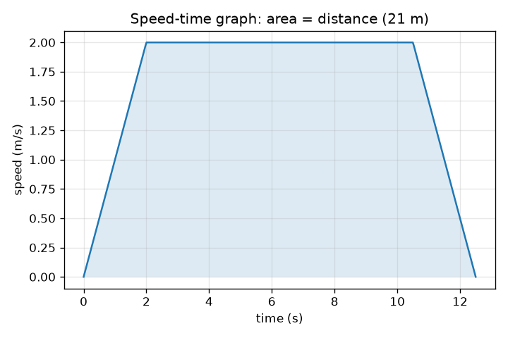
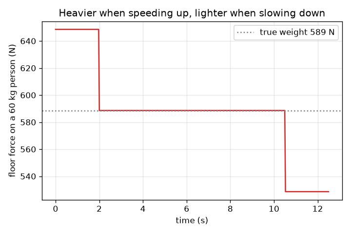

# సెషన్ 1: పైకి కిందికి వెళ్ళే లిఫ్ట్: వేగం, గ్రాఫ్‌లు మరియు మీరు ఎందుకు బరువుగా అనిపిస్తారు

[Session 1 — हिन्दी](README.hi.md) · [Session 1 — മലയാളം](README.ml.md) · [Session 1 — தமிழ்](README.ta.md)

*స్థాయి 1 (భావనాత్మక ఇంటరాక్టివ్ నమూనా) · సుమారు 60 నిమిషాలు · openelevator*

> ఇది ఒక సరళీకృత విద్యా నమూనా. ఇది ధృవీకరించబడిన డిజైన్ సాధనం కాదు; నిజమైన నిర్మాణాలు, విద్యుత్ ఇన్‌స్టలేషన్లు, వాహనాలు, పారిశ్రామిక ప్రక్రియలు లేదా వైద్య నిర్ణయాల కోసం దీనిని ఉపయోగించకూడదు.

**ముందస్తు అవసరాలు (Prerequisites)**

- వేగం (speed) మరియు త్వరణం (acceleration), మరియు వేగ-కాల గ్రాఫ్‌ను చదవడం.
- మీరు PRIMER.md చదివి, `python start.py 1` ను ఒకసారి రన్ చేశారు.

**అభ్యసన లక్ష్యాలు (Learning objectives).** ఈ సెషన్ తర్వాత మీరు చేయగలరు:

- లిఫ్ట్ ప్రయాణాన్ని వేగ-కాల గ్రాఫ్‌పై త్వరణం, స్థిర ప్రయాణం (cruise), మందగమనం అని వివరించడం.
- గ్రాఫ్ వాలు (slope) నుండి త్వరణాన్ని మరియు వైశాల్యం (area) నుండి దూరాన్ని చదవడం.
- మీరు ఎప్పుడు బరువుగా లేదా తేలికగా అనిపిస్తారో చెప్పడానికి దృశ్య బరువు (apparent weight) N = m (g + a) ను ఉపయోగించడం.
- దూరం, గరిష్ఠ వేగం మరియు త్వరణం నుండి ప్రయాణ సమయాన్ని కనుగొనడం.

## A. వాస్తవ ప్రపంచ సమస్య
మీరు లిఫ్ట్‌లోకి అడుగుపెడతారు, అది పైకి లేవడం ప్రారంభించినప్పుడు నేల మీ పాదాలపై ఎక్కువగా నెడుతున్నట్లు అనిపిస్తుంది. పైకి దగ్గరగా అది నెమ్మదించినప్పుడు మీరు కొంచెం తేలికగా అనిపిస్తారు. మీ గురించి ఏమీ మారలేదు, గురుత్వాకర్షణ కూడా మారలేదు. మరి ఏమి మారింది? మీ పాదాలపై నెట్టుడును అసౌకర్యంగా చేయకుండా డిజైనర్ ప్రయాణాన్ని ఎలా వేగంగా చేయగలరు?

## B. భావన మరియు సిద్ధాంతం
లిఫ్ట్ ప్రయాణాన్ని వేగ-కాల గ్రాఫ్‌తో వివరించడం అత్యంత సులభం. లిఫ్ట్ గరిష్ఠ వేగం v చేరే వరకు స్థిర త్వరణం a తో వేగం పెంచుకుంటుంది, v వద్ద ప్రయాణిస్తుంది, తర్వాత అదే రేటుతో నెమ్మదిస్తుంది. గ్రాఫ్ ఒక సమలంబ చతుర్భుజం (trapezoid). గ్రాఫ్ వాలు త్వరణం మరియు దాని కింద వైశాల్యం దూరం. v వరకు వేగం పెంచడానికి v / a సెకన్లు పడుతుంది మరియు v^2 / (2 a) మీటర్లు కవర్ అవుతుంది, నెమ్మదించడం కూడా అంతే, కాబట్టి d కనీసం v^2 / a (v వరకు వేగం పెంచి మళ్ళీ నెమ్మదించడానికి అవసరమైన దూరం) ఉన్నంత వరకు d దూరం ప్రయాణానికి d / v + v / a సెకన్లు పడుతుంది. దూరం తక్కువైతే, లిఫ్ట్ ఎప్పుడూ v ని చేరదు: అది సగం దూరం వేగం పెంచి మిగిలిన సగం నెమ్మదిస్తుంది, ప్రయాణానికి 2 sqrt(d / a) సెకన్లు పడుతుంది. మీ పాదాలపై నేల బలాన్ని, అంటే దృశ్య బరువు N ను, మీరు అనుభవిస్తారు. మీకు న్యూటన్ రెండవ నియమం నికర బలం = ద్రవ్యరాశి x త్వరణం అని చెబుతుంది, నికర బలం పైకి N మైనస్ కిందికి మీ బరువు m g, కాబట్టి N = m (g + a). లిఫ్ట్ పైకి త్వరణం చెందినప్పుడు (పైకి వెళ్తూ వేగం పెంచుకున్నప్పుడు, లేదా కిందికి వెళ్తూ నెమ్మదించినప్పుడు) a ధనాత్మకం, మీరు బరువుగా అనిపిస్తారు. త్వరణం కిందికి ఉన్నప్పుడు మీరు తేలికగా అనిపిస్తారు. స్థిర వేగం వద్ద a = 0 మరియు N = m g. త్వరణం మాత్రమే ముఖ్యం, ఎప్పుడూ వేగం కాదు.

| గుర్తు | అర్థం | యూనిట్ |
|---|---|---|
| d | ప్రయాణించిన దూరం | m |
| v | గరిష్ఠ (స్థిర ప్రయాణ) వేగం | m/s |
| a | లిఫ్ట్ త్వరణం, పైకి ధనాత్మకం | m/s^2 |
| m | వ్యక్తి ద్రవ్యరాశి | kg |
| g | గురుత్వ త్వరణం, 9.81 | m/s^2 |
| N | వ్యక్తిపై నేల బలం (దృశ్య బరువు) | N |
| T | మొత్తం ప్రయాణ సమయం | s |

**ఊహలు (Assumptions)**

- లిఫ్ట్ సరళ రేఖా వేగ మార్పులతో నిటారు నిలువు రేఖలో కదులుతుంది (త్వరణం తక్షణమే దూకుతుంది).
- వ్యక్తి నేలపై కదలకుండా నిలబడతాడు.
- గాలి నిరోధం మరియు ఘర్షణ విస్మరించబడతాయి.
- ఈ సెషన్‌లో సౌకర్యం త్వరణం పరిమాణం ద్వారా మాత్రమే అంచనా వేయబడుతుంది.

$$ T=\frac{d}{v}+\frac{v}{a}\qquad (d\ge v^2/a) $$

$$ d_{\text{accelerate}}=\frac{v^2}{2a},\qquad t_{\text{accelerate}}=\frac{v}{a} $$

$$ N-mg=ma\;\Rightarrow\;N=m\,(g+a) $$

## C. దృశ్య వివరణ
మొదటి చిత్రం 2 m/s గరిష్ఠ వేగం మరియు 1 m/s^2 త్వరణం ఉన్న 21 m ప్రయాణం యొక్క వేగ-కాల గ్రాఫ్: 2 s పెరుగుదల, 8.5 s చదునైన పైభాగం మరియు 2 s తగ్గుదల, మొత్తం 12.5 s ఉన్న సమలంబ చతుర్భుజం, దాని నీడ వేసిన వైశాల్యం 21 m. రెండవ చిత్రం అదే ప్రయాణంలో 60 kg వ్యక్తిపై నేల బలాన్ని చూపిస్తుంది: వేగం పెరుగుతున్నప్పుడు 649 N (589 N నిజమైన బరువు కంటే ఎక్కువ), స్థిరంగా ప్రయాణిస్తున్నప్పుడు 589 N మరియు నెమ్మదిస్తున్నప్పుడు 529 N.

*21 m ప్రయాణం యొక్క వేగ-కాల గ్రాఫ్: వాలు త్వరణం, నీడ వేసిన వైశాల్యం దూరం.*

*60 kg వ్యక్తిపై నేల బలం: వేగం పెరిగేటప్పుడు బరువుగా, నెమ్మదించేటప్పుడు తేలికగా.*

## D. ఇంటరాక్టివ్ సిమ్యులేషన్
పాఠాన్ని రన్ చేయండి (`python start.py 1`), తర్వాత లైవ్ యాప్‌ను తెరవండి: [సెషన్ 1: లిఫ్ట్ ప్రయాణం మరియు మీ పాదాలపై బలం](https://krunalpanchal1995.github.io/pan-iit-oss/openelevator/session-01/) (లేదా ఈ ఫోల్డర్‌లోని `app.html`). ప్రయాణ-పురోగతి స్లైడర్‌ను కదిలించి కారు షాఫ్ట్‌లో పైకి లేవడం మరియు బల బార్ పెరగడం తగ్గడం చూడండి. తర్వాత వేగ గ్రాఫ్ మరియు బల గ్రాఫ్‌ను తెరిచి త్వరణాన్ని మార్చండి.

**సవాలు (Challenge).** నేల బలం ఎప్పుడూ మీ బరువు కంటే 15 శాతం మించకుండా, 21 m ప్రయాణం 12 s కంటే తక్కువ సమయం తీసుకునేలా చేయండి.

## E. సాధించిన ఉదాహరణ మరియు ప్రయోగం
**సమస్య.** 60 kg వ్యక్తి 1.0 m/s^2 వద్ద పైకి వేగం పెంచుకుంటున్న లిఫ్ట్‌లో ఉన్నాడు. నేల ఏ బలాన్ని కలిగిస్తుంది, అది విరామంలో ఉన్న వ్యక్తి బరువుతో ఎలా పోలుస్తుంది?

1. విరామంలో బరువు: m g = 60 * 9.81 = 588.6 N.
2. వేగం పెరుగుతున్నప్పుడు: N = m (g + a) = 60 * (9.81 + 1.0) = 60 * 10.81 = 648.6 N.
3. నిష్పత్తి: 648.6 / 588.6 = 1.10, కాబట్టి వ్యక్తి 10 శాతం బరువుగా అనిపిస్తాడు.
4. అదే రేటుతో నెమ్మదిస్తున్నప్పుడు (a = -1.0): N = 60 * 8.81 = 528.6 N, సుమారు 10 శాతం తేలికగా.

**సమాధానం.** వేగం పెరుగుతున్నప్పుడు N = 648.6 N (విరామంలో 588.6 N, నెమ్మదిస్తున్నప్పుడు 528.6 N).

**ప్రయోగం.** లిఫ్ట్‌లో బాత్‌రూమ్ త్రాసుపై నిలబడండి (లేదా త్వరణాన్ని చూపించే ఫోన్ యాప్ ఉపయోగించండి), లిఫ్ట్ ప్రారంభమై ఆగినప్పుడు రీడింగ్‌ను చూడండి. త్రాసు ద్రవ్యరాశిని చూపిస్తుంది, కాబట్టి అది m (g + a) / g చదువుతుంది: మీ సాధారణ ద్రవ్యరాశి గుణకారం 1 + a / g. a = 1 m/s^2 కు రీడింగ్ సుమారు 10 శాతం పెరిగి, చివరలో అంతే తగ్గి, స్థిర వేగం వద్ద మీ సాధారణ బరువుకు తిరిగి రావాలి. సాధారణ లిఫ్టులు 1 m/s^2 కంటే తక్కువ త్వరణం చెందుతాయి, కాబట్టి మీరు చూసే మార్పులు చిన్నవిగా ఉంటాయి (a = 0.5 m/s^2 కు సుమారు 5 శాతం). నింపాల్సిన పట్టిక మరియు ఆశించే రీడింగులతో దశలవారీ షీట్ [scale_experiment.md](scale_experiment.md) లో ఉంది; ఉపయోగించడానికి అనుమతి ఉన్న లిఫ్టులలో మాత్రమే దీన్ని చేయండి. నమూనా మరియు వాస్తవం మధ్య తేడాలు: నిజమైన త్రాసు నెమ్మదిగా స్పందిస్తుంది, నిజమైన త్వరణం పరిపూర్ణ మెట్టు కాదు, మరియు లిఫ్ట్ కొంచెం ఊగవచ్చు.

## F. మూల్యాంకనం మరియు డిజైన్ సవాలు
**ప్రశ్న రకం A: భావనాత్మక.** ఒక లిఫ్ట్ స్థిర వేగంతో కిందికి కదులుతూ, తర్వాత కింది అంతస్తులో ఆగడానికి నెమ్మదించడం ప్రారంభిస్తుంది. మీరు బరువుగా, తేలికగా, లేదా అదే విధంగా అనిపిస్తారా? వేగం అనే పదాన్ని ఉపయోగించకుండా వివరించండి.

సూచన

కిందికి కదులుతూ నెమ్మదించడం అంటే వేగసదిశ పైకి మారుతుంది. త్వరణం ఏ దిశలో ఉంది?

దశలవారీ పరిష్కారం

మీరు బరువుగా అనిపిస్తారు. వేగసదిశ (velocity) కిందికి ఉంది మరియు తగ్గుతోంది, కాబట్టి వేగసదిశ మార్పు (త్వరణం) పైకి ఉంది. a పైకి మరియు ధనాత్మకంగా ఉన్నప్పుడు, N = m (g + a), m g కంటే పెద్దది. ముఖ్యమైనది త్వరణం దిశ, చలన దిశ కాదు.

**ప్రశ్న రకం B: సంఖ్యాత్మక.** 75 kg వ్యక్తి 1.5 m/s^2 వద్ద పైకి వేగం పెంచుకుంటున్న లిఫ్ట్‌లో నిలబడ్డాడు. నేల బలాన్ని మరియు విరామంలో ఉన్న వ్యక్తి బరువు నుండి శాతం మార్పును కనుగొనండి.

సూచన

g = 9.81 m/s^2 తో N = m (g + a).

దశలవారీ పరిష్కారం

N = 75 * (9.81 + 1.5) = 75 * 11.31 = 848.25 N, సుమారు 848 N. విరామంలో బరువు = 75 * 9.81 = 735.75 N. మార్పు = 848.25 / 735.75 = 1.153, కాబట్టి 15.3 శాతం బరువుగా. యూనిట్ సరిచూపు: kg * m/s^2 = N.

**ప్రశ్న రకం C: గ్రాఫ్ మరియు సిమ్యులేషన్ వ్యాఖ్యానం.** 21 m ప్రయాణం యొక్క వేగ-కాల గ్రాఫ్‌పై (గరిష్ఠ వేగం 2 m/s, 2 s లో పెరుగుదల, 8.5 s చదునుగా), త్వరణం ఎంత, దూరం 21 m అని ఎలా సరిచూడగలరు?

సూచన

వాలు = పెరుగుదల / పరుగు. వైశాల్యం = రెండు త్రిభుజాలు మరియు ఒక దీర్ఘచతురస్రం.

దశలవారీ పరిష్కారం

పెరిగే భాగం వాలు = (2 - 0) / 2 = 1.0 m/s^2. వైశాల్యం: ఒక్కొక్కటి 0.5 * 2 * 2 = 2 m ఉన్న రెండు త్రిభుజాలు (4 m) కలిపి ఒక దీర్ఘచతురస్రం 2 m/s * 8.5 s = 17 m, మొత్తం 21 m, ఇది దూరంతో సరిపోతుంది.

**ప్రశ్న రకం D: డిజైన్ మరియు ఆప్టిమైజేషన్ సవాలు.** డిజైన్: 21 m ప్రయాణం 11 s కంటే తక్కువ సమయం తీసుకోవాలి మరియు నేల బలం వ్యక్తి బరువులో 15 శాతం లోపు ఉండాలి (a <= 1.47 m/s^2). a మరియు v ని ఎంచుకుని, d >= v^2 / a సరిచూసి, ప్రయాణ సమయాన్ని ఇవ్వండి. చాలా పెద్ద v ని ఎందుకు ఎంచుకోకూడదు?

సూచన

a = 1.4 m/s^2 మరియు T = d / v + v / a లో v యొక్క కొన్ని విలువలను ప్రయత్నించండి.

దశలవారీ పరిష్కారం

a = 1.4 m/s^2 తీసుకోండి (a/g = 0.143, అంటే 14.3 శాతం). v = 3 m/s తో: v^2 / a = 6.4 m, ఇది 21 m కంటే తక్కువ, కాబట్టి లిఫ్ట్ పూర్తి వేగాన్ని చేరుతుంది. T = 21 / 3 + 3 / 1.4 = 7.0 + 2.14 = 9.14 s, 11 s కంటే తక్కువ. చాలా పెద్ద v ఉచితం కాదు: లిఫ్ట్‌కు బలమైన మోటార్ అవసరం, సురక్షితంగా నెమ్మదించడానికి ఎక్కువ షాఫ్ట్ ఎత్తు అవసరం, ప్రయాణికులు చాలా ఎక్కువ వేగాన్ని ఇష్టపడరు. a = 1.4 తో సుమారు 2.23 m/s పైన ఉన్న v కి మాత్రమే సమయం 11 s కంటే తక్కువగా ఉంటుంది (21 / v + v / 1.4 = 11 సాధించండి), కాబట్టి 2.5 నుండి 4 m/s వరకు v ఒక సహేతుకమైన పరిధి. ఊహలు: స్థిర త్వరణం, జెర్క్ పరిమితి (jerk limit) లేదు (సెషన్ 2 దానిని జోడిస్తుంది).

[RUBRIC.md](../../RUBRIC.md) తో మిమ్మల్ని మీరు స్కోర్ చేసుకోండి. కాగితంపై పని చేయడానికి [కార్యాచరణ పత్రాన్ని](activity_sheet.md) ప్రింట్ చేయండి.

## సాధారణ అపోహలు
| సాధారణ అపోహ | నిజానికి సరైనది |
|---|---|
| లిఫ్ట్ వేగంగా కదిలినప్పుడల్లా నేను బరువుగా అనిపిస్తాను. | త్వరణం మాత్రమే నేల బలాన్ని మారుస్తుంది. ఏ స్థిర వేగం వద్దనైనా, వేగంగా అయినా నెమ్మదిగా అయినా, మీరు మీ సాధారణ బరువును అనుభవిస్తారు. |
| లిఫ్ట్‌లో నా బరువు నిజంగా మారుతుంది. | గురుత్వాకర్షణ మిమ్మల్ని అదే బలంతో లాగుతుంది. మారేది మీపై నేల బలం, అంటే దృశ్య బరువు. |
| పైకి వెళ్ళడం ఎల్లప్పుడూ బరువుగా, కిందికి వెళ్ళడం ఎల్లప్పుడూ తేలికగా అనిపిస్తుంది. | ఇది త్వరణం దిశపై ఆధారపడి ఉంటుంది: పైకి వెళ్తూ వేగం పెంచడం మరియు కిందికి వెళ్తూ నెమ్మదించడం రెండూ బరువుగా అనిపిస్తాయి. |
| పెద్ద గరిష్ఠ వేగం ఎల్లప్పుడూ అనుపాతంలో సమయాన్ని ఆదా చేస్తుంది. | సమయం d / v + v / a: దానిలో కొంత భాగం వేగం పెంచడంలో ఖర్చవుతుంది, కాబట్టి v ని రెట్టింపు చేస్తే సమయం సగం కాదు, ముఖ్యంగా చిన్న ప్రయాణాలకు. |

## పదకోశం (Glossary)
- **త్వరణం (acceleration)**: వేగం ఎంత త్వరగా మారుతుందో, m/s^2 లో; వేగ-కాల గ్రాఫ్ వాలు
- **దృశ్య బరువు (apparent weight)**: నేల మీపై కలిగించే బలం; త్రాసు చదివేది
- **వేగ-కాల గ్రాఫ్ (speed-time graph)**: కాలానికి వ్యతిరేకంగా వేగం యొక్క గ్రాఫ్; వాలు త్వరణం, వైశాల్యం దూరం
- **స్థిర ప్రయాణం (cruise)**: స్థిర వేగంతో ఉన్న ప్రయాణ భాగం

## ముగించండి
1. [exercises.md](exercises.md) లోని మూడు కోడింగ్ పనులను చేయండి.
2. మీ మార్పుల తర్వాత `python start.py 1` ను మళ్ళీ రన్ చేయండి. ఇది చెక్‌పాయింట్‌తో ముగుస్తుంది; అది `PASS` అని ప్రింట్ చేసినప్పుడు మీరు పూర్తి చేశారు. (చెక్‌పాయింట్ మాత్రమే: `python start.py check 1`.)

తదుపరి: [సెషన్ 2](../session-02/README.md)
