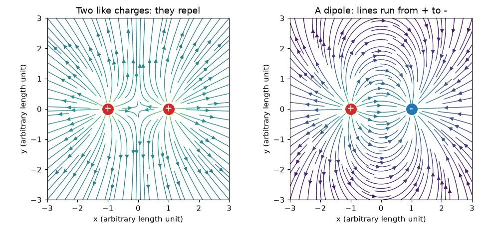
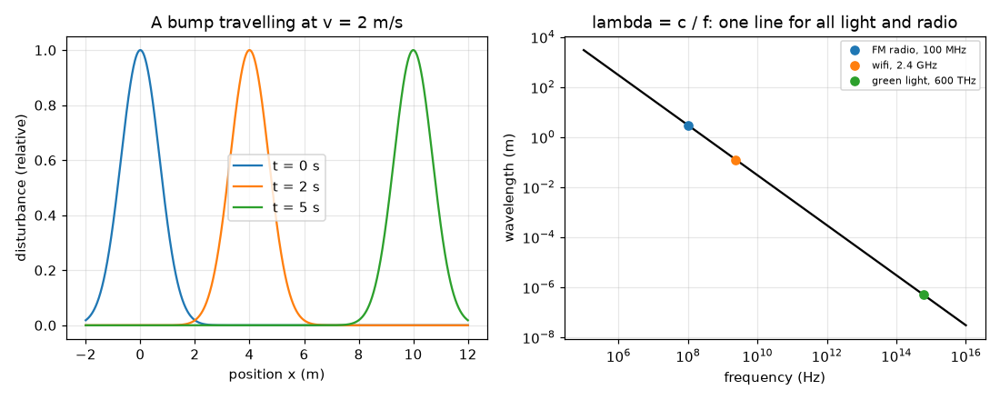

# सत्र 1: आवेश, क्षेत्र और तरंगें

*स्तर 1 (वैचारिक इंटरैक्टिव मॉडल) · लगभग 60 मिनट · openemwave*

> यह एक सरलीकृत शैक्षिक मॉडल है। यह कोई प्रमाणित डिज़ाइन टूल नहीं है और इसका उपयोग वास्तविक संरचनाओं, बिजली की वायरिंग (electrical installations), वाहनों, औद्योगिक प्रक्रियाओं या चिकित्सा निर्णयों के लिए नहीं किया जाना चाहिए।

**पूर्व-आवश्यकताएँ (Prerequisites)**

- स्कूल का अंकगणित और ग्राफ़ का विचार।
- आपने PRIMER.md पढ़ लिया है और एक बार `python start.py 1` चलाया है।

**सीखने के उद्देश्य (Learning objectives).** इस सत्र के बाद आप:

- बता सकेंगे कि समान और विपरीत आवेश क्या करते हैं, और दो समान आवेशों तथा एक द्विध्रुव (dipole) का क्षेत्र बना सकेंगे।
- तरंग को एक चलते हुए विक्षोभ (disturbance) के रूप में समझा सकेंगे, और उससे तरंगदैर्ध्य और आवृत्ति पढ़ सकेंगे।
- रेडियो और प्रकाश के लिए चाल = आवृत्ति x तरंगदैर्ध्य का उपयोग कर सकेंगे।
- बता सकेंगे कि रेडियो, वाईफ़ाई और प्रकाश एक ही प्रकार की तरंगें हैं, जिनके लिए c लगभग 3e8 m/s है।

## A. वास्तविक दुनिया की समस्या
बालों पर रगड़ा गया गुब्बारा दीवार से चिपक जाता है, और उसी प्रकार का अदृश्य धक्का आपके पसंदीदा FM स्टेशन को दीवारों के पार एक छोटे रेडियो तक ले जाता है। वह धक्का क्या है, हम उसे कैसे चित्रित कर सकते हैं, और रेडियो तरंगें और प्रकाश वास्तव में एक ही चीज़ क्यों हैं? इस चित्र के बिना, ऐंटेना (antenna) बस धातु का एक रहस्यमय टुकड़ा है।

## B. अवधारणा और सिद्धांत
विद्युत आवेश (electric charge) दो चिह्नों में आता है। एक ही चिह्न के आवेश एक-दूसरे को प्रतिकर्षित (repel) करते हैं और विपरीत चिह्न के आवेश आकर्षित (attract) करते हैं। किसी बिंदु पर विद्युत क्षेत्र (electric field) वह प्रति इकाई आवेश धक्का है जो वहाँ एक छोटा धनात्मक परीक्षण आवेश (test charge) महसूस करेगा; यह धनात्मक आवेशों से दूर और ऋणात्मक आवेशों की ओर इंगित करता है, और यह हर आवेश के धक्कों का (तीरों के रूप में) योग है। दो बराबर धनात्मक आवेश ठीक उनके बीचोंबीच शून्य क्षेत्र देते हैं; एक द्विध्रुव (बराबर धनात्मक और ऋणात्मक आवेश) वहाँ अपना सबसे प्रबल क्षेत्र देता है, जो धनात्मक से ऋणात्मक आवेश की ओर इंगित करता है। तरंग (wave) एक विक्षोभ है जो पदार्थ को साथ लिए बिना चलता है: एक उभार जो समय 0 पर x = 0 पर था, समय t के बाद x = v t पर होता है। एक दोहराती तरंग के लिए, तरंगदैर्ध्य (wavelength) lambda शिखरों के बीच की दूरी है और आवृत्ति (frequency) f हर सेकंड गुज़रने वाले शिखरों की संख्या है, इसलिए तरंग प्रति सेकंड f lambda मीटर आगे बढ़ती है: v = f lambda। रेडियो, वाईफ़ाई, अवरक्त (infrared), दृश्य प्रकाश और एक्स-किरणें (X-rays) सभी विद्युतचुंबकीय तरंगें (electromagnetic waves) हैं: निर्वात में उनकी चाल समान है, c लगभग 3 x 10^8 m/s, और वे केवल आवृत्ति में भिन्न हैं।

| प्रतीक | अर्थ | इकाई |
|---|---|---|
| q | विद्युत आवेश (चिह्न सहित) | कूलॉम, C (nC = 1e-9 C) |
| E | विद्युत क्षेत्र (प्रति इकाई आवेश धक्का) | वोल्ट प्रति मीटर, V/m |
| v | तरंग की चाल | मीटर प्रति सेकंड, m/s |
| f | आवृत्ति | हर्ट्ज़, Hz (1 MHz = 1e6 Hz) |
| lambda | तरंगदैर्ध्य | मीटर, m |
| c | निर्वात में प्रकाश की चाल | 299 792 458 m/s, लगभग 3e8 m/s |

**मान्यताएँ (Assumptions)**

- सत्र के पहले आधे भाग में आवेश बिंदु हैं और स्थिर बैठे हैं (स्थिरवैद्युतिकी (electrostatics))।
- सत्र 1 में क्षेत्र के तीर सरल इकाइयों का उपयोग करते हैं; वास्तविक संख्याएँ सत्र 2 में आएँगी।
- तरंगें निर्वात में (वायु लगभग वैसी ही है) एक सीधी रेखा में चलती हैं।

$$ \mathbf E=\sum_i q_i\,\frac{\mathbf r-\mathbf r_i}{|\mathbf r-\mathbf r_i|^{3}}\quad\text{(simple units: sum of the pushes)} $$

$$ y(x,t)=y_0(x-vt)\quad\text{(a bump moving right at speed } v) $$

$$ v=f\,\lambda $$

$$ \lambda=\frac{c}{f},\qquad c\approx 3\times10^{8}\ \mathrm{m/s} $$

## C. दृश्य व्याख्या
पहला चित्र दो समान आवेशों की क्षेत्र रेखाएँ (field lines) दिखाता है (वे एक-दूसरे से दूर मुड़ती हैं और बीच का भाग एक मृत स्थान है) और एक द्विध्रुव की (रेखाएँ लाल धनात्मक आवेश से निकलती हैं और नीले ऋणात्मक आवेश पर पहुँचती हैं)। दूसरा चित्र 2 m/s से चलते हुए एक उभार को तीन क्षणों पर दिखाता है, और log-log ग्राफ़ पर रेखा lambda = c / f: 100 MHz पर FM रेडियो लगभग 3 m पर, 2.4 GHz पर वाईफ़ाई 12.5 cm पर और 600 THz पर हरा प्रकाश लगभग 500 nm पर, सभी एक ही सीधी रेखा पर हैं क्योंकि सभी c से चलते हैं।

*दो समान आवेशों (बाएँ) और एक द्विध्रुव (दाएँ) की क्षेत्र रेखाएँ।*

*2 m/s से चलता एक उभार, और आवृत्ति के सापेक्ष तरंगदैर्ध्य: FM, वाईफ़ाई और प्रकाश एक रेखा पर।*

## D. इंटरैक्टिव सिमुलेशन
पाठ चलाइए (`python start.py 1`), फिर लाइव ऐप खोलिए: [सत्र 1: आवेश और तरंगें](https://krunalpanchal1995.github.io/pan-iit-oss/openemwave/session-01/) (या इसी फ़ोल्डर में `app.html`)। दोनों आवेशों को बदलिए और तीरों को देखिए: उन्हें बराबर कीजिए, फिर विपरीत, और मध्य बिंदु पर क्षेत्र पढ़िए। फिर तरंग व्यू पर जाइए और आवृत्ति को खिसकाकर देखिए कि आवृत्ति बढ़ने पर तरंगदैर्ध्य कैसे घटता है।

**चुनौती।** एक द्विध्रुव (बराबर और विपरीत आवेश) बनाइए और तरंग को FM आवृत्ति 100 MHz पर सेट कीजिए, ताकि तरंगदैर्ध्य लगभग 3 m हो।

## E. हल किया गया उदाहरण और प्रयोग
**समस्या।** एक FM स्टेशन 100 MHz पर प्रसारण करता है। उसकी रेडियो तरंग का तरंगदैर्ध्य क्या है? 2.4 GHz वाईफ़ाई का तरंगदैर्ध्य क्या है? कौन-सा लंबा है, और कितना?

1. c = 2.998 x 10^8 m/s के साथ lambda = c / f का उपयोग कीजिए।
2. FM: f = 100 MHz = 1.00 x 10^8 Hz, इसलिए lambda = 2.998e8 / 1.00e8 = 2.998 m, लगभग 3.0 m।
3. वाईफ़ाई: f = 2.4 GHz = 2.4 x 10^9 Hz, इसलिए lambda = 2.998e8 / 2.4e9 = 0.1249 m, लगभग 12.5 cm।
4. तरंगदैर्ध्यों का अनुपात 2.998 / 0.1249 = 24 है, जो बस आवृत्तियों का अनुपात है, 2400 / 100 = 24।
5. समझदारी जाँच (sanity check): FM के लिए मनुष्य के आकार की तरंग (मीटर), वाईफ़ाई के लिए हाथ के आकार की तरंग (सेंटीमीटर): इसीलिए FM ऐंटेना लंबे होते हैं और वाईफ़ाई ऐंटेना छोटे।

**उत्तर।** FM: लगभग 3.0 m। वाईफ़ाई: लगभग 12.5 cm। FM तरंग 24 गुना लंबी है क्योंकि उसकी आवृत्ति 24 गुना कम है।

**प्रयोग।** एक हाथ वाले FM रेडियो को ट्यून कीजिए और उसका दूरबीन जैसा (telescopic) ऐंटेना खींचिए: रिसेप्शन आमतौर पर तब सबसे अच्छा होता है जब वह एक मीटर के अच्छे-ख़ासे हिस्से से लेकर डेढ़ मीटर तक लंबा हो। सत्र 2 की 1.5 m अर्ध-तरंग (half-wave) भविष्यवाणी से तुलना कीजिए। वास्तविक रिसेप्शन इमारतों, रेडियो के परिपथ और आप उसे कैसे पकड़ते हैं, इस पर भी निर्भर करता है, इसलिए सरल मॉडल आपको केवल सही परिमाण-कोटि (order of magnitude) बताता है।

## F. मूल्यांकन और डिज़ाइन चुनौती
**प्रश्न प्रकार A: वैचारिक।** दो प्रोटॉन और दो इलेक्ट्रॉन एक रेखा में रखे गए हैं। बिना गणना किए समझाइए कि कौन-से जोड़े एक-दूसरे को दूर धकेलते हैं और कौन-से पास खींचते हैं। दो बराबर धनात्मक आवेशों का क्षेत्र उनके बीचोंबीच शून्य क्यों हो जाता है?

संकेत

समान चिह्न प्रतिकर्षित करता है, विपरीत चिह्न आकर्षित करता है। मध्य बिंदु पर हर आवेश समान प्रबलता से धकेलता है।

चरण-दर-चरण हल

प्रोटॉन-प्रोटॉन और इलेक्ट्रॉन-इलेक्ट्रॉन जोड़ों का चिह्न समान है और वे प्रतिकर्षित करते हैं; प्रोटॉन-इलेक्ट्रॉन जोड़ों के चिह्न विपरीत हैं और वे आकर्षित करते हैं। दो बराबर धनात्मक आवेशों के बीचोंबीच हर आवेश परीक्षण आवेश को अपने से दूर धकेलता है, समान प्रबलता से पर विपरीत दिशाओं में, इसलिए दोनों धक्के एक-दूसरे को निरस्त कर देते हैं और वहाँ क्षेत्र शून्य होता है।

**प्रश्न प्रकार B: संख्यात्मक।** एक रेडियो तरंग की आवृत्ति 90 MHz है। उसका तरंगदैर्ध्य ज्ञात कीजिए। 100 MHz वाले परिणाम से तुलना करके जाँचिए कि उत्तर समझदारी भरा है।

संकेत

c = 3e8 m/s (या 2.998e8) के साथ lambda = c / f। पहले MHz को Hz में बदलिए।

चरण-दर-चरण हल

f = 90 MHz = 9.0e7 Hz, इसलिए lambda = 2.998e8 / 9.0e7 = 3.33 m। समझदारी जाँच: 100 MHz से कम आवृत्ति को 3.0 m से लंबा तरंगदैर्ध्य देना चाहिए, और 3.33 m लंबा है। इकाई: मीटर।

**प्रश्न प्रकार C: ग्राफ़ और सिमुलेशन की व्याख्या।** lambda-बनाम-आवृत्ति ग्राफ़ में, FM रेडियो, वाईफ़ाई और हरा प्रकाश एक ही सीधी रेखा पर हैं। यह आपको उनकी चालों के बारे में क्या बताता है? यदि आप किसी बिंदु को रेखा के ऊपर ले जाएँ, तो उसका क्या अर्थ होगा?

संकेत

log-log ग्राफ़ पर lambda = c / f ढाल -1 वाली एक सीधी रेखा है; रेखा की स्थिति c से तय होती है।

चरण-दर-चरण हल

वे सभी एक ही रेखा पर हैं क्योंकि lambda f = c हर एक के लिए समान है, इसलिए सभी एक ही चाल c से चलती हैं। रेखा के ऊपर का कोई बिंदु उसी आवृत्ति पर लंबे तरंगदैर्ध्य वाली तरंग होगी, इसलिए lambda f > c: निर्वात में प्रकाश से तेज़ तरंग, जो नहीं होता। (काँच या पानी में तरंगें c से धीमी होती हैं और रेखा के नीचे होंगी।)

**प्रश्न प्रकार D: डिज़ाइन और अनुकूलन (optimisation) चुनौती।** डिज़ाइन: आप ऐसी तरंग चाहते हैं जिसका तरंगदैर्ध्य 1 m हो ताकि वह कमरे के आकार के परीक्षण में समा जाए। आपको कौन-सी आवृत्ति चाहिए? वह रेडियो तरंग है या प्रकाश तरंग? क्या 1 m की तरंग दीवार के 5 cm के छेद से उतनी ही आसानी से गुज़रेगी जितनी 12.5 cm की वाईफ़ाई तरंग?

संकेत

f = c / lambda। छेद की तुलना तरंगदैर्ध्य से कीजिए: जब छिद्र लगभग एक तरंगदैर्ध्य से छोटा हो तो तरंगें रुक जाती हैं या मुड़ जाती हैं।

चरण-दर-चरण हल

f = 2.998e8 / 1 = 3.0e8 Hz = 300 MHz, एक रेडियो तरंग (FM और वाईफ़ाई के बीच)। 5 cm का छेद 1 m से बहुत छोटा है और 12.5 cm से भी छोटा है, इसलिए कोई भी सीधी किरण के रूप में आसानी से नहीं गुज़रती; 12.5 cm की तरंग छेद के आकार के अधिक निकट है और कहीं बेहतर गुज़रती है। मान्यताएँ: छेद का सरल चित्र; वास्तविक व्यवहार पदार्थ पर और तरंग के आकार पर निर्भर करता है।

[RUBRIC.md](../../RUBRIC.md) से स्वयं को अंक दीजिए। काग़ज़ पर काम करने के लिए [गतिविधि पत्रक (activity sheet)](activity_sheet.md) प्रिंट कीजिए।

## आम भ्रांतियाँ (Common misconceptions)
| आम भ्रांति | वास्तव में क्या सही है |
|---|---|
| प्रकाश और रेडियो अलग-अलग प्रकार की चीज़ें हैं। | वे एक ही प्रकार की तरंग (एक विद्युतचुंबकीय तरंग) हैं जिनकी आवृत्तियाँ अलग हैं; दोनों निर्वात में c से चलती हैं। |
| तरंग पदार्थ को अपने साथ ले जाती है। | विक्षोभ चलता है; रस्सी, पानी या क्षेत्र केवल अपनी जगह पर ऊपर-नीचे होते हैं। |
| अधिक आवृत्ति का अर्थ तेज़ तरंग है। | निर्वात में सभी विद्युतचुंबकीय तरंगों की चाल समान c होती है; अधिक आवृत्ति का अर्थ छोटा तरंगदैर्ध्य है, क्योंकि v = f lambda। |
| समान आवेश आकर्षित करते हैं क्योंकि वे एक जैसे हैं। | समान आवेश प्रतिकर्षित करते हैं; विपरीत आवेश आकर्षित करते हैं। |

## शब्दावली (Glossary)
- **विद्युत क्षेत्र (electric field)**: अंतरिक्ष के किसी बिंदु पर प्रति इकाई आवेश धक्का, वोल्ट प्रति मीटर में
- **द्विध्रुव (dipole)**: पास-पास रखे एक धनात्मक और एक ऋणात्मक आवेश
- **तरंगदैर्ध्य (wavelength)**: किसी तरंग के दो पड़ोसी शिखरों के बीच की दूरी, मीटर में
- **आवृत्ति (frequency)**: हर सेकंड किसी बिंदु से कितने शिखर गुज़रते हैं, हर्ट्ज़ में
- **विद्युतचुंबकीय तरंग (electromagnetic wave)**: विद्युत और चुंबकीय क्षेत्रों का एक चलता हुआ पैटर्न, जैसे रेडियो या प्रकाश

## समापन
1. [exercises.md](exercises.md) में दिए गए तीन कोडिंग कार्य कीजिए।
2. अपने बदलावों के बाद `python start.py 1` फिर से चलाइए। यह चेकपॉइंट (checkpoint) के साथ समाप्त होता है; जब यह `PASS` प्रिंट करे, तो आपका काम पूरा हुआ। (केवल चेकपॉइंट: `python start.py check 1`।)

आगे: [सत्र 2](../session-02/README.md)
