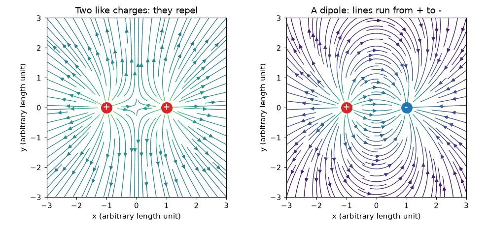
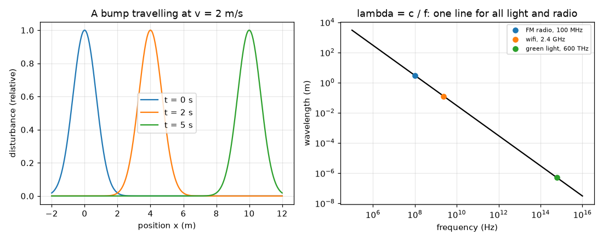

# സെഷൻ 1: ചാർജുകൾ, ഫീൽഡുകൾ, തരംഗങ്ങൾ

[Session 1 — हिन्दी](README.hi.md)

*ലെവൽ 1 (ആശയപരമായ ഇന്ററാക്ടീവ് മോഡൽ) · ഏകദേശം 60 മിനിറ്റ് · openemwave*

> ഇത് ലളിതമാക്കിയ ഒരു വിദ്യാഭ്യാസ മോഡൽ (educational model) ആണ്. ഇത് സാധൂകരിക്കപ്പെട്ട ഒരു ഡിസൈൻ ഉപകരണമല്ല; യഥാർത്ഥ നിർമ്മിതികൾ, വൈദ്യുത ഇൻസ്റ്റലേഷനുകൾ, വാഹനങ്ങൾ, വ്യാവസായിക പ്രക്രിയകൾ അല്ലെങ്കിൽ വൈദ്യശാസ്ത്ര തീരുമാനങ്ങൾ എന്നിവയ്ക്ക് ഇത് ഉപയോഗിക്കരുത്.

**മുൻ‌അറിവ് (Prerequisites)**

- സ്കൂൾ ഗണിതവും ഗ്രാഫ് എന്ന ആശയവും.
- നിങ്ങൾ PRIMER.md വായിക്കുകയും `python start.py 1` ഒരിക്കൽ റൺ ചെയ്യുകയും ചെയ്തിട്ടുണ്ട്.

**പഠന ലക്ഷ്യങ്ങൾ (Learning objectives).** ഈ സെഷനു ശേഷം നിങ്ങൾക്ക് കഴിയും:

- സജാതീയ, വിജാതീയ ചാർജുകൾ എന്തു ചെയ്യുന്നു എന്ന് പറയാനും, രണ്ട് സജാതീയ ചാർജുകളുടെയും ഒരു ഡൈപോളിന്റെയും (dipole) ഫീൽഡ് വരയ്ക്കാനും.
- സഞ്ചരിക്കുന്ന ഒരു വിക്ഷോഭമായി തരംഗത്തെ (wave) വിശദീകരിക്കാനും, അതിൽ നിന്ന് തരംഗദൈർഘ്യവും ആവൃത്തിയും വായിക്കാനും.
- റേഡിയോയ്ക്കും പ്രകാശത്തിനും വേഗം = ആവൃത്തി x തരംഗദൈർഘ്യം ഉപയോഗിക്കാൻ.
- റേഡിയോ, വൈഫൈ, പ്രകാശം എന്നിവ ഒരേ തരം തരംഗമാണെന്നും c ഏകദേശം 3e8 m/s ആണെന്നും പ്രസ്താവിക്കാൻ.

## A. യഥാർത്ഥ ജീവിതത്തിലെ പ്രശ്നം
മുടിയിൽ ഉരസിയ ഒരു ബലൂൺ ചുമരിൽ ഒട്ടിപ്പിടിക്കുന്നു, അതേ തരം അദൃശ്യമായ തള്ളൽ നിങ്ങളുടെ പ്രിയപ്പെട്ട FM സ്റ്റേഷനെ ചുമരുകളിലൂടെ ഒരു ചെറിയ റേഡിയോയിലേക്ക് എത്തിക്കുന്നു. ആ തള്ളൽ എന്താണ്, നമുക്ക് അത് എങ്ങനെ വരയ്ക്കാം, റേഡിയോ തരംഗങ്ങളും പ്രകാശവും യഥാർത്ഥത്തിൽ ഒന്നുതന്നെയാകുന്നത് എന്തുകൊണ്ട്? ഈ ചിത്രം ഇല്ലാതെ, ഒരു ആന്റിന വെറുമൊരു നിഗൂഢ ലോഹക്കഷണം മാത്രമാണ്.

## B. ആശയവും സിദ്ധാന്തവും
വൈദ്യുത ചാർജ് (electric charge) രണ്ട് ചിഹ്നങ്ങളിൽ വരുന്നു. ഒരേ ചിഹ്നമുള്ള ചാർജുകൾ വികർഷിക്കുന്നു, വിപരീത ചിഹ്നമുള്ളവ ആകർഷിക്കുന്നു. ഒരു ബിന്ദുവിലെ വൈദ്യുത ഫീൽഡ് (electric field) എന്നത് ഒരു ചെറിയ പോസിറ്റീവ് ടെസ്റ്റ് ചാർജിന് അവിടെ അനുഭവപ്പെടുന്ന യൂണിറ്റ് ചാർജിനുള്ള തള്ളലാണ്; അത് പോസിറ്റീവ് ചാർജുകളിൽ നിന്ന് അകലേക്കും നെഗറ്റീവ് ചാർജുകളിലേക്കും ചൂണ്ടുന്നു, ഓരോ ചാർജിൽ നിന്നുമുള്ള തള്ളലുകളുടെ (അമ്പുകളായി) തുകയാണ് അത്. രണ്ട് തുല്യ പോസിറ്റീവ് ചാർജുകൾ അവയ്ക്കിടയിൽ കൃത്യം പകുതിയിൽ പൂജ്യം ഫീൽഡ് നൽകുന്നു; ഒരു ഡൈപോൾ (തുല്യ പോസിറ്റീവും നെഗറ്റീവും ചാർജുകൾ) അവിടെ അതിന്റെ ഏറ്റവും ശക്തമായ ഫീൽഡ് നൽകുന്നു, പോസിറ്റീവിൽ നിന്ന് നെഗറ്റീവ് ചാർജിലേക്ക് ചൂണ്ടി. ഒരു തരംഗം എന്നത് പദാർത്ഥത്തെ കൂടെ കൊണ്ടുപോകാതെ നീങ്ങുന്ന ഒരു വിക്ഷോഭമാണ്: സമയം 0-ൽ x = 0-ൽ ഉണ്ടായിരുന്ന ഒരു മുഴ t സമയത്തിനു ശേഷം x = v t-ൽ ആണ്. ആവർത്തിക്കുന്ന ഒരു തരംഗത്തിന്, തരംഗദൈർഘ്യം (wavelength) lambda എന്നത് ശൃംഗങ്ങൾ തമ്മിലുള്ള ദൂരവും ആവൃത്തി (frequency) f എന്നത് ഓരോ സെക്കൻഡിലും കടന്നുപോകുന്ന ശൃംഗങ്ങളുടെ എണ്ണവുമാണ്, അതിനാൽ തരംഗം സെക്കൻഡിൽ f lambda മീറ്റർ മുന്നോട്ടു പോകുന്നു: v = f lambda. റേഡിയോ, വൈഫൈ, ഇൻഫ്രാറെഡ്, ദൃശ്യപ്രകാശം, എക്സ്-റേ എന്നിവയെല്ലാം വൈദ്യുതകാന്തിക തരംഗങ്ങളാണ് (electromagnetic waves): ശൂന്യതയിൽ അവയ്ക്ക് ഒരേ വേഗമാണ്, c ഏകദേശം 3 x 10^8 m/s, ആവൃത്തിയിൽ മാത്രമേ വ്യത്യാസമുള്ളൂ.

| ചിഹ്നം | അർത്ഥം | യൂണിറ്റ് |
|---|---|---|
| q | വൈദ്യുത ചാർജ് (ചിഹ്നത്തോടെ) | coulomb, C (nC = 1e-9 C) |
| E | വൈദ്യുത ഫീൽഡ് (യൂണിറ്റ് ചാർജിനുള്ള തള്ളൽ) | volt per metre, V/m |
| v | തരംഗ വേഗം | metre per second, m/s |
| f | ആവൃത്തി | hertz, Hz (1 MHz = 1e6 Hz) |
| lambda | തരംഗദൈർഘ്യം | metre, m |
| c | ശൂന്യതയിലെ പ്രകാശവേഗം | 299 792 458 m/s, ഏകദേശം 3e8 m/s |

**അനുമാനങ്ങൾ (Assumptions)**

- സെഷന്റെ ആദ്യ പകുതിയിൽ ചാർജുകൾ ബിന്ദുക്കളാണ്, നിശ്ചലമാണ് (ഇലക്ട്രോസ്റ്റാറ്റിക്സ്).
- സെഷൻ 1-ലെ ഫീൽഡ് അമ്പുകൾ ലളിതമായ യൂണിറ്റുകൾ ഉപയോഗിക്കുന്നു; യഥാർത്ഥ സംഖ്യകൾ സെഷൻ 2-ൽ വരും.
- തരംഗങ്ങൾ ശൂന്യതയിൽ (വായുവും ഏതാണ്ട് അതുപോലെ) നേർരേഖയിൽ സഞ്ചരിക്കുന്നു.

$$ \mathbf E=\sum_i q_i\,\frac{\mathbf r-\mathbf r_i}{|\mathbf r-\mathbf r_i|^{3}}\quad\text{(simple units: sum of the pushes)} $$

$$ y(x,t)=y_0(x-vt)\quad\text{(a bump moving right at speed } v) $$

$$ v=f\,\lambda $$

$$ \lambda=\frac{c}{f},\qquad c\approx 3\times10^{8}\ \mathrm{m/s} $$

## C. ദൃശ്യ വിശദീകരണം
ആദ്യ ചിത്രം രണ്ട് സജാതീയ ചാർജുകളുടെ ഫീൽഡ് രേഖകളും (അവ പരസ്പരം അകന്നു വളയുന്നു, മധ്യം ഒരു നിർജ്ജീവ ബിന്ദുവാണ്) ഒരു ഡൈപോളിന്റെ ഫീൽഡ് രേഖകളും (രേഖകൾ ചുവന്ന പോസിറ്റീവ് ചാർജിൽ നിന്ന് പുറപ്പെട്ട് നീല നെഗറ്റീവ് ചാർജിൽ എത്തുന്നു) കാണിക്കുന്നു. രണ്ടാമത്തെ ചിത്രം 2 m/s-ൽ നീങ്ങുന്ന ഒരു മുഴയെ മൂന്ന് നിമിഷങ്ങളിലും, ഒരു log-log ഗ്രാഫിൽ lambda = c / f എന്ന രേഖയും കാണിക്കുന്നു: 100 MHz-ലെ FM റേഡിയോ ഏകദേശം 3 m-ൽ, 2.4 GHz-ലെ വൈഫൈ 12.5 cm-ൽ, 600 THz-ലെ പച്ച പ്രകാശം ഏകദേശം 500 nm-ൽ — എല്ലാം c-യിൽ സഞ്ചരിക്കുന്നതിനാൽ ഒരേ നേർരേഖയിൽ.

*രണ്ട് സജാതീയ ചാർജുകളുടെ (ഇടത്) ഒരു ഡൈപോളിന്റെയും (വലത്) ഫീൽഡ് രേഖകൾ.*

*2 m/s-ൽ സഞ്ചരിക്കുന്ന ഒരു മുഴ, ആവൃത്തിക്കെതിരെ തരംഗദൈർഘ്യം: FM, വൈഫൈ, പ്രകാശം ഒരേ രേഖയിൽ.*

## D. ഇന്ററാക്ടീവ് സിമുലേഷൻ
പാഠം റൺ ചെയ്യുക (`python start.py 1`), എന്നിട്ട് ലൈവ് ആപ്പ് തുറക്കുക: [സെഷൻ 1: ചാർജുകളും തരംഗങ്ങളും](https://krunalpanchal1995.github.io/pan-iit-oss/openemwave/session-01/) (അല്ലെങ്കിൽ ഈ ഫോൾഡറിലെ `app.html`). രണ്ട് ചാർജുകൾ മാറ്റി അമ്പുകൾ നിരീക്ഷിക്കുക: അവയെ തുല്യമാക്കുക, പിന്നെ വിപരീതമാക്കുക, മധ്യബിന്ദുവിലെ ഫീൽഡ് വായിക്കുക. പിന്നെ തരംഗ വ്യൂവിലേക്ക് മാറി ആവൃത്തി നീക്കി, ആവൃത്തി കൂടുമ്പോൾ തരംഗദൈർഘ്യം ചുരുങ്ങുന്നത് കാണുക.

**വെല്ലുവിളി.** ഒരു ഡൈപോൾ ഉണ്ടാക്കുക (തുല്യവും വിപരീതവുമായ ചാർജുകൾ), തരംഗത്തെ FM ആവൃത്തിയായ 100 MHz-ൽ വയ്ക്കുക, അപ്പോൾ തരംഗദൈർഘ്യം ഏകദേശം 3 m ആകും.

## E. ഉദാഹരണവും പരീക്ഷണവും
**പ്രശ്നം.** ഒരു FM സ്റ്റേഷൻ 100 MHz-ൽ പ്രക്ഷേപണം ചെയ്യുന്നു. അതിന്റെ റേഡിയോ തരംഗത്തിന്റെ തരംഗദൈർഘ്യം എത്ര? 2.4 GHz വൈഫൈയുടെ തരംഗദൈർഘ്യം എത്ര? ഏതാണ് നീളം കൂടിയത്, എത്രമാത്രം?

1. c = 2.998 x 10^8 m/s ഉപയോഗിച്ച് lambda = c / f ഉപയോഗിക്കുക.
2. FM: f = 100 MHz = 1.00 x 10^8 Hz, അതിനാൽ lambda = 2.998e8 / 1.00e8 = 2.998 m, ഏകദേശം 3.0 m.
3. വൈഫൈ: f = 2.4 GHz = 2.4 x 10^9 Hz, അതിനാൽ lambda = 2.998e8 / 2.4e9 = 0.1249 m, ഏകദേശം 12.5 cm.
4. തരംഗദൈർഘ്യങ്ങളുടെ അനുപാതം 2.998 / 0.1249 = 24 ആണ്, ഇത് ആവൃത്തികളുടെ അനുപാതം തന്നെയാണ്, 2400 / 100 = 24.
5. പരിശോധന: FM-ന് മനുഷ്യവലിപ്പമുള്ള തരംഗം (മീറ്ററുകൾ), വൈഫൈക്ക് കൈവലിപ്പമുള്ള തരംഗം (സെന്റിമീറ്ററുകൾ): അതുകൊണ്ടാണ് FM ആന്റിനകൾ നീളമുള്ളതും വൈഫൈ ആന്റിനകൾ ചെറുതുമായിരിക്കുന്നത്.

**ഉത്തരം.** FM: ഏകദേശം 3.0 m. വൈഫൈ: ഏകദേശം 12.5 cm. FM തരംഗത്തിന്റെ ആവൃത്തി 24 മടങ്ങ് കുറവായതിനാൽ അത് 24 മടങ്ങ് നീളമുള്ളതാണ്.

**പരീക്ഷണം.** കൈയിൽ പിടിക്കാവുന്ന ഒരു FM റേഡിയോ ട്യൂൺ ചെയ്ത് അതിന്റെ ടെലിസ്കോപ്പിക് ആന്റിന നീട്ടുക: സാധാരണയായി അത് ഒരു മീറ്ററിന്റെ നല്ലൊരു ഭാഗം മുതൽ ഒന്നര മീറ്റർ വരെ നീളമുള്ളപ്പോൾ സ്വീകരണം ഏറ്റവും നല്ലതാണ്. സെഷൻ 2-ലെ 1.5 m അർധ-തരംഗ പ്രവചനവുമായി താരതമ്യം ചെയ്യുക. യഥാർത്ഥ സ്വീകരണം കെട്ടിടങ്ങൾ, റേഡിയോയുടെ സർക്യൂട്ട്, നിങ്ങൾ അത് എങ്ങനെ പിടിക്കുന്നു എന്നിവയെയും ആശ്രയിച്ചിരിക്കുന്നു, അതിനാൽ ലളിതമായ മോഡൽ ശരിയായ ഓർഡർ ഓഫ് മാഗ്നിറ്റ്യൂഡ് (order of magnitude) മാത്രമേ പറയൂ.

## F. വിലയിരുത്തലും ഡിസൈൻ വെല്ലുവിളിയും
**ചോദ്യ തരം A: ആശയപരം.** രണ്ട് പ്രോട്ടോണുകളും രണ്ട് ഇലക്ട്രോണുകളും ഒരു വരിയിൽ വയ്ക്കുന്നു. കണക്കുകൂട്ടാതെ, ഏത് ജോഡികൾ അകന്നു തള്ളുന്നു, ഏതെല്ലാം അടുത്തു വലിക്കുന്നു എന്ന് വിശദീകരിക്കുക. രണ്ട് തുല്യ പോസിറ്റീവ് ചാർജുകളുടെ ഫീൽഡ് അവയ്ക്കിടയിൽ പകുതിയിൽ ഇല്ലാതാകുന്നത് എന്തുകൊണ്ട്?

സൂചന

ഒരേ ചിഹ്നം വികർഷിക്കുന്നു, വിപരീത ചിഹ്നം ആകർഷിക്കുന്നു. മധ്യബിന്ദുവിൽ ഓരോ ചാർജും ഒരേ ശക്തിയോടെ തള്ളുന്നു.

ഘട്ടം ഘട്ടമായുള്ള പരിഹാരം

പ്രോട്ടോൺ-പ്രോട്ടോൺ, ഇലക്ട്രോൺ-ഇലക്ട്രോൺ ജോഡികൾക്ക് ഒരേ ചിഹ്നമാണ്, അവ വികർഷിക്കുന്നു; പ്രോട്ടോൺ-ഇലക്ട്രോൺ ജോഡികൾക്ക് വിപരീത ചിഹ്നമാണ്, അവ ആകർഷിക്കുന്നു. രണ്ട് തുല്യ പോസിറ്റീവ് ചാർജുകൾക്കിടയിൽ പകുതിയിൽ, ഓരോന്നും ടെസ്റ്റ് ചാർജിനെ തന്നിൽ നിന്ന് അകലേക്ക് തുല്യ ശക്തിയോടെ, എന്നാൽ വിപരീത ദിശകളിൽ തള്ളുന്നു, അതിനാൽ രണ്ട് തള്ളലുകളും റദ്ദാകുന്നു, അവിടെ ഫീൽഡ് പൂജ്യമാണ്.

**ചോദ്യ തരം B: സംഖ്യാപരം.** ഒരു റേഡിയോ തരംഗത്തിന്റെ ആവൃത്തി 90 MHz ആണ്. അതിന്റെ തരംഗദൈർഘ്യം കണ്ടെത്തുക. 100 MHz ഫലവുമായി താരതമ്യം ചെയ്ത് ഉത്തരം യുക്തിസഹമാണോ എന്ന് പരിശോധിക്കുക.

സൂചന

c = 3e8 m/s (അല്ലെങ്കിൽ 2.998e8) ഉപയോഗിച്ച് lambda = c / f. ആദ്യം MHz-നെ Hz ആക്കുക.

ഘട്ടം ഘട്ടമായുള്ള പരിഹാരം

f = 90 MHz = 9.0e7 Hz, അതിനാൽ lambda = 2.998e8 / 9.0e7 = 3.33 m. പരിശോധന: 100 MHz-നേക്കാൾ കുറഞ്ഞ ആവൃത്തി 3.0 m-നേക്കാൾ നീളമുള്ള തരംഗദൈർഘ്യം നൽകണം, 3.33 m നീളം കൂടിയതാണ്. യൂണിറ്റ്: മീറ്റർ.

**ചോദ്യ തരം C: ഗ്രാഫും സിമുലേഷനും വ്യാഖ്യാനിക്കൽ.** lambda-ആവൃത്തി ഗ്രാഫിൽ, FM റേഡിയോ, വൈഫൈ, പച്ച പ്രകാശം എന്നിവ ഒരു നേർരേഖയിലാണ്. അത് അവയുടെ വേഗത്തെക്കുറിച്ച് എന്ത് പറയുന്നു? ഒരു ബിന്ദുവിനെ രേഖയ്ക്ക് മുകളിലേക്ക് നീക്കിയാൽ, അതിന്റെ അർത്ഥമെന്ത്?

സൂചന

ഒരു log-log ഗ്രാഫിൽ lambda = c / f എന്നത് ചരിവ് -1 ഉള്ള ഒരു നേർരേഖയാണ്; രേഖയുടെ സ്ഥാനം c നിശ്ചയിക്കുന്നു.

ഘട്ടം ഘട്ടമായുള്ള പരിഹാരം

ഓരോന്നിനും lambda f = c ഒന്നുതന്നെ ആയതിനാൽ അവയെല്ലാം ഒരേ രേഖയിലാണ്, അതിനാൽ എല്ലാം ഒരേ വേഗം c-യിൽ സഞ്ചരിക്കുന്നു. രേഖയ്ക്കു മുകളിലുള്ള ഒരു ബിന്ദു ഒരേ ആവൃത്തിയിൽ കൂടുതൽ നീളമുള്ള തരംഗദൈർഘ്യമുള്ള തരംഗമായിരിക്കും, അതായത് lambda f > c: ശൂന്യതയിൽ പ്രകാശത്തേക്കാൾ വേഗമുള്ള ഒരു തരംഗം, അത് സംഭവിക്കുന്നില്ല. (ഗ്ലാസിലോ വെള്ളത്തിലോ ഉള്ള തരംഗങ്ങൾ c-യേക്കാൾ വേഗം കുറഞ്ഞവയാണ്, അവ രേഖയ്ക്കു താഴെയായിരിക്കും.)

**ചോദ്യ തരം D: ഡിസൈനും ഒപ്റ്റിമൈസേഷൻ (optimisation) വെല്ലുവിളിയും.** ഡിസൈൻ: ഒരു മുറിയുടെ വലിപ്പമുള്ള പരീക്ഷണത്തിന് യോജിക്കുന്ന 1 m തരംഗദൈർഘ്യമുള്ള ഒരു തരംഗം നിങ്ങൾക്ക് വേണം. നിങ്ങൾക്ക് എത്ര ആവൃത്തി വേണം? അത് റേഡിയോ തരംഗമാണോ പ്രകാശ തരംഗമാണോ? ഒരു 1 m തരംഗം ചുമരിലെ 5 cm വിടവിലൂടെ 12.5 cm വൈഫൈ തരംഗം പോലെ എളുപ്പത്തിൽ കടന്നുപോകുമോ?

സൂചന

f = c / lambda. വിടവിനെ തരംഗദൈർഘ്യവുമായി താരതമ്യം ചെയ്യുക: തുറപ്പ് ഏകദേശം ഒരു തരംഗദൈർഘ്യത്തേക്കാൾ ചെറുതാകുമ്പോൾ തരംഗങ്ങൾ തടയപ്പെടുകയോ വളയുകയോ ചെയ്യുന്നു.

ഘട്ടം ഘട്ടമായുള്ള പരിഹാരം

f = 2.998e8 / 1 = 3.0e8 Hz = 300 MHz, ഒരു റേഡിയോ തരംഗം (FM-നും വൈഫൈക്കും ഇടയിൽ). 5 cm വിടവ് 1 m-നേക്കാൾ വളരെ ചെറുതും 12.5 cm-നേക്കാൾ ചെറുതുമാണ്, അതിനാൽ രണ്ടും നേർരശ്മിയായി എളുപ്പത്തിൽ കടന്നുപോകില്ല; 12.5 cm തരംഗം വിടവിന്റെ വലിപ്പത്തോട് കൂടുതൽ അടുത്താണ്, വളരെ നന്നായി കടന്നുപോകുന്നു. അനുമാനങ്ങൾ: വിടവിന്റെ ലളിതമായ ചിത്രം; യഥാർത്ഥ പെരുമാറ്റം പദാർത്ഥത്തെയും തരംഗത്തിന്റെ ആകൃതിയെയും ആശ്രയിച്ചിരിക്കുന്നു.

[RUBRIC.md](../../RUBRIC.md) ഉപയോഗിച്ച് സ്വയം സ്കോർ ചെയ്യുക. പേപ്പറിൽ ചെയ്യാൻ [ആക്ടിവിറ്റി ഷീറ്റ്](activity_sheet.md) പ്രിന്റ് ചെയ്യുക.

## സാധാരണ തെറ്റിദ്ധാരണകൾ
| സാധാരണ തെറ്റിദ്ധാരണ | യഥാർത്ഥത്തിൽ ശരിയായത് |
|---|---|
| പ്രകാശവും റേഡിയോയും വ്യത്യസ്ത തരം കാര്യങ്ങളാണ്. | അവ വ്യത്യസ്ത ആവൃത്തികളുള്ള ഒരേ തരം തരംഗമാണ് (ഒരു വൈദ്യുതകാന്തിക തരംഗം); രണ്ടും ശൂന്യതയിൽ c-യിൽ സഞ്ചരിക്കുന്നു. |
| ഒരു തരംഗം പദാർത്ഥത്തെ കൂടെ കൊണ്ടുപോകുന്നു. | വിക്ഷോഭമാണ് സഞ്ചരിക്കുന്നത്; കയറോ വെള്ളമോ ഫീൽഡോ സ്ഥലത്തുനിന്ന് മുകളിലേക്കും താഴേക്കും മാത്രം നീങ്ങുന്നു. |
| ഉയർന്ന ആവൃത്തി എന്നാൽ വേഗം കൂടിയ തരംഗം. | ശൂന്യതയിൽ എല്ലാ വൈദ്യുതകാന്തിക തരംഗങ്ങൾക്കും ഒരേ വേഗം c ആണ്; v = f lambda ആയതിനാൽ ഉയർന്ന ആവൃത്തി എന്നാൽ ചെറിയ തരംഗദൈർഘ്യം. |
| സജാതീയ ചാർജുകൾ ഒരുപോലെയായതിനാൽ ആകർഷിക്കുന്നു. | സജാതീയ ചാർജുകൾ വികർഷിക്കുന്നു; വിജാതീയ ചാർജുകൾ ആകർഷിക്കുന്നു. |

## പദാവലി (Glossary)
- **വൈദ്യുത ഫീൽഡ് (electric field)**: സ്ഥലത്തെ ഒരു ബിന്ദുവിൽ യൂണിറ്റ് ചാർജിനുള്ള തള്ളൽ, വോൾട്ട് പെർ മീറ്ററിൽ
- **ഡൈപോൾ (dipole)**: അടുത്തടുത്തുള്ള ഒരു പോസിറ്റീവും ഒരു നെഗറ്റീവും ചാർജ്
- **തരംഗദൈർഘ്യം (wavelength)**: ഒരു തരംഗത്തിന്റെ അടുത്തടുത്തുള്ള രണ്ട് ശൃംഗങ്ങൾ തമ്മിലുള്ള ദൂരം, മീറ്ററിൽ
- **ആവൃത്തി (frequency)**: ഓരോ സെക്കൻഡിലും ഒരു ബിന്ദുവിലൂടെ എത്ര ശൃംഗങ്ങൾ കടന്നുപോകുന്നു, ഹെർട്സിൽ
- **വൈദ്യുതകാന്തിക തരംഗം (electromagnetic wave)**: റേഡിയോ അല്ലെങ്കിൽ പ്രകാശം പോലെ, വൈദ്യുത, കാന്തിക ഫീൽഡുകളുടെ സഞ്ചരിക്കുന്ന ഒരു പാറ്റേൺ

## പൂർത്തിയാക്കുക
1. [exercises.md](exercises.md)-ലെ മൂന്ന് കോഡിംഗ് ടാസ്കുകൾ ചെയ്യുക.
2. മാറ്റങ്ങൾക്കു ശേഷം `python start.py 1` വീണ്ടും റൺ ചെയ്യുക. അത് ചെക്ക്‌പോയിന്റോടെ (checkpoint) അവസാനിക്കുന്നു; അത് `PASS` എന്ന് പ്രിന്റ് ചെയ്യുമ്പോൾ നിങ്ങൾ പൂർത്തിയാക്കി. (ചെക്ക്‌പോയിന്റ് മാത്രം: `python start.py check 1`.)

അടുത്തത്: [സെഷൻ 2](../session-02/README.md)
