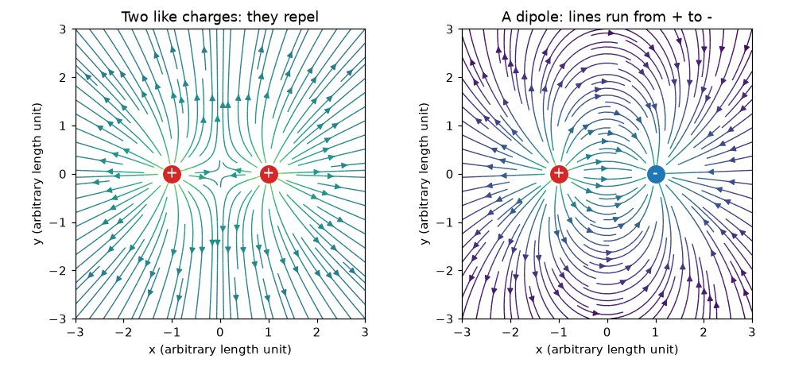
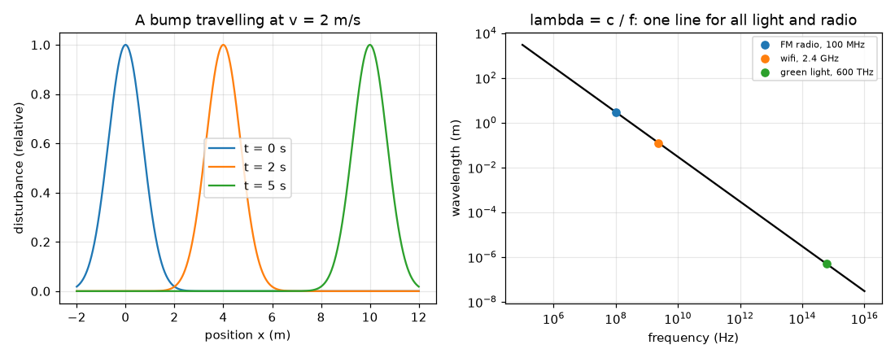

# அமர்வு 1: மின்னூட்டங்கள், புலங்கள் மற்றும் அலைகள்

[Session 1 — हिन्दी](README.hi.md)

*நிலை 1 (கருத்தியல் ஊடாடும் மாதிரி) · சுமார் 60 நிமிடங்கள் · openemwave*

> இது எளிமைப்படுத்தப்பட்ட ஒரு கல்வி மாதிரி (educational model). இது சரிபார்க்கப்பட்ட வடிவமைப்புக் கருவி அல்ல; உண்மையான கட்டமைப்புகள், மின் நிறுவல்கள், வாகனங்கள், தொழில்துறை செயல்முறைகள் அல்லது மருத்துவ முடிவுகளுக்கு இதைப் பயன்படுத்தக் கூடாது.

**முன்தேவைகள் (Prerequisites)**

- பள்ளிக் கணக்கும் வரைபடம் என்ற கருத்தும்.
- நீங்கள் PRIMER.md படித்து `python start.py 1` ஒருமுறை இயக்கியிருக்கிறீர்கள்.

**கற்றல் நோக்கங்கள் (Learning objectives).** இந்த அமர்வுக்குப் பிறகு உங்களால் முடியும்:

- ஒத்த மற்றும் எதிர் மின்னூட்டங்கள் என்ன செய்கின்றன என்று சொல்லவும், இரண்டு ஒத்த மின்னூட்டங்களின் மற்றும் ஒரு இருமுனையின் (dipole) புலத்தை வரையவும்.
- அலையை (wave) பயணிக்கும் ஒரு தொந்தரவாக விளக்கவும், அதிலிருந்து அலைநீளம், அதிர்வெண் ஆகியவற்றைப் படிக்கவும்.
- வானொலி மற்றும் ஒளிக்கு வேகம் = அதிர்வெண் x அலைநீளம் பயன்படுத்த.
- வானொலி, வைஃபை, ஒளி ஆகியவை ஒரே வகை அலை என்றும் c சுமார் 3e8 m/s என்றும் கூற.

## A. நிஜ உலகப் பிரச்சினை
தலைமுடியில் தேய்த்த பலூன் சுவரில் ஒட்டிக்கொள்கிறது, அதே வகையான கண்ணுக்குத் தெரியாத தள்ளுதல் உங்களுக்குப் பிடித்த FM நிலையத்தைச் சுவர்கள் வழியாக ஒரு சிறிய வானொலிக்குக் கொண்டு செல்கிறது. அந்தத் தள்ளுதல் என்ன, அதை எப்படி வரையலாம், வானொலி அலைகளும் ஒளியும் உண்மையில் ஏன் ஒன்றே? இந்தப் படம் இல்லாமல், ஒரு ஆன்டெனா வெறும் மர்மமான உலோகத் துண்டு.

## B. கருத்தும் கோட்பாடும்
மின்னூட்டம் (electric charge) இரண்டு குறிகளில் வருகிறது. ஒரே குறியுடைய மின்னூட்டங்கள் விலக்குகின்றன, எதிர்க் குறியுடையவை கவர்கின்றன. ஒரு புள்ளியில் உள்ள மின்புலம் (electric field) என்பது ஒரு சிறிய நேர் சோதனை மின்னூட்டம் அங்கு உணரும் அலகு மின்னூட்டத்துக்கான தள்ளுதல்; அது நேர் மின்னூட்டங்களிலிருந்து விலகியும் எதிர் மின்னூட்டங்களை நோக்கியும் சுட்டுகிறது, ஒவ்வொரு மின்னூட்டத்தின் தள்ளுதல்களின் (அம்புகளாக) கூட்டுத்தொகை அது. இரண்டு சம நேர் மின்னூட்டங்கள் அவற்றுக்கிடையே சரியாகப் பாதியில் பூஜ்ஜியப் புலத்தைத் தருகின்றன; ஒரு இருமுனை (சம நேர் மற்றும் எதிர் மின்னூட்டங்கள்) அங்கு அதன் வலிமையான புலத்தைத் தருகிறது, நேரிலிருந்து எதிர் மின்னூட்டத்தை நோக்கிச் சுட்டி. அலை என்பது பொருளைக் கூடவே கொண்டு செல்லாமல் நகரும் ஒரு தொந்தரவு: நேரம் 0-இல் x = 0-இல் இருந்த ஒரு மேடு t நேரத்துக்குப் பிறகு x = v t-இல் உள்ளது. மீண்டும் மீண்டும் வரும் அலைக்கு, அலைநீளம் (wavelength) lambda என்பது முகடுகளுக்கிடையிலான தூரம், அதிர்வெண் (frequency) f என்பது ஒவ்வொரு வினாடியும் கடக்கும் முகடுகளின் எண்ணிக்கை, எனவே அலை வினாடிக்கு f lambda மீட்டர் முன்னேறுகிறது: v = f lambda. வானொலி, வைஃபை, அகச்சிவப்பு, கண்ணுறு ஒளி, எக்ஸ்-கதிர்கள் அனைத்தும் மின்காந்த அலைகள் (electromagnetic waves): வெற்றிடத்தில் அவற்றுக்கு ஒரே வேகம், c சுமார் 3 x 10^8 m/s, அதிர்வெண்ணில் மட்டுமே வேறுபடுகின்றன.

| குறியீடு | பொருள் | அலகு |
|---|---|---|
| q | மின்னூட்டம் (குறியுடன்) | coulomb, C (nC = 1e-9 C) |
| E | மின்புலம் (அலகு மின்னூட்டத்துக்கான தள்ளுதல்) | volt per metre, V/m |
| v | அலை வேகம் | metre per second, m/s |
| f | அதிர்வெண் | hertz, Hz (1 MHz = 1e6 Hz) |
| lambda | அலைநீளம் | metre, m |
| c | வெற்றிடத்தில் ஒளியின் வேகம் | 299 792 458 m/s, சுமார் 3e8 m/s |

**அனுமானங்கள் (Assumptions)**

- அமர்வின் முதல் பாதியில் மின்னூட்டங்கள் புள்ளிகள், அசையாமல் உள்ளன (நிலைமின்னியல்).
- அமர்வு 1-இல் புல அம்புகள் எளிய அலகுகளைப் பயன்படுத்துகின்றன; உண்மையான எண்கள் அமர்வு 2-இல் வரும்.
- அலைகள் வெற்றிடத்தில் (காற்றும் கிட்டத்தட்ட அதேதான்) நேர்கோட்டில் பயணிக்கின்றன.

$$ \mathbf E=\sum_i q_i\,\frac{\mathbf r-\mathbf r_i}{|\mathbf r-\mathbf r_i|^{3}}\quad\text{(simple units: sum of the pushes)} $$

$$ y(x,t)=y_0(x-vt)\quad\text{(a bump moving right at speed } v) $$

$$ v=f\,\lambda $$

$$ \lambda=\frac{c}{f},\qquad c\approx 3\times10^{8}\ \mathrm{m/s} $$

## C. காட்சி விளக்கம்
முதல் படம் இரண்டு ஒத்த மின்னூட்டங்களின் புலக் கோடுகளையும் (அவை ஒன்றையொன்று விட்டு விலகி வளைகின்றன, நடுப்பகுதி ஒரு செயலற்ற இடம்) ஒரு இருமுனையின் புலக் கோடுகளையும் (கோடுகள் சிவப்பு நேர் மின்னூட்டத்திலிருந்து புறப்பட்டு நீல எதிர் மின்னூட்டத்தை அடைகின்றன) காட்டுகிறது. இரண்டாவது படம் 2 m/s-இல் நகரும் ஒரு மேட்டை மூன்று கணங்களிலும், ஒரு log-log வரைபடத்தில் lambda = c / f என்ற கோட்டையும் காட்டுகிறது: 100 MHz-இல் FM வானொலி சுமார் 3 m-இல், 2.4 GHz-இல் வைஃபை 12.5 cm-இல், 600 THz-இல் பச்சை ஒளி சுமார் 500 nm-இல் — அனைத்தும் c-இல் பயணிப்பதால் ஒரே நேர்கோட்டில்.

*இரண்டு ஒத்த மின்னூட்டங்களின் (இடது) மற்றும் ஒரு இருமுனையின் (வலது) புலக் கோடுகள்.*

*2 m/s-இல் பயணிக்கும் ஒரு மேடு, அதிர்வெண்ணுக்கு எதிரான அலைநீளம்: FM, வைஃபை, ஒளி ஒரே கோட்டில்.*

## D. ஊடாடும் உருவகப்படுத்தல் (Interactive simulation)
பாடத்தை இயக்குங்கள் (`python start.py 1`), பிறகு நேரடிச் செயலியைத் திறக்கவும்: [அமர்வு 1: மின்னூட்டங்களும் அலைகளும்](https://krunalpanchal1995.github.io/pan-iit-oss/openemwave/session-01/) (அல்லது இந்தக் கோப்புறையில் உள்ள `app.html`). இரண்டு மின்னூட்டங்களை மாற்றி அம்புகளைக் கவனியுங்கள்: அவற்றைச் சமமாக்குங்கள், பிறகு எதிராக்குங்கள், நடுப்புள்ளியில் புலத்தைப் படியுங்கள். பிறகு அலைக் காட்சிக்கு மாறி அதிர்வெண்ணை நகர்த்தி, அதிர்வெண் அதிகரிக்கும்போது அலைநீளம் சுருங்குவதைப் பாருங்கள்.

**சவால்.** ஒரு இருமுனையை உருவாக்குங்கள் (சமமான, எதிரான மின்னூட்டங்கள்), அலையை FM அதிர்வெண் 100 MHz-இல் அமையுங்கள், அப்போது அலைநீளம் சுமார் 3 m.

## E. தீர்க்கப்பட்ட எடுத்துக்காட்டும் சோதனையும்
**கணக்கு.** ஒரு FM நிலையம் 100 MHz-இல் ஒலிபரப்புகிறது. அதன் வானொலி அலையின் அலைநீளம் என்ன? 2.4 GHz வைஃபையின் அலைநீளம் என்ன? எது நீளமானது, எவ்வளவு?

1. c = 2.998 x 10^8 m/s உடன் lambda = c / f பயன்படுத்துங்கள்.
2. FM: f = 100 MHz = 1.00 x 10^8 Hz, எனவே lambda = 2.998e8 / 1.00e8 = 2.998 m, சுமார் 3.0 m.
3. வைஃபை: f = 2.4 GHz = 2.4 x 10^9 Hz, எனவே lambda = 2.998e8 / 2.4e9 = 0.1249 m, சுமார் 12.5 cm.
4. அலைநீளங்களின் விகிதம் 2.998 / 0.1249 = 24, இது அதிர்வெண்களின் விகிதமே, 2400 / 100 = 24.
5. சரிபார்ப்பு: FM-க்கு மனித அளவு அலை (மீட்டர்கள்), வைஃபைக்குக் கை அளவு அலை (சென்டிமீட்டர்கள்): அதனால்தான் FM ஆன்டெனாக்கள் நீளமாகவும் வைஃபை ஆன்டெனாக்கள் குட்டையாகவும் உள்ளன.

**விடை.** FM: சுமார் 3.0 m. வைஃபை: சுமார் 12.5 cm. FM அலையின் அதிர்வெண் 24 மடங்கு குறைவு என்பதால் அது 24 மடங்கு நீளமானது.

**சோதனை.** கையடக்க FM வானொலியை டியூன் செய்து அதன் தொலைநோக்கி ஆன்டெனாவை நீட்டுங்கள்: பொதுவாக அது ஒரு மீட்டரின் நல்ல பகுதியிலிருந்து ஒன்றரை மீட்டர் வரை நீளமாக இருக்கும்போது வரவேற்பு சிறந்தது. அமர்வு 2-இன் 1.5 m அரை-அலை கணிப்புடன் ஒப்பிடுங்கள். உண்மையான வரவேற்பு கட்டடங்கள், வானொலியின் சுற்று, நீங்கள் அதைப் பிடிக்கும் விதம் ஆகியவற்றையும் பொறுத்தது, எனவே எளிய மாதிரி சரியான அளவு வரிசையை (order of magnitude) மட்டுமே சொல்கிறது.

## F. மதிப்பீடும் வடிவமைப்புச் சவாலும்
**கேள்வி வகை A: கருத்தியல்.** இரண்டு புரோட்டான்களும் இரண்டு எலக்ட்ரான்களும் ஒரு வரிசையில் வைக்கப்படுகின்றன. கணக்கிடாமல், எந்த ஜோடிகள் விலகித் தள்ளுகின்றன, எவை சேர்ந்து இழுக்கின்றன என்று விளக்குங்கள். இரண்டு சம நேர் மின்னூட்டங்களின் புலம் அவற்றுக்கிடையே பாதியில் ஏன் மறைகிறது?

குறிப்பு

ஒரே குறி விலக்குகிறது, எதிர்க் குறி கவர்கிறது. நடுப்புள்ளியில் ஒவ்வொரு மின்னூட்டமும் அதே வலிமையுடன் தள்ளுகிறது.

படிப்படியான தீர்வு

புரோட்டான்-புரோட்டான், எலக்ட்ரான்-எலக்ட்ரான் ஜோடிகளுக்கு ஒரே குறி, அவை விலக்குகின்றன; புரோட்டான்-எலக்ட்ரான் ஜோடிகளுக்கு எதிர்க் குறிகள், அவை கவர்கின்றன. இரண்டு சம நேர் மின்னூட்டங்களுக்கிடையே பாதியில், ஒவ்வொன்றும் சோதனை மின்னூட்டத்தைத் தன்னிடமிருந்து சம வலிமையுடன், ஆனால் எதிர்த் திசைகளில் தள்ளுகிறது, எனவே இரண்டு தள்ளுதல்களும் ஒன்றையொன்று நீக்குகின்றன, அங்கு புலம் பூஜ்ஜியம்.

**கேள்வி வகை B: எண்ணியல்.** ஒரு வானொலி அலையின் அதிர்வெண் 90 MHz. அதன் அலைநீளத்தைக் கண்டறியுங்கள். 100 MHz முடிவுடன் ஒப்பிட்டு விடை பொருத்தமானதா என்று சரிபாருங்கள்.

குறிப்பு

c = 3e8 m/s (அல்லது 2.998e8) உடன் lambda = c / f. முதலில் MHz-ஐ Hz ஆக மாற்றுங்கள்.

படிப்படியான தீர்வு

f = 90 MHz = 9.0e7 Hz, எனவே lambda = 2.998e8 / 9.0e7 = 3.33 m. சரிபார்ப்பு: 100 MHz-ஐ விடக் குறைந்த அதிர்வெண் 3.0 m-ஐ விட நீளமான அலைநீளத்தைத் தர வேண்டும், 3.33 m நீளமானது. அலகு: மீட்டர்.

**கேள்வி வகை C: வரைபடம் மற்றும் உருவகப்படுத்தல் விளக்கம்.** lambda-அதிர்வெண் வரைபடத்தில், FM வானொலி, வைஃபை, பச்சை ஒளி ஆகியவை ஒரு நேர்கோட்டில் உள்ளன. அது அவற்றின் வேகங்களைப் பற்றி என்ன சொல்கிறது? ஒரு புள்ளியைக் கோட்டுக்கு மேலே நகர்த்தினால், அதன் பொருள் என்ன?

குறிப்பு

ஒரு log-log வரைபடத்தில் lambda = c / f என்பது சாய்வு -1 உள்ள ஒரு நேர்கோடு; கோட்டின் நிலையை c தீர்மானிக்கிறது.

படிப்படியான தீர்வு

ஒவ்வொன்றுக்கும் lambda f = c ஒன்றே என்பதால் அவை அனைத்தும் ஒரே கோட்டில் உள்ளன, எனவே அனைத்தும் ஒரே வேகம் c-இல் பயணிக்கின்றன. கோட்டுக்கு மேலுள்ள ஒரு புள்ளி அதே அதிர்வெண்ணில் நீளமான அலைநீளம் கொண்ட அலையாக இருக்கும், அதாவது lambda f > c: வெற்றிடத்தில் ஒளியைவிட வேகமான அலை, அது நிகழ்வதில்லை. (கண்ணாடியிலோ நீரிலோ உள்ள அலைகள் c-ஐ விட மெதுவானவை, அவை கோட்டுக்குக் கீழே இருக்கும்.)

**கேள்வி வகை D: வடிவமைப்பு மற்றும் உகப்பாக்கம் (optimisation) சவால்.** வடிவமைப்பு: அறை அளவு சோதனைக்குப் பொருந்தும் 1 m அலைநீளம் கொண்ட அலை உங்களுக்கு வேண்டும். உங்களுக்கு என்ன அதிர்வெண் தேவை? அது வானொலி அலையா ஒளி அலையா? ஒரு 1 m அலை சுவரில் உள்ள 5 cm இடைவெளி வழியாக 12.5 cm வைஃபை அலையைப் போல எளிதாகச் செல்லுமா?

குறிப்பு

f = c / lambda. இடைவெளியை அலைநீளத்துடன் ஒப்பிடுங்கள்: திறப்பு சுமார் ஒரு அலைநீளத்தைவிடச் சிறியதாக இருக்கும்போது அலைகள் தடுக்கப்படுகின்றன அல்லது வளைகின்றன.

படிப்படியான தீர்வு

f = 2.998e8 / 1 = 3.0e8 Hz = 300 MHz, ஒரு வானொலி அலை (FM-க்கும் வைஃபைக்கும் இடையே). 5 cm இடைவெளி 1 m-ஐ விட மிகச் சிறியது, 12.5 cm-ஐ விடவும் சிறியது, எனவே இரண்டுமே நேர்க் கற்றையாக எளிதாகச் செல்லாது; 12.5 cm அலை இடைவெளியின் அளவுக்கு நெருக்கமானது, மிகச் சிறப்பாகச் செல்கிறது. அனுமானங்கள்: இடைவெளியின் எளிய படம்; உண்மையான நடத்தை பொருளையும் அலையின் வடிவத்தையும் பொறுத்தது.

[RUBRIC.md](../../RUBRIC.md) கொண்டு உங்களை மதிப்பிடுங்கள். தாளில் செய்ய [செயல்பாட்டுத் தாள்](activity_sheet.md)-ஐ அச்சிடுங்கள்.

## பொதுவான தவறான கருத்துகள்
| பொதுவான தவறான கருத்து | உண்மையில் சரியானது |
|---|---|
| ஒளியும் வானொலியும் வெவ்வேறு வகையான விஷயங்கள். | அவை வெவ்வேறு அதிர்வெண்கள் கொண்ட ஒரே வகை அலை (ஒரு மின்காந்த அலை); இரண்டும் வெற்றிடத்தில் c-இல் பயணிக்கின்றன. |
| ஒரு அலை பொருளைக் கூடவே கொண்டு செல்கிறது. | தொந்தரவு பயணிக்கிறது; கயிறு, நீர் அல்லது புலம் இடத்திலேயே மேலும் கீழும் மட்டுமே நகர்கிறது. |
| அதிக அதிர்வெண் என்றால் வேகமான அலை. | வெற்றிடத்தில் எல்லா மின்காந்த அலைகளுக்கும் ஒரே வேகம் c; v = f lambda என்பதால் அதிக அதிர்வெண் என்றால் குறுகிய அலைநீளம். |
| ஒத்த மின்னூட்டங்கள் ஒன்றுபோல் இருப்பதால் கவர்கின்றன. | ஒத்த மின்னூட்டங்கள் விலக்குகின்றன; எதிர் மின்னூட்டங்கள் கவர்கின்றன. |

## சொற்களஞ்சியம் (Glossary)
- **மின்புலம் (electric field)**: வெளியில் ஒரு புள்ளியில் அலகு மின்னூட்டத்துக்கான தள்ளுதல், வோல்ட் பெர் மீட்டரில்
- **இருமுனை (dipole)**: அருகருகே உள்ள ஒரு நேர் மற்றும் ஒரு எதிர் மின்னூட்டம்
- **அலைநீளம் (wavelength)**: ஒரு அலையின் அடுத்தடுத்த இரண்டு முகடுகளுக்கிடையிலான தூரம், மீட்டரில்
- **அதிர்வெண் (frequency)**: ஒவ்வொரு வினாடியும் ஒரு புள்ளியைக் கடக்கும் முகடுகளின் எண்ணிக்கை, ஹெர்ட்ஸில்
- **மின்காந்த அலை (electromagnetic wave)**: வானொலி அல்லது ஒளி போன்ற, மின் மற்றும் காந்தப் புலங்களின் பயணிக்கும் அமைப்பு

## முடிவு
1. [exercises.md](exercises.md)-இல் உள்ள மூன்று நிரலாக்கப் பணிகளைச் செய்யுங்கள்.
2. உங்கள் மாற்றங்களுக்குப் பிறகு `python start.py 1` மீண்டும் இயக்குங்கள். அது சோதனைச் சாவடியுடன் (checkpoint) முடிகிறது; அது `PASS` என்று அச்சிடும்போது நீங்கள் முடித்துவிட்டீர்கள். (சோதனைச் சாவடி மட்டும்: `python start.py check 1`.)

அடுத்து: [அமர்வு 2](../session-02/README.md)
