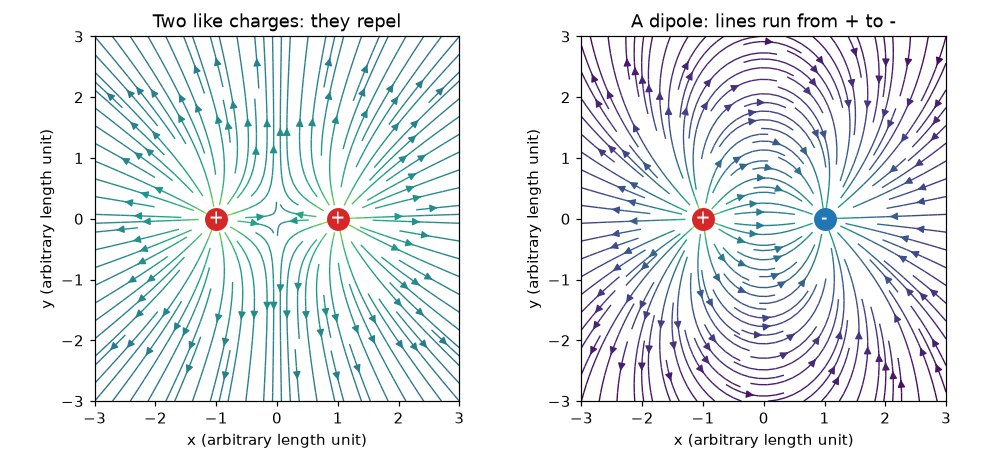
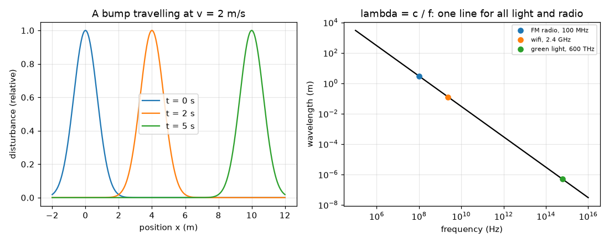

# సెషన్ 1: ఆవేశాలు, క్షేత్రాలు మరియు తరంగాలు

[Session 1 — हिन्दी](README.hi.md)

*స్థాయి 1 (భావనాత్మక ఇంటరాక్టివ్ నమూనా) · సుమారు 60 నిమిషాలు · openemwave*

> ఇది సరళీకరించిన ఒక విద్యా నమూనా (educational model). ఇది ధృవీకరించబడిన డిజైన్ సాధనం కాదు; నిజమైన నిర్మాణాలు, విద్యుత్ ఇన్‌స్టాలేషన్‌లు, వాహనాలు, పారిశ్రామిక ప్రక్రియలు లేదా వైద్య నిర్ణయాల కోసం దీనిని ఉపయోగించకూడదు.

**ముందస్తు జ్ఞానం (Prerequisites)**

- పాఠశాల అంకగణితం మరియు గ్రాఫ్ అనే భావన.
- మీరు PRIMER.md చదివి `python start.py 1` ఒకసారి రన్ చేశారు.

**అభ్యాస లక్ష్యాలు (Learning objectives).** ఈ సెషన్ తర్వాత మీరు చేయగలరు:

- సజాతీయ మరియు విజాతీయ ఆవేశాలు ఏమి చేస్తాయో చెప్పడం, రెండు సజాతీయ ఆవేశాల మరియు ఒక ద్విధ్రువం (dipole) యొక్క క్షేత్రాన్ని గీయడం.
- తరంగాన్ని (wave) ప్రయాణించే ఒక అలజడిగా వివరించడం, దాని నుండి తరంగదైర్ఘ్యం మరియు పౌనఃపున్యం చదవడం.
- రేడియో మరియు కాంతికి వేగం = పౌనఃపున్యం x తరంగదైర్ఘ్యం ఉపయోగించడం.
- రేడియో, వైఫై మరియు కాంతి ఒకే రకమైన తరంగమని, c సుమారు 3e8 m/s అని చెప్పడం.

## A. వాస్తవ ప్రపంచ సమస్య
జుట్టుకు రుద్దిన బెలూన్ గోడకు అంటుకుంటుంది, అదే రకమైన కనిపించని తోపు మీకు ఇష్టమైన FM స్టేషన్‌ను గోడల గుండా ఒక చిన్న రేడియోకు తీసుకువెళ్తుంది. ఆ తోపు ఏమిటి, దానిని ఎలా గీయవచ్చు, రేడియో తరంగాలు మరియు కాంతి నిజానికి ఒకటే ఎందుకు? ఈ చిత్రం లేకుండా, యాంటెన్నా కేవలం ఒక రహస్యమైన లోహపు ముక్క.

## B. భావన మరియు సిద్ధాంతం
విద్యుత్ ఆవేశం (electric charge) రెండు గుర్తులలో వస్తుంది. ఒకే గుర్తు ఉన్న ఆవేశాలు వికర్షిస్తాయి, వ్యతిరేక గుర్తు ఉన్నవి ఆకర్షిస్తాయి. ఒక బిందువు వద్ద విద్యుత్ క్షేత్రం (electric field) అంటే ఒక చిన్న ధన పరీక్షా ఆవేశం అక్కడ అనుభవించే ప్రమాణ ఆవేశానికి తోపు; అది ధన ఆవేశాల నుండి దూరంగా మరియు ఋణ ఆవేశాల వైపు చూపుతుంది, ప్రతి ఆవేశం నుండి వచ్చే తోపుల (బాణాలుగా) మొత్తం అది. రెండు సమాన ధన ఆవేశాలు వాటి మధ్య సరిగ్గా సగం వద్ద సున్నా క్షేత్రాన్ని ఇస్తాయి; ఒక ద్విధ్రువం (సమాన ధన మరియు ఋణ ఆవేశాలు) అక్కడ దాని బలమైన క్షేత్రాన్ని ఇస్తుంది, ధన నుండి ఋణ ఆవేశం వైపు చూపుతూ. తరంగం అంటే పదార్థాన్ని వెంట తీసుకువెళ్ళకుండా కదిలే ఒక అలజడి: సమయం 0 వద్ద x = 0 వద్ద ఉన్న ఒక ఉబ్బు t సమయం తర్వాత x = v t వద్ద ఉంటుంది. పునరావృతమయ్యే తరంగానికి, తరంగదైర్ఘ్యం (wavelength) lambda అంటే శృంగాల మధ్య దూరం, పౌనఃపున్యం (frequency) f అంటే ప్రతి సెకనుకు దాటే శృంగాల సంఖ్య, కాబట్టి తరంగం సెకనుకు f lambda మీటర్లు ముందుకు వెళ్తుంది: v = f lambda. రేడియో, వైఫై, పరారుణ, దృశ్య కాంతి మరియు X-కిరణాలు అన్నీ విద్యుదయస్కాంత తరంగాలు (electromagnetic waves): శూన్యంలో వాటికి ఒకే వేగం, c సుమారు 3 x 10^8 m/s, పౌనఃపున్యంలో మాత్రమే తేడా.

| చిహ్నం | అర్థం | యూనిట్ |
|---|---|---|
| q | విద్యుత్ ఆవేశం (గుర్తుతో) | coulomb, C (nC = 1e-9 C) |
| E | విద్యుత్ క్షేత్రం (ప్రమాణ ఆవేశానికి తోపు) | volt per metre, V/m |
| v | తరంగ వేగం | metre per second, m/s |
| f | పౌనఃపున్యం | hertz, Hz (1 MHz = 1e6 Hz) |
| lambda | తరంగదైర్ఘ్యం | metre, m |
| c | శూన్యంలో కాంతి వేగం | 299 792 458 m/s, సుమారు 3e8 m/s |

**ఊహలు (Assumptions)**

- సెషన్ మొదటి సగంలో ఆవేశాలు బిందువులు, నిశ్చలంగా ఉంటాయి (స్థిర విద్యుత్).
- సెషన్ 1లో క్షేత్ర బాణాలు సరళమైన యూనిట్‌లను వాడతాయి; నిజమైన సంఖ్యలు సెషన్ 2లో వస్తాయి.
- తరంగాలు శూన్యంలో (గాలి దాదాపు అదే) సరళ రేఖలో ప్రయాణిస్తాయి.

$$ \mathbf E=\sum_i q_i\,\frac{\mathbf r-\mathbf r_i}{|\mathbf r-\mathbf r_i|^{3}}\quad\text{(simple units: sum of the pushes)} $$

$$ y(x,t)=y_0(x-vt)\quad\text{(a bump moving right at speed } v) $$

$$ v=f\,\lambda $$

$$ \lambda=\frac{c}{f},\qquad c\approx 3\times10^{8}\ \mathrm{m/s} $$

## C. దృశ్య వివరణ
మొదటి చిత్రం రెండు సజాతీయ ఆవేశాల క్షేత్ర రేఖలను (అవి ఒకదానికొకటి దూరంగా వంగుతాయి, మధ్యభాగం ఒక నిర్జీవ స్థానం) మరియు ఒక ద్విధ్రువం యొక్క క్షేత్ర రేఖలను (రేఖలు ఎరుపు ధన ఆవేశం నుండి బయలుదేరి నీలం ఋణ ఆవేశం వద్దకు చేరతాయి) చూపిస్తుంది. రెండవ చిత్రం 2 m/s వద్ద కదిలే ఒక ఉబ్బును మూడు క్షణాలలో, మరియు ఒక log-log గ్రాఫ్‌పై lambda = c / f రేఖను చూపిస్తుంది: 100 MHz వద్ద FM రేడియో సుమారు 3 m వద్ద, 2.4 GHz వద్ద వైఫై 12.5 cm వద్ద, 600 THz వద్ద ఆకుపచ్చ కాంతి సుమారు 500 nm వద్ద — అన్నీ c వద్ద ప్రయాణిస్తాయి కాబట్టి ఒకే సరళ రేఖపై.

*రెండు సజాతీయ ఆవేశాల (ఎడమ) మరియు ఒక ద్విధ్రువం (కుడి) యొక్క క్షేత్ర రేఖలు.*

*2 m/s వద్ద ప్రయాణించే ఒక ఉబ్బు, మరియు పౌనఃపున్యానికి వ్యతిరేకంగా తరంగదైర్ఘ్యం: FM, వైఫై, కాంతి ఒకే రేఖపై.*

## D. ఇంటరాక్టివ్ సిమ్యులేషన్
పాఠాన్ని రన్ చేయండి (`python start.py 1`), తర్వాత లైవ్ యాప్‌ను తెరవండి: [సెషన్ 1: ఆవేశాలు మరియు తరంగాలు](https://krunalpanchal1995.github.io/pan-iit-oss/openemwave/session-01/) (లేదా ఈ ఫోల్డర్‌లోని `app.html`). రెండు ఆవేశాలను మార్చి బాణాలను గమనించండి: వాటిని సమానం చేయండి, తర్వాత వ్యతిరేకం చేయండి, మధ్యబిందువు వద్ద క్షేత్రాన్ని చదవండి. తర్వాత తరంగ వ్యూకి మారి పౌనఃపున్యాన్ని జరిపి, పౌనఃపున్యం పెరిగేకొద్దీ తరంగదైర్ఘ్యం కుంచించుకుపోవడం చూడండి.

**సవాలు.** ఒక ద్విధ్రువాన్ని తయారు చేయండి (సమాన మరియు వ్యతిరేక ఆవేశాలు), తరంగాన్ని FM పౌనఃపున్యం 100 MHz కి సెట్ చేయండి, అప్పుడు తరంగదైర్ఘ్యం సుమారు 3 m.

## E. సాధించిన ఉదాహరణ మరియు ప్రయోగం
**సమస్య.** ఒక FM స్టేషన్ 100 MHz వద్ద ప్రసారం చేస్తుంది. దాని రేడియో తరంగం యొక్క తరంగదైర్ఘ్యం ఎంత? 2.4 GHz వైఫై తరంగదైర్ఘ్యం ఎంత? ఏది పొడవైనది, ఎంత?

1. c = 2.998 x 10^8 m/s తో lambda = c / f ఉపయోగించండి.
2. FM: f = 100 MHz = 1.00 x 10^8 Hz, కాబట్టి lambda = 2.998e8 / 1.00e8 = 2.998 m, సుమారు 3.0 m.
3. వైఫై: f = 2.4 GHz = 2.4 x 10^9 Hz, కాబట్టి lambda = 2.998e8 / 2.4e9 = 0.1249 m, సుమారు 12.5 cm.
4. తరంగదైర్ఘ్యాల నిష్పత్తి 2.998 / 0.1249 = 24, ఇది పౌనఃపున్యాల నిష్పత్తే, 2400 / 100 = 24.
5. సరిచూపు: FM కి మనిషి పరిమాణం తరంగం (మీటర్లు), వైఫైకి చేతి పరిమాణం తరంగం (సెంటీమీటర్లు): అందుకే FM యాంటెన్నాలు పొడవుగా, వైఫై యాంటెన్నాలు పొట్టిగా ఉంటాయి.

**సమాధానం.** FM: సుమారు 3.0 m. వైఫై: సుమారు 12.5 cm. FM తరంగం యొక్క పౌనఃపున్యం 24 రెట్లు తక్కువ కాబట్టి అది 24 రెట్లు పొడవైనది.

**ప్రయోగం.** చేతిలో పట్టుకునే FM రేడియోను ట్యూన్ చేసి దాని టెలిస్కోపిక్ యాంటెన్నాను చాపండి: సాధారణంగా అది ఒక మీటర్‌లో మంచి భాగం నుండి ఒకటిన్నర మీటర్ల వరకు పొడవుగా ఉన్నప్పుడు రిసెప్షన్ ఉత్తమంగా ఉంటుంది. సెషన్ 2 యొక్క 1.5 m అర్ధ-తరంగ అంచనాతో పోల్చండి. నిజమైన రిసెప్షన్ భవనాలు, రేడియో సర్క్యూట్, మీరు దానిని ఎలా పట్టుకుంటారు అనే వాటిపై కూడా ఆధారపడి ఉంటుంది, కాబట్టి సరళమైన నమూనా సరైన పరిమాణ క్రమాన్ని (order of magnitude) మాత్రమే చెబుతుంది.

## F. మూల్యాంకనం మరియు డిజైన్ సవాలు
**ప్రశ్న రకం A: భావనాత్మక.** రెండు ప్రోటాన్లు మరియు రెండు ఎలక్ట్రాన్లు ఒక వరుసలో ఉంచబడ్డాయి. లెక్కించకుండా, ఏ జంటలు దూరంగా నెడతాయో, ఏవి దగ్గరకు లాగుతాయో వివరించండి. రెండు సమాన ధన ఆవేశాల క్షేత్రం వాటి మధ్య సగం వద్ద ఎందుకు అదృశ్యమవుతుంది?

సూచన

ఒకే గుర్తు వికర్షిస్తుంది, వ్యతిరేక గుర్తు ఆకర్షిస్తుంది. మధ్యబిందువు వద్ద ప్రతి ఆవేశం ఒకే బలంతో నెడుతుంది.

దశలవారీ పరిష్కారం

ప్రోటాన్-ప్రోటాన్ మరియు ఎలక్ట్రాన్-ఎలక్ట్రాన్ జంటలకు ఒకే గుర్తు, అవి వికర్షిస్తాయి; ప్రోటాన్-ఎలక్ట్రాన్ జంటలకు వ్యతిరేక గుర్తులు, అవి ఆకర్షిస్తాయి. రెండు సమాన ధన ఆవేశాల మధ్య సగం వద్ద, ప్రతి ఒక్కటీ పరీక్షా ఆవేశాన్ని తన నుండి దూరంగా సమాన బలంతో కానీ వ్యతిరేక దిశలలో నెడుతుంది, కాబట్టి రెండు తోపులు రద్దవుతాయి, అక్కడ క్షేత్రం సున్నా.

**ప్రశ్న రకం B: సంఖ్యాత్మక.** ఒక రేడియో తరంగం పౌనఃపున్యం 90 MHz. దాని తరంగదైర్ఘ్యం కనుగొనండి. 100 MHz ఫలితంతో పోల్చి సమాధానం సహేతుకమో సరిచూడండి.

సూచన

c = 3e8 m/s (లేదా 2.998e8) తో lambda = c / f. మొదట MHz ను Hz గా మార్చండి.

దశలవారీ పరిష్కారం

f = 90 MHz = 9.0e7 Hz, కాబట్టి lambda = 2.998e8 / 9.0e7 = 3.33 m. సరిచూపు: 100 MHz కంటే తక్కువ పౌనఃపున్యం 3.0 m కంటే పొడవైన తరంగదైర్ఘ్యాన్ని ఇవ్వాలి, 3.33 m పొడవైనది. యూనిట్: మీటర్లు.

**ప్రశ్న రకం C: గ్రాఫ్ మరియు సిమ్యులేషన్ వ్యాఖ్యానం.** lambda-పౌనఃపున్యం గ్రాఫ్‌లో, FM రేడియో, వైఫై మరియు ఆకుపచ్చ కాంతి ఒకే సరళ రేఖపై ఉన్నాయి. అది వాటి వేగాల గురించి ఏమి చెబుతుంది? ఒక బిందువును రేఖ పైకి జరిపితే, దాని అర్థం ఏమిటి?

సూచన

log-log గ్రాఫ్‌పై lambda = c / f అనేది వాలు -1 ఉన్న సరళ రేఖ; రేఖ స్థానాన్ని c నిర్ణయిస్తుంది.

దశలవారీ పరిష్కారం

ప్రతి దానికీ lambda f = c ఒకటే కాబట్టి అవన్నీ ఒకే రేఖపై ఉన్నాయి, కాబట్టి అన్నీ ఒకే వేగం c వద్ద ప్రయాణిస్తాయి. రేఖ పైన ఉన్న బిందువు అదే పౌనఃపున్యం వద్ద పొడవైన తరంగదైర్ఘ్యం ఉన్న తరంగం అవుతుంది, అంటే lambda f > c: శూన్యంలో కాంతి కంటే వేగవంతమైన తరంగం, అది జరగదు. (గాజు లేదా నీటిలోని తరంగాలు c కంటే నెమ్మదిగా ఉంటాయి, అవి రేఖ కింద ఉంటాయి.)

**ప్రశ్న రకం D: డిజైన్ మరియు ఆప్టిమైజేషన్ (optimisation) సవాలు.** డిజైన్: గది పరిమాణం పరీక్షకు సరిపోయే 1 m తరంగదైర్ఘ్యం ఉన్న తరంగం మీకు కావాలి. మీకు ఏ పౌనఃపున్యం కావాలి? అది రేడియో తరంగమా లేక కాంతి తరంగమా? 1 m తరంగం గోడలోని 5 cm ఖాళీ గుండా 12.5 cm వైఫై తరంగం అంత సులభంగా వెళ్తుందా?

సూచన

f = c / lambda. ఖాళీని తరంగదైర్ఘ్యంతో పోల్చండి: ద్వారం సుమారు ఒక తరంగదైర్ఘ్యం కంటే చిన్నదైనప్పుడు తరంగాలు అడ్డుకోబడతాయి లేదా వంగుతాయి.

దశలవారీ పరిష్కారం

f = 2.998e8 / 1 = 3.0e8 Hz = 300 MHz, ఒక రేడియో తరంగం (FM మరియు వైఫై మధ్య). 5 cm ఖాళీ 1 m కంటే చాలా చిన్నది, 12.5 cm కంటే కూడా చిన్నది, కాబట్టి రెండూ సరళ కిరణంగా సులభంగా వెళ్ళవు; 12.5 cm తరంగం ఖాళీ పరిమాణానికి దగ్గరగా ఉంటుంది, చాలా బాగా వెళ్తుంది. ఊహలు: ఖాళీ యొక్క సరళమైన చిత్రం; నిజమైన ప్రవర్తన పదార్థంపై మరియు తరంగం ఆకారంపై ఆధారపడి ఉంటుంది.

[RUBRIC.md](../../RUBRIC.md)తో మిమ్మల్ని మీరు స్కోర్ చేసుకోండి. కాగితంపై చేయడానికి [కార్యాచరణ పత్రం](activity_sheet.md) ప్రింట్ చేయండి.

## సాధారణ అపోహలు
| సాధారణ అపోహ | నిజానికి సరైనది |
|---|---|
| కాంతి మరియు రేడియో వేర్వేరు రకాల విషయాలు. | అవి వేర్వేరు పౌనఃపున్యాలు ఉన్న ఒకే రకమైన తరంగం (విద్యుదయస్కాంత తరంగం); రెండూ శూన్యంలో c వద్ద ప్రయాణిస్తాయి. |
| తరంగం పదార్థాన్ని వెంట తీసుకువెళ్తుంది. | అలజడి ప్రయాణిస్తుంది; తాడు, నీరు లేదా క్షేత్రం అక్కడే పైకి కిందికి మాత్రమే కదులుతుంది. |
| ఎక్కువ పౌనఃపున్యం అంటే వేగవంతమైన తరంగం. | శూన్యంలో అన్ని విద్యుదయస్కాంత తరంగాలకు ఒకే వేగం c; v = f lambda కాబట్టి ఎక్కువ పౌనఃపున్యం అంటే తక్కువ తరంగదైర్ఘ్యం. |
| సజాతీయ ఆవేశాలు ఒకేలా ఉంటాయి కాబట్టి ఆకర్షిస్తాయి. | సజాతీయ ఆవేశాలు వికర్షిస్తాయి; విజాతీయ ఆవేశాలు ఆకర్షిస్తాయి. |

## పదకోశం (Glossary)
- **విద్యుత్ క్షేత్రం (electric field)**: అంతరిక్షంలో ఒక బిందువు వద్ద ప్రమాణ ఆవేశానికి తోపు, వోల్ట్ పర్ మీటర్‌లో
- **ద్విధ్రువం (dipole)**: దగ్గరగా ఉన్న ఒక ధన మరియు ఒక ఋణ ఆవేశం
- **తరంగదైర్ఘ్యం (wavelength)**: తరంగం యొక్క పక్కపక్కనే ఉన్న రెండు శృంగాల మధ్య దూరం, మీటర్లలో
- **పౌనఃపున్యం (frequency)**: ప్రతి సెకనుకు ఒక బిందువును ఎన్ని శృంగాలు దాటతాయి, హెర్ట్జ్‌లో
- **విద్యుదయస్కాంత తరంగం (electromagnetic wave)**: రేడియో లేదా కాంతి వంటి, విద్యుత్ మరియు అయస్కాంత క్షేత్రాల ప్రయాణించే నమూనా

## ముగింపు
1. [exercises.md](exercises.md)లోని మూడు కోడింగ్ పనులు చేయండి.
2. మీ మార్పుల తర్వాత `python start.py 1` మళ్ళీ రన్ చేయండి. అది చెక్‌పాయింట్‌తో (checkpoint) ముగుస్తుంది; అది `PASS` అని ప్రింట్ చేసినప్పుడు మీరు పూర్తి చేశారు. (చెక్‌పాయింట్ మాత్రమే: `python start.py check 1`.)

తర్వాత: [సెషన్ 2](../session-02/README.md)
