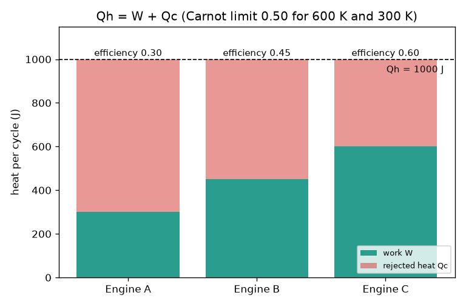
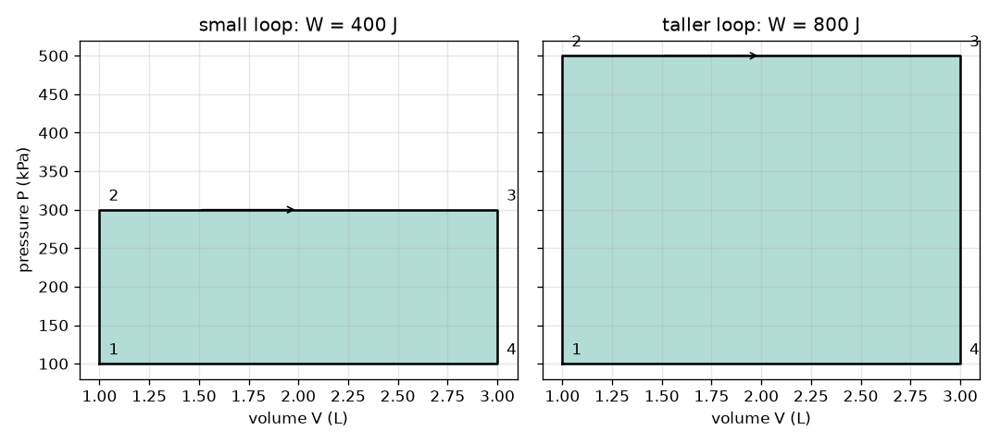

# सत्र 1: ऊष्मा अंदर, कार्य बाहर, ऊष्मा अस्वीकृत

[Session 1 — తెలుగు](README.te.md)

*स्तर 1 (वैचारिक इंटरैक्टिव मॉडल) · लगभग 60 मिनट · openengine*

> यह एक सरलीकृत शैक्षिक मॉडल है। यह कोई प्रमाणित डिज़ाइन उपकरण नहीं है और इसका उपयोग वास्तविक संरचनाओं, विद्युत स्थापनाओं, वाहनों, औद्योगिक प्रक्रियाओं या चिकित्सा संबंधी निर्णयों के लिए नहीं किया जाना चाहिए।

**पूर्वापेक्षाएँ (Prerequisites)**

- स्कूली अंकगणित और दाब (pressure) तथा आयतन (volume) की अवधारणा।
- आपने PRIMER.md पढ़ लिया है और `python start.py 1` एक बार चला लिया है।

**सीखने के उद्देश्य (Learning objectives)।** इस सत्र के बाद आप:

- किसी इंजन का ऊर्जा संतुलन (energy balance), W = Qh - Qc, लिख सकेंगे और उसकी दक्षता (efficiency) की गणना कर सकेंगे।
- कार्नो सीमा (Carnot limit) 1 - Tc / Th बता सकेंगे और केल्विन का सही उपयोग कर सकेंगे।
- समझा सकेंगे कि दक्षिणावर्त (clockwise) P-V लूप से घिरा क्षेत्रफल शुद्ध कार्य (net work) क्यों है।
- तय कर सकेंगे कि दावा किया गया कोई इंजन ऊर्जा संतुलन और ऊष्मागतिकी के द्वितीय नियम (second law) द्वारा अनुमत है या नहीं।

## A. वास्तविक दुनिया की समस्या
एक कार ईंधन जलाती है, पर ईंधन की अधिकांश ऊर्जा पहियों को घुमाने के बजाय निकास (exhaust) और रेडिएटर से बाहर चली जाती है। कोई भी इंजन सारी ऊष्मा को कार्य में क्यों नहीं बदल सकता? और यदि आप सिलिंडर के अंदर गैस का केवल दाब और आयतन देखें, तो एक चक्र का कार्य कैसे पढ़ सकते हैं? (केवल सामान्य शिक्षा के लिए: यह एक सरलीकृत मॉडल है, इंजन डिज़ाइन की विधि नहीं।)

## B. अवधारणा और सिद्धांत
एक इंजन गर्म स्रोत से ऊष्मा Qh लेता है, कार्य W करता है और उसे ऊष्मा Qc किसी ठंडी जगह पर फेंकनी ही पड़ती है। एक पूरे चक्र (cycle) के बाद इंजन वहीं लौट आता है जहाँ से उसने शुरू किया था, इसलिए उसकी संचित ऊर्जा नहीं बदली और ऊर्जा संतुलन Qh = W + Qc है। दक्षता ऊष्मा का वह भाग है जो कार्य बनता है: eta = W / Qh। द्वितीय नियम कहता है कि Qc शून्य नहीं हो सकती; Th पर गर्म स्रोत और Tc (केल्विन) पर ठंडे परिवेश के बीच, कोई भी इंजन eta = 1 - Tc / Th से बेहतर नहीं कर सकता। दाब बनाम आयतन के ग्राफ़ पर, उच्च दाब पर प्रसार (expansion) जितना कार्य देता है, निम्न दाब पर संपीडन (compression) उससे कम वापस लेता है, इसलिए दक्षिणावर्त लूप शुद्ध कार्य देता है और कार्य घिरा हुआ क्षेत्रफल है। P को kPa में और V को लीटर में लेने पर, kPa गुणा L जूल के बराबर होता है।

| प्रतीक | अर्थ | इकाई |
|---|---|---|
| Qh | प्रति चक्र गर्म स्रोत से ली गई ऊष्मा | J |
| Qc | प्रति चक्र ठंडे परिवेश को अस्वीकृत ऊष्मा | J |
| W | प्रति चक्र शुद्ध कार्य | J |
| eta | ऊष्मीय दक्षता W / Qh | कोई इकाई नहीं |
| Th, Tc | गर्म और ठंडे तापमान, निरपेक्ष | K |
| P, V | गैस का दाब और आयतन | kPa, L |

**मान्यताएँ (Assumptions)**

- एक पूरा चक्र: गैस उसी अवस्था में समाप्त होती है जहाँ से उसने शुरू किया था।
- तापमान निरपेक्ष हैं (केल्विन = डिग्री C + 273.15)।
- आयताकार P-V लूप क्षेत्रफल का नियम सीखने के लिए एक खिलौना आकृति है।

$$ Q_h = W + Q_c,\qquad W = Q_h - Q_c $$

$$ \eta = \frac{W}{Q_h} = 1 - \frac{Q_c}{Q_h} $$

$$ \eta \le \eta_{\mathrm{Carnot}} = 1 - \frac{T_c}{T_h} $$

$$ W = \oint P\,dV $$

## C. दृश्य व्याख्या
पहला चित्र तीन इंजन दिखाता है जिनमें से प्रत्येक 600 K स्रोत से 1000 J लेता है: इंजन A 300 J कार्य करता है (दक्षता 0.30), इंजन B 450 J करता है (0.45) और इंजन C 600 J का दावा करता है (0.60)। 600 K और 300 K के बीच कार्नो सीमा 0.50 है, इसलिए इंजन C असंभव है। दूसरा चित्र समान आयतन परास (1 से 3 L) वाले दो आयताकार P-V लूप दिखाता है: 300 kPa तक का लूप 400 J घेरता है और 500 kPa तक का ऊँचा लूप 800 J घेरता है।

*1000 J लेने वाले तीन इंजन: कार्य और अस्वीकृत ऊष्मा; इंजन C कार्नो सीमा तोड़ता है।*

*दो आयताकार P-V लूप: घिरा हुआ क्षेत्रफल ही कार्य है (400 J और 800 J)।*

## D. इंटरैक्टिव सिमुलेशन
पाठ चलाइए (`python start.py 1`), फिर लाइव ऐप खोलिए: [सत्र 1: ऊष्मा अंदर, कार्य बाहर](https://krunalpanchal1995.github.io/pan-iit-oss/openengine/session-01/) (या इसी फ़ोल्डर में `app.html`)। ली गई ऊष्मा और उसका अस्वीकृत हिस्सा बदलिए। इंजन का चित्र देखिए (तीर उतने ही मोटे हैं जितनी ऊष्माएँ), फिर P-V दृश्य खोलिए और देखिए कि क्षेत्रफल कार्य के बराबर है। कार्नो सीमा को खिसकते देखने के लिए गर्म तापमान बढ़ाइए।

**चुनौती।** कार्नो सीमा तोड़े बिना प्रति चक्र कम से कम 300 J कार्य दीजिए।

## E. हल किया गया उदाहरण और प्रयोग
**समस्या।** एक इंजन 600 K स्रोत से 1000 J लेता है और 300 K परिवेश को 650 J अस्वीकृत करता है। W और दक्षता ज्ञात कीजिए और कार्नो सीमा जाँचिए। फिर 100 से 300 kPa और 1 से 3 L वाले P-V आयत का कार्य ज्ञात कीजिए।

1. ऊर्जा संतुलन: W = Qh - Qc = 1000 - 650 = 350 J।
2. दक्षता = 350 / 1000 = 0.35।
3. कार्नो सीमा = 1 - 300 / 600 = 0.50; चूँकि 0.35, 0.50 से कम है, इंजन अनुमत है।
4. लूप का क्षेत्रफल = (300 - 100) kPa x (3 - 1) L = 200 x 2 = 400 kPa L = 400 J।
5. यदि वह लूप Qh = 1000 J वाले इसी इंजन का चक्र होता, तो Qc = 600 J और eta = 0.40।

**उत्तर।** W = 350 J, दक्षता 0.35 (अनुमत, सीमा 0.50); आयत 400 J घेरता है।

**प्रयोग।** साइकिल पंप का उपयोग कीजिए: एक मिनट तक ज़ोर से पंप कीजिए और बैरल को गर्म होते महसूस कीजिए। आपने कार्य किया और गैस गर्म हुई; ऊष्मा हवा में चली जाती है। मॉडल से तुलना कीजिए: यह कहता है कि आपके द्वारा डाला गया कार्य ऊष्मा के रूप में प्रकट होता है, और एक इंजन इस प्रक्रिया को उल्टी दिशा में चलाता है। वास्तविक उपकरण घर्षण और शोर में अतिरिक्त ऊर्जा खोते हैं, इसलिए मापी गई दक्षता हमेशा मॉडल से कम होती है।

## F. मूल्यांकन और डिज़ाइन चुनौती
**प्रश्न प्रकार A: वैचारिक।** एक इंजन, चाहे उसमें बिल्कुल भी घर्षण न हो, प्राप्त सारी ऊष्मा को कभी भी कार्य में क्यों नहीं बदल सकता?

संकेत

द्वितीय नियम Qc के बारे में क्या कहता है, और eta = 1 - Tc / Th के लिए क्या चाहिए होगा?

चरण-दर-चरण हल

द्वितीय नियम ऐसे चक्रीय इंजन को निषिद्ध करता है जो एक स्रोत से ऊष्मा लेकर उसे पूरी तरह कार्य में बदल दे। कुछ ऊष्मा Qc किसी ठंडी जगह जानी ही चाहिए। सर्वोत्तम स्थिति कार्नो सीमा 1 - Tc / Th है, जो 1 तक तभी पहुँचती है जब Tc 0 K हो (या Th अनंत हो), और इनमें से कोई भी संभव नहीं है। इसलिए घर्षण-रहित इंजन की दक्षता भी 1 से कम होती है।

**प्रश्न प्रकार B: संख्यात्मक।** एक इंजन गर्म स्रोत से 800 J लेता है और 520 J अस्वीकृत करता है। कार्य और दक्षता ज्ञात कीजिए, और जाँचिए कि इकाइयाँ और उत्तर उचित हैं।

संकेत

W = Qh - Qc, फिर Qh से भाग दीजिए।

चरण-दर-चरण हल

W = 800 - 520 = 280 J। eta = 280 / 800 = 0.35 (कोई इकाई नहीं)। जाँच: दक्षता 0 और 1 के बीच है, और W और Qc का योग फिर से 800 J देता है।

**प्रश्न प्रकार C: ग्राफ़ और सिमुलेशन की व्याख्या।** P-V दृश्य में कार्य बढ़ाने के बाद लूप की चौड़ाई वही है पर वह ऊँचा है। जब ऊपरी दाब 300 kPa से 500 kPa होता है (निचला 100 kPa, आयतन 1 से 3 L), तो क्षेत्रफल कितने गुना बढ़ता है? दोनों कार्य क्या हैं?

संकेत

क्षेत्रफल = (ऊपरी - निचला) x चौड़ाई।

चरण-दर-चरण हल

ऊँचाइयाँ 200 kPa और 400 kPa हैं, इसलिए क्षेत्रफल दुगुना होता है: 400 J, 800 J बन जाता है (इकाइयाँ: kPa L = J)।

**प्रश्न प्रकार D: डिज़ाइन और अनुकूलन चुनौती।** डिज़ाइन: एक इंजन को 700 K स्रोत और 300 K परिवेश के बीच प्रति चक्र 300 J कार्य देना है। उसे कम से कम कितनी ऊष्मा Qh लेनी होगी, और न्यूनतम Qc कितनी होगी? एक वास्तविक इंजन 0.30 तक पहुँचता है। उसे कितनी ऊष्मा चाहिए होगी?

संकेत

सर्वोत्तम स्थिति के रूप में कार्नो सीमा का उपयोग कीजिए: Qh = W / eta।

चरण-दर-चरण हल

सर्वोत्तम स्थिति eta = 1 - 300 / 700 = 0.571, इसलिए Qh = 300 / 0.571 = 525 J और Qc = 225 J। 0.30 वाले वास्तविक इंजन को Qh = 300 / 0.30 = 1000 J चाहिए और वह 700 J अस्वीकृत करता है। समझौता (trade-off): कार्नो मान उस ऊष्मा की निचली सीमा है जो आपको देनी ही होगी, डिज़ाइन लक्ष्य नहीं, क्योंकि वास्तविक इंजन उससे बहुत नीचे होते हैं।

[RUBRIC.md](../../RUBRIC.md) से स्वयं को अंक दीजिए। कागज़ पर काम करने के लिए [गतिविधि पत्रक](activity_sheet.md) प्रिंट कीजिए।

## आम भ्रांतियाँ
| आम भ्रांति | वास्तव में क्या सच है |
|---|---|
| बिना घर्षण वाला इंजन 100 प्रतिशत दक्ष हो सकता है। | द्वितीय नियम घर्षण के बिना भी ऊष्मा अस्वीकृति को अनिवार्य करता है; सीमा 1 - Tc / Th है। |
| कार्नो सीमा की गणना डिग्री सेल्सियस में तापमानों से की जा सकती है। | इसके लिए केल्विन चाहिए। 100 C और 20 C के साथ गलत मान 0.8 देंगे; सही मान (373 K और 293 K) 0.21 देते हैं। |
| कार्य P-V लूप की ऊँचाई है। | कार्य घिरा हुआ क्षेत्रफल है: दाब की ऊँचाई गुणा आयतन की चौड़ाई, जूल में। |
| दक्षिणावर्त या वामावर्त लूप समान कार्य देता है। | दक्षिणावर्त धनात्मक कार्य देता है (एक इंजन); वामावर्त ऋणात्मक कार्य देता है (एक रेफ़्रिजरेटर या हीट पंप)। |

## शब्दावली
- **दक्षता (efficiency)**: ली गई ऊष्मा का वह अंश जो कार्य बनता है
- **कार्नो सीमा (Carnot limit)**: दो तापमानों के बीच संभव अधिकतम दक्षता, 1 - Tc / Th
- **चक्र (cycle)**: चरणों का एक क्रम जो गैस को उसकी प्रारंभिक अवस्था में लौटा देता है
- **केल्विन (kelvin)**: निरपेक्ष तापमान पैमाना: K = डिग्री C + 273.15
- **P-V आरेख (P-V diagram)**: गैस के दाब बनाम आयतन का ग्राफ़

## समापन
1. [exercises.md](exercises.md) में दिए तीन कोडिंग कार्य कीजिए।
2. अपने बदलावों के बाद `python start.py 1` फिर से चलाइए। यह चेकपॉइंट (checkpoint) पर समाप्त होता है; जब यह `PASS` छापे, तो आपका काम पूरा है। (केवल चेकपॉइंट: `python start.py check 1`।)

अगला: [सत्र 2](../session-02/README.md)
