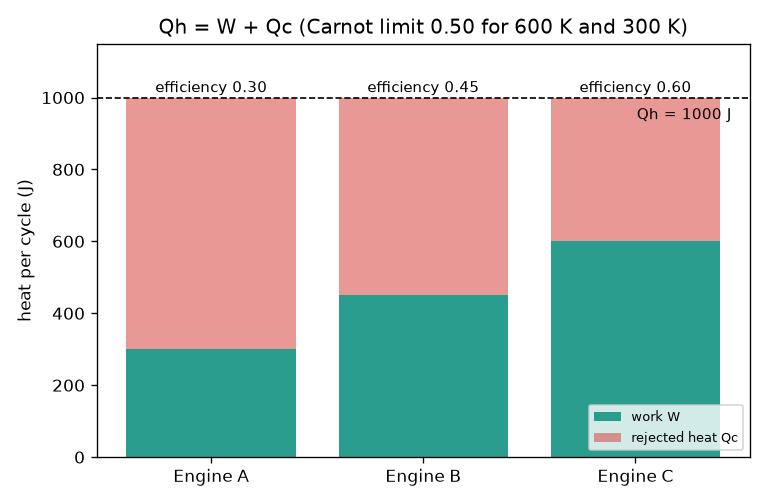
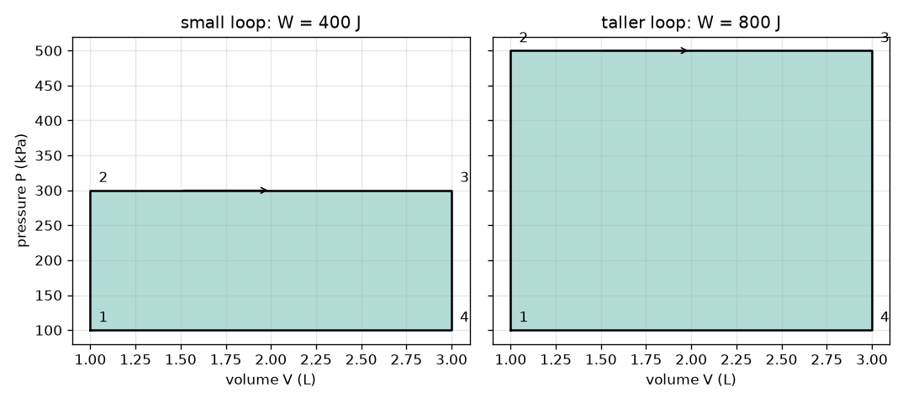

# Session 1: Heat in, work out, heat rejected

[Session 1 — తెలుగు](README.te.md) · [Session 1 — हिन्दी](README.hi.md) · [Session 1 — தமிழ்](README.ta.md) · [Session 1 — മലയാളം](README.ml.md)

*Level 1 (conceptual interactive model) · about 60 minutes · openengine*

> This is a simplified educational model. It is not a validated design tool and must not be used for real structures, electrical installations, vehicles, industrial processes or medical decisions.

**Prerequisites**

- School arithmetic and the idea of pressure and volume.
- You have read [PRIMER.md](../../PRIMER.md) and run `python start.py 1` once.

**Learning objectives.** After this session you can:

- Write the energy balance of an engine, W = Qh - Qc, and compute its efficiency.
- State the Carnot limit 1 - Tc / Th and use kelvin correctly.
- Explain why the enclosed area of a clockwise P-V loop is the net work.
- Decide whether a claimed engine is allowed by the energy balance and the second law.

## A. Real-world problem
A car burns fuel, but most of the fuel's energy leaves through the exhaust and the radiator instead of turning the wheels. Why can no engine turn all the heat into work? And if you only see the pressure and volume of the gas inside the cylinder, how can you read off the work of one cycle? (General education only: this is a simplified model, not an engine design method.)

## B. Concept and theory
An engine takes heat Qh from a hot source, does work W and must throw heat Qc away to a cold place. After one full cycle the engine is back where it started, so its stored energy has not changed and the energy balance is Qh = W + Qc. The efficiency is the part of the heat that becomes work: eta = W / Qh. The second law says Qc cannot be zero; between a hot source at Th and cold surroundings at Tc (kelvin), no engine can beat eta = 1 - Tc / Th. On a graph of pressure against volume, expansion at high pressure gives more work than compression at low pressure takes back, so a clockwise loop gives net work and the work is the enclosed area. With P in kPa and V in litres, kPa times L equals joules.

| Symbol | Meaning | Unit |
|---|---|---|
| Qh | heat taken from the hot source per cycle | J |
| Qc | heat rejected to the cold surroundings per cycle | J |
| W | net work per cycle | J |
| eta | thermal efficiency W / Qh | no unit |
| Th, Tc | hot and cold temperatures, absolute | K |
| P, V | gas pressure and volume | kPa, L |

**Assumptions**

- One complete cycle: the gas ends in the state where it started.
- Temperatures are absolute (kelvin = degrees C + 273.15).
- The rectangular P-V loop is a toy shape used to learn the area rule.

$$ Q_h = W + Q_c,\qquad W = Q_h - Q_c $$

$$ \eta = \frac{W}{Q_h} = 1 - \frac{Q_c}{Q_h} $$

$$ \eta \le \eta_{\mathrm{Carnot}} = 1 - \frac{T_c}{T_h} $$

$$ W = \oint P\,dV $$

## C. Visual explanation
The first figure shows three engines that each take 1000 J from a 600 K source: Engine A does 300 J of work (efficiency 0.30), Engine B does 450 J (0.45) and Engine C claims 600 J (0.60). The Carnot limit between 600 K and 300 K is 0.50, so Engine C is impossible. The second figure shows two rectangular P-V loops with the same volume range (1 to 3 L): both start at 100 kPa; the loop that goes up to 300 kPa encloses 400 J and the taller loop that goes up to 500 kPa encloses 800 J.

*Three engines taking 1000 J: work and rejected heat; Engine C breaks the Carnot limit.*

*Two rectangular P-V loops: the enclosed area is the work (400 J and 800 J).*

## D. Interactive simulation
Run the lesson (`python start.py 1`), then open the live app: [Session 1: heat in, work out](https://krunalpanchal1995.github.io/pan-iit-oss/openengine/session-01/) (or `app.html` in this folder). Change the heat taken in and the share of it rejected. Watch the engine picture (arrows are as thick as the heats), then open the P-V view and see the area equal to the work. Raise the hot temperature to see the Carnot limit move.

**Challenge.** Deliver at least 300 J of work per cycle without breaking the Carnot limit.

## E. Worked example and experiment
**Problem.** An engine takes 1000 J from a 600 K source and rejects 650 J to 300 K surroundings. Find W and the efficiency and check the Carnot limit. Then find the work of a P-V rectangle from 100 to 300 kPa and 1 to 3 L.

1. Energy balance: W = Qh - Qc = 1000 - 650 = 350 J.
2. Efficiency = 350 / 1000 = 0.35.
3. Carnot limit = 1 - 300 / 600 = 0.50; since 0.35 is below 0.50 the engine is allowed.
4. Loop area = (300 - 100) kPa x (3 - 1) L = 200 x 2 = 400 kPa L = 400 J.
5. Link the two parts: if this 400 J rectangle were the cycle of an engine that takes Qh = 1000 J, it would reject Qc = 1000 - 400 = 600 J and its efficiency would be 400 / 1000 = 0.40.

**Answer.** W = 350 J, efficiency 0.35 (allowed, limit 0.50); the rectangle encloses 400 J.

**Experiment.** Use a bicycle pump: pump hard for a minute and feel the barrel get warm. You did work and the gas got hot; the heat leaves to the air. Compare with the model: it says the work you put in appears as heat, and an engine runs the process the other way round. Real devices lose extra energy to friction and noise, so measured efficiency is always below the model's.

## F. Assessment and design challenge
**Question type A: Conceptual.** Why can an engine never turn all of the heat it receives into work, even if it had no friction at all?

Hint

What does the second law say about Qc, and what would eta = 1 - Tc / Th need?

Step-by-step solution

The second law forbids a cyclic engine that takes heat from one source and turns all of it into work. Some heat Qc must go to a colder place. The best case is the Carnot limit 1 - Tc / Th, which reaches 1 only if Tc were 0 K (or Th infinite), and neither is possible. So even a frictionless engine has an efficiency below 1.

**Question type B: Numerical.** An engine takes 800 J from a hot source and rejects 520 J. Find the work and the efficiency, and check the units and the answer is reasonable.

Hint

W = Qh - Qc, then divide by Qh.

Step-by-step solution

W = 800 - 520 = 280 J. eta = 280 / 800 = 0.35 (no unit). Sanity check: the efficiency is between 0 and 1, and W plus Qc gives back 800 J.

**Question type C: Graph and simulation interpretation.** In the P-V view the loop is the same width but taller after you raise the work. By what factor does the area grow when the top pressure goes from 300 kPa to 500 kPa (bottom 100 kPa, volume 1 to 3 L)? What are the two works?

Hint

Area = (top - bottom) x width.

Step-by-step solution

The heights are 200 kPa and 400 kPa, so the area doubles: 400 J becomes 800 J (units: kPa L = J).

**Question type D: Design and optimisation challenge.** Design: an engine must give 300 J of work per cycle between a 700 K source and 300 K surroundings. What is the smallest heat Qh it must take in, and the smallest Qc? A real engine reaches 0.30. How much heat would it need?

Hint

Use the Carnot limit as the best case: Qh = W / eta.

Step-by-step solution

Best case eta = 1 - 300 / 700 = 0.571, so Qh = 300 / 0.571 = 525 J and Qc = 225 J. A real engine at 0.30 needs Qh = 300 / 0.30 = 1000 J and rejects 700 J. Trade-off: the Carnot value is a floor on the heat you must supply, not a design target, because real engines are far below it.

Score yourself with [RUBRIC.md](../../RUBRIC.md). Print the [activity sheet](activity_sheet.md) to work on paper.

## Common misconceptions
| Common misconception | What is actually true |
|---|---|
| An engine with no friction could be 100 percent efficient. | The second law forces heat rejection even without friction; the limit is 1 - Tc / Th. |
| The Carnot limit can be computed with temperatures in degrees Celsius. | It needs kelvin. Putting the Celsius numbers 100 and 20 into the formula wrongly gives 1 - 20 / 100 = 0.8; with 373 K and 293 K the correct limit is 0.21. |
| The work is the height of the P-V loop. | The work is the enclosed area: pressure height times volume width, in joules. |
| A clockwise or counter-clockwise loop gives the same work. | Clockwise gives positive work (an engine); counter-clockwise gives negative work (a refrigerator or heat pump). |

## Glossary
- **efficiency**: the fraction of the heat taken in that becomes work
- **Carnot limit**: the highest efficiency possible between two temperatures, 1 - Tc / Th
- **cycle**: a sequence of steps that returns the gas to its starting state
- **kelvin**: absolute temperature scale: K = degrees C + 273.15
- **P-V diagram**: a graph of gas pressure against volume

## Finish
1. Do the three coding tasks in [exercises.md](exercises.md).
2. Run `python start.py 1` again after your changes. It ends with the checkpoint; when it prints `PASS`, you are done. (Checkpoint only: `python start.py check 1`.)

Next: [Session 2](../session-02/README.md)
