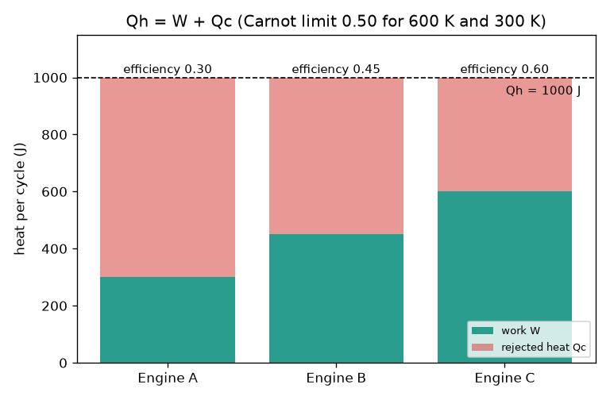
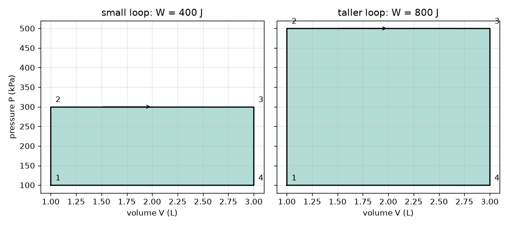

# സെഷൻ 1: താപം അകത്ത്, പ്രവൃത്തി പുറത്ത്, താപം പുറന്തള്ളൽ

[Session 1 — English](README.md)

*ലെവൽ 1 (ആശയപരമായ ഇന്ററാക്ടീവ് മോഡൽ) · ഏകദേശം 60 മിനിറ്റ് · openengine*

> ഇത് ലളിതമാക്കിയ ഒരു വിദ്യാഭ്യാസ മോഡൽ ആണ്. ഇത് സാധൂകരിച്ച ഒരു ഡിസൈൻ ഉപകരണമല്ല; യഥാർത്ഥ നിർമ്മിതികൾ, വൈദ്യുത സംവിധാനങ്ങൾ, വാഹനങ്ങൾ, വ്യാവസായിക പ്രക്രിയകൾ അല്ലെങ്കിൽ വൈദ്യശാസ്ത്രപരമായ തീരുമാനങ്ങൾ എന്നിവയ്ക്ക് ഇത് ഉപയോഗിക്കരുത്.

**മുൻ‌അറിവുകൾ (Prerequisites)**

- സ്കൂൾ ഗണിതവും മർദം (pressure), വ്യാപ്തം (volume) എന്നിവയുടെ ആശയവും.
- നിങ്ങൾ [PRIMER.md](../../PRIMER.md) വായിക്കുകയും `python start.py 1` ഒരിക്കൽ പ്രവർത്തിപ്പിക്കുകയും ചെയ്തിട്ടുണ്ട്.

**പഠന ലക്ഷ്യങ്ങൾ (Learning objectives).** ഈ സെഷനു ശേഷം നിങ്ങൾക്ക്:

- ഒരു എഞ്ചിന്റെ ഊർജ സന്തുലനം (energy balance), W = Qh - Qc, എഴുതാനും അതിന്റെ ക്ഷമത (efficiency) കണക്കാക്കാനും കഴിയും.
- കാർനോ പരിധി (Carnot limit) 1 - Tc / Th പ്രസ്താവിക്കാനും കെൽവിൻ ശരിയായി ഉപയോഗിക്കാനും കഴിയും.
- ഘടികാരദിശയിൽ (clockwise) ചുറ്റുന്ന ഒരു P-V ലൂപ്പ് ഉൾക്കൊള്ളുന്ന വിസ്തീർണം എന്തുകൊണ്ട് മൊത്ത പ്രവൃത്തി (net work) ആകുന്നു എന്ന് വിശദീകരിക്കാൻ കഴിയും.
- അവകാശപ്പെടുന്ന ഒരു എഞ്ചിൻ ഊർജ സന്തുലനവും താപഗതികത്തിലെ രണ്ടാം നിയമവും (second law) അനുവദിക്കുന്നതാണോ എന്ന് തീരുമാനിക്കാൻ കഴിയും.

## A. യഥാർത്ഥ ലോകത്തിലെ പ്രശ്നം
ഒരു കാർ ഇന്ധനം കത്തിക്കുന്നു, പക്ഷേ ഇന്ധനത്തിന്റെ ഊർജത്തിന്റെ ഭൂരിഭാഗവും ചക്രങ്ങളെ തിരിക്കുന്നതിനു പകരം എക്സ്ഹോസ്റ്റിലൂടെയും (exhaust) റേഡിയേറ്ററിലൂടെയും പുറത്തുപോകുന്നു. എന്തുകൊണ്ടാണ് ഒരു എഞ്ചിനും മുഴുവൻ താപത്തെയും പ്രവൃത്തിയാക്കി മാറ്റാൻ കഴിയാത്തത്? സിലിണ്ടറിനുള്ളിലെ വാതകത്തിന്റെ മർദവും വ്യാപ്തവും മാത്രമേ നിങ്ങൾ കാണുന്നുള്ളൂവെങ്കിൽ, ഒരു ചക്രത്തിന്റെ പ്രവൃത്തി എങ്ങനെ വായിച്ചെടുക്കാം? (പൊതുവിദ്യാഭ്യാസത്തിന് മാത്രം: ഇത് ലളിതമാക്കിയ ഒരു മോഡൽ ആണ്, എഞ്ചിൻ ഡിസൈൻ രീതിയല്ല.)

## B. ആശയവും സിദ്ധാന്തവും
ഒരു എഞ്ചിൻ ചൂടുള്ള സ്രോതസ്സിൽ നിന്ന് താപം Qh എടുക്കുന്നു, പ്രവൃത്തി W ചെയ്യുന്നു, കൂടാതെ താപം Qc ഒരു തണുത്ത സ്ഥലത്തേക്ക് പുറന്തള്ളുകയും വേണം. ഒരു പൂർണ ചക്രത്തിനു (cycle) ശേഷം എഞ്ചിൻ തുടങ്ങിയ അവസ്ഥയിലേക്ക് തിരിച്ചെത്തുന്നു, അതിനാൽ അതിൽ സംഭരിച്ച ഊർജം മാറിയിട്ടില്ല; ഊർജ സന്തുലനം Qh = W + Qc ആണ്. ക്ഷമത എന്നത് പ്രവൃത്തിയായി മാറുന്ന താപത്തിന്റെ ഭാഗമാണ്: eta = W / Qh. രണ്ടാം നിയമം പറയുന്നത് Qc പൂജ്യമാകാൻ കഴിയില്ല എന്നാണ്; Th താപനിലയിലുള്ള ചൂടുള്ള സ്രോതസ്സിനും Tc (കെൽവിൻ) താപനിലയിലുള്ള തണുത്ത പരിസരത്തിനും ഇടയിൽ, ഒരു എഞ്ചിനും eta = 1 - Tc / Th നെക്കാൾ മെച്ചപ്പെടാൻ കഴിയില്ല. മർദവും വ്യാപ്തവും തമ്മിലുള്ള ഗ്രാഫിൽ, ഉയർന്ന മർദത്തിലുള്ള വികാസം (expansion) നൽകുന്ന പ്രവൃത്തി, താഴ്ന്ന മർദത്തിലുള്ള സമ്മർദനം (compression) തിരിച്ചെടുക്കുന്നതിനെക്കാൾ കൂടുതലാണ്; അതിനാൽ ഘടികാരദിശയിലുള്ള ലൂപ്പ് മൊത്ത പ്രവൃത്തി നൽകുന്നു, ആ പ്രവൃത്തി ലൂപ്പ് ഉൾക്കൊള്ളുന്ന വിസ്തീർണമാണ്. P kPa-യിലും V ലിറ്ററിലും ആണെങ്കിൽ, kPa ഗുണം L ജൂളിന് തുല്യമാണ്.

| ചിഹ്നം | അർത്ഥം | ഏകകം |
|---|---|---|
| Qh | ഓരോ ചക്രത്തിലും ചൂടുള്ള സ്രോതസ്സിൽ നിന്ന് എടുക്കുന്ന താപം | J |
| Qc | ഓരോ ചക്രത്തിലും തണുത്ത പരിസരത്തേക്ക് പുറന്തള്ളുന്ന താപം | J |
| W | ഓരോ ചക്രത്തിലെയും മൊത്ത പ്രവൃത്തി | J |
| eta | താപ ക്ഷമത W / Qh | ഏകകമില്ല |
| Th, Tc | ചൂടുള്ളതും തണുത്തതുമായ താപനിലകൾ, കേവലം (absolute) | K |
| P, V | വാതക മർദവും വ്യാപ്തവും | kPa, L |

**അനുമാനങ്ങൾ (Assumptions)**

- ഒരു പൂർണ ചക്രം: വാതകം തുടങ്ങിയ അവസ്ഥയിൽ തന്നെ അവസാനിക്കുന്നു.
- താപനിലകൾ കേവലമാണ് (കെൽവിൻ = ഡിഗ്രി C + 273.15).
- ചതുരാകൃതിയിലുള്ള P-V ലൂപ്പ് വിസ്തീർണ നിയമം പഠിക്കാൻ ഉപയോഗിക്കുന്ന ഒരു കളിപ്പാട്ട രൂപം മാത്രമാണ്.

$$ Q_h = W + Q_c,\qquad W = Q_h - Q_c $$

$$ \eta = \frac{W}{Q_h} = 1 - \frac{Q_c}{Q_h} $$

$$ \eta \le \eta_{\mathrm{Carnot}} = 1 - \frac{T_c}{T_h} $$

$$ W = \oint P\,dV $$

## C. ദൃശ്യ വിശദീകരണം
ആദ്യത്തെ ചിത്രം 600 K സ്രോതസ്സിൽ നിന്ന് ഓരോന്നും 1000 J എടുക്കുന്ന മൂന്ന് എഞ്ചിനുകളെ കാണിക്കുന്നു: എഞ്ചിൻ A 300 J പ്രവൃത്തി ചെയ്യുന്നു (ക്ഷമത 0.30), എഞ്ചിൻ B 450 J ചെയ്യുന്നു (0.45), എഞ്ചിൻ C 600 J എന്ന് അവകാശപ്പെടുന്നു (0.60). 600 K-നും 300 K-നും ഇടയിലെ കാർനോ പരിധി 0.50 ആണ്, അതിനാൽ എഞ്ചിൻ C അസാധ്യമാണ്. രണ്ടാമത്തെ ചിത്രം ഒരേ വ്യാപ്ത പരിധിയുള്ള (1 മുതൽ 3 L വരെ) രണ്ട് ചതുരാകൃതിയിലുള്ള P-V ലൂപ്പുകൾ കാണിക്കുന്നു: രണ്ടും 100 kPa-ൽ തുടങ്ങുന്നു; 300 kPa വരെ ഉയരുന്ന ലൂപ്പ് 400 J ഉൾക്കൊള്ളുന്നു, 500 kPa വരെ ഉയരുന്ന ഉയരം കൂടിയ ലൂപ്പ് 800 J ഉൾക്കൊള്ളുന്നു.

*1000 J എടുക്കുന്ന മൂന്ന് എഞ്ചിനുകൾ: പ്രവൃത്തിയും പുറന്തള്ളിയ താപവും; എഞ്ചിൻ C കാർനോ പരിധി ലംഘിക്കുന്നു.*

*രണ്ട് ചതുരാകൃതിയിലുള്ള P-V ലൂപ്പുകൾ: ഉൾക്കൊള്ളുന്ന വിസ്തീർണമാണ് പ്രവൃത്തി (400 J, 800 J).*

## D. ഇന്ററാക്ടീവ് സിമുലേഷൻ
പാഠം പ്രവർത്തിപ്പിക്കുക (`python start.py 1`), തുടർന്ന് ലൈവ് ആപ്പ് തുറക്കുക: [Session 1: heat in, work out](https://krunalpanchal1995.github.io/pan-iit-oss/openengine/session-01/) (അല്ലെങ്കിൽ ഈ ഫോൾഡറിലെ `app.html`). എടുക്കുന്ന താപവും അതിൽ പുറന്തള്ളുന്ന ഭാഗവും മാറ്റുക. എഞ്ചിൻ ചിത്രം ശ്രദ്ധിക്കുക (അമ്പുകളുടെ കനം താപങ്ങൾക്ക് ആനുപാതികമാണ്), തുടർന്ന് P-V കാഴ്ച തുറന്ന് വിസ്തീർണം പ്രവൃത്തിക്ക് തുല്യമാകുന്നത് കാണുക. കാർനോ പരിധി നീങ്ങുന്നത് കാണാൻ ചൂടുള്ള താപനില ഉയർത്തുക.

**വെല്ലുവിളി.** കാർനോ പരിധി ലംഘിക്കാതെ ഓരോ ചക്രത്തിലും കുറഞ്ഞത് 300 J പ്രവൃത്തി നൽകുക.

## E. ചെയ്തുകാണിച്ച ഉദാഹരണവും പരീക്ഷണവും
**പ്രശ്നം.** ഒരു എഞ്ചിൻ 600 K സ്രോതസ്സിൽ നിന്ന് 1000 J എടുക്കുകയും 300 K പരിസരത്തേക്ക് 650 J പുറന്തള്ളുകയും ചെയ്യുന്നു. W-ഉം ക്ഷമതയും കണ്ടെത്തി കാർനോ പരിധി പരിശോധിക്കുക. തുടർന്ന് 100 മുതൽ 300 kPa വരെയും 1 മുതൽ 3 L വരെയുമുള്ള ഒരു P-V ചതുരത്തിന്റെ പ്രവൃത്തി കണ്ടെത്തുക.

1. ഊർജ സന്തുലനം: W = Qh - Qc = 1000 - 650 = 350 J.
2. ക്ഷമത = 350 / 1000 = 0.35.
3. കാർനോ പരിധി = 1 - 300 / 600 = 0.50; 0.35 എന്നത് 0.50-ൽ താഴെയായതിനാൽ എഞ്ചിൻ അനുവദനീയമാണ്.
4. ലൂപ്പിന്റെ വിസ്തീർണം = (300 - 100) kPa x (3 - 1) L = 200 x 2 = 400 kPa L = 400 J.
5. രണ്ട് ഭാഗങ്ങളെയും ബന്ധിപ്പിക്കുക: ഈ 400 J ചതുരം Qh = 1000 J എടുക്കുന്ന ഒരു എഞ്ചിന്റെ ചക്രമായിരുന്നെങ്കിൽ, അത് Qc = 1000 - 400 = 600 J പുറന്തള്ളും, അതിന്റെ ക്ഷമത 400 / 1000 = 0.40 ആയിരിക്കും.

**ഉത്തരം.** W = 350 J, ക്ഷമത 0.35 (അനുവദനീയം, പരിധി 0.50); ചതുരം 400 J ഉൾക്കൊള്ളുന്നു.

**പരീക്ഷണം.** ഒരു സൈക്കിൾ പമ്പ് ഉപയോഗിക്കുക: ഒരു മിനിറ്റ് ശക്തിയായി പമ്പ് ചെയ്ത് ബാരൽ ചൂടാകുന്നത് അനുഭവിക്കുക. നിങ്ങൾ പ്രവൃത്തി ചെയ്തു, വാതകം ചൂടായി; ആ താപം വായുവിലേക്ക് പോകുന്നു. മോഡലുമായി താരതമ്യം ചെയ്യുക: നിങ്ങൾ നൽകുന്ന പ്രവൃത്തി താപമായി പ്രത്യക്ഷപ്പെടുന്നു എന്ന് മോഡൽ പറയുന്നു, ഒരു എഞ്ചിൻ ഈ പ്രക്രിയ നേരെ എതിർദിശയിൽ നടത്തുന്നു. യഥാർത്ഥ ഉപകരണങ്ങൾ ഘർഷണത്തിലൂടെയും ശബ്ദത്തിലൂടെയും അധിക ഊർജം നഷ്ടപ്പെടുത്തുന്നു, അതിനാൽ അളന്ന ക്ഷമത എപ്പോഴും മോഡലിന്റേതിനെക്കാൾ കുറവായിരിക്കും.

## F. വിലയിരുത്തലും ഡിസൈൻ വെല്ലുവിളിയും
**ചോദ്യ തരം A: ആശയപരം.** ഘർഷണം ഒട്ടും ഇല്ലെങ്കിൽ പോലും, ഒരു എഞ്ചിന് ലഭിക്കുന്ന മുഴുവൻ താപത്തെയും എന്തുകൊണ്ട് ഒരിക്കലും പ്രവൃത്തിയാക്കി മാറ്റാൻ കഴിയില്ല?

സൂചന

രണ്ടാം നിയമം Qc-യെക്കുറിച്ച് എന്ത് പറയുന്നു, eta = 1 - Tc / Th ന് എന്ത് ആവശ്യമായി വരും?

ഘട്ടം ഘട്ടമായുള്ള പരിഹാരം

ഒരു സ്രോതസ്സിൽ നിന്ന് താപം എടുത്ത് അതു മുഴുവൻ പ്രവൃത്തിയാക്കി മാറ്റുന്ന ഒരു ചാക്രിക എഞ്ചിനെ രണ്ടാം നിയമം വിലക്കുന്നു. കുറച്ച് താപം Qc കൂടുതൽ തണുത്ത ഒരു സ്ഥലത്തേക്ക് പോകണം. ഏറ്റവും മികച്ച സാഹചര്യം കാർനോ പരിധി 1 - Tc / Th ആണ്, അത് 1-ൽ എത്തുന്നത് Tc 0 K ആണെങ്കിൽ (അല്ലെങ്കിൽ Th അനന്തമാണെങ്കിൽ) മാത്രം, ഇവ രണ്ടും സാധ്യമല്ല. അതിനാൽ ഘർഷണമില്ലാത്ത ഒരു എഞ്ചിന്റെ ക്ഷമത പോലും 1-ൽ താഴെയാണ്.

**ചോദ്യ തരം B: സംഖ്യാപരം.** ഒരു എഞ്ചിൻ ചൂടുള്ള സ്രോതസ്സിൽ നിന്ന് 800 J എടുക്കുകയും 520 J പുറന്തള്ളുകയും ചെയ്യുന്നു. പ്രവൃത്തിയും ക്ഷമതയും കണ്ടെത്തുക, ഏകകങ്ങളും ഉത്തരവും യുക്തിസഹമാണോ എന്ന് പരിശോധിക്കുക.

സൂചന

W = Qh - Qc, തുടർന്ന് Qh കൊണ്ട് ഹരിക്കുക.

ഘട്ടം ഘട്ടമായുള്ള പരിഹാരം

W = 800 - 520 = 280 J. eta = 280 / 800 = 0.35 (ഏകകമില്ല). പരിശോധന: ക്ഷമത 0-നും 1-നും ഇടയിലാണ്, W-ഉം Qc-യും കൂട്ടിയാൽ വീണ്ടും 800 J ലഭിക്കുന്നു.

**ചോദ്യ തരം C: ഗ്രാഫും സിമുലേഷനും വ്യാഖ്യാനിക്കൽ.** പ്രവൃത്തി കൂട്ടിയതിനു ശേഷം P-V കാഴ്ചയിൽ ലൂപ്പിന് അതേ വീതിയാണ്, പക്ഷേ ഉയരം കൂടുതലാണ്. മുകളിലെ മർദം 300 kPa-ൽ നിന്ന് 500 kPa ആകുമ്പോൾ (താഴെ 100 kPa, വ്യാപ്തം 1 മുതൽ 3 L വരെ) വിസ്തീർണം എത്ര മടങ്ങ് വർധിക്കുന്നു? രണ്ട് പ്രവൃത്തികളും എത്ര?

സൂചന

വിസ്തീർണം = (മുകളിൽ - താഴെ) x വീതി.

ഘട്ടം ഘട്ടമായുള്ള പരിഹാരം

ഉയരങ്ങൾ 200 kPa-ഉം 400 kPa-ഉം ആണ്, അതിനാൽ വിസ്തീർണം ഇരട്ടിയാകുന്നു: 400 J, 800 J ആയി മാറുന്നു (ഏകകങ്ങൾ: kPa L = J).

**ചോദ്യ തരം D: ഡിസൈനും ഒപ്റ്റിമൈസേഷനും വെല്ലുവിളി.** ഡിസൈൻ: ഒരു എഞ്ചിൻ 700 K സ്രോതസ്സിനും 300 K പരിസരത്തിനും ഇടയിൽ ഓരോ ചക്രത്തിലും 300 J പ്രവൃത്തി നൽകണം. അത് എടുക്കേണ്ട ഏറ്റവും കുറഞ്ഞ താപം Qh എത്ര, ഏറ്റവും കുറഞ്ഞ Qc എത്ര? ഒരു യഥാർത്ഥ എഞ്ചിൻ 0.30-ൽ എത്തുന്നു. അതിന് എത്ര താപം വേണ്ടിവരും?

സൂചന

ഏറ്റവും മികച്ച സാഹചര്യമായി കാർനോ പരിധി ഉപയോഗിക്കുക: Qh = W / eta.

ഘട്ടം ഘട്ടമായുള്ള പരിഹാരം

ഏറ്റവും മികച്ച സാഹചര്യം eta = 1 - 300 / 700 = 0.571, അതിനാൽ Qh = 300 / 0.571 = 525 J, Qc = 225 J. 0.30 ക്ഷമതയുള്ള യഥാർത്ഥ എഞ്ചിന് Qh = 300 / 0.30 = 1000 J വേണം, അത് 700 J പുറന്തള്ളുന്നു. വിട്ടുവീഴ്ച (trade-off): കാർനോ മൂല്യം നിങ്ങൾ നൽകേണ്ട താപത്തിന്റെ താഴത്തെ പരിധിയാണ്, ഡിസൈൻ ലക്ഷ്യമല്ല, കാരണം യഥാർത്ഥ എഞ്ചിനുകൾ അതിനെക്കാൾ വളരെ താഴെയാണ്.

[RUBRIC.md](../../RUBRIC.md) ഉപയോഗിച്ച് സ്വയം മാർക്കിടുക. കടലാസിൽ ചെയ്യാൻ [പ്രവർത്തന ഷീറ്റ്](activity_sheet.md) പ്രിന്റ് ചെയ്യുക.

## സാധാരണ തെറ്റിദ്ധാരണകൾ
| സാധാരണ തെറ്റിദ്ധാരണ | യഥാർത്ഥത്തിൽ സത്യം എന്താണ് |
|---|---|
| ഘർഷണമില്ലാത്ത ഒരു എഞ്ചിന് 100 ശതമാനം ക്ഷമത ഉണ്ടാകാം. | ഘർഷണം ഇല്ലെങ്കിൽ പോലും രണ്ടാം നിയമം താപം പുറന്തള്ളൽ നിർബന്ധമാക്കുന്നു; പരിധി 1 - Tc / Th ആണ്. |
| കാർനോ പരിധി ഡിഗ്രി സെൽഷ്യസിലുള്ള താപനിലകൾ ഉപയോഗിച്ച് കണക്കാക്കാം. | ഇതിന് കെൽവിൻ വേണം. സെൽഷ്യസ് സംഖ്യകളായ 100, 20 എന്നിവ സൂത്രവാക്യത്തിൽ ഇട്ടാൽ തെറ്റായി 1 - 20 / 100 = 0.8 ലഭിക്കും; 373 K, 293 K എന്നിവ ഉപയോഗിച്ചാൽ ശരിയായ പരിധി 0.21 ആണ്. |
| പ്രവൃത്തി P-V ലൂപ്പിന്റെ ഉയരമാണ്. | പ്രവൃത്തി ഉൾക്കൊള്ളുന്ന വിസ്തീർണമാണ്: മർദത്തിന്റെ ഉയരം ഗുണം വ്യാപ്തത്തിന്റെ വീതി, ജൂളിൽ. |
| ഘടികാരദിശയിലോ എതിർ ഘടികാരദിശയിലോ ഉള്ള ലൂപ്പ് ഒരേ പ്രവൃത്തി നൽകുന്നു. | ഘടികാരദിശ പോസിറ്റീവ് പ്രവൃത്തി നൽകുന്നു (ഒരു എഞ്ചിൻ); എതിർ ഘടികാരദിശ നെഗറ്റീവ് പ്രവൃത്തി നൽകുന്നു (ഒരു റഫ്രിജറേറ്റർ അല്ലെങ്കിൽ ഹീറ്റ് പമ്പ്). |

## പദാവലി
- **ക്ഷമത (efficiency)**: എടുക്കുന്ന താപത്തിൽ പ്രവൃത്തിയായി മാറുന്ന അംശം
- **കാർനോ പരിധി (Carnot limit)**: രണ്ട് താപനിലകൾക്കിടയിൽ സാധ്യമായ ഏറ്റവും ഉയർന്ന ക്ഷമത, 1 - Tc / Th
- **ചക്രം (cycle)**: വാതകത്തെ അതിന്റെ ആരംഭ അവസ്ഥയിലേക്ക് തിരികെ കൊണ്ടുവരുന്ന ഘട്ടങ്ങളുടെ ഒരു ശ്രേണി
- **കെൽവിൻ (kelvin)**: കേവല താപനില സ്കെയിൽ: K = ഡിഗ്രി C + 273.15
- **P-V രേഖാചിത്രം (P-V diagram)**: വാതക മർദവും വ്യാപ്തവും തമ്മിലുള്ള ഗ്രാഫ്

## പൂർത്തിയാക്കൽ
1. [exercises.md](exercises.md) ലെ മൂന്ന് കോഡിംഗ് ജോലികൾ ചെയ്യുക.
2. നിങ്ങളുടെ മാറ്റങ്ങൾക്കു ശേഷം `python start.py 1` വീണ്ടും പ്രവർത്തിപ്പിക്കുക. അത് ചെക്ക്‌പോയിന്റിൽ (checkpoint) അവസാനിക്കുന്നു; അത് `PASS` എന്ന് കാണിക്കുമ്പോൾ, നിങ്ങളുടെ ജോലി പൂർത്തിയായി. (ചെക്ക്‌പോയിന്റ് മാത്രം: `python start.py check 1`.)

അടുത്തത്: [സെഷൻ 2](../session-02/README.md)
