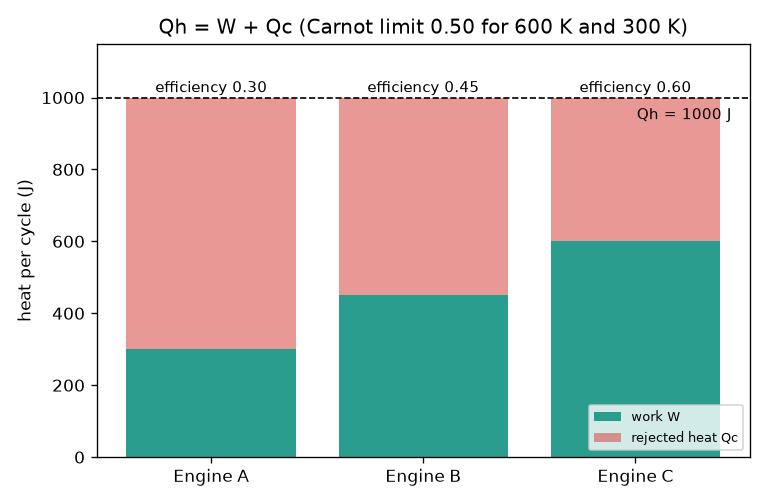
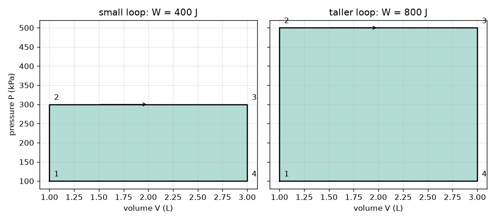

# அமர்வு 1: வெப்பம் உள்ளே, வேலை வெளியே, வெப்பம் வெளியேற்றம்

[Session 1 — English](README.md)

*நிலை 1 (கருத்தியல் ஊடாடும் மாதிரி) · சுமார் 60 நிமிடங்கள் · openengine*

> இது ஒரு எளிமைப்படுத்தப்பட்ட கல்வி மாதிரி. இது சரிபார்க்கப்பட்ட வடிவமைப்புக் கருவி அல்ல; உண்மையான கட்டமைப்புகள், மின் நிறுவல்கள், வாகனங்கள், தொழில்துறை செயல்முறைகள் அல்லது மருத்துவ முடிவுகளுக்கு இதைப் பயன்படுத்தக் கூடாது.

**முன்தேவைகள் (Prerequisites)**

- பள்ளிக் கணிதமும் அழுத்தம் (pressure), கனஅளவு (volume) பற்றிய கருத்தும்.
- நீங்கள் [PRIMER.md](../../PRIMER.md) படித்துவிட்டு, `python start.py 1` ஒருமுறை இயக்கியிருக்கிறீர்கள்.

**கற்றல் நோக்கங்கள் (Learning objectives).** இந்த அமர்வுக்குப் பிறகு உங்களால்:

- ஒரு இயந்திரத்தின் ஆற்றல் சமநிலையை (energy balance), W = Qh - Qc, எழுதி அதன் திறனைக் (efficiency) கணக்கிட முடியும்.
- கார்னோ வரம்பு (Carnot limit) 1 - Tc / Th ஐக் கூறி, கெல்வினைச் சரியாகப் பயன்படுத்த முடியும்.
- கடிகாரத் திசையில் (clockwise) சுற்றும் P-V வளையம் அடைக்கும் பரப்பு ஏன் நிகர வேலை (net work) என்பதை விளக்க முடியும்.
- கூறப்படும் ஓர் இயந்திரத்தை ஆற்றல் சமநிலையும் வெப்ப இயக்கவியலின் இரண்டாம் விதியும் (second law) அனுமதிக்கின்றனவா என்பதைத் தீர்மானிக்க முடியும்.

## A. நிஜ உலகப் பிரச்சினை
ஒரு கார் எரிபொருளை எரிக்கிறது, ஆனால் எரிபொருளின் ஆற்றலில் பெரும்பகுதி சக்கரங்களைச் சுழற்றுவதற்குப் பதிலாக வெளியேற்றக் குழாய் (exhaust) மற்றும் ரேடியேட்டர் வழியாக வெளியேறுகிறது. எந்த இயந்திரத்தாலும் முழு வெப்பத்தையும் ஏன் வேலையாக மாற்ற முடியாது? சிலிண்டருக்குள் இருக்கும் வாயுவின் அழுத்தத்தையும் கனஅளவையும் மட்டுமே நீங்கள் பார்த்தால், ஒரு சுழற்சியின் வேலையை எப்படிப் படித்தறிய முடியும்? (பொதுக் கல்விக்காக மட்டும்: இது ஒரு எளிமைப்படுத்தப்பட்ட மாதிரி, இயந்திர வடிவமைப்பு முறை அல்ல.)

## B. கருத்தும் கோட்பாடும்
ஓர் இயந்திரம் சூடான மூலத்திலிருந்து வெப்பம் Qh ஐ எடுத்து, வேலை W ஐச் செய்து, வெப்பம் Qc ஐ ஒரு குளிர்ந்த இடத்திற்கு வெளியேற்றியே ஆக வேண்டும். ஒரு முழுச் சுழற்சிக்குப் (cycle) பிறகு இயந்திரம் தொடங்கிய நிலைக்கே திரும்புகிறது, எனவே அதில் சேமிக்கப்பட்ட ஆற்றல் மாறவில்லை; ஆற்றல் சமநிலை Qh = W + Qc. திறன் என்பது வேலையாக மாறும் வெப்பத்தின் பகுதி: eta = W / Qh. இரண்டாம் விதி Qc பூஜ்ஜியமாக இருக்க முடியாது என்கிறது; Th வெப்பநிலையில் உள்ள சூடான மூலத்திற்கும் Tc (கெல்வின்) வெப்பநிலையில் உள்ள குளிர்ந்த சூழலுக்கும் இடையில், எந்த இயந்திரமும் eta = 1 - Tc / Th ஐ விடச் சிறப்பாகச் செயல்பட முடியாது. அழுத்தத்திற்கும் கனஅளவுக்கும் இடையிலான வரைபடத்தில், உயர் அழுத்தத்தில் நடக்கும் விரிவு (expansion) தரும் வேலை, குறைந்த அழுத்தத்தில் நடக்கும் அமுக்கம் (compression) திரும்ப எடுத்துக்கொள்வதை விட அதிகம்; எனவே கடிகாரத் திசை வளையம் நிகர வேலையைத் தருகிறது, அந்த வேலையே அடைக்கப்பட்ட பரப்பு. P ஐ kPa இலும் V ஐ லிட்டரிலும் எடுத்தால், kPa பெருக்கல் L என்பது ஜூலுக்குச் சமம்.

| குறியீடு | பொருள் | அலகு |
|---|---|---|
| Qh | ஒரு சுழற்சிக்குச் சூடான மூலத்திலிருந்து எடுக்கப்படும் வெப்பம் | J |
| Qc | ஒரு சுழற்சிக்குக் குளிர்ந்த சூழலுக்கு வெளியேற்றப்படும் வெப்பம் | J |
| W | ஒரு சுழற்சிக்கான நிகர வேலை | J |
| eta | வெப்பத் திறன் W / Qh | அலகு இல்லை |
| Th, Tc | சூடான மற்றும் குளிர்ந்த வெப்பநிலைகள், தனிநிலை (absolute) | K |
| P, V | வாயு அழுத்தமும் கனஅளவும் | kPa, L |

**அனுமானங்கள் (Assumptions)**

- ஒரு முழுச் சுழற்சி: வாயு தொடங்கிய நிலையிலேயே முடிகிறது.
- வெப்பநிலைகள் தனிநிலையானவை (கெல்வின் = டிகிரி C + 273.15).
- செவ்வக வடிவ P-V வளையம் பரப்பு விதியைக் கற்க மட்டுமே பயன்படும் ஒரு விளையாட்டு வடிவம்.

$$ Q_h = W + Q_c,\qquad W = Q_h - Q_c $$

$$ \eta = \frac{W}{Q_h} = 1 - \frac{Q_c}{Q_h} $$

$$ \eta \le \eta_{\mathrm{Carnot}} = 1 - \frac{T_c}{T_h} $$

$$ W = \oint P\,dV $$

## C. காட்சி விளக்கம்
முதல் படம் 600 K மூலத்திலிருந்து ஒவ்வொன்றும் 1000 J எடுக்கும் மூன்று இயந்திரங்களைக் காட்டுகிறது: இயந்திரம் A 300 J வேலை செய்கிறது (திறன் 0.30), இயந்திரம் B 450 J செய்கிறது (0.45), இயந்திரம் C 600 J என்று கூறுகிறது (0.60). 600 K க்கும் 300 K க்கும் இடையிலான கார்னோ வரம்பு 0.50, எனவே இயந்திரம் C சாத்தியமற்றது. இரண்டாவது படம் ஒரே கனஅளவு வரம்புள்ள (1 முதல் 3 L வரை) இரண்டு செவ்வக P-V வளையங்களைக் காட்டுகிறது: இரண்டும் 100 kPa இல் தொடங்குகின்றன; 300 kPa வரை உயரும் வளையம் 400 J ஐ அடைக்கிறது, 500 kPa வரை உயரும் உயரமான வளையம் 800 J ஐ அடைக்கிறது.

*1000 J எடுக்கும் மூன்று இயந்திரங்கள்: வேலையும் வெளியேற்றப்பட்ட வெப்பமும்; இயந்திரம் C கார்னோ வரம்பை மீறுகிறது.*

*இரண்டு செவ்வக P-V வளையங்கள்: அடைக்கப்பட்ட பரப்பே வேலை (400 J மற்றும் 800 J).*

## D. ஊடாடும் உருவகப்படுத்தல்
பாடத்தை இயக்குங்கள் (`python start.py 1`), பிறகு நேரடிச் செயலியைத் திறங்கள்: [Session 1: heat in, work out](https://krunalpanchal1995.github.io/pan-iit-oss/openengine/session-01/) (அல்லது இந்தக் கோப்புறையில் உள்ள `app.html`). எடுக்கப்படும் வெப்பத்தையும் அதில் வெளியேற்றப்படும் பங்கையும் மாற்றுங்கள். இயந்திரப் படத்தைக் கவனியுங்கள் (அம்புகளின் தடிமன் வெப்பங்களுக்குச் சமமாக இருக்கும்), பிறகு P-V காட்சியைத் திறந்து பரப்பு வேலைக்குச் சமமாக இருப்பதைப் பாருங்கள். கார்னோ வரம்பு நகர்வதைக் காண சூடான வெப்பநிலையை உயர்த்துங்கள்.

**சவால்.** கார்னோ வரம்பை மீறாமல் ஒரு சுழற்சிக்குக் குறைந்தது 300 J வேலையைத் தாருங்கள்.

## E. தீர்க்கப்பட்ட எடுத்துக்காட்டும் சோதனையும்
**கணக்கு.** ஓர் இயந்திரம் 600 K மூலத்திலிருந்து 1000 J எடுத்து, 300 K சூழலுக்கு 650 J வெளியேற்றுகிறது. W ஐயும் திறனையும் கண்டுபிடித்து, கார்னோ வரம்பைச் சரிபாருங்கள். பிறகு 100 முதல் 300 kPa வரையும் 1 முதல் 3 L வரையும் உள்ள P-V செவ்வகத்தின் வேலையைக் கண்டுபிடியுங்கள்.

1. ஆற்றல் சமநிலை: W = Qh - Qc = 1000 - 650 = 350 J.
2. திறன் = 350 / 1000 = 0.35.
3. கார்னோ வரம்பு = 1 - 300 / 600 = 0.50; 0.35 என்பது 0.50 ஐ விடக் குறைவு என்பதால் இயந்திரம் அனுமதிக்கப்படுகிறது.
4. வளையப் பரப்பு = (300 - 100) kPa x (3 - 1) L = 200 x 2 = 400 kPa L = 400 J.
5. இரு பகுதிகளையும் இணையுங்கள்: இந்த 400 J செவ்வகம் Qh = 1000 J எடுக்கும் ஓர் இயந்திரத்தின் சுழற்சியாக இருந்தால், அது Qc = 1000 - 400 = 600 J ஐ வெளியேற்றும், அதன் திறன் 400 / 1000 = 0.40 ஆக இருக்கும்.

**விடை.** W = 350 J, திறன் 0.35 (அனுமதிக்கப்படுகிறது, வரம்பு 0.50); செவ்வகம் 400 J ஐ அடைக்கிறது.

**சோதனை.** ஒரு சைக்கிள் பம்பைப் பயன்படுத்துங்கள்: ஒரு நிமிடம் வேகமாகப் பம்ப் செய்து அதன் குழல் சூடாவதை உணருங்கள். நீங்கள் வேலை செய்தீர்கள், வாயு சூடானது; அந்த வெப்பம் காற்றுக்குச் செல்கிறது. மாதிரியுடன் ஒப்பிடுங்கள்: நீங்கள் கொடுக்கும் வேலை வெப்பமாகத் தோன்றுகிறது என்று மாதிரி கூறுகிறது; ஓர் இயந்திரம் இந்தச் செயல்முறையை எதிர்த் திசையில் நடத்துகிறது. உண்மையான கருவிகள் உராய்வு மற்றும் ஒலி மூலம் கூடுதல் ஆற்றலை இழக்கின்றன, எனவே அளக்கப்பட்ட திறன் எப்போதும் மாதிரியின் திறனை விடக் குறைவாகவே இருக்கும்.

## F. மதிப்பீடும் வடிவமைப்புச் சவாலும்
**கேள்வி வகை A: கருத்தியல்.** உராய்வே இல்லாவிட்டாலும், ஓர் இயந்திரம் தான் பெறும் முழு வெப்பத்தையும் ஏன் ஒருபோதும் வேலையாக மாற்ற முடியாது?

குறிப்பு

இரண்டாம் விதி Qc பற்றி என்ன சொல்கிறது, eta = 1 - Tc / Th க்கு என்ன தேவைப்படும்?

படிப்படியான தீர்வு

ஒரே மூலத்திலிருந்து வெப்பத்தை எடுத்து அதை முழுவதுமாக வேலையாக மாற்றும் சுழற்சி இயந்திரத்தை இரண்டாம் விதி தடை செய்கிறது. சிறிது வெப்பம் Qc மேலும் குளிர்ந்த ஓர் இடத்திற்குச் செல்ல வேண்டும். சிறந்த நிலை கார்னோ வரம்பு 1 - Tc / Th, அது Tc 0 K ஆக இருந்தால் (அல்லது Th முடிவிலியாக இருந்தால்) மட்டுமே 1 ஐ அடையும், இவை இரண்டும் சாத்தியமில்லை. எனவே உராய்வற்ற இயந்திரத்தின் திறன் கூட 1 ஐ விடக் குறைவு.

**கேள்வி வகை B: எண்ணியல்.** ஓர் இயந்திரம் சூடான மூலத்திலிருந்து 800 J எடுத்து 520 J வெளியேற்றுகிறது. வேலையையும் திறனையும் கண்டுபிடித்து, அலகுகளும் விடையும் பொருத்தமானவையா என்று சரிபாருங்கள்.

குறிப்பு

W = Qh - Qc, பிறகு Qh ஆல் வகுங்கள்.

படிப்படியான தீர்வு

W = 800 - 520 = 280 J. eta = 280 / 800 = 0.35 (அலகு இல்லை). சரிபார்ப்பு: திறன் 0 க்கும் 1 க்கும் இடையில் உள்ளது, W உடன் Qc ஐக் கூட்டினால் மீண்டும் 800 J கிடைக்கிறது.

**கேள்வி வகை C: வரைபடம் மற்றும் உருவகப்படுத்தல் விளக்கம்.** வேலையை அதிகரித்த பிறகு P-V காட்சியில் வளையம் அதே அகலத்துடன் ஆனால் அதிக உயரத்துடன் உள்ளது. மேல் அழுத்தம் 300 kPa இலிருந்து 500 kPa ஆகும்போது (கீழ் 100 kPa, கனஅளவு 1 முதல் 3 L வரை) பரப்பு எத்தனை மடங்கு வளர்கிறது? இரண்டு வேலைகளும் எவ்வளவு?

குறிப்பு

பரப்பு = (மேல் - கீழ்) x அகலம்.

படிப்படியான தீர்வு

உயரங்கள் 200 kPa மற்றும் 400 kPa, எனவே பரப்பு இரட்டிப்பாகிறது: 400 J, 800 J ஆகிறது (அலகுகள்: kPa L = J).

**கேள்வி வகை D: வடிவமைப்பு மற்றும் உகப்பாக்கச் சவால்.** வடிவமைப்பு: ஓர் இயந்திரம் 700 K மூலத்திற்கும் 300 K சூழலுக்கும் இடையில் ஒரு சுழற்சிக்கு 300 J வேலை தர வேண்டும். அது எடுக்க வேண்டிய மிகக் குறைந்த வெப்பம் Qh எவ்வளவு, மிகக் குறைந்த Qc எவ்வளவு? ஓர் உண்மையான இயந்திரம் 0.30 ஐ அடைகிறது. அதற்கு எவ்வளவு வெப்பம் தேவைப்படும்?

குறிப்பு

சிறந்த நிலையாகக் கார்னோ வரம்பைப் பயன்படுத்துங்கள்: Qh = W / eta.

படிப்படியான தீர்வு

சிறந்த நிலை eta = 1 - 300 / 700 = 0.571, எனவே Qh = 300 / 0.571 = 525 J மற்றும் Qc = 225 J. 0.30 திறன் கொண்ட உண்மையான இயந்திரத்திற்கு Qh = 300 / 0.30 = 1000 J தேவை, அது 700 J ஐ வெளியேற்றுகிறது. சமரசம் (trade-off): கார்னோ மதிப்பு நீங்கள் வழங்க வேண்டிய வெப்பத்தின் கீழ் எல்லை, வடிவமைப்பு இலக்கு அல்ல, ஏனெனில் உண்மையான இயந்திரங்கள் அதைவிட மிகவும் கீழே உள்ளன.

[RUBRIC.md](../../RUBRIC.md) மூலம் உங்களுக்கு நீங்களே மதிப்பெண் இடுங்கள். தாளில் செய்ய [செயல்பாட்டுத் தாளை](activity_sheet.md) அச்சிடுங்கள்.

## பொதுவான தவறான கருத்துகள்
| பொதுவான தவறான கருத்து | உண்மையில் எது சரி |
|---|---|
| உராய்வற்ற இயந்திரம் 100 சதவீதத் திறனுடன் இருக்க முடியும். | உராய்வு இல்லாவிட்டாலும் இரண்டாம் விதி வெப்ப வெளியேற்றத்தைக் கட்டாயமாக்குகிறது; வரம்பு 1 - Tc / Th. |
| கார்னோ வரம்பை டிகிரி செல்சியஸ் வெப்பநிலைகளைக் கொண்டு கணக்கிடலாம். | இதற்குக் கெல்வின் தேவை. செல்சியஸ் எண்களான 100, 20 ஐ சூத்திரத்தில் இட்டால் தவறாக 1 - 20 / 100 = 0.8 கிடைக்கும்; 373 K மற்றும் 293 K ஐக் கொண்டு சரியான வரம்பு 0.21. |
| வேலை என்பது P-V வளையத்தின் உயரம். | வேலை என்பது அடைக்கப்பட்ட பரப்பு: அழுத்த உயரம் பெருக்கல் கனஅளவு அகலம், ஜூலில். |
| கடிகாரத் திசை அல்லது எதிர்க் கடிகாரத் திசை வளையம் ஒரே வேலையைத் தருகிறது. | கடிகாரத் திசை நேர்மறை வேலையைத் தருகிறது (ஓர் இயந்திரம்); எதிர்க் கடிகாரத் திசை எதிர்மறை வேலையைத் தருகிறது (ஒரு குளிர்சாதனம் அல்லது வெப்ப இறைப்பி). |

## சொற்களஞ்சியம்
- **திறன் (efficiency)**: எடுக்கப்பட்ட வெப்பத்தில் வேலையாக மாறும் பின்னம்
- **கார்னோ வரம்பு (Carnot limit)**: இரண்டு வெப்பநிலைகளுக்கு இடையில் சாத்தியமான மிக உயர்ந்த திறன், 1 - Tc / Th
- **சுழற்சி (cycle)**: வாயுவை அதன் தொடக்க நிலைக்குத் திருப்பும் படிகளின் வரிசை
- **கெல்வின் (kelvin)**: தனிநிலை வெப்பநிலை அளவுகோல்: K = டிகிரி C + 273.15
- **P-V வரைபடம் (P-V diagram)**: வாயு அழுத்தத்திற்கும் கனஅளவுக்கும் இடையிலான வரைபடம்

## நிறைவு
1. [exercises.md](exercises.md) இல் உள்ள மூன்று நிரலாக்கப் பணிகளைச் செய்யுங்கள்.
2. உங்கள் மாற்றங்களுக்குப் பிறகு `python start.py 1` ஐ மீண்டும் இயக்குங்கள். அது சோதனைப்புள்ளியில் (checkpoint) முடிகிறது; அது `PASS` என்று காட்டும்போது, உங்கள் பணி முடிந்தது. (சோதனைப்புள்ளி மட்டும்: `python start.py check 1`.)

அடுத்தது: [அமர்வு 2](../session-02/README.md)
