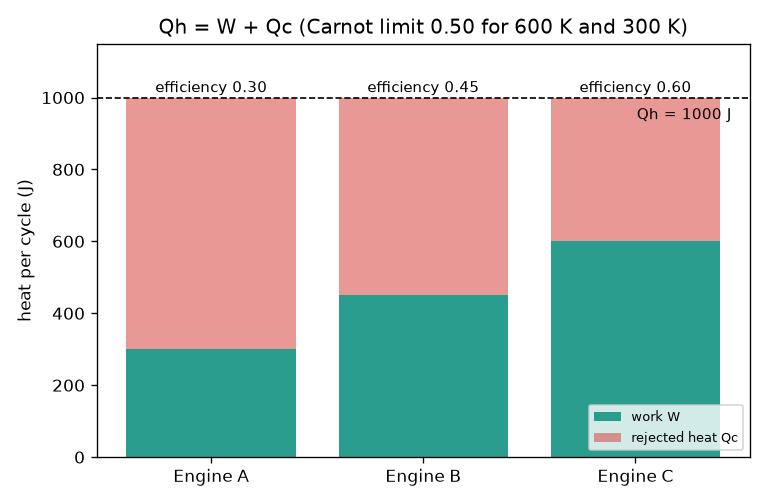
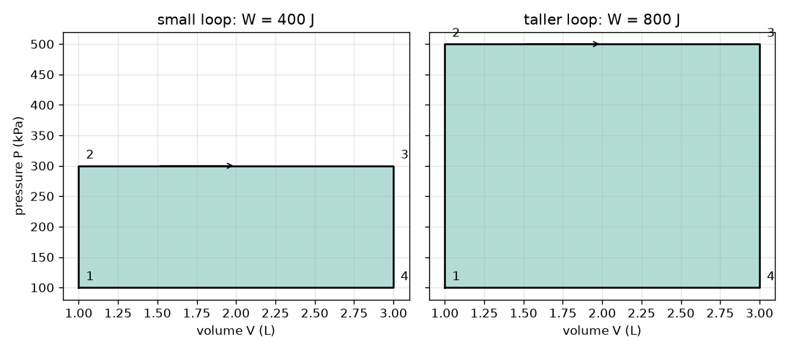

# సెషన్ 1: ఉష్ణాన్ని స్వీకరించడం, పని చేయడం, మిగిలిన ఉష్ణాన్ని విడుదల చేయడం

*స్థాయి 1 (భావనలను అర్థం చేసుకునేందుకు పరస్పర చర్యల నమూనా) · సుమారు 60 నిమిషాలు · ఓపెన్‌ఇంజిన్*

> ఇది బోధన కోసం రూపొందించిన సరళీకృత నమూనా. ఇది ధ్రువీకరించబడిన రూపకల్పన సాధనం కాదు. వాస్తవ నిర్మాణాలు, విద్యుత్ వ్యవస్థల ఏర్పాటు, వాహనాలు, పారిశ్రామిక ప్రక్రియలు లేదా వైద్య నిర్ణయాల కోసం దీనిని ఉపయోగించకూడదు.

**ముందుగా తెలిసి ఉండాల్సినవి**

- పాఠశాల స్థాయి అంకగణితం, పీడనం మరియు ఘనపరిమాణం గురించిన అవగాహన.
- మీరు PRIMER.md చదివి, `python start.py 1` ఆదేశాన్ని ఒకసారి అమలు చేసి ఉండాలి.

**అభ్యసన లక్ష్యాలు.** ఈ సెషన్ తరువాత మీరు:

- ఇంజిన్ శక్తి సమతుల్యతను W = Qh - Qc రూపంలో రాసి, దాని సామర్థ్యాన్ని లెక్కించగలరు.
- కార్నో పరిమితి 1 - Tc / Th ను పేర్కొని, కెల్విన్‌ను సరిగ్గా ఉపయోగించగలరు.
- సవ్యదిశలో (గడియారపు ముళ్లు తిరిగే దిశలో) సాగే P-V లూప్ చుట్టుముట్టిన వైశాల్యం నికర పనిని ఎందుకు సూచిస్తుందో వివరించగలరు.
- ఒక ఇంజిన్ గురించి చేసిన వాదన శక్తి సమతుల్యతకు, ఉష్ణగతిక శాస్త్ర రెండవ నియమానికి అనుగుణంగా ఉందో లేదో నిర్ణయించగలరు.

## A. వాస్తవ జీవితంలోని సమస్య
కారు ఇంధనాన్ని మండిస్తుంది. అయితే ఇంధనంలోని శక్తిలో ఎక్కువ భాగం చక్రాలను తిప్పడానికి బదులుగా ఎగ్జాస్ట్ మరియు రేడియేటర్ ద్వారా బయటకు వెళుతుంది. ఏ ఇంజిన్ కూడా అందుకున్న ఉష్ణాన్నంతటినీ పనిగా ఎందుకు మార్చలేదు? సిలిండర్‌లోని వాయువు పీడనం, ఘనపరిమాణం మాత్రమే తెలిస్తే, ఒక చక్రంలో జరిగే పనిని ఎలా తెలుసుకోవచ్చు? (ఇది సాధారణ విద్యా ప్రయోజనాల కోసం మాత్రమే: ఇది సరళీకృత నమూనా; ఇంజిన్‌ను రూపకల్పన చేసే పద్ధతి కాదు.)

## B. భావన మరియు సిద్ధాంతం
ఒక ఇంజిన్ అధిక ఉష్ణోగ్రత గల ఉష్ణ మూలం నుంచి Qh ఉష్ణాన్ని స్వీకరించి, W పని చేస్తుంది. అలాగే Qc ఉష్ణాన్ని తక్కువ ఉష్ణోగ్రత గల ప్రదేశానికి తప్పనిసరిగా విడుదల చేయాలి. ఒక పూర్తి చక్రం తరువాత ఇంజిన్ తన ప్రారంభ స్థితికి తిరిగి వస్తుంది. కాబట్టి దానిలో నిల్వ ఉన్న శక్తిలో మార్పు ఉండదు; శక్తి సమతుల్యత Qh = W + Qc అవుతుంది. స్వీకరించిన ఉష్ణంలో పనిగా మారే భాగమే సామర్థ్యం: eta = W / Qh. రెండవ నియమం ప్రకారం Qc సున్నా కాలేదు; Th ఉష్ణోగ్రత గల ఉష్ణ మూలం, Tc ఉష్ణోగ్రత గల చల్లని పరిసరాల మధ్య పనిచేసే ఏ ఇంజిన్ కూడా eta = 1 - Tc / Th పరిమితిని మించలేదు. ఈ ఉష్ణోగ్రతలు కెల్విన్‌లో ఉండాలి. పీడనాన్ని ఘనపరిమాణానికి సంబంధించి చూపే గ్రాఫ్‌లో, అధిక పీడనం వద్ద వ్యాకోచం వల్ల లభించే పని, తక్కువ పీడనం వద్ద సంపీడనానికి అవసరమయ్యే పని కంటే ఎక్కువగా ఉంటుంది. అందువల్ల సవ్యదిశలో సాగే లూప్ నికర పనిని ఇస్తుంది; ఆ పని లూప్ చుట్టుముట్టిన వైశాల్యానికి సమానం. P ను kPa లో, V ను లీటర్లలో తీసుకుంటే, kPa ను L తో గుణించినప్పుడు జూల్‌లు వస్తాయి.

| చిహ్నం | అర్థం | ప్రమాణం |
|---|---|---|
| Qh | ప్రతి చక్రంలో అధిక ఉష్ణోగ్రత గల మూలం నుంచి స్వీకరించే ఉష్ణం | J |
| Qc | ప్రతి చక్రంలో తక్కువ ఉష్ణోగ్రత గల పరిసరాలకు విడుదల చేసే ఉష్ణం | J |
| W | ప్రతి చక్రంలో జరిగే నికర పని | J |
| eta | ఉష్ణ సామర్థ్యం W / Qh | ప్రమాణం లేదు |
| Th, Tc | అధిక మరియు తక్కువ ఉష్ణోగ్రతలు, పరమ ఉష్ణోగ్రత ప్రమాణంలో | K |
| P, V | వాయువు పీడనం మరియు ఘనపరిమాణం | kPa, L |

**ఊహలు**

- ఒక పూర్తి చక్రం: చివరికి వాయువు తన ప్రారంభ స్థితికి తిరిగి వస్తుంది.
- ఉష్ణోగ్రతలు పరమ ఉష్ణోగ్రత ప్రమాణంలో ఉంటాయి (kelvin = degrees C + 273.15).
- దీర్ఘచతురస్రాకార P-V లూప్ అనేది వైశాల్య నియమాన్ని నేర్చుకోవడానికి ఉపయోగించే సరళమైన నమూనా ఆకారం.

$$ Q_h = W + Q_c,\qquad W = Q_h - Q_c $$

$$ \eta = \frac{W}{Q_h} = 1 - \frac{Q_c}{Q_h} $$

$$ \eta \le \eta_{\mathrm{Carnot}} = 1 - \frac{T_c}{T_h} $$

$$ W = \oint P\,dV $$

## C. చిత్రాల ద్వారా వివరణ
మొదటి చిత్రంలో 600 K ఉష్ణోగ్రత గల మూలం నుంచి ఒక్కొక్కటి 1000 J ఉష్ణాన్ని స్వీకరించే మూడు ఇంజిన్‌లు ఉన్నాయి: ఇంజిన్ A 300 J పని చేస్తుంది (సామర్థ్యం 0.30), ఇంజిన్ B 450 J పని చేస్తుంది (0.45), ఇంజిన్ C మాత్రం 600 J పని చేస్తుందని వాదిస్తోంది (0.60). 600 K మరియు 300 K మధ్య కార్నో పరిమితి 0.50. కాబట్టి ఇంజిన్ C సాధ్యం కాదు. రెండవ చిత్రంలో ఒకే ఘనపరిమాణ పరిధి (1 నుంచి 3 L) గల రెండు దీర్ఘచతురస్రాకార P-V లూప్‌లు ఉన్నాయి: 300 kPa వరకు ఉన్న లూప్ 400 J పనికి సమానమైన వైశాల్యాన్ని చుట్టుముడుతుంది; 500 kPa వరకు ఉన్న పొడవైన లూప్ 800 J పనికి సమానమైన వైశాల్యాన్ని చుట్టుముడుతుంది.

*1000 J ఉష్ణాన్ని స్వీకరించే మూడు ఇంజిన్‌లు: పని మరియు విడుదల చేసే ఉష్ణం; ఇంజిన్ C కార్నో పరిమితిని ఉల్లంఘిస్తుంది.*

*రెండు దీర్ఘచతురస్రాకార P-V లూప్‌లు: చుట్టుముట్టిన వైశాల్యమే పని (400 J మరియు 800 J).*

## D. పరస్పర చర్యల సిమ్యులేషన్
పాఠాన్ని అమలు చేయండి (`python start.py 1`). తరువాత ప్రత్యక్ష యాప్‌ను తెరవండి: [సెషన్ 1: ఉష్ణాన్ని స్వీకరించడం, పని చేయడం](https://krunalpanchal1995.github.io/pan-iit-oss/openengine/session-01/) (లేదా ఈ ఫోల్డర్‌లోని `app.html`). స్వీకరించే ఉష్ణాన్ని, అందులో విడుదల చేసే భాగాన్ని మార్చండి. ఇంజిన్ చిత్రాన్ని గమనించండి (బాణాల మందం ఉష్ణ పరిమాణాలకు అనుగుణంగా ఉంటుంది). తరువాత P-V వీక్షణాన్ని తెరిచి, వైశాల్యం పనికి సమానంగా ఉండటాన్ని చూడండి. అధిక ఉష్ణోగ్రత గల మూలం ఉష్ణోగ్రతను పెంచి, కార్నో పరిమితి ఎలా మారుతుందో గమనించండి.

**సవాలు.** కార్నో పరిమితిని ఉల్లంఘించకుండా ప్రతి చక్రంలో కనీసం 300 J పని పొందండి.

## E. పరిష్కరించిన ఉదాహరణ మరియు ప్రయోగం
**సమస్య.** ఒక ఇంజిన్ 600 K ఉష్ణోగ్రత గల మూలం నుంచి 1000 J ఉష్ణాన్ని స్వీకరించి, 300 K ఉష్ణోగ్రత గల పరిసరాలకు 650 J ఉష్ణాన్ని విడుదల చేస్తుంది. W మరియు సామర్థ్యాన్ని కనుగొని, కార్నో పరిమితికి అనుగుణంగా ఉన్నాయో లేదో తనిఖీ చేయండి. తరువాత 100 నుంచి 300 kPa పీడన పరిధి, 1 నుంచి 3 L ఘనపరిమాణ పరిధి గల P-V దీర్ఘచతురస్రం సూచించే పనిని కనుగొనండి.

1. శక్తి సమతుల్యత: W = Qh - Qc = 1000 - 650 = 350 J.
2. సమర్థత = 350 / 1000 = 0.35.
3. కార్నో పరిమితి = 1 - 300 / 600 = 0.50; 0.35 అనేది 0.50 కంటే తక్కువ కాబట్టి, ఈ ఇంజిన్ నియమాలకు అనుగుణంగా ఉంది.
4. లూప్ ప్రాంతం = (300 - 100) kPa x (3 - 1) L = 200 x 2 = 400 kPa L = 400 J.
5. ఆ లూప్ అదే ఇంజిన్ చక్రాన్ని సూచిస్తూ, Qh = 1000 J అయితే, Qc = 600 J మరియు eta = 0.40 అవుతాయి.

**జవాబు.** W = 350 J, సామర్థ్యం 0.35 (నియమాలకు అనుగుణంగా ఉంది, పరిమితి 0.50); దీర్ఘచతురస్రం చుట్టుముట్టిన వైశాల్యం 400 J పనిని సూచిస్తుంది.

**ప్రయోగం.** సైకిల్ పంపును ఉపయోగించండి: ఒక నిమిషం పాటు బలంగా పంపు చేసి, దాని గొట్టం వేడెక్కడం గమనించండి. మీరు పని చేశారు; వాయువు వేడెక్కింది. ఆ ఉష్ణం గాలిలోకి వెళుతుంది. దీనిని నమూనాతో పోల్చండి: మీరు చేసిన పని ఉష్ణంగా కనిపిస్తుందని, ఇంజిన్ ఈ ప్రక్రియను వ్యతిరేక దిశలో నడుపుతుందని నమూనా చెబుతుంది. వాస్తవ పరికరాల్లో ఘర్షణ, శబ్దం వల్ల అదనపు శక్తి నష్టం జరుగుతుంది. అందువల్ల కొలిచిన సామర్థ్యం ఎల్లప్పుడూ నమూనాలోని సామర్థ్యం కంటే తక్కువగా ఉంటుంది.

## F. మూల్యాంకనం మరియు రూపకల్పన సవాలు
**ప్రశ్న రకం A: భావనాత్మకం.** అసలు ఘర్షణే లేకపోయినా, ఒక ఇంజిన్ తాను స్వీకరించిన ఉష్ణాన్నంతటినీ పనిగా ఎందుకు మార్చలేదు?

సూచన

Qc గురించి రెండవ నియమం ఏమి చెబుతుంది? ఈటా = 1 - Tc / Th ప్రకారం మొత్తం ఉష్ణం పనిగా మారాలంటే ఏమి అవసరం?

దశలవారీ పరిష్కారం

ఒకే ఉష్ణ మూలం నుంచి ఉష్ణాన్ని స్వీకరించి, దానినంతటినీ పనిగా మార్చే చక్రీయ ఇంజిన్‌ను రెండవ నియమం అనుమతించదు. కొంత ఉష్ణం Qc తక్కువ ఉష్ణోగ్రత గల ప్రదేశానికి వెళ్లాలి. అత్యుత్తమ సందర్భం కార్నో పరిమితి 1 - Tc / Th. ఇది 1 కావాలంటే Tc విలువ 0 K అయి ఉండాలి (లేదా Th అనంతం కావాలి); రెండూ సాధ్యం కావు. కాబట్టి ఘర్షణ లేని ఇంజిన్ సామర్థ్యం కూడా 1 కంటే తక్కువే.

**ప్రశ్న రకం B: గణనాత్మకం.** ఒక ఇంజిన్ అధిక ఉష్ణోగ్రత గల మూలం నుంచి 800 J ఉష్ణాన్ని స్వీకరించి, 520 J ఉష్ణాన్ని విడుదల చేస్తుంది. పని మరియు సామర్థ్యాన్ని కనుగొనండి. ప్రమాణాలు సరైనవో, జవాబు సమంజసంగా ఉందో తనిఖీ చేయండి.

సూచన

W = Qh - Qc ను ఉపయోగించండి. తరువాత Qh తో భాగించండి.

దశలవారీ పరిష్కారం

W = 800 - 520 = 280 J. eta = 280 / 800 = 0.35 (ప్రమాణం లేదు). సమంజసత తనిఖీ: సామర్థ్యం 0 మరియు 1 మధ్య ఉంది; W కు Qc ను కలిపితే తిరిగి 800 J వస్తుంది.

**ప్రశ్న రకం C: గ్రాఫ్ మరియు సిమ్యులేషన్‌ను అర్థం చేసుకోవడం.** P-V వీక్షణంలో పనిని పెంచినప్పుడు లూప్ వెడల్పు మారదు, కానీ ఎత్తు పెరుగుతుంది. పై పీడనం 300 kPa నుంచి 500 kPa కు పెరిగినప్పుడు వైశాల్యం ఎన్ని రెట్లు అవుతుంది (దిగువ పీడనం 100 kPa, ఘనపరిమాణం 1 నుంచి 3 L)? రెండు సందర్భాల్లో జరిగే పని ఎంత?

సూచన

Area = (top - bottom) x width.

దశలవారీ పరిష్కారం

ఎత్తులు 200 kPa మరియు 400 kPa. కాబట్టి వైశాల్యం రెట్టింపు అవుతుంది: 400 J అనేది 800 J అవుతుంది (ప్రమాణాలు: kPa L = J).

**ప్రశ్న రకం D: రూపకల్పన మరియు మెరుగుదల సవాలు.** రూపకల్పన: ఒక ఇంజిన్ 700 K ఉష్ణోగ్రత గల మూలం, 300 K ఉష్ణోగ్రత గల పరిసరాల మధ్య పనిచేస్తూ, ప్రతి చక్రంలో 300 J పని ఇవ్వాలి. అది స్వీకరించాల్సిన కనిష్ఠ ఉష్ణం Qh ఎంత? కనిష్ఠ Qc ఎంత? ఒక వాస్తవ ఇంజిన్ సామర్థ్యం 0.30 కు చేరుతుంది. దానికి ఎంత ఉష్ణం అవసరం?

సూచన

కార్నో పరిమితిని అత్యుత్తమ సందర్భంగా ఉపయోగించండి: Qh = W / eta.

దశలవారీ పరిష్కారం

అత్యుత్తమ సందర్భంలో ఈటా = 1 - 300 / 700 = 0.571, కాబట్టి Qh = 300 / 0.571 = 525 J మరియు Qc = 225 J. 0.30 సామర్థ్యం గల వాస్తవ ఇంజిన్‌కు Qh = 300 / 0.30 = 1000 J అవసరం; అది 700 J ఉష్ణాన్ని విడుదల చేస్తుంది. పరిగణించాల్సిన పరిమితి: కార్నో విలువ మీరు అందించాల్సిన ఉష్ణానికి కనిష్ఠ హద్దును నిర్దేశిస్తుంది; అది రూపకల్పనలో సాధించగల లక్ష్యం కాదు. ఎందుకంటే వాస్తవ ఇంజిన్‌ల సామర్థ్యం కార్నో పరిమితి కంటే చాలా తక్కువగా ఉంటుంది.

[RUBRIC.md](../../RUBRIC.md) సహాయంతో మీకు మీరే మార్కులు వేసుకోండి. కాగితంపై పని చేయడానికి [కార్యాచరణ పత్రాన్ని](activity_sheet.md) ముద్రించండి.

## సాధారణ అపోహలు

| సాధారణ అపోహ | వాస్తవం |
|---|---|
| ఘర్షణ లేని ఇంజిన్ 100 శాతం సామర్థ్యంతో పనిచేయగలదు. | ఘర్షణ లేకపోయినా ఉష్ణాన్ని విడుదల చేయడం రెండవ నియమం ప్రకారం తప్పనిసరి; పరిమితి 1 - Tc / Th. |
| డిగ్రీల సెల్సియస్‌లోని ఉష్ణోగ్రతలతో కార్నో పరిమితిని లెక్కించవచ్చు. | దీనికి కెల్విన్ అవసరం. 100 C మరియు 20 C ను నేరుగా ఉపయోగిస్తే తప్పుగా 0.8 వస్తుంది; సరైన విలువలు (373 K మరియు 293 K) ఉపయోగిస్తే 0.21 వస్తుంది. |
| P-V లూప్ ఎత్తే పని. | పని అనేది చుట్టుముట్టిన వైశాల్యం: పీడన ఎత్తును ఘనపరిమాణ వెడల్పుతో గుణిస్తే జూల్‌లలో పని వస్తుంది. |
| సవ్యదిశలో లేదా అపసవ్యదిశలో సాగే లూప్ ఒకే పనిని ఇస్తుంది. | సవ్యదిశలో ధనాత్మక పని లభిస్తుంది (ఇంజిన్); అపసవ్యదిశలో రుణాత్మక పని లభిస్తుంది (రిఫ్రిజిరేటర్ లేదా హీట్ పంప్). |

## పదకోశం
- **సామర్థ్యం**: స్వీకరించిన ఉష్ణంలో పనిగా మారే భాగం
- **కార్నో పరిమితి**: రెండు ఉష్ణోగ్రతల మధ్య సాధ్యమయ్యే గరిష్ఠ సామర్థ్యం, 1 - Tc / Th
- **చక్రం**: వాయువును తిరిగి తన ప్రారంభ స్థితికి తీసుకువచ్చే దశల క్రమం
- **కెల్విన్**: పరమ ఉష్ణోగ్రత కొలమానం: K = degrees C + 273.15
- **P-V రేఖాచిత్రం**: వాయువు పీడనాన్ని ఘనపరిమాణానికి సంబంధించి చూపే గ్రాఫ్

## ముగింపు
1. [exercises.md](exercises.md) లోని మూడు కోడింగ్ పనులను పూర్తి చేయండి.
2. మీ మార్పుల తరువాత `python start.py 1` ను మళ్లీ అమలు చేయండి. ఇది తనిఖీ దశతో ముగుస్తుంది; `PASS` అని ముద్రించినప్పుడు మీ పని పూర్తయినట్లే. (తనిఖీ దశ మాత్రమే అమలు చేయడానికి: `python start.py check 1`.)

తరువాత: [సెషన్ 2](../session-02/README.md)