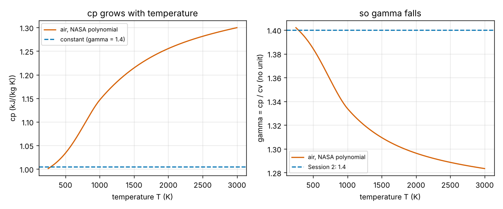
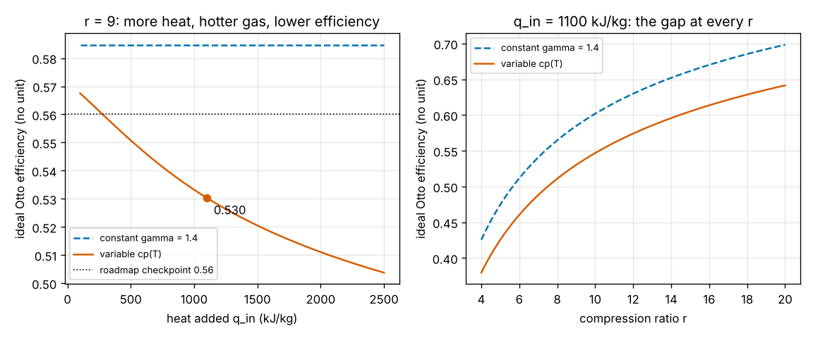

# Session 4: Temperature-dependent gas properties

*Level 2 (mathematical engineering model) · about 75 minutes · openengine*

> This is a simplified educational model. It is not a validated design tool and must not be used for real structures, electrical installations, vehicles, industrial processes or medical decisions.

**Prerequisites**

- Session 2: the Otto cycle, isentropes and efficiency from the heats.
- Session 3: summing P dv around a loop and Runge-Kutta steps.
- Natural logarithm ln and the idea of a derivative (explained in Section B where used).

**Learning objectives.** After this session you can:

- Compute cp, cv and gamma of air at any temperature from a published NASA polynomial.
- Follow the Otto cycle with variable cp using u(T) for the heats and an entropy function for the isentropes.
- Validate the model: it must give back the Session 2 formula when the properties are constant, and its P-V loop area must equal the net heat.
- Explain why more heat (a hotter cycle) lowers the ideal efficiency, and how much of the gap to real engines this explains.

## A. Real-world problem
Session 2 promised an ideal Otto efficiency of 0.585 at r = 9, yet a real petrol engine reaches perhaps 0.25 to 0.35. Session 3 blamed burn time, heat loss and friction. A quieter part of the gap hides in one number: gamma = 1.4 is the value for cold air. When air is hot its molecules vibrate as well as move and spin, so each kelvin costs more energy and gamma falls. How much efficiency does that cost even in a perfect engine, and does it change the best compression ratio? (Simplified air-standard model; not an engine design method.)

## B. Concept and theory
An ideal gas still obeys P v = R T, but its heat capacities depend on temperature. Data tables (JANAF, NASA) fit cp of each gas with a polynomial cp / R = a1 + a2 T + a3 T^2 + a4 T^3 + a5 T^4, with one set of coefficients for 200 to 1000 K and another for 1000 to 6000 K. Air is 79 percent N2 and 21 percent O2 by moles, and for a mixture of ideal gases the coefficients mix in that ratio. Then cv = cp - R and gamma = cp / cv, which falls from 1.40 at 300 K to 1.33 at 1000 K and 1.30 at 2000 K. Integrating cp gives the enthalpy h(T) and the internal energy u = h - R T. Heat at constant volume raises u, so q_in = u(T3) - u(T2) and q_out = u(T4) - u(T1). For a reversible step with no heat the first law gives cv(T) dT / T = -R dv / v, which no longer integrates to a power law. Instead define phi(T) = s0(T) - R ln T, where s0 is the tabulated standard entropy: then phi(T2) - phi(T1) = R ln(v1 / v2) = R ln r. Because phi always grows with T, each state follows from a one-line bisection. With constant gamma, u = cv T and phi = cv ln T, and every step reduces to Session 2. With variable cp the compression ends a little cooler, the same heat raises the temperature much less because hot air has a larger cv, and the expansion with its low gamma returns less of the heat as work. A useful summary is the effective gamma: the constant value that would give the same efficiency in the Otto formula.

| Symbol | Meaning | Unit |
|---|---|---|
| cp, cv | specific heats at constant pressure and volume | kJ/(kg K) |
| gamma | cp / cv at a given temperature | no unit |
| a1..a7 | NASA polynomial coefficients (a6, a7 fix h and s) | various |
| u, h | specific internal energy and enthalpy | kJ/kg |
| s0, phi | standard entropy at 1 bar, and phi = s0 - R ln T | kJ/(kg K) |
| gamma_eff | constant gamma giving the same Otto efficiency | no unit |

**Assumptions**

- Air-standard Otto cycle: ideal gas, heat from outside, isentropic compression and expansion.
- cp(T) of air from the NASA 7-coefficient fits for N2 and O2 (argon counted as N2).
- The gas does not change its chemistry: no combustion products, no dissociation.
- T1 = 300 K, P1 = 100 kPa; temperatures in kelvin.

$$ \frac{c_p(T)}{R} = a_1 + a_2 T + a_3 T^2 + a_4 T^3 + a_5 T^4,\qquad c_v = c_p - R,\qquad \gamma = \frac{c_p}{c_v} $$

$$ u(T) = h(T) - R T,\qquad q_{\mathrm{in}} = u(T_3) - u(T_2),\qquad q_{\mathrm{out}} = u(T_4) - u(T_1) $$

$$ c_v(T)\,\frac{dT}{T} = -R\,\frac{dv}{v}\quad\Rightarrow\quad \phi(T_2) - \phi(T_1) = R\ln r,\qquad \phi(T) = s^0(T) - R\ln T $$

$$ \eta = 1 - \frac{q_{\mathrm{out}}}{q_{\mathrm{in}}},\qquad \gamma_{\mathrm{eff}} = 1 + \frac{\ln\!\left(1/(1-\eta)\right)}{\ln r} $$

## C. Visual explanation
The first figure shows cp of air rising from 1.006 kJ/(kg K) at 300 K to 1.255 at 2000 K, and gamma falling from 1.40 to 1.30, against Session 2's constant values (dashed). The second figure shows the cost. Left: at r = 9 the constant-gamma model gives 0.585 for any heat input, while the variable model starts near it for a small heat input and falls to 0.551 at 500 kJ/kg, 0.530 at 1100 kJ/kg and 0.511 at 2000 kJ/kg, crossing the roadmap's 0.56 line. Right: at q_in = 1100 kJ/kg the variable curve sits about 0.04 to 0.06 below the constant one at every compression ratio.

*cp of air rises with temperature and gamma falls; dashed lines are the constant Session 2 values.*

*Ideal Otto efficiency with constant gamma (dashed) and variable cp(T) (solid), against heat input and compression ratio.*

## D. Interactive simulation
Run the lesson (`python start.py 4`), then open the live app: [Session 4: variable cp](https://krunalpanchal1995.github.io/pan-iit-oss/openengine/session-04/) (or `app.html` in this folder). Move r and the heat input. The P-V view draws the constant-gamma loop (dashed) and the variable-cp loop (solid) for the same heat; the efficiency view shows both against r; the property view shows cp and gamma against temperature with the cycle's own temperatures marked.

**Challenge.** With variable cp and q_in = 1100 kJ/kg, find the smallest compression ratio that still reaches an ideal efficiency of 0.60. Compare with the r that Session 2's formula asks for.

## E. Worked example and experiment
**Problem.** An ideal Otto cycle with r = 9, T1 = 300 K and q_in = 1100 kJ/kg (the Session 2 example), but with cp(T) of air from the NASA polynomial. Find T2, T3, T4, the efficiency and the effective gamma, and check the first law.

1. Compression: phi(300 K) = 5.0787 kJ/(kg K) and R ln 9 = 0.287 x 2.1972 = 0.6306, so phi(T2) = 5.7093. Bisection gives T2 = 700.0 K (constant gamma gave 722.5 K).
2. Heat at constant volume: u(T2) = 215.4 kJ/kg, so u(T3) = 215.4 + 1100 = 1315.4 kJ/kg and T3 = 1927 K (constant gamma gave 2256 K). The mean cv over this step is 1100 / 1227 = 0.896 kJ/(kg K), not 0.7175.
3. Expansion: phi(T4) = phi(T3) - 0.6306, so T4 = 964 K (constant gamma gave 937 K).
4. Rejected heat: q_out = u(964 K) - u(300 K) = 432.4 - (-84.2) = 516.6 kJ/kg (constant gamma gave 456.8). Efficiency = 1 - 516.6 / 1100 = 0.530.
5. Effective gamma = 1 + ln(1 / 0.470) / ln 9 = 1.344, between gamma(T3) = 1.298 and gamma(T1) = 1.399. The P dv area of the loop traced with RK4 is 583.4 kJ/kg, equal to q_in - q_out = 583.4 kJ/kg.

**Answer.** T2 = 700 K, T3 = 1927 K, T4 = 964 K; efficiency 0.530 against 0.585 with constant gamma, below the roadmap target of 0.56. The effective gamma is 1.344.

**Experiment.** Look up cp of air at 300 K, 1000 K and 2000 K in a thermodynamics textbook table (or NIST data for N2 and O2) and compare with `cp_air`; they should agree to about 1 percent. Then compare the variable-cp efficiency with a published brake efficiency of a petrol engine: variable properties explain part of the gap (0.585 to 0.530); burn time, heat loss, friction, gas exchange and dissociation of the hot products explain the rest.

## F. Assessment and design challenge
**Question type A: Conceptual.** Why does adding more heat per cycle lower the ideal Otto efficiency once cp depends on temperature, while in Session 2 the efficiency did not depend on the heat at all?

Hint

What does more heat do to T3, and what does a higher temperature do to gamma during the expansion?

Step-by-step solution

With constant gamma the efficiency 1 - 1 / r^(gamma-1) contains only r and gamma, so the heat cancels out. With variable cp, more heat means a hotter gas, and hot air has a larger cv and a smaller gamma. The expansion follows an isentrope with low gamma, along which the temperature falls less for the same volume ratio, so the gas leaves the expansion hotter and more heat is thrown away at the bottom. The more heat, the hotter the cycle and the lower the effective gamma: 1.364 at 500 kJ/kg, 1.344 at 1100 kJ/kg, 1.326 at 2000 kJ/kg.

**Question type B: Numerical.** Using `cp_air`, find cp, cv and gamma of air at 1500 K. Then estimate the Otto efficiency at r = 9 if you used that single gamma for the whole cycle. Is it above or below the variable-cp answer of 0.530, and why?

Hint

cv = cp - 0.287; eta = 1 - 9^(1 - gamma).

Step-by-step solution

cp(1500 K) = 1.214 kJ/(kg K), cv = 1.214 - 0.287 = 0.927, gamma = 1.214 / 0.927 = 1.310. Then eta = 1 - 9^(-0.310) = 1 - 0.506 = 0.494. This is below 0.530 because the real cycle also spends time at low temperature (compression from 300 K to 700 K) where gamma is close to 1.4. A single hot gamma is too pessimistic and a single cold gamma (0.585) too optimistic; the effective value 1.344 lies in between.

**Question type C: Graph and simulation interpretation.** In the left panel of the efficiency figure, the variable-cp curve approaches a value near the constant-gamma line as the heat input goes to zero, but not exactly 0.585. Explain why it starts there and why it does not quite reach 0.585.

Hint

With very little heat, the cycle only spans the compression from 300 K to T2. What is gamma there?

Step-by-step solution

With almost no heat added the expansion retraces the compression, so the cycle only sees temperatures from 300 K to about 700 K. There gamma falls from 1.40 to about 1.36, so the effective gamma is a little below 1.40 and the efficiency (about 0.57) is a little below 0.585. As the heat grows, the cycle reaches temperatures where gamma is lower still and the curve falls further.

**Question type D: Design and optimisation challenge.** Design: with Session 2's constant gamma, r = 9.88 gives an ideal efficiency of 0.60. With variable cp and q_in = 1100 kJ/kg, what compression ratio is needed for 0.60, and what is T2? If the fuel knocks above an end-of-compression temperature of about 750 K (an illustrative number), is this design possible? What would you trade?

Hint

Bisection on r with `otto_cycle(r, 1100)["eta"]`, then read `["T"][1]`.

Step-by-step solution

Bisection gives r = 14.4, with T2 = 829 K. That is well above the illustrative 750 K knock limit, so a spark-ignition engine on that fuel cannot reach 0.60 even in the ideal model. Trade-offs: accept a lower efficiency at a knock-safe r (about 0.53 at r = 9); use a fuel with a higher knock limit; or move to compression ignition (a diesel compresses only air, so r = 14 to 20 is allowed), accepting higher peak pressures and the constant-pressure heat addition of Session 2. The lesson: the constant-gamma formula asks for too small an r and promises too much.

Score yourself with [RUBRIC.md](../../RUBRIC.md). Print the [activity sheet](activity_sheet.md) to work on paper.

## Common misconceptions
| Common misconception | What is actually true |
|---|---|
| gamma = 1.4 is a fixed property of air. | 1.4 is the cold-air value. gamma falls to about 1.33 at 1000 K and 1.30 at 2000 K as the molecules start to vibrate. |
| A temperature-dependent cp breaks P v = R T. | Air is still an ideal gas; only the energy stored per kelvin changes. P v = R T holds throughout. |
| With variable cp you can still use T V^(gamma-1) = const along an isentrope. | That rule assumes constant gamma. With variable cp use phi(T2) - phi(T1) = R ln(v1 / v2), or integrate cv dT / T = -R dv / v step by step. |
| More heat per cycle always means a more efficient engine. | More heat gives more work per cycle, but in the variable-cp model the efficiency falls: 0.551 at 500 kJ/kg, 0.530 at 1100 and 0.511 at 2000 (r = 9). |

## Glossary
- **specific heat cp, cv**: energy needed to warm 1 kg by 1 K at constant pressure or constant volume
- **NASA polynomial**: a published fit of cp / R as a polynomial in T, with two extra constants for enthalpy and entropy
- **internal energy u**: the energy stored in the gas; heat at constant volume raises it
- **standard entropy s0**: entropy at 1 bar from the tables; its change along T is cp / T
- **effective gamma**: the constant gamma that would give the same Otto efficiency as the variable-cp cycle

## Finish
1. Do the three coding tasks in [exercises.md](exercises.md).
2. Run `python start.py 4` again after your changes. It ends with the checkpoint; when it prints `PASS`, you are done. (Checkpoint only: `python start.py check 4`.)

Next: [Session 5](../session-05/README.md)
