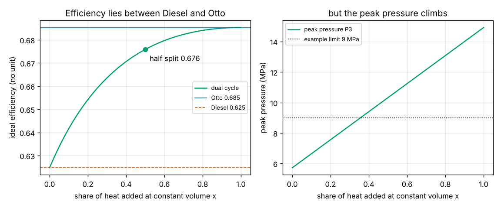
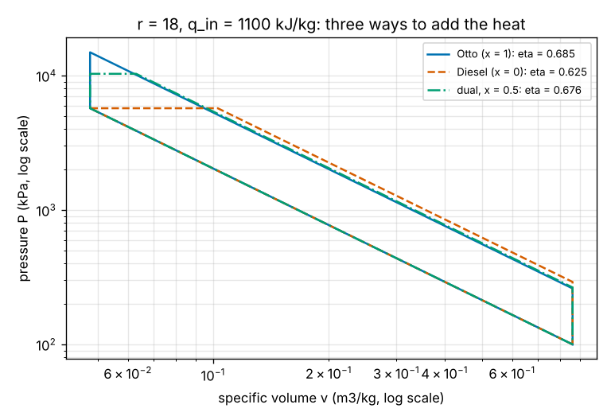

# Session 5: The dual cycle

*Level 2 (mathematical engineering model) · about 75 minutes · openengine*

> This is a simplified educational model. It is not a validated design tool and must not be used for real structures, electrical installations, vehicles, industrial processes or medical decisions.

**Prerequisites**

- Session 2: the Otto and Diesel cycles, isentropes and efficiency from the heats.
- Session 3: why the peak pressure limits a real engine.
- Powers such as 18 to the 0.4 and a calculator or Python.

**Learning objectives.** After this session you can:

- Describe the five processes of the dual (Seiliger) cycle and split its heat into a constant-volume and a constant-pressure part.
- Compute the dual-cycle temperatures, pressure ratio, cut-off ratio and efficiency, and show that it becomes Otto or Diesel in the limits.
- Explain why the efficiency of the dual cycle lies between the Diesel and Otto values at the same compression ratio and heat.
- Choose the heat split that gives the best efficiency under a peak-pressure limit.

## A. Real-world problem
Session 2 had two extremes: the Otto cycle adds all its heat at constant volume, the Diesel cycle all of it at constant pressure. A real high-speed diesel does both. The fuel injected just before top dead centre mixes with hot air and burns almost at once, at nearly constant volume; the rest burns as it is injected while the piston moves down, at nearly constant pressure. How does the share of heat added at constant volume change the efficiency, and why do engine designers not simply add all of it at constant volume? (Simplified air-standard model; not an engine design method.)

## B. Concept and theory
The dual cycle, also called the Seiliger or Sabathe cycle, has five states. 1 to 2 is isentropic compression by the compression ratio r. 2 to 3 adds a share x of the heat at constant volume, raising the pressure by the pressure ratio alpha = P3 / P2 = T3 / T2. 3 to 4 adds the rest, (1 - x) q_in, at constant pressure, raising the volume by the cut-off ratio rho = v4 / v3 = T4 / T3. 4 to 5 is isentropic expansion back to the largest volume, and 5 to 1 rejects heat at constant volume. Using cv for the first heat and cp = gamma cv for the second, and q_out = cv (T5 - T1), the efficiency simplifies to the closed form below. Two checks show that it contains Sessions 2's formulas: with rho = 1 (x = 1) the last fraction is (alpha - 1) / (alpha - 1) = 1 and the Otto formula returns; with alpha = 1 (x = 0) it becomes (rho^gamma - 1) / (gamma (rho - 1)), the Diesel factor. At the same r and heat, the heat added at constant volume is expanded through the whole stroke while the constant-pressure heat is expanded less, so the efficiency rises steadily from the Diesel value to the Otto value as x grows. The price is the peak pressure P3 = alpha P2, which also rises with x and must be carried by the cylinder head, the piston and the bearings.

| Symbol | Meaning | Unit |
|---|---|---|
| r | compression ratio v1 / v2 | no unit |
| x | share of the heat added at constant volume | no unit |
| alpha | pressure ratio P3 / P2 during constant-volume heating | no unit |
| rho | cut-off ratio v4 / v3 during constant-pressure heating | no unit |
| T1..T5, P1..P5 | temperature and pressure at the five states | K, kPa |
| q_in, q_out | heat added, heat rejected | kJ/kg |

**Assumptions**

- Air-standard: ideal gas, constant gamma = 1.4, cv = 0.7175 and cp = 1.0045 kJ/(kg K).
- Heat is added from outside, instantly, first at constant volume and then at constant pressure.
- Compression and expansion are isentropic (no heat, no friction).
- T1 = 300 K, P1 = 100 kPa; temperatures in kelvin.

$$ x\,q_{\mathrm{in}} = c_v (T_3 - T_2),\qquad (1-x)\,q_{\mathrm{in}} = c_p (T_4 - T_3) $$

$$ \alpha = \frac{P_3}{P_2} = \frac{T_3}{T_2},\qquad \rho = \frac{v_4}{v_3} = \frac{T_4}{T_3} $$

$$ \eta_{\mathrm{dual}} = 1 - \frac{1}{r^{\gamma-1}}\,\frac{\alpha\rho^{\gamma} - 1}{(\alpha - 1) + \gamma\alpha(\rho - 1)} $$

$$ \rho = 1:\ \eta = \eta_{\mathrm{Otto}},\qquad \alpha = 1:\ \eta = \eta_{\mathrm{Diesel}} $$

## C. Visual explanation
The first figure shows the three ways to add 1100 kJ/kg at r = 18 on log-log axes, where the isentropes are straight lines: the Otto loop climbs straight up to a peak of 14.9 MPa, the Diesel loop runs flat at 5.7 MPa, and the dual loop with a half-and-half split goes up to 10.3 MPa and then across. The second figure is the roadmap checkpoint: as the constant-volume share x grows from 0 to 1, the efficiency rises from the Diesel value 0.625 to the Otto value 0.685, and the half split gives 0.676, strictly between them. The right panel shows the cost: the peak pressure rises in a straight line with x, and an example limit of 9 MPa allows only x = 0.357.

*Efficiency of the dual cycle against the constant-volume share, between Diesel and Otto (left), and its peak pressure (right).*

*Otto, Diesel and a half-split dual loop at r = 18 with the same heat (log-log axes).*

## D. Interactive simulation
Run the lesson (`python start.py 5`), then open the live app: [Session 5: the dual cycle](https://krunalpanchal1995.github.io/pan-iit-oss/openengine/session-05/) (or `app.html` in this folder). Move the heat split x and watch the dual loop (solid) move from the Diesel loop (dashed) to the Otto loop (dotted). Switch to the efficiency view to see where your split sits between the two, with the peak pressure against a limit you choose.

**Challenge.** At r = 18 and q_in = 1100 kJ/kg, get the highest efficiency you can while the peak pressure stays at or below 9000 kPa.

## E. Worked example and experiment
**Problem.** A dual cycle with r = 18, T1 = 300 K, P1 = 100 kPa takes q_in = 1100 kJ/kg, half at constant volume and half at constant pressure. Find the temperatures, alpha, rho, the peak pressure and the efficiency, and check the result with the closed-form formula.

1. Compression: 18^0.4 = 3.1777, so T2 = 300 x 3.1777 = 953.3 K and P2 = 100 x 18 x 3.1777 = 5719.8 kPa.
2. Constant volume: T3 = 953.3 + 550 / 0.7175 = 953.3 + 766.6 = 1719.9 K, so alpha = 1719.9 / 953.3 = 1.804 and the peak pressure P3 = 1.804 x 5719.8 = 10319 kPa.
3. Constant pressure: T4 = 1719.9 + 550 / 1.0045 = 1719.9 + 547.5 = 2267.4 K, so rho = 2267.4 / 1719.9 = 1.318.
4. Expansion from rho v2 to r v2: T5 = 2267.4 x (1.318 / 18)^0.4 = 2267.4 x 0.3515 = 796.9 K. Heat rejected q_out = 0.7175 x (796.9 - 300) = 356.6 kJ/kg, so eta = 1 - 356.6 / 1100 = 0.676.
5. Formula: alpha rho^1.4 - 1 = 1.804 x 1.4725 - 1 = 1.6565 and (alpha - 1) + 1.4 alpha (rho - 1) = 1.6082, ratio 1.0300; eta = 1 - 0.3147 x 1.0300 = 0.676. It agrees and lies between the Diesel value 0.625 and the Otto value 0.685.

**Answer.** T2 = 953 K, T3 = 1720 K, T4 = 2267 K, T5 = 797 K; alpha = 1.804, rho = 1.318, peak pressure 10.3 MPa; efficiency 0.676, between Diesel (0.625) and Otto (0.685).

**Experiment.** Find a published cylinder-pressure trace of a diesel engine (engine textbooks and many open lab reports show one) and look at the top of the loop: a steep rise near top dead centre followed by a flatter plateau is the dual-cycle shape. The real trace is rounded because the burn takes time, and its area is smaller because of heat loss and the changing gas properties of Session 4.

## F. Assessment and design challenge
**Question type A: Conceptual.** At the same r and the same heat, why does moving heat from constant pressure to constant volume raise the efficiency, and why is that not free?

Hint

How much of the stroke does each part of the heat get to expand through? What happens to P3?

Step-by-step solution

Heat added at constant volume is added at the smallest volume, so the hot gas expands through the full compression ratio r and turns more of that heat into work. Heat added at constant pressure is added while the volume is already growing by rho, so it is expanded through only r / rho and gives less work. More constant-volume heat therefore raises the efficiency towards the Otto value. The cost is the peak pressure P3 = alpha P2, which rises with every extra kJ added at constant volume (from 5.7 MPa at x = 0 to 14.9 MPa at x = 1 for r = 18), and the engine structure must carry it.

**Question type B: Numerical.** A dual cycle has r = 16, q_in = 1000 kJ/kg and x = 0.4 (T1 = 300 K, gamma = 1.4). Find T2, T3, T4, alpha, rho and the efficiency.

Hint

T2 = 300 x 16^0.4; then 400 kJ/kg with cv = 0.7175 and 600 kJ/kg with cp = 1.0045.

Step-by-step solution

16^0.4 = 3.031, so T2 = 909.4 K. T3 = 909.4 + 400 / 0.7175 = 1466.9 K, alpha = 1.613. T4 = 1466.9 + 600 / 1.0045 = 2064.2 K, rho = 1.407. T5 = 2064.2 x (1.407 / 16)^0.4 = 780.6 K, q_out = 0.7175 x 480.6 = 344.9 kJ/kg, eta = 1 - 344.9 / 1000 = 0.655. Check: between Diesel and Otto at r = 16 (Otto 1 - 1 / 3.031 = 0.670).

**Question type C: Graph and simulation interpretation.** In the efficiency figure the curve rises quickly for small x and flattens near x = 1, while the peak pressure rises in a straight line. What does that mean for the last 10 percent of heat moved to constant volume?

Hint

Compare the efficiency gained from x = 0 to 0.1 with the gain from 0.9 to 1.0, and the pressure rise in each step.

Step-by-step solution

Each step of x raises the peak pressure by the same amount (about 0.92 MPa per 0.1 at r = 18 and 1100 kJ/kg), but the efficiency gain shrinks: the first tenth gains 0.017, the last tenth only 0.0003. So the last bit of constant-volume heat costs the most pressure for the least efficiency. That is why real diesels aim for a moderate pressure rise rather than a pure Otto-like burn.

**Question type D: Design and optimisation challenge.** Design: the cylinder head of a diesel engine allows a peak pressure of 9000 kPa. With q_in = 1100 kJ/kg, find the largest constant-volume share x and the resulting efficiency at r = 16, 18 and 20. Which r would you choose, and what limits r from above?

Hint

x_max = cv T2 (P_max / P2 - 1) / q_in; use `max_cv_share` and `dual_cycle`.

Step-by-step solution

r = 16: x = 0.508, eta = 0.660. r = 18: x = 0.357, eta = 0.668. r = 20: x = 0.232, eta = 0.672. A higher r leaves less room for constant-volume heat because P2 is already higher, but it still wins slightly, with diminishing returns. Above about r = 24.9 the compression alone (P2 = 100 r^1.4) exceeds 9000 kPa and no heat at all can be added at constant volume. Real choices also weigh friction, which grows with r and pressure, heat loss and cold starting; the model gives the direction, not the final number.

Score yourself with [RUBRIC.md](../../RUBRIC.md). Print the [activity sheet](activity_sheet.md) to work on paper.

## Common misconceptions
| Common misconception | What is actually true |
|---|---|
| A diesel engine adds all its heat at constant pressure. | That is the ideal Diesel cycle. Real diesels burn part of the fuel almost at once near top dead centre; the dual cycle models both parts. |
| The dual cycle is a third, separate formula to memorise. | It contains both Session 2 formulas: rho = 1 gives Otto, alpha = 1 gives Diesel. |
| The most efficient split, all heat at constant volume, is always best. | It also gives the highest peak pressure; with a pressure limit the best design uses only part of the heat at constant volume. |
| Splitting the heat changes how much heat the engine takes in. | q_in is the same; only where in the cycle it is added changes, and with it how much work it can do. |

## Glossary
- **dual cycle**: an air-standard cycle that adds heat first at constant volume, then at constant pressure (also called Seiliger or Sabathe cycle)
- **pressure ratio alpha**: pressure after constant-volume heating divided by pressure before it, P3 / P2
- **cut-off ratio rho**: volume at the end of constant-pressure heating divided by its start, v4 / v3
- **heat split x**: the share of the heat added at constant volume
- **peak pressure**: the highest cylinder pressure in the cycle, which the engine structure must carry

## Finish
1. Do the three coding tasks in [exercises.md](exercises.md).
2. Run `python start.py 5` again after your changes. It ends with the checkpoint; when it prints `PASS`, you are done. (Checkpoint only: `python start.py check 5`.)

Next: the [roadmap](../../promo/roadmap.md). Session 6 is yours to build.
