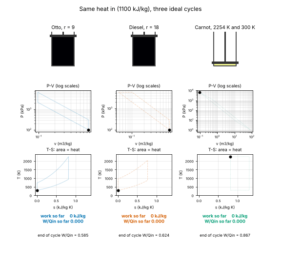

# The Target, rebuilt



*Our reproduction: Otto (r = 9), Diesel (r = 18) and Carnot take the same 1100 kJ/kg and settle at 0.585, 0.624 and 0.867.*

> This is a simplified educational model. It is not a validated design tool and must not be used for real structures, electrical installations, vehicles, industrial processes or medical decisions.

```bash
python target/target.py --check   # final efficiencies and 16 checks, prints PASS
python target/target.py           # also writes docs/figures/target_reproduction.gif (about 30 s)
```

## The settings

| Engine | What it does | Final W / Qin |
|---|---|---|
| Otto, r = 9 | isentropic compression, 1100 kJ/kg at constant volume, isentropic expansion, rejection at constant volume | 0.585 |
| Diesel, r = 18 | as Otto, but the 1100 kJ/kg is added at constant pressure | 0.624 |
| Carnot | takes 1100 kJ/kg at the Otto peak temperature (2254 K), rejects heat at 300 K | 0.867 |

All three start from air at 300 K and 100 kPa (1 kg). The gas is an ideal gas with the textbook table values for air at 300 K: cp = 1.005 and cv = 0.718 kJ/(kg K), so R = cp - cv = 0.287 kJ/(kg K) and gamma = cp / cv = 1.3997.

## Method

1. **One cycle is a chain of simple processes.** Each process is sampled at 400 points of specific volume v and temperature T, using only the gas laws of Sessions 2 and 3: an isentrope keeps T v^(gamma-1) constant, an isochore keeps v, an isobar keeps T / v, an isotherm keeps T. Pressure follows from P = R T / v. Isentropes and isotherms are sampled evenly in log v, so the huge volume range of the Carnot cycle is resolved as well as the small one.
2. **The Carnot cycle is placed where the Otto cycle is hottest.** Its hot isotherm starts at the Otto state 3 (v = v1 / 9, T = 2254 K) and expands until it has taken in 1100 kJ/kg: v grows by exp(q / (R T_hot)) = 5.5. Isentropes then link it to the 300 K isotherm. That is why the Carnot efficiency is 1 - 300 / 2254 = 0.867, the same number as the Carnot limit in the Session 2 worked example.
3. **Entropy, for the T-S loop (roadmap Session 6).** Along the path s = cv ln(T / T1) + R ln(v / v1), zero at state 1. The heat of each small step is T ds, and the heat taken in is the sum of the positive steps.
4. **The running readout.** The "work so far" is the running trapezoid sum of P dv (Session 3), and "W/Qin so far" divides it by 1100 kJ/kg. It goes negative during compression and, for the Carnot cycle, overshoots during the long expansions before the compression strokes bring it back. The value at the end of the loop is the efficiency.
5. **The animation** uses Matplotlib only. The piston height follows log v (otherwise the Carnot cylinder would be 900 times taller than the Otto one), its gas is coloured by temperature with the perceptually uniform `inferno` map, and the three cycles use Okabe-Ito colours plus solid, dashed and dotted lines, so they stay distinct in grayscale.

## How we know it is right

`python target/target.py --check` runs 16 checks:

- the end-of-cycle W / Qin of each engine, shown to 3 decimals, equals the Target (0.585, 0.624, 0.867);
- the P dv sums agree with the closed-form Otto, Diesel and Carnot formulas within 1e-4;
- the heat taken in, summed as T ds, is 1100 kJ/kg within 0.5 percent;
- the T-S area equals the P-V area within 0.5 percent (the first law, and the roadmap's Session 6 checkpoint);
- each path is closed, and Otto < Diesel < Carnot.

The same check runs in the test suite (`tests/test_target.py`).

## A note on the third decimal

The Target numbers depend on the fourth digit of the gas properties. With the table values cp = 1.005 and cv = 0.718 used here, the closed forms give Otto 0.584502, Diesel 0.624457 and Carnot 0.866907, which round to the Target's 0.585, 0.624 and 0.867. Sessions 2 to 5 use R = 0.287 with gamma exactly 1.4 (cv = 0.7175); then the Diesel value is 0.624729, printed as 0.625 in those sessions and in the roadmap, while Otto (0.584763) and Carnot (0.867) do not change at 3 decimals. The Otto value here is only 0.000002 above the rounding boundary of 0.5845, so treat the third decimal as a property of the rounding, not of the physics. Session 4 shows that real air changes far more than this: with cp(T) the Otto value at the same settings drops to 0.530.

## What the Target does not show

These are ideal air-standard cycles: no burn time, heat loss, friction, gas exchange, temperature-dependent properties or knock. The roadmap sessions 6 to 8 (entropy of the simulated cycle, a knock model and a four-stroke model) are the path from here to a cycle that looks like a real engine, and Session 3's mini-project shows why the most efficient cycle on paper is not the one in your car.
