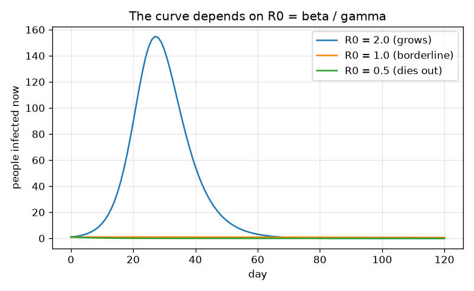
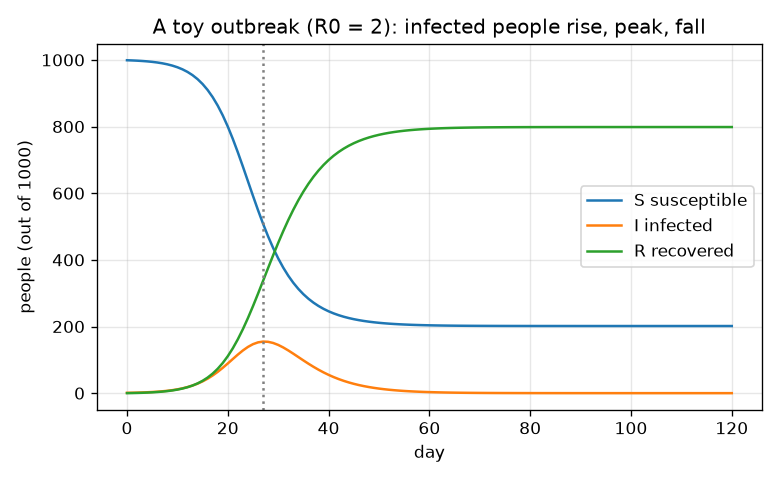

# सत्र 1: तीर वाले तीन डिब्बे: एक प्रकोप (outbreak) कैसे बढ़ता और घटता है

*स्तर 1 (वैचारिक इंटरैक्टिव मॉडल) · लगभग 60 मिनट · openepidemic*

> यह एक सरलीकृत शैक्षिक मॉडल है। यह कोई प्रमाणित डिज़ाइन उपकरण नहीं है और इसका उपयोग वास्तविक संरचनाओं, विद्युत संस्थापनों, वाहनों, औद्योगिक प्रक्रियाओं या चिकित्सा निर्णयों के लिए नहीं किया जाना चाहिए।

**पूर्वापेक्षाएँ (Prerequisites)**

- स्कूल का अंकगणित: गुणा, प्रतिशत, अनुपात।
- आपने PRIMER.md पढ़ लिया है और एक बार `python start.py 1` चला लिया है।

**सीखने के उद्देश्य (Learning objectives)।** इस सत्र के बाद आप:

- S, I और R डिब्बों और उनके बीच के दो तीरों का वर्णन कर सकेंगे।
- समझा सकेंगे कि जब हर मामला (case) एक से अधिक अन्य व्यक्तियों को संक्रमित करता है तो संक्रमण क्यों फैलता है।
- समय के सापेक्ष संक्रमित लोगों का ग्राफ़ पढ़ सकेंगे: यह बढ़ता है, शिखर (peak) पर पहुँचता है और घटता है।
- संख्या R0 = beta / gamma की गणना और उपयोग कर सकेंगे।

## A. वास्तविक दुनिया की समस्या
केवल सामान्य शिक्षा के लिए: यह काल्पनिक लोगों वाला एक खिलौना मॉडल है। यह कोई पूर्वानुमान (forecast) नहीं है, कोई चिकित्सा सलाह नहीं है और सार्वजनिक स्वास्थ्य निर्णयों का आधार नहीं है। जब कोई नया संक्रमण किसी कस्बे में पहुँचता है, तो एक प्रकोप विस्फोटक रूप से क्यों फैलता है जबकि दूसरा अपने-आप ख़त्म हो जाता है? और बीमार लोगों की संख्या क्यों बढ़ती है, शिखर पर पहुँचती है, और फिर घटती है, भले ही शिखर पर किसी ने कुछ ख़ास न किया हो? मॉडल बनाने वाले लोगों को तीन डिब्बों में बाँटते हैं: अतिसंवेदनशील (Susceptible) (जिन्हें संक्रमण हो सकता है), संक्रमित (Infected) (जिन्हें संक्रमण है और जो उसे आगे फैला सकते हैं) और स्वस्थ हुए (Recovered) (जिन्हें संक्रमण हो चुका है, अब प्रतिरक्षित (immune) हैं)। दो तीर लोगों को आगे ले जाते हैं: संक्रमण (S से I) और स्वस्थ होना (I से R)।

## B. अवधारणा और सिद्धांत
एक छोटे समय-चरण (time step) dt (दिन) में, नए संक्रमणों की संख्या beta गुणा S गुणा I भाग N गुणा dt होती है: यह तब बड़ी होती है जब बहुत से लोग अतिसंवेदनशील हों और बहुत से संक्रामक हों, क्योंकि तभी दोनों के बीच मुलाक़ातें आम होती हैं। नए स्वस्थ होने वालों की संख्या gamma गुणा I गुणा dt होती है: संक्रमित लोगों का एक निश्चित हिस्सा हर दिन स्वस्थ होता है। लोग केवल डिब्बों के बीच चलते हैं, इसलिए S + I + R = N हमेशा रहता है। एक संक्रमित व्यक्ति लगभग 1/gamma दिन तक संक्रामक रहता है और beta दर से लोगों को संक्रमित करता है, इसलिए जब लगभग सभी अतिसंवेदनशील हों तो वह लगभग beta / gamma अन्य लोगों को संक्रमित करता है। यह संख्या R0 है। यदि R0 1 से ऊपर है तो हर मामला अपनी जगह एक से अधिक मामले बनाता है और प्रकोप बढ़ता है; यदि यह 1 से नीचे है तो प्रकोप ख़त्म हो जाता है। संक्रमित लोगों का वक्र बाद में शिखर पर पहुँचता है, जब इतने लोग पहले ही स्वस्थ हो चुके होते हैं कि संक्रमित लोगों को संक्रमण आगे देने के लिए पर्याप्त अतिसंवेदनशील लोग नहीं मिलते।

| प्रतीक | अर्थ | इकाई |
|---|---|---|
| S, I, R | अतिसंवेदनशील, संक्रमित और स्वस्थ हुए लोगों की संख्या | लोग |
| N | लोगों की कुल संख्या (S + I + R) | लोग |
| beta | संपर्क दर (contact rate): जब सभी अतिसंवेदनशील हों, तब प्रति संक्रमित व्यक्ति प्रति दिन होने वाले संक्रमण | 1/day |
| gamma | स्वस्थ होने की दर (recovery rate) = 1 / (व्यक्ति कितने दिन संक्रामक रहता है) | 1/day |
| R0 | मूल प्रजनन संख्या (basic reproduction number) = beta / gamma | कोई इकाई नहीं |
| dt | समय-चरण | दिन |

**मान्यताएँ (Assumptions)**

- हर व्यक्ति बाक़ी सभी से बराबर मिलता-जुलता है (एक अच्छी तरह मिश्रित (well-mixed) कस्बा)।
- स्वस्थ हुए लोग पूरे सिमुलेशन के दौरान प्रतिरक्षित रहते हैं।
- कोई जन्म, मृत्यु या यात्रा नहीं; N स्थिर रहता है।
- केवल काल्पनिक संख्याएँ: यह एक शिक्षण उपकरण है, पूर्वानुमान नहीं।

$$ \text{new infections}=\beta\,\dfrac{S\,I}{N}\,\Delta t,\qquad \text{new recoveries}=\gamma\,I\,\Delta t $$

$$ S+I+R=N\quad\text{(people only move between boxes)} $$

$$ R_0=\dfrac{\beta}{\gamma}\quad\text{(people infected by one case in a fully susceptible town)} $$

## C. दृश्य व्याख्या
पहला चित्र 1000 लोगों के एक कस्बे के S, I और R वक्र दिखाता है, जिसमें शुरुआत में एक मामला है, beta = 0.5 और gamma = 0.25 प्रति दिन (R0 = 2): S घटता है, R बढ़ता है, और I दिन 27 पर लगभग 155 लोगों के शिखर तक बढ़ता है और फिर घटता है। दूसरा चित्र एक ही gamma के साथ beta के तीन मानों की तुलना करता है: R0 = 2 पर संक्रमण बढ़ता है, R0 = 1 पर संक्रमित लोगों की संख्या केवल धीरे-धीरे घटती है, और R0 = 0.5 पर यह पहले दिन से ही घटती है।

*R0 = 2, 1 और 0.5 के लिए संक्रमित लोग: केवल 1 से ऊपर का R0 प्रकोप देता है।*

*R0 = 2 वाले 1000 लोगों के खिलौना कस्बे के लिए S, I और R: संक्रमित वक्र बढ़ता है, दिन 27 पर शिखर पर पहुँचता है और घटता है।*

## D. इंटरैक्टिव सिमुलेशन
पाठ चलाएँ (`python start.py 1`), फिर लाइव ऐप खोलें: [सत्र 1: तीन डिब्बे और वक्र](https://krunalpanchal1995.github.io/pan-iit-oss/openepidemic/session-01/) (या इस फ़ोल्डर में `app.html`)। ऐप में दिन वाले स्लाइडर को खींचें और डिब्बों को भरते-खाली होते देखें, फिर वक्र वाले दृश्य पर जाएँ। beta और gamma बदलें और शिखर को खिसकते देखें।

**चुनौती।** beta और gamma ऐसे चुनें कि R0 1 से नीचे हो, ताकि प्रकोप शुरुआत से ही ख़त्म हो जाए।

## E. हल किया गया उदाहरण और प्रयोग
**समस्या।** एक कस्बे में N = 1000 लोग हैं, 999 अतिसंवेदनशील और 1 संक्रमित। beta = 0.5 और gamma = 0.25 प्रति दिन के साथ, लोगों को एक दिन (dt = 1) के लिए आगे बढ़ाएँ और R0 ज्ञात करें।

1. नए संक्रमण = 0.5 * 999 * 1 / 1000 * 1 = 0.4995 लोग।
2. नए स्वस्थ = 0.25 * 1 * 1 = 0.25 लोग।
3. S = 999 - 0.4995 = 998.5005; I = 1 + 0.4995 - 0.25 = 1.2495; R = 0 + 0.25 = 0.25।
4. जाँच: 998.5005 + 1.2495 + 0.25 = 1000, यानी कोई व्यक्ति खोया नहीं।
5. R0 = beta / gamma = 0.5 / 0.25 = 2, इसलिए एक मामला लगभग 2 अन्य को संक्रमित करता है: चार पीढ़ियों (generations) में 1, 2, 4, 8 मामले।

**उत्तर।** एक दिन के बाद S = 998.5005, I = 1.2495, R = 0.25, और R0 = 2। (lesson.py में प्रयुक्त 0.1 दिन के बारीक चरणों के साथ दिन 10 पर कस्बे में S = 978.0, I = 11.4, R = 10.6 है।)

**प्रयोग।** 20 विद्यार्थियों की कक्षा में पासों या सिक्कों से फैलाव का खेल खेलें: हर 'संक्रमित' व्यक्ति जिससे भी मिलता है उसके लिए एक सिक्का उछालता है, और चित (head) आने पर वह व्यक्ति संक्रमित हो जाता है; कुछ दौरों के बाद तीनों समूहों को गिनें और डिब्बों से तुलना करें। एक मोटा-मोटा उतार-चढ़ाव अपेक्षित है, चिकना वक्र नहीं: वास्तविक समूह छोटे होते हैं और संयोग (chance) मायने रखता है (सत्र 3)। मॉडल और वास्तविकता में अंतर इसलिए है क्योंकि वास्तविक लोग बराबर नहीं मिलते-जुलते, उम्र और व्यवहार में भिन्न होते हैं, और मामले देर से गिने जाते हैं।

## F. मूल्यांकन और डिज़ाइन चुनौती
**प्रश्न प्रकार A: वैचारिक।** शिखर के बाद संक्रमित लोगों की संख्या क्यों घटती है, भले ही कोई अपना व्यवहार न बदले?

संकेत

सोचें कि एक संक्रमित व्यक्ति के मिलने के लिए कौन बचा है।

चरण-दर-चरण हल

शिखर के बाद इतने लोग स्वस्थ (और प्रतिरक्षित) हो चुके होते हैं कि एक संक्रमित व्यक्ति ज़्यादातर स्वस्थ हुए लोगों से मिलता है, इसलिए हर मामला एक से कम अन्य को संक्रमित करता है। नए संक्रमण नए स्वस्थ होने वालों से कम हो जाते हैं, इसलिए I घटता है। प्रकोप इसलिए ख़त्म नहीं होता कि संक्रमण का समय ख़त्म हो गया, बल्कि इसलिए कि उसके लिए अतिसंवेदनशील लोग ख़त्म हो गए।

**प्रश्न प्रकार B: संख्यात्मक।** एक कस्बे में beta = 0.3 और gamma = 0.1 प्रति दिन है। एक मामले से शुरू करके R0 और पीढ़ी 3 में मामलों की संख्या ज्ञात करें।

संकेत

R0 = beta / gamma; हर पीढ़ी मामलों की संख्या को R0 से गुणा करती है।

चरण-दर-चरण हल

R0 = 0.3 / 0.1 = 3। पीढ़ियाँ: 1, 3, 9, 27, इसलिए पीढ़ी 3 में 27 मामले हैं। सामान्य जाँच (sanity check): R0 1 से ऊपर है, इसलिए संख्याएँ बढ़ती हैं। इकाइयाँ: R0 की कोई इकाई नहीं है; मामले लोग हैं।

**प्रश्न प्रकार C: ग्राफ़ और सिमुलेशन की व्याख्या।** S, I, R चित्र में शिखर किस दिन है, उस समय लगभग कितने लोग संक्रमित हैं, और उस क्षण R का क्या होता है?

संकेत

I वक्र का सबसे ऊँचा बिंदु खोजें और उस दिन के ऊपर बाक़ी वक्रों को देखें।

चरण-दर-चरण हल

शिखर दिन 27 पर है, जब लगभग 155 लोग संक्रमित हैं। उस क्षण S घट रहा है और R बढ़ रहा है, लेकिन I वक्र एक पल के लिए सपाट है क्योंकि नए संक्रमण नए स्वस्थ होने वालों के बराबर हैं। उस दिन के बाद R बढ़ता रहता है और I घटता है।

**प्रश्न प्रकार D: डिज़ाइन और अनुकूलन (optimisation) चुनौती।** डिज़ाइन: gamma = 0.25 प्रति दिन के साथ, कस्बे की संपर्क दर beta = 0.5 है। स्कूल बंद करने की एक योजना beta को कम कर सकती है। कौन-सा beta R0 को ठीक 1 बनाता है, और यदि योजना beta = 0.2 तक पहुँच जाए तो क्या होता है? एक कारण बताएँ कि आपका उत्तर बहुत आशावादी क्यों हो सकता है।

संकेत

R0 = beta / gamma, इसलिए beta = R0 * gamma।

चरण-दर-चरण हल

R0 = 1 के लिए हमें beta = 1 * 0.25 = 0.25 प्रति दिन चाहिए: यानी beta को आधा करना। beta = 0.2 पर, R0 = 0.8 और संक्रमित लोगों की संख्या पहले दिन से घटती है। यह बहुत आशावादी है क्योंकि beta कोई डायल नहीं है जिसे हम सेट कर सकें: लोगों और समूहों के बीच संपर्क अलग-अलग होते हैं, मॉडल बराबर मिश्रण मानता है, और व्यवहार में बदलाव स्वयं अनिश्चित है। यह एक कक्षा अभ्यास है, सलाह नहीं।

[RUBRIC.md](../../RUBRIC.md) से स्वयं को अंक दें। काग़ज़ पर काम करने के लिए [गतिविधि पत्रक](activity_sheet.md) प्रिंट करें।

## सामान्य भ्रांतियाँ (Common misconceptions)
| सामान्य भ्रांति | वास्तव में क्या सही है |
|---|---|
| प्रकोप इसलिए रुकता है क्योंकि सभी संक्रमित हो चुके हैं। | यह तब रुकता है जब R0 गुणा अतिसंवेदनशील हिस्सा 1 से नीचे चला जाता है; कुछ लोग कभी संक्रमित नहीं होते (सत्र 2 गणना करता है कि कितने)। |
| R0 केवल कीटाणु (germ) का गुण है। | R0 = beta / gamma इस पर निर्भर करता है कि लोग कैसे मिलते हैं (beta) और वे कितने समय तक संक्रामक रहते हैं (gamma), इसलिए यह व्यवहार और स्थान के साथ बदलता है। |
| शिखर वह समय है जब कुल मिलाकर सबसे अधिक लोग संक्रमित हो चुके हों। | शिखर वह समय है जब एक साथ सबसे अधिक लोग संक्रमित हों; कुल संख्या उसके बाद भी बढ़ती रहती है। |
| इस तरह का मॉडल बता सकता है कि किसी वास्तविक कस्बे में क्या होगा। | यह काल्पनिक संख्याओं वाला एक शिक्षण उपकरण है। वास्तविक पूर्वानुमान के लिए कहीं अधिक सावधानी और विशेषज्ञ काम चाहिए। |

## शब्दावली (Glossary)
- **अतिसंवेदनशील (susceptible)**: वह व्यक्ति जिसे अभी भी संक्रमण हो सकता है
- **संक्रमित (infected)**: वह व्यक्ति जिसे संक्रमण है और जो उसे आगे फैला सकता है
- **स्वस्थ हुआ (recovered)**: वह व्यक्ति जिसे संक्रमण हो चुका है और जो अब प्रतिरक्षित है (इस मॉडल में)
- **R0**: मूल प्रजनन संख्या: पूरी तरह अतिसंवेदनशील कस्बे में एक मामले द्वारा संक्रमित लोग
- **संपर्क दर beta (contact rate)**: प्रति संक्रमित व्यक्ति प्रति दिन होने वाले संक्रमण
- **स्वस्थ होने की दर gamma (recovery rate)**: 1 / (संक्रामक रहने के दिन)

## समापन
1. [exercises.md](exercises.md) में दिए तीन कोडिंग कार्य करें।
2. अपने बदलावों के बाद `python start.py 1` फिर से चलाएँ। यह चेकपॉइंट (checkpoint) के साथ समाप्त होता है; जब यह `PASS` प्रिंट करे, तो आपका काम पूरा है। (केवल चेकपॉइंट: `python start.py check 1`।)

आगे: [सत्र 2](../session-02/README.md)
