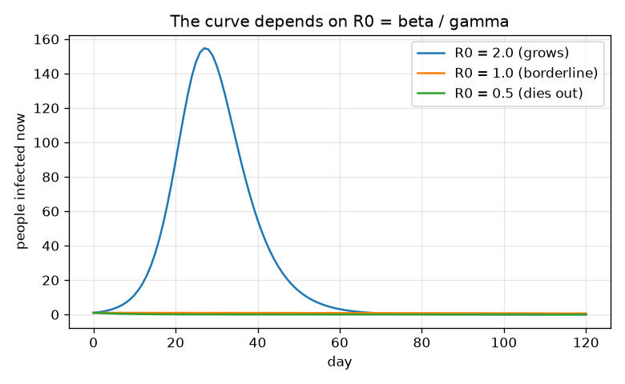
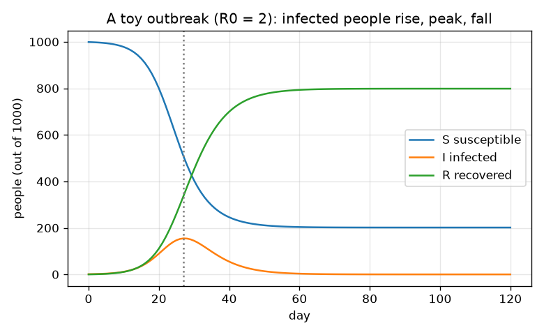

# സെഷൻ 1: അമ്പുകളുള്ള മൂന്ന് പെട്ടികൾ: ഒരു പകർച്ചവ്യാധി എങ്ങനെ ഉയരുകയും താഴുകയും ചെയ്യുന്നു

[Session 1 — हिन्दी](README.hi.md)

*ലെവൽ 1 (ആശയപരമായ ഇന്ററാക്ടീവ് മോഡൽ) · ഏകദേശം 60 മിനിറ്റ് · openepidemic*

> ഇത് ലളിതമാക്കിയ ഒരു വിദ്യാഭ്യാസ മോഡൽ മാത്രമാണ്. ഇത് സാധൂകരിച്ച ഒരു ഡിസൈൻ ഉപകരണമല്ല; യഥാർത്ഥ നിർമ്മിതികൾ, വൈദ്യുത സംവിധാനങ്ങൾ, വാഹനങ്ങൾ, വ്യാവസായിക പ്രക്രിയകൾ അല്ലെങ്കിൽ മെഡിക്കൽ തീരുമാനങ്ങൾ എന്നിവയ്ക്ക് ഇത് ഉപയോഗിക്കരുത്.

**മുൻ‌അറിവ് (Prerequisites)**

- സ്കൂൾ ഗണിതം: ഗുണനം, ശതമാനം, അനുപാതം.
- നിങ്ങൾ [PRIMER.md](../../PRIMER.md) വായിക്കുകയും `python start.py 1` ഒരിക്കൽ പ്രവർത്തിപ്പിക്കുകയും ചെയ്തിട്ടുണ്ട്.

**പഠന ലക്ഷ്യങ്ങൾ (Learning objectives).** ഈ സെഷനു ശേഷം നിങ്ങൾക്ക് കഴിയും:

- S, I, R പെട്ടികളെയും അവയ്ക്കിടയിലുള്ള രണ്ട് അമ്പുകളെയും വിവരിക്കാൻ.
- ഓരോ രോഗിയും ഒന്നിലധികം പേരെ രോഗബാധിതരാക്കുമ്പോൾ അണുബാധ പടരുന്നത് എന്തുകൊണ്ടെന്ന് വിശദീകരിക്കാൻ.
- സമയത്തിനെതിരെ രോഗബാധിതരുടെ ഗ്രാഫ് വായിക്കാൻ: അത് ഉയരുന്നു, ഉച്ചസ്ഥായിയിൽ (peak) എത്തുന്നു, താഴുന്നു.
- R0 = beta / gamma എന്ന സംഖ്യ കണക്കാക്കി ഉപയോഗിക്കാൻ.

## A. യഥാർത്ഥ ലോക പ്രശ്നം
പൊതുവിദ്യാഭ്യാസത്തിനു മാത്രം: ഇത് സാങ്കൽപ്പിക ആളുകളുള്ള ഒരു കളിപ്പാട്ട മോഡലാണ്. ഇത് ഒരു പ്രവചനമല്ല, മെഡിക്കൽ ഉപദേശമല്ല, പൊതുജനാരോഗ്യ തീരുമാനങ്ങൾക്കുള്ള അടിസ്ഥാനവുമല്ല. ഒരു പുതിയ അണുബാധ ഒരു പട്ടണത്തിൽ എത്തുമ്പോൾ, ഒരു പകർച്ചവ്യാധി പൊട്ടിത്തെറിക്കുകയും മറ്റൊന്ന് കെട്ടടങ്ങുകയും ചെയ്യുന്നത് എന്തുകൊണ്ട്? ഉച്ചസ്ഥായിയിൽ ആരും പ്രത്യേകമായി ഒന്നും ചെയ്യാതിരുന്നിട്ടും രോഗികളുടെ എണ്ണം ഉയർന്ന്, ഉച്ചസ്ഥായിയിലെത്തി, പിന്നീട് താഴുന്നത് എന്തുകൊണ്ട്? മോഡലർമാർ ആളുകളെ മൂന്ന് പെട്ടികളായി തരംതിരിക്കുന്നു: രോഗസാധ്യതയുള്ളവർ (Susceptible, രോഗം പിടിപെടാവുന്നവർ), രോഗബാധിതർ (Infected, രോഗമുള്ളവരും പകർത്താൻ കഴിയുന്നവരും), സുഖം പ്രാപിച്ചവർ (Recovered, രോഗം വന്നുപോയവർ, ഇപ്പോൾ പ്രതിരോധശേഷിയുള്ളവർ). രണ്ട് അമ്പുകൾ ആളുകളെ നീക്കുന്നു: അണുബാധ (S-ൽ നിന്ന് I-ലേക്ക്), സുഖപ്പെടൽ (I-ൽ നിന്ന് R-ലേക്ക്).

## B. ആശയവും സിദ്ധാന്തവും
ഒരു ചെറിയ സമയ ഘട്ടം dt-യിൽ (ദിവസങ്ങൾ), പുതിയ അണുബാധകളുടെ എണ്ണം beta ഗുണം S ഗുണം I-നെ N കൊണ്ട് ഹരിച്ച് dt കൊണ്ട് ഗുണിച്ചതാണ്: ധാരാളം പേർ രോഗസാധ്യതയുള്ളവരും ധാരാളം പേർ രോഗം പകർത്തുന്നവരും ആകുമ്പോൾ ഇത് വലുതാണ്, കാരണം അപ്പോഴാണ് ഇരുകൂട്ടരും തമ്മിലുള്ള കൂടിക്കാഴ്ചകൾ സാധാരണമാകുന്നത്. പുതിയ സുഖപ്പെടലുകളുടെ എണ്ണം gamma ഗുണം I ഗുണം dt ആണ്: രോഗബാധിതരുടെ ഒരു നിശ്ചിത പങ്ക് ഓരോ ദിവസവും സുഖപ്പെടുന്നു. ആളുകൾ നീങ്ങുക മാത്രം ചെയ്യുന്നു, അതിനാൽ S + I + R = N എപ്പോഴും. ഒരു രോഗബാധിതൻ ഏകദേശം 1/gamma ദിവസം രോഗം പകർത്തുന്നു, beta നിരക്കിൽ ആളുകളെ ബാധിക്കുന്നു, അതിനാൽ മിക്കവാറും എല്ലാവരും രോഗസാധ്യതയുള്ളവരായിരിക്കുമ്പോൾ ഏകദേശം beta / gamma പേരെ ബാധിക്കുന്നു. ഈ സംഖ്യയാണ് R0. മോഡൽ ശരാശരികൾ ഉപയോഗിക്കുന്നു, അതിനാൽ അത് ഒരാളുടെ ഭിന്നസംഖ്യകളെ (ഉദാഹരണത്തിന് ഒരു ദിവസം 0.4995 പേർ) സന്തോഷത്തോടെ നീക്കുന്നു; അത്തരമൊരു സംഖ്യയെ "ശരാശരി ഏകദേശം പകുതി ആൾ" എന്ന് വായിക്കുക, ഒരു യഥാർത്ഥ പകുതി ആൾ എന്നല്ല. R0, 1-ന് മുകളിലാണെങ്കിൽ ഓരോ രോഗിയും തന്നെത്തന്നെ ഒന്നിലധികം രോഗികളാൽ മാറ്റിസ്ഥാപിക്കുന്നു, പകർച്ചവ്യാധി വളരുന്നു; 1-ന് താഴെയാണെങ്കിൽ അത് കെട്ടടങ്ങുന്നു. രോഗബാധിതരുടെ വക്രം പിന്നീട് ഉച്ചസ്ഥായിയിലെത്തുന്നു, R0 ഗുണം രോഗസാധ്യതയുള്ളവരുടെ പങ്ക് S / N, 1 ആയി താഴുന്ന നിമിഷത്തിൽ: അത്രയധികം പേർ ഇതിനകം സുഖപ്പെട്ടതിനാൽ രോഗബാധിതർക്ക് തങ്ങളെ മാറ്റിസ്ഥാപിക്കാൻ ആവശ്യമായ രോഗസാധ്യതയുള്ളവരെ കണ്ടെത്താൻ കഴിയുന്നില്ല.

| ചിഹ്നം | അർത്ഥം | യൂണിറ്റ് |
|---|---|---|
| S, I, R | രോഗസാധ്യതയുള്ളവർ, രോഗബാധിതർ, സുഖം പ്രാപിച്ചവർ എന്നിവരുടെ എണ്ണം | ആളുകൾ |
| N | ആകെ ആളുകളുടെ എണ്ണം (S + I + R) | ആളുകൾ |
| beta | സമ്പർക്ക നിരക്ക് (contact rate): എല്ലാവരും രോഗസാധ്യതയുള്ളവരായിരിക്കുമ്പോൾ ഒരു രോഗബാധിതൻ ഒരു ദിവസം ഉണ്ടാക്കുന്ന അണുബാധകൾ | 1/day |
| gamma | സുഖപ്പെടൽ നിരക്ക് (recovery rate) = 1 / (ഒരാൾ രോഗം പകർത്തുന്ന ദിവസങ്ങൾ) | 1/day |
| R0 | അടിസ്ഥാന പുനരുൽപ്പാദന സംഖ്യ (basic reproduction number) = beta / gamma | യൂണിറ്റില്ല |
| dt | സമയ ഘട്ടം | ദിവസങ്ങൾ |

**അനുമാനങ്ങൾ (Assumptions)**

- എല്ലാവരും മറ്റെല്ലാവരുമായും തുല്യമായി ഇടപഴകുന്നു (നന്നായി കലർന്ന ഒരൊറ്റ പട്ടണം).
- സുഖം പ്രാപിച്ചവർ മുഴുവൻ സിമുലേഷനിലും പ്രതിരോധശേഷിയുള്ളവരാണ്.
- ജനനങ്ങളോ മരണങ്ങളോ യാത്രകളോ ഇല്ല; N സ്ഥിരമായി നിൽക്കുന്നു.
- സാങ്കൽപ്പിക സംഖ്യകൾ മാത്രം: ഇത് ഒരു പഠനോപകരണമാണ്, പ്രവചനമല്ല.

$$ \text{new infections}=\beta\,\dfrac{S\,I}{N}\,\Delta t,\qquad \text{new recoveries}=\gamma\,I\,\Delta t $$

$$ S+I+R=N\quad\text{(people only move between boxes)} $$

$$ R_0=\dfrac{\beta}{\gamma}\quad\text{(people infected by one case in a fully susceptible town)} $$

## C. ദൃശ്യ വിശദീകരണം
ആദ്യ ചിത്രം ഒരേ gamma-യോടൊപ്പം beta-യുടെ മൂന്ന് മൂല്യങ്ങൾ താരതമ്യം ചെയ്യുന്നു: R0 = 2 ആകുമ്പോൾ അണുബാധ വളരുന്നു, R0 = 1 ആകുമ്പോൾ രോഗബാധിതരുടെ എണ്ണം പതുക്കെ മാത്രം കുറയുന്നു, R0 = 0.5 ആകുമ്പോൾ ആദ്യ ദിവസം മുതൽ താഴുന്നു. രണ്ടാമത്തെ ചിത്രം ഒരു തുടക്ക രോഗി, beta = 0.5, gamma = 0.25 / ദിവസം (R0 = 2) ഉള്ള 1000 പേരുടെ ഒരു പട്ടണത്തിന്റെ S, I, R വക്രങ്ങൾ വരയ്ക്കുന്നു: S താഴുന്നു, R ഉയരുന്നു, I 27-ാം ദിവസം ഏകദേശം 155 പേരുടെ ഉച്ചസ്ഥായിയിലെത്തി പിന്നീട് താഴുന്നു.

*R0 = 2, 1, 0.5 എന്നിവയ്ക്കുള്ള രോഗബാധിതർ: R0, 1-ന് മുകളിലാകുമ്പോൾ മാത്രമേ പകർച്ചവ്യാധി ഉണ്ടാകൂ.*

*R0 = 2 ഉള്ള 1000 പേരുടെ സാങ്കൽപ്പിക പട്ടണത്തിന് S, I, R: രോഗബാധിതരുടെ വക്രം ഉയർന്ന്, 27-ാം ദിവസം ഉച്ചസ്ഥായിയിലെത്തി, താഴുന്നു.*

## D. ഇന്ററാക്ടീവ് സിമുലേഷൻ
പാഠം പ്രവർത്തിപ്പിക്കുക (`python start.py 1`), തുടർന്ന് ലൈവ് ആപ്പ് തുറക്കുക: [സെഷൻ 1: മൂന്ന് പെട്ടികളും വക്രവും](https://krunalpanchal1995.github.io/pan-iit-oss/openepidemic/session-01/) (അല്ലെങ്കിൽ ഈ ഫോൾഡറിലെ `app.html`). ആപ്പിൽ, ദിവസ സ്ലൈഡർ വലിച്ച് പെട്ടികൾ നിറയുന്നതും ഒഴിയുന്നതും ശ്രദ്ധിക്കുക, തുടർന്ന് വക്രങ്ങളുടെ വ്യൂവിലേക്ക് മാറുക. beta-യും gamma-യും മാറ്റി ഉച്ചസ്ഥായി നീങ്ങുന്നത് ശ്രദ്ധിക്കുക.

**വെല്ലുവിളി.** R0, 1-ന് താഴെയാകുന്ന വിധം beta-യും gamma-യും തിരഞ്ഞെടുത്ത് പകർച്ചവ്യാധി തുടക്കം മുതൽ കെട്ടടങ്ങാൻ ഇടയാക്കുക.

## E. ചെയ്തുകാണിച്ച ഉദാഹരണവും പരീക്ഷണവും
**പ്രശ്നം.** ഒരു പട്ടണത്തിൽ N = 1000 പേരുണ്ട്, 999 രോഗസാധ്യതയുള്ളവരും 1 രോഗബാധിതനും. beta = 0.5, gamma = 0.25 / ദിവസം എന്നിവ ഉപയോഗിച്ച്, ഒരു ദിവസത്തേക്ക് (dt = 1) ആളുകളെ നീക്കി R0 കണ്ടെത്തുക.

1. പുതിയ അണുബാധകൾ = 0.5 * 999 * 1 / 1000 * 1 = 0.4995 പേർ.
2. പുതിയ സുഖപ്പെടലുകൾ = 0.25 * 1 * 1 = 0.25 പേർ.
3. S = 999 - 0.4995 = 998.5005; I = 1 + 0.4995 - 0.25 = 1.2495; R = 0 + 0.25 = 0.25.
4. പരിശോധന: 998.5005 + 1.2495 + 0.25 = 1000, അതിനാൽ ആരും നഷ്ടപ്പെട്ടില്ല.
5. R0 = beta / gamma = 0.5 / 0.25 = 2, അതിനാൽ ഒരു രോഗി ഏകദേശം 2 പേരെ ബാധിക്കുന്നു. ആദ്യ രോഗിയെ തലമുറ 0 ആയി കണക്കാക്കിയാൽ, തലമുറകൾ 0, 1, 2, 3 എന്നിവയിൽ 1, 2, 4, 8 രോഗികൾ.

**ഉത്തരം.** ഒരു ദിവസത്തിനു ശേഷം S = 998.5005, I = 1.2495, R = 0.25, R0 = 2. (lesson.py-യിൽ ഉപയോഗിക്കുന്ന കൂടുതൽ സൂക്ഷ്മമായ 0.1 ദിവസ ഘട്ടങ്ങൾ ഉപയോഗിച്ചാൽ 10-ാം ദിവസം പട്ടണത്തിൽ S = 978.0, I = 11.4, R = 10.6.)

**പരീക്ഷണം.** 20 പേരുള്ള ഒരു ക്ലാസിൽ പകിടയോ നാണയങ്ങളോ ഉപയോഗിച്ച് പടരൽ കളി കളിക്കുക: ഓരോ റൗണ്ടിലും, ഓരോ 'രോഗബാധിതനും' രണ്ട് സഹപാഠികളെ കണ്ടുമുട്ടി ഓരോരുത്തർക്കും ഒരു നാണയം എറിയുന്നു: തല വീണാൽ ആ സഹപാഠി ഇപ്പോഴും രോഗസാധ്യതയുള്ളയാളാണെങ്കിൽ രോഗബാധിതനാകുന്നു. റൗണ്ടിന്റെ അവസാനം രോഗബാധിതൻ 'സുഖം പ്രാപിച്ചയാൾ' ആയി ഇരിക്കുന്നു, ഇനി രോഗം പകർത്താനോ പിടിപെടാനോ കഴിയില്ല. കുറച്ച് റൗണ്ടുകൾക്കു ശേഷം, മൂന്ന് ഗ്രൂപ്പുകളും എണ്ണി പെട്ടികളുമായി താരതമ്യം ചെയ്യുക. മിനുസമുള്ള വക്രമല്ല, ഏകദേശമായ ഒരു ഉയർച്ചയും പിന്നീട് താഴ്ചയും പ്രതീക്ഷിക്കുക: യഥാർത്ഥ ഗ്രൂപ്പുകൾ ചെറുതാണ്, യാദൃച്ഛികതയ്ക്ക് പ്രാധാന്യമുണ്ട് (സെഷൻ 3). മോഡലും യാഥാർത്ഥ്യവും വ്യത്യസ്തമാണ്, കാരണം യഥാർത്ഥ ആളുകൾ തുല്യമായി ഇടപഴകുന്നില്ല, പ്രായത്തിലും പെരുമാറ്റത്തിലും വ്യത്യസ്തരാണ്, രോഗികളെ വൈകിയാണ് എണ്ണുന്നത്.

## F. വിലയിരുത്തലും ഡിസൈൻ വെല്ലുവിളിയും
**ചോദ്യ തരം A: ആശയപരം.** ആരും പെരുമാറ്റം മാറ്റിയില്ലെങ്കിലും ഉച്ചസ്ഥായിക്കു ശേഷം രോഗബാധിതരുടെ എണ്ണം താഴുന്നത് എന്തുകൊണ്ട്?

സൂചന

ഒരു രോഗബാധിതന് കണ്ടുമുട്ടാൻ ആരാണ് ബാക്കിയുള്ളത് എന്ന് ചിന്തിക്കുക.

ഘട്ടം ഘട്ടമായുള്ള പരിഹാരം

ഉച്ചസ്ഥായിക്കു ശേഷം അത്രയധികം പേർ സുഖം പ്രാപിച്ചിരിക്കുന്നു (പ്രതിരോധശേഷിയുള്ളവരും) അതിനാൽ ഒരു രോഗബാധിതൻ കൂടുതലും സുഖം പ്രാപിച്ചവരെയാണ് കണ്ടുമുട്ടുന്നത്, അതിനാൽ ഓരോ രോഗിയും ഒരാളിൽ കുറവിനെ ബാധിക്കുന്നു. പുതിയ അണുബാധകൾ പുതിയ സുഖപ്പെടലുകളേക്കാൾ താഴെയാകുന്നു, അതിനാൽ I താഴുന്നു. പകർച്ചവ്യാധി അവസാനിക്കുന്നത് അണുബാധയ്ക്ക് സമയം തീരുന്നതുകൊണ്ടല്ല, രോഗസാധ്യതയുള്ളവർ തീരുന്നതുകൊണ്ടാണ്.

**ചോദ്യ തരം B: സംഖ്യാപരം.** ഒരു പട്ടണത്തിൽ beta = 0.3, gamma = 0.1 / ദിവസം. ഒരു രോഗിയിൽ നിന്ന് തുടങ്ങി, R0-യും തലമുറ 3-ലെ രോഗികളുടെ എണ്ണവും കണ്ടെത്തുക.

സൂചന

R0 = beta / gamma; ഓരോ തലമുറയും രോഗികളുടെ എണ്ണത്തെ R0 കൊണ്ട് ഗുണിക്കുന്നു.

ഘട്ടം ഘട്ടമായുള്ള പരിഹാരം

R0 = 0.3 / 0.1 = 3. തലമുറകൾ: 1, 3, 9, 27, അതിനാൽ തലമുറ 3-ൽ 27 രോഗികൾ. യുക്തിപരിശോധന: R0, 1-ന് മുകളിലാണ്, അതിനാൽ സംഖ്യകൾ വളരുന്നു. യൂണിറ്റുകൾ: R0-ന് യൂണിറ്റില്ല; രോഗികൾ ആളുകളാണ്.

**ചോദ്യ തരം C: ഗ്രാഫും സിമുലേഷനും വ്യാഖ്യാനിക്കൽ.** S, I, R ചിത്രത്തിൽ, ഉച്ചസ്ഥായി ഏത് ദിവസമാണ്, അപ്പോൾ ഏകദേശം എത്ര പേർ രോഗബാധിതരാണ്, ആ നിമിഷം R-ന് എന്ത് സംഭവിക്കുന്നു?

സൂചന

I വക്രത്തിന്റെ ഏറ്റവും ഉയർന്ന ബിന്ദു കണ്ടെത്തി ആ ദിവസത്തിന് മുകളിലുള്ള മറ്റ് വക്രങ്ങൾ നോക്കുക.

ഘട്ടം ഘട്ടമായുള്ള പരിഹാരം

ഉച്ചസ്ഥായി 27-ാം ദിവസമാണ്, ഏകദേശം 155 രോഗബാധിതർ. ആ നിമിഷം S താഴുകയും R ഉയരുകയും ചെയ്യുന്നു, എന്നാൽ പുതിയ അണുബാധകൾ പുതിയ സുഖപ്പെടലുകൾക്ക് തുല്യമായതിനാൽ ഒരു നിമിഷത്തേക്ക് I വക്രം പരന്നതാണ്. ആ ദിവസത്തിനു ശേഷം R ഉയർന്നുകൊണ്ടിരിക്കുന്നു, I താഴുന്നു.

**ചോദ്യ തരം D: ഡിസൈനും ഒപ്റ്റിമൈസേഷൻ (optimisation) വെല്ലുവിളിയും.** ഡിസൈൻ: gamma = 0.25 / ദിവസം ആയിരിക്കുമ്പോൾ, പട്ടണത്തിന്റെ സമ്പർക്ക നിരക്ക് beta = 0.5 ആണ്. ഒരു സ്കൂൾ അടച്ചിടൽ പദ്ധതിക്ക് beta കുറയ്ക്കാൻ കഴിഞ്ഞേക്കും. ഏത് beta R0-നെ കൃത്യം 1 ആക്കുന്നു, പദ്ധതി beta = 0.2-ൽ എത്തിയാൽ എന്ത് സംഭവിക്കുന്നു? നിങ്ങളുടെ ഉത്തരം അമിത ശുഭാപ്തിവിശ്വാസമുള്ളതാകാനുള്ള ഒരു കാരണം പറയുക.

സൂചന

R0 = beta / gamma, അതിനാൽ beta = R0 * gamma.

ഘട്ടം ഘട്ടമായുള്ള പരിഹാരം

R0 = 1-ന് beta = 1 * 0.25 = 0.25 / ദിവസം വേണം: beta പകുതിയാക്കൽ. beta = 0.2-ൽ, R0 = 0.8, രോഗബാധിതരുടെ എണ്ണം ആദ്യ ദിവസം മുതൽ താഴുന്നു. അമിത ശുഭാപ്തിവിശ്വാസം, കാരണം beta നമുക്ക് സജ്ജമാക്കാവുന്ന ഒരു ഡയൽ അല്ല: സമ്പർക്കങ്ങൾ ആളുകൾക്കും ഗ്രൂപ്പുകൾക്കുമിടയിൽ വ്യത്യസ്തമാണ്, മോഡൽ തുല്യമായ ഇടപഴകൽ അനുമാനിക്കുന്നു, പെരുമാറ്റത്തിലെ മാറ്റം തന്നെ അനിശ്ചിതമാണ്. ഇത് ഒരു ക്ലാസ്റൂം അഭ്യാസമാണ്, ഉപദേശമല്ല.

[RUBRIC.md](../../RUBRIC.md) ഉപയോഗിച്ച് സ്വയം സ്കോർ ചെയ്യുക. പേപ്പറിൽ ചെയ്യാൻ [പ്രവർത്തന ഷീറ്റ്](activity_sheet.md) പ്രിന്റ് ചെയ്യുക.

## സാധാരണ തെറ്റിദ്ധാരണകൾ
| സാധാരണ തെറ്റിദ്ധാരണ | യഥാർത്ഥത്തിൽ ശരിയായത് |
|---|---|
| എല്ലാവരും രോഗബാധിതരായതുകൊണ്ടാണ് പകർച്ചവ്യാധി നിൽക്കുന്നത്. | R0 ഗുണം രോഗസാധ്യതയുള്ളവരുടെ പങ്ക് 1-ന് താഴെയാകുമ്പോൾ രോഗബാധിതരുടെ എണ്ണം താഴാൻ തുടങ്ങുന്നു, തുടർന്ന് പകർച്ചവ്യാധി മങ്ങുന്നു; ചിലർക്ക് ഒരിക്കലും രോഗം ബാധിക്കുന്നില്ല (ഇവിടെ 1000-ൽ ഏകദേശം 200; എത്രയെന്ന് സെഷൻ 2 കണക്കാക്കുന്നു). |
| R0 അണുവിന്റെ മാത്രം ഒരു സ്വഭാവമാണ്. | R0 = beta / gamma ആളുകൾ എങ്ങനെ കണ്ടുമുട്ടുന്നു (beta) എന്നതിനെയും അവർ എത്രകാലം രോഗം പകർത്തുന്നു (gamma) എന്നതിനെയും ആശ്രയിക്കുന്നു, അതിനാൽ അത് പെരുമാറ്റവും സ്ഥലവും അനുസരിച്ച് മാറുന്നു. |
| ആകെ ഏറ്റവും കൂടുതൽ പേർ രോഗബാധിതരായ സമയമാണ് ഉച്ചസ്ഥായി. | ഒരേ സമയം ഏറ്റവും കൂടുതൽ പേർ രോഗബാധിതരായിരിക്കുന്ന സമയമാണ് ഉച്ചസ്ഥായി; ആകെത്തുക അതിനുശേഷവും ഉയർന്നുകൊണ്ടിരിക്കുന്നു. |
| ഇതുപോലൊരു മോഡലിന് ഒരു യഥാർത്ഥ പട്ടണത്തിൽ എന്ത് സംഭവിക്കുമെന്ന് പറയാൻ കഴിയും. | ഇത് സാങ്കൽപ്പിക സംഖ്യകളുള്ള ഒരു പഠനോപകരണമാണ്. യഥാർത്ഥ പ്രവചനത്തിന് വളരെയധികം ശ്രദ്ധയും വിദഗ്ദ്ധ പ്രവർത്തനവും ആവശ്യമാണ്. |

## പദാവലി (Glossary)
- **രോഗസാധ്യതയുള്ളയാൾ (susceptible)**: ഇപ്പോഴും അണുബാധ പിടിപെടാവുന്ന ഒരാൾ
- **രോഗബാധിതൻ (infected)**: അണുബാധയുള്ളതും അത് പകർത്താൻ കഴിയുന്നതുമായ ഒരാൾ
- **സുഖം പ്രാപിച്ചയാൾ (recovered)**: അണുബാധ വന്നുപോയതും ഇപ്പോൾ പ്രതിരോധശേഷിയുള്ളതുമായ ഒരാൾ (ഈ മോഡലിൽ)
- **R0**: അടിസ്ഥാന പുനരുൽപ്പാദന സംഖ്യ: പൂർണ്ണമായും രോഗസാധ്യതയുള്ള ഒരു പട്ടണത്തിൽ ഒരു രോഗി ബാധിക്കുന്ന ആളുകൾ
- **സമ്പർക്ക നിരക്ക് beta (contact rate beta)**: ഒരു രോഗബാധിതൻ ഒരു ദിവസം ഉണ്ടാക്കുന്ന അണുബാധകൾ
- **സുഖപ്പെടൽ നിരക്ക് gamma (recovery rate gamma)**: 1 / (രോഗം പകർത്തുന്ന ദിവസങ്ങൾ)

## പൂർത്തിയാക്കൽ
1. [exercises.md](exercises.md)-ലെ മൂന്ന് കോഡിംഗ് ടാസ്കുകൾ ചെയ്യുക.
2. നിങ്ങളുടെ മാറ്റങ്ങൾക്കു ശേഷം `python start.py 1` വീണ്ടും പ്രവർത്തിപ്പിക്കുക. അത് ചെക്ക്‌പോയിന്റിൽ (checkpoint) അവസാനിക്കുന്നു; അത് `PASS` എന്ന് പ്രിന്റ് ചെയ്യുമ്പോൾ നിങ്ങൾ പൂർത്തിയാക്കി. (ചെക്ക്‌പോയിന്റ് മാത്രം: `python start.py check 1`.)

അടുത്തത്: [സെഷൻ 2](../session-02/README.md)
