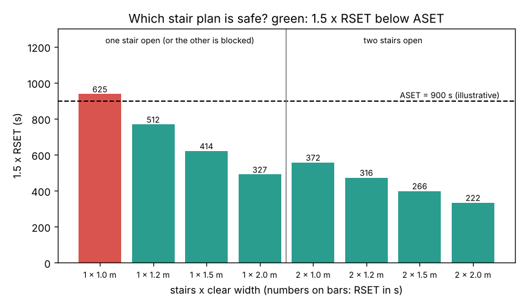
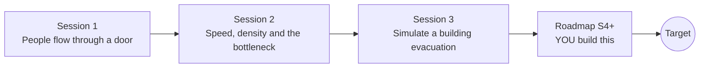

# openevacuation

[](https://github.com/KrunalPanchal1995/pan-iit-oss/actions/workflows/tests.yml)   [](https://colab.research.google.com/github/KrunalPanchal1995/pan-iit-oss/blob/main/openevacuation/sessions/session-01/lesson.ipynb) [](https://krunalpanchal1995.github.io/pan-iit-oss/openevacuation/)

**Plan a safe evacuation from a building with crowd flow, in three sessions.**

openevacuation teaches how people leave a building, from the flow of a crowd through one door to the speed-density law, bottlenecks and a simulation of a whole multi-storey block that you validate and use to choose the stairs, using only Python and a browser.

- **Start from zero.** Session 1 needs only school arithmetic: flow = density x speed x width, and time = people / flow.
- **See the queues.** Every session ships a slider app that runs in the browser, with labelled graphs and a live picture of the crowd.
- **Know you got it right.** Each session ends with a checkpoint that prints PASS or FAIL against hand calculations, conservation of people and known limits.
- **Build the missing half.** The repo stops at Session 3 on purpose; the roadmap shows the path to the Target.

[Target](#the-target) · [Who is this for](#who-is-this-for) · [Quick start](#quick-start) · [Sessions](#sessions) · [Roadmap](#roadmap) · [Contribute](#contribute) · [Explainer PDF](docs/explainer.pdf)

> **This repo is incomplete on purpose.** Sessions 1 to 3 are here and fully working. The finished Target below is a preview of what the community can build next. We show you the path, not the code. Sessions 4 and up are yours.

> **Safety.** Every model here is a simplified educational model. It is not a validated design tool. Real buildings must follow the fire code (in India, the National Building Code, Part 4: Fire and Life Safety) and be checked by a qualified fire engineer.

## The Target

A college block with a ground floor and three upper floors, 120 people on each, is planned for an available safe escape time (ASET) of 900 s. For eight designs (one or two stairs, 1.0 to 2.0 m wide) the network simulation gives the required safe escape time (RSET); the bars show 1.5 x RSET against ASET. One 1.0 m stair fails; two 1.2 m stairs pass even when smoke blocks one of them (RSET 316 s, or 512 s with one blocked). Your goal over the coming sessions: grow this into a full planning tool, with a floor plan you can draw, people who start at different times and move at different speeds, exit choice and an agent-based animation, and see whether the plan still holds.



*Target: 1.5 x RSET against ASET for one or two stairs of different widths; green designs are safe*

Try it live:

- [Session 3 app: simulate a building evacuation](https://krunalpanchal1995.github.io/pan-iit-oss/openevacuation/session-03/)
- [Math Visual Studio](https://krunalpanchal1995.github.io/studio/)

How the Target grows from here is shown only as a path in [promo/roadmap.md](promo/roadmap.md).

## Who is this for
**higher secondary to diploma / undergraduate (levels 4-5).** Topic area: Architecture, Design and Smart Buildings.

Prerequisites:

- School arithmetic; speed = distance / time; a straight line and the top of a parabola.
- Python 3.10 or newer; if `python --version` works, you are ready. PRIMER.md explains the rest.
- No prior GitHub, fire engineering or programming experience is needed; Session 3 explains the time-stepping it uses.

New to Python? Read [PRIMER.md](PRIMER.md) first (10 minutes).

## Quick start

No installation knowledge needed. You need [Git](https://git-scm.com/downloads) and [Python 3.10+](https://www.python.org/downloads/) (Windows: tick "Add Python to PATH"). On Mac and Linux type `python3` wherever this page says `python`.

```bash
git clone https://github.com/KrunalPanchal1995/pan-iit-oss.git
cd pan-iit-oss/openevacuation
python start.py 1
```

`start.py` creates a private environment, installs what is needed and runs Session 1 with its checkpoint. Next: `python start.py 2`, `python start.py 3`, or `python start.py test` to check everything. Only a checkpoint: `python start.py check 1`.

<!-- friendly-help -->
<details>
<summary><b>Not working? Common fixes (no Git, "python not found", no internet)</b></summary>

- **No Git?** You do not need it. On the main page of this collection click the green **Code** button, then **Download ZIP**, unzip it, open a terminal inside the folder `pan-iit-oss-main/openevacuation` and run `python start.py 1`. The ZIP holds every project, so it is large; the live apps need no download at all.
- **"python is not recognized" or "command not found".** On Windows try `py start.py 1`. On Mac and Linux try `python3 start.py 1`. If neither works, install Python from [python.org](https://www.python.org/downloads/) and tick "Add Python to PATH".
- **Needs internet once.** The first run downloads NumPy and Matplotlib into a private folder (`.venv`); after that it works offline.
- **Rather not install anything?** Open the [live apps](https://krunalpanchal1995.github.io/pan-iit-oss/openevacuation/) in your browser, or use the Colab badge at the top of this page.
- **Still stuck?** [Open an issue](https://github.com/KrunalPanchal1995/pan-iit-oss/issues/new?title=%5Bopenevacuation%5D%20) with your operating system and the message you see. Questions from beginners are welcome.

</details>

Four lines turn the idea of Session 1 into a result (they work as they are): Save it as `try.py` and run it with `python start.py run try.py` (this uses the private environment, where NumPy is installed):

```python
import numpy as np
fs, width, people = 1.3, 1.2 - 2 * 0.15, 240           # persons/(s m), effective width (m), persons
print(np.round(people / (fs * width), 1))             # -> 205.1  queue time at one 1.2 m door (s)
print(np.round(60 + 20 / 1.2 + people / (fs * width), 1))  # -> 281.8  with 60 s pre-movement and a 20 m walk
```

Every session also opens in your browser with sliders (no install): [live apps](https://krunalpanchal1995.github.io/pan-iit-oss/openevacuation/). Or use the Colab badge above for the notebook.

## Sessions

| # | Session | Model level | Time | Live app |
|---|---|---|---|---|
| 1 | [People flow through a door](sessions/session-01/README.md) | Level 1: conceptual interactive model | 60 min | [open](https://krunalpanchal1995.github.io/pan-iit-oss/openevacuation/session-01/) |
| 2 | [Speed, density and the bottleneck](sessions/session-02/README.md) | Level 2: mathematical engineering model | 75 min | [open](https://krunalpanchal1995.github.io/pan-iit-oss/openevacuation/session-02/) |
| 3 | [Simulate a building evacuation and plan it safely](sessions/session-03/README.md) | Level 3: simulation and validation | 90 min | [open](https://krunalpanchal1995.github.io/pan-iit-oss/openevacuation/session-03/) |

Each session follows the same six steps: A real-world problem, B concept and theory, C visual explanation, D interactive simulation, E worked example and experiment, F assessment and design challenge. Each ends with `checkpoint.py`, which prints `PASS` or `FAIL` against reference numbers. Session 3 also contains the real-world mini-project: **Plan the stairs of a student hostel**.

## Architecture



| Folder or file | What is inside |
|---|---|
| `sessions/` | three sessions: README (A-F), `lesson.py`, notebook, live app, exercises, activity sheet, checkpoint |
| `promo/` | the Target: media, live links, and the roadmap (path only) |
| `docs/` | `explainer.tex` and the built `explainer.pdf` |
| `tests/` | runs every lesson and checkpoint headless |
| `start.py` | one command to set up and run anything |
| `QUALITY.md`, `RUBRIC.md` | the quality checklist and the scoring rubric |
| `.github/` | CI, PDF build, Pages deploy, issue and PR templates |

## Roadmap

| Milestone | What you will build | Difficulty |
|---|---|---|
| Session 4: People are not all the same | Pre-movement times and walking speeds drawn from distributions, with a Monte Carlo of the evacuation time. | intermediate |
| Session 5: Draw the floor plan | A small graph of rooms, corridors, doors and stairs read from a text file, with shortest-route exit choice. | intermediate |
| Session 6: Counterflow and merging rules | Firefighters going up, and fair or floor-priority merging on landings. | intermediate |
| Session 7: People as agents | A social-force model of individuals in a room, validated against the flow of Sessions 1 and 2. | advanced |
| Session 8: Smoke and ASET | A simple smoke-filling model that gives ASET and slows people in smoke. | advanced |

Full detail with a checkpoint per milestone: [promo/roadmap.md](promo/roadmap.md).

## Contribute
New to GitHub? Read [CONTRIBUTING.md](CONTRIBUTING.md); it starts from zero. Pick an issue labelled `good first issue`. Translations into Hindi, Telugu, Tamil and Malayalam are welcome.

<details>
<summary>Development</summary>

```bash
python start.py test        # runs every lesson and checkpoint
```
Lessons use `# %%` cell markers so they open as notebooks in VS Code. See [QUALITY.md](QUALITY.md) for the standard every session meets.
</details>

## License
MIT. See [LICENSE](LICENSE). Media in `promo/media` is (c) Krunal Panchal, CC BY 4.0.

## Acknowledgments
Part of the [PAN IIT OSS](https://hellofoss.tech-iitb.org/projects) open-source teaching collection, modelled on the structure of [openspline](https://github.com/openspline/openspline). Built on ideas from the Math Visual Studio at https://krunalpanchal1995.github.io/studio/. The speed-density and flow values follow the hydraulic model summarised in the SFPE Handbook of Fire Protection Engineering (Gwynne and Rosenbaum, after Fruin, Pauls, and Predtechenskii and Milinskii).
