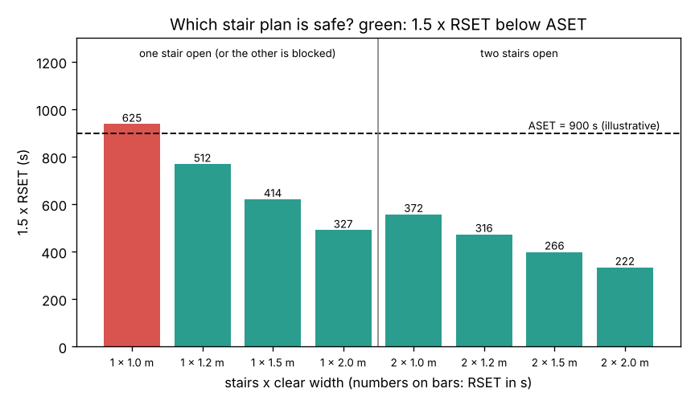

# What you are building toward

A college block with a ground floor and three upper floors, 120 people on each, is planned for an available safe escape time (ASET) of 900 s. For eight designs (one or two stairs, 1.0 to 2.0 m wide) the network simulation gives the required safe escape time (RSET); the bars show 1.5 x RSET against ASET. One 1.0 m stair fails; two 1.2 m stairs pass even when smoke blocks one of them (RSET 316 s, or 512 s with one blocked). Your goal over the coming sessions: grow this into a full planning tool, with a floor plan you can draw, people who start at different times and move at different speeds, exit choice and an agent-based animation, and see whether the plan still holds.

*Target: 1.5 x RSET against ASET for one or two stairs of different widths; green designs are safe*

The finished planning tool comes from a private reference build. Its code is not published; the roadmap shows the path so you can build your own.

Live links:

- [Session 3 app: simulate a building evacuation](https://krunalpanchal1995.github.io/pan-iit-oss/openevacuation/session-03/)
- [Math Visual Studio](https://krunalpanchal1995.github.io/studio/)
