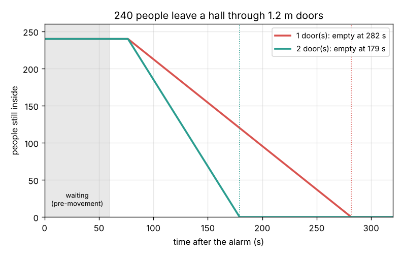
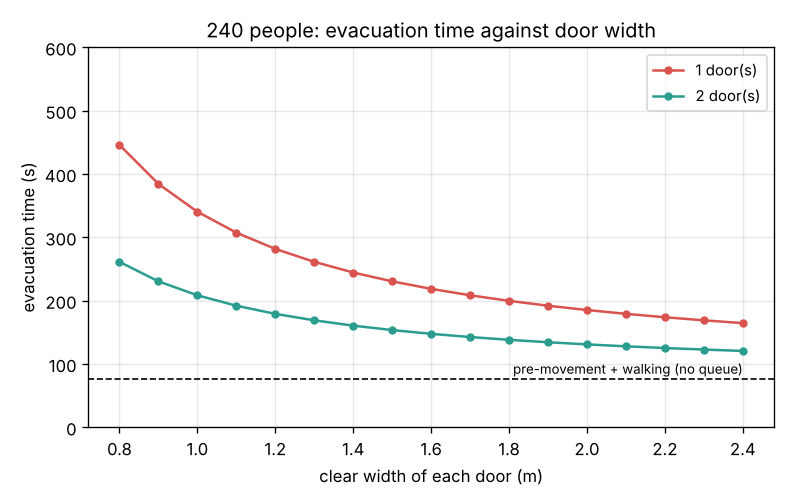

# Session 1: People flow through a door

*Level 1 (conceptual interactive model) · about 60 minutes · openevacuation*

> This is a simplified educational model. It is not a validated design tool and must not be used for real structures, electrical installations, vehicles, industrial processes or medical decisions. Real buildings must follow the fire code (in India, the National Building Code, Part 4: Fire and Life Safety) and be checked by a qualified fire engineer.

**Prerequisites**

- School arithmetic: multiply, divide, and the idea of speed = distance / time.
- You have read PRIMER.md and run `python start.py 1` once.

**Learning objectives.** After this session you can:

- Explain why a crowd passing a door behaves like a liquid flowing through a pipe.
- Compute a flow with F = D x v x W and use the specific flow of about 1.3 persons per second per metre.
- Use the effective width of a door (clear width minus 0.15 m at each side).
- Estimate the time to empty a room as pre-movement + walking + queueing, and say what a second door really buys.

## A. Real-world problem
A fire alarm rings during a college function. 240 people are in the hall and there is one 1.2 m exit door, 20 m from the middle of the hall. How long until the last person is outside? Would a second door halve that time? Fire engineers answer this with a surprisingly simple idea: a crowd moving through a door behaves like water flowing through a pipe, and the narrowest part sets the pace. (General education only: this is a simplified model, not a building design method.)

## B. Concept and theory
Stand next to a door and count the people who pass each second: that number is the **flow** F. It depends on how tightly packed the crowd is (the density D, persons per square metre), how fast it moves (v, m/s) and how wide the passage is (W, m): F = D v W. In a dense moving crowd of about 2 persons/m2 people shuffle at about 0.65 m/s, so each metre of width passes about 1.3 persons per second. This number, the **specific flow** Fs, makes hand calculations possible. People keep a small gap from the door frame, so only the **effective width** We = clear width - 2 x 0.15 m is used; a 1.2 m door is effectively 0.9 m wide and passes Fs We = 1.17 persons/s. The time to empty a room has three parts: the **pre-movement time** (hearing the alarm, deciding, picking up a bag), the walk of the first people to the door, and the **queue time** N / F for N people to pass a door that lets F persons through each second. This is the simplest form of the "hydraulic model" in fire engineering handbooks.

| Symbol | Meaning | Unit |
|---|---|---|
| F | flow: people passing per second | persons/s |
| D | crowd density | persons/m2 |
| v | walking speed | m/s |
| W, We | clear width and effective width of the opening | m |
| Fs | specific flow: flow per metre of effective width | persons/(s m) |
| N | number of people to evacuate | persons |
| t_pre | pre-movement time (alarm to starting to move) | s |
| L | walking distance to the door | m |

**Assumptions**

- Everyone starts moving at the same moment, after t_pre.
- The door is the bottleneck: a queue forms there and it runs at its full flow until the room is empty.
- Fs = 1.3 persons/(s m) and the walking speed 1.2 m/s are typical values for healthy adults; children, elderly or disabled people, smoke and darkness make both lower.

$$ F = D\,v\,W $$

$$ W_e = W - 2 \times 0.15\ \mathrm{m},\qquad F_{\mathrm{door}} = F_s\,W_e $$

$$ t_{\mathrm{evac}} = t_{\mathrm{pre}} + \frac{L}{v} + \frac{N}{F_{\mathrm{door}}} $$

## C. Visual explanation
The first figure follows the 240 people of the hall. For the first 60 s nobody moves (pre-movement); 17 s later the first people reach the door, and from then on the number inside falls in a straight line whose slope is the door flow: 1.17 persons/s with one 1.2 m door, 2.34 with two. One door empties the hall at 282 s, two doors at 179 s: not half, because the waiting and walking times do not shrink. The second figure shows the evacuation time against door width. Wider doors help, but the curve flattens towards the dashed line of pre-movement plus walking, which no door can remove.

*240 people leave a hall through one or two 1.2 m doors; the number inside falls at the door flow after the pre-movement time.*

*Evacuation time against door width for one and two doors; it flattens towards pre-movement plus walking.*

## D. Interactive simulation
Run the lesson (`python start.py 1`), then open the live app: [Session 1: people flow through a door](https://krunalpanchal1995.github.io/pan-iit-oss/openevacuation/session-01/) (or `app.html` in this folder). Change the number of people, the door width, the number of doors and the pre-movement time. Watch the line of people still inside: its flat start is the waiting time and its slope is the door flow. Open the second view to see how much each extra 10 cm of door buys.

**Challenge.** Get 240 people out of the hall within 180 s with a pre-movement time of at least 60 s.

## E. Worked example and experiment
**Problem.** 240 people are in a hall with one exit door of clear width 1.2 m. The pre-movement time is 60 s, the walk to the door is 20 m at 1.2 m/s and the specific flow is 1.3 persons/(s m). Find the evacuation time, then repeat with two such doors.

1. Effective width: We = 1.2 - 2 x 0.15 = 0.9 m.
2. Door flow: F = 1.3 x 0.9 = 1.17 persons/s.
3. Walking time: 20 / 1.2 = 16.7 s; queue time: 240 / 1.17 = 205.1 s.
4. One door: t = 60 + 16.7 + 205.1 = 281.8 s, about 4.7 minutes.
5. Two doors: F = 2.34 persons/s, queue time 102.6 s, t = 60 + 16.7 + 102.6 = 179.2 s, about 3.0 minutes.

**Answer.** 282 s with one door, 179 s with two: the second door saves 103 s, which is only the half of the queue time.

**Experiment.** At the end of a lecture, stand at the door with a phone stopwatch (ask permission first). Count how many people pass in 30 s while a queue is waiting, and measure the clear width. Divide to get your own specific flow and compare with 1.3 persons/(s m). Students in a relaxed crowd usually give a lower number, because the model value is a near-maximum for people who are in a hurry; nobody should be pushed to test it.

## F. Assessment and design challenge
**Question type A: Conceptual.** A second identical door is added to the hall. Why does the evacuation time not halve?

Hint

Which of the three parts of t_evac depends on the number of doors?

Step-by-step solution

Only the queue time N / F depends on the doors. Doubling the doors doubles F and halves the queue time (205 s to 103 s), but the pre-movement time (60 s) and the walk to the door (17 s) stay the same. So the total goes from 282 s to 179 s, a cut of 37 percent, not 50 percent. To shorten the evacuation further you must also shorten the pre-movement time, for example with a clear alarm and trained wardens.

**Question type B: Numerical.** A classroom holds 150 people and has one 1.0 m door 12 m away. The pre-movement time is 30 s and the walking speed 1.2 m/s. Find the evacuation time with Fs = 1.3 persons/(s m). Check the units.

Hint

We = 1.0 - 0.3; then add t_pre, L / v and N / F.

Step-by-step solution

We = 0.7 m, so F = 1.3 x 0.7 = 0.91 persons/s. Walking: 12 / 1.2 = 10 s. Queue: 150 / 0.91 = 164.8 s (persons divided by persons per second gives seconds). Total: 30 + 10 + 164.8 = 204.8 s, about 3.4 minutes. Reasonable: the queue dominates because the door is narrow.

**Question type C: Graph and simulation interpretation.** In the door-width figure, doubling the clear width of one door from 1.2 m to 2.4 m cuts the queue time by more than half. Why? Find both queue times and both total times.

Hint

Compare the effective widths, not the clear widths.

Step-by-step solution

The effective widths are 0.9 m and 2.1 m, a factor 2.33, because the two 0.15 m edge strips are lost only once. Queue times: 240 / (1.3 x 0.9) = 205.1 s and 240 / (1.3 x 2.1) = 87.9 s. Totals: 281.8 s and 164.6 s. The total falls by less than half, again because 76.7 s of waiting and walking stays.

**Question type D: Design and optimisation challenge.** Design: a hall for 300 people must be empty within 240 s of the alarm (pre-movement 60 s, walk 20 m at 1.2 m/s). Compare two 1.0 m doors, two 1.2 m doors and one 1.8 m door. Which meet the limit, and which would you choose?

Hint

The queue may last at most 240 - 76.7 = 163.3 s, so F must be at least 300 / 163.3 persons/s.

Step-by-step solution

Needed: F = 300 / 163.3 = 1.84 persons/s, so total effective width at least 1.84 / 1.3 = 1.41 m. Two 1.0 m doors: We = 1.4 m, t = 76.7 + 300 / 1.82 = 241.5 s: just misses. Two 1.2 m doors: We = 1.8 m, t = 76.7 + 128.2 = 204.9 s: meets it. One 1.8 m door: We = 1.5 m, t = 76.7 + 153.8 = 230.5 s: meets it on paper. Choose two 1.2 m doors at opposite ends: if a fire blocks one door, the other still works, and a single door gives no such choice. Building codes ask for at least two exits from large rooms for exactly this reason.

Score yourself with [RUBRIC.md](../../RUBRIC.md). Print the [activity sheet](activity_sheet.md) to work on paper.

## Common misconceptions
| Common misconception | What is actually true |
|---|---|
| Doubling the doors halves the evacuation time. | Only the queue time halves; pre-movement and walking times stay. |
| A 1.2 m door is used over its full 1.2 m. | People keep away from the frame; the effective width is about 0.9 m. |
| People leave as soon as the alarm rings. | Pre-movement times of one to several minutes are common; they are often the largest part of the evacuation time. |
| Running and pushing gets everyone out faster. | Pushing raises the density above the best value and the flow falls (Session 2); it also causes falls and crushing. |

## Glossary
- **flow**: the number of people passing a line per second
- **specific flow**: flow per metre of effective width, about 1.3 persons/(s m) at best through doors
- **effective width**: the clear width minus the edge strips people do not use
- **pre-movement time**: the time between the alarm and a person starting to move to the exit
- **bottleneck**: the narrowest part of a route, where the queue forms and which sets the pace

## Finish
1. Do the three coding tasks in [exercises.md](exercises.md).
2. Run `python start.py 1` again after your changes. It ends with the checkpoint; when it prints `PASS`, you are done. (Checkpoint only: `python start.py check 1`.)

Next: [Session 2](../session-02/README.md)
