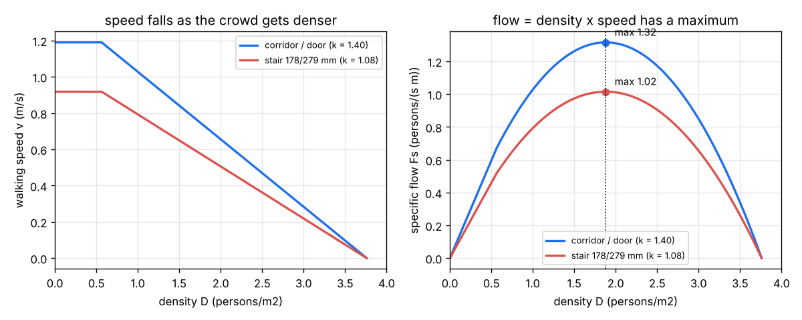
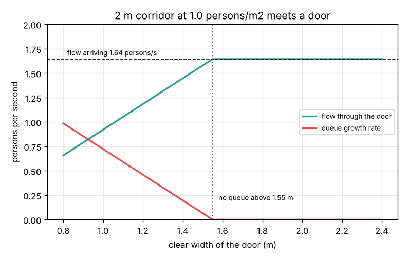

# Session 2: Speed, density and the bottleneck

*Level 2 (mathematical engineering model) · about 75 minutes · openevacuation*

> This is a simplified educational model. It is not a validated design tool and must not be used for real structures, electrical installations, vehicles, industrial processes or medical decisions. Real buildings must follow the fire code (in India, the National Building Code, Part 4: Fire and Life Safety) and be checked by a qualified fire engineer.

**Prerequisites**

- Session 1: flow = density x speed x width, effective width, evacuation time.
- Straight lines y = m x + c and the top of a downward parabola; explained in Section B.

**Learning objectives.** After this session you can:

- Use the linear speed-density law v = k (1 - a D) on corridors, doors and stairs.
- Derive the largest specific flow k / (4a) and the density at which it happens.
- Explain why a crowd that is too dense moves fewer people per second, not more.
- Apply conservation of flow at a change of width to decide whether a queue forms and how fast it grows.

## A. Real-world problem
Students leave a lecture block along a 2 m wide corridor. Its end is a 1.2 m door into the stair. Will a queue form at that door? How fast will it grow, and what width of door would avoid it? And why do announcements say "do not push"? If everyone squeezes closer, surely more people get through? (Simplified hydraulic model of crowd movement; not a design method.)

## B. Concept and theory
Measurements of real crowds (Fruin, Pauls, Predtechenskii and Milinskii, collected in the SFPE Handbook of Fire Protection Engineering) show that walking speed falls roughly in a straight line as the crowd gets denser: v = k (1 - a D) with a = 0.266 m2/person. On level ground, in corridors and through doors k = 1.40 m/s. In a thin crowd (below about 0.55 persons/m2) people are not slowed by others and walk at a free speed of 0.85 k = 1.19 m/s. At D = 1 / a = 3.8 persons/m2 the crowd is jammed. The specific flow Fs = D v = k D (1 - a D) is a downward parabola: zero when the corridor is empty (no people) and zero when it is jammed (no speed). Its top is half way, at D* = 1 / (2a) = 1.88 persons/m2, where Fs_max = k / (4a) = 1.32 persons/(s m): the 1.3 of Session 1. Above D* more crowding means less flow. On stairs people step tread by tread, so k is lower and depends on the steps; for the common 178 mm riser and 279 mm tread k = 1.08 m/s (speed along the slope) and Fs_max = 1.02 persons/(s m). People are neither created nor lost where a corridor meets a door, so the flow in equals the flow out: Fs_in We_in = Fs_out We_out. If this asks the narrower passage for more than its Fs_max, it cannot carry it: a queue forms, the passage runs at its maximum flow, and the queue grows at the difference.

| Symbol | Meaning | Unit |
|---|---|---|
| v | walking speed | m/s |
| D | crowd density | persons/m2 |
| k | speed constant: 1.40 level, 1.00 to 1.23 stairs | m/s |
| a | slope of the speed-density law, 0.266 | m2/person |
| Fs | specific flow D v | persons/(s m) |
| D* | density of maximum flow, 1 / (2a) | persons/m2 |
| We | effective width: clear width minus 0.15 m (doors, stairs) or 0.20 m (corridor walls) at each side | m |
| F | total flow Fs We | persons/s |

**Assumptions**

- The crowd is uniform across the width and moves in one direction.
- The speed-density law is the linear handbook fit; real data scatter around it by 20 percent or more.
- Stair speed is measured along the slope of the stair.
- Edge strips: 0.15 m for doors and stair walls, 0.20 m for corridor walls (handbook values).

$$ v = k\,(1 - a D),\qquad a = 0.266\ \mathrm{m^2/person} $$

$$ F_s = D\,v = k D (1 - a D) $$

$$ D^{*} = \frac{1}{2a},\qquad F_{s,\max} = \frac{k}{4a} $$

$$ F_{s,\mathrm{in}}\,W_{e,\mathrm{in}} = F_{s,\mathrm{out}}\,W_{e,\mathrm{out}} \quad\text{(if } F_{s,\mathrm{out}} \le F_{s,\max}\text{, otherwise a queue grows at } F_{\mathrm{in}} - F_{\max}) $$

## C. Visual explanation
The first figure shows the speed-density law on the left and the flow it implies on the right, for level ground and a stair. Speed falls in a straight line from the free speed to zero at 3.8 persons/m2. Flow rises, peaks at 1.88 persons/m2 and falls again: 1.32 persons/(s m) at best on the level and 1.02 on the stair. The second figure takes a 2 m corridor carrying a crowd at 1.0 persons/m2 (1.64 persons/s) into a door. Below a clear width of 1.55 m the door cannot pass everyone and the queue grows (red); above it the queue disappears and the door passes all 1.64 persons/s.

*Speed against density (left) and specific flow against density (right) for level ground and a stair; the flow has a maximum at 1.88 persons/m2.*

*A 2 m corridor carrying 1.64 persons/s meets a door: flow through the door and queue growth rate against door width.*

## D. Interactive simulation
Run the lesson (`python start.py 2`), then open the live app: [Session 2: speed, density and the bottleneck](https://krunalpanchal1995.github.io/pan-iit-oss/openevacuation/session-02/) (or `app.html` in this folder). Move the crowd density and watch the point travel along the speed and flow curves; switch to a stair to see both curves drop. Then open the corridor-to-door view and change the corridor width and the door width to see when a queue forms.

**Challenge.** Find the narrowest door (in steps of 0.05 m) that takes a 2.4 m corridor at 1.2 persons/m2 without a queue.

## E. Worked example and experiment
**Problem.** A 2.0 m wide corridor carries a crowd at a density of 1.0 persons/m2 towards a 1.2 m door. Find the walking speed, the flow arriving, the largest flow the door can pass, and how fast the queue grows.

1. Speed: v = 1.40 x (1 - 0.266 x 1.0) = 1.40 x 0.734 = 1.028 m/s.
2. Specific flow in the corridor: Fs = D v = 1.0 x 1.028 = 1.028 persons/(s m).
3. Effective corridor width: 2.0 - 2 x 0.20 = 1.6 m, so the flow arriving is 1.028 x 1.6 = 1.644 persons/s.
4. Door: We = 1.2 - 2 x 0.15 = 0.9 m and Fs_max = 1.40 / (4 x 0.266) = 1.316, so it passes at most 1.316 x 0.9 = 1.184 persons/s.
5. Conservation: 1.644 arrive but only 1.184 leave, so the queue grows at 1.644 - 1.184 = 0.460 persons/s, about 28 people per minute.

**Answer.** v = 1.03 m/s, 1.64 persons/s arrive, the door passes 1.18 persons/s and a queue grows at 0.46 persons/s. A door with We = 1.644 / 1.316 = 1.25 m (clear width 1.55 m) would avoid it.

**Experiment.** Mark a 2 m by 2 m square on the floor of a busy corridor with chalk or tape. Film it from above during a class change and count people inside the square (D = count / 4 m2) and the time each person takes to cross it (v = 2 m / time). Plot your points on the speed-density figure. Real points scatter around the line; that scatter is why codes use cautious values.

## F. Assessment and design challenge
**Question type A: Conceptual.** Why does pushing into a crowded doorway reduce the number of people who get through each second?

Hint

Look at the right half of the flow curve, above 1.88 persons/m2.

Step-by-step solution

Flow is density times speed. Up to 1.88 persons/m2 more people per square metre wins: the flow rises. Above it the speed falls faster than the density rises, so the product falls; at 3.8 persons/m2 nobody moves. Pushing raises the density above the best value, so fewer people pass per second, and it adds the danger of falls and crushing. Calm, steady movement at a moderate density gives the most flow.

**Question type B: Numerical.** Find the walking speed and the specific flow at D = 2.5 persons/m2 on level ground, and on a stair with k = 1.08 m/s. Compare with the maxima.

Hint

1 - 0.266 x 2.5 = 0.335.

Step-by-step solution

Level: v = 1.40 x 0.335 = 0.469 m/s, Fs = 2.5 x 0.469 = 1.17 persons/(s m), below the maximum 1.32. Stair: v = 1.08 x 0.335 = 0.362 m/s, Fs = 0.905 persons/(s m), below its maximum 1.02. Both are on the falling, congested side of the curve.

**Question type C: Graph and simulation interpretation.** On the flow curve, the same specific flow of 1.0 persons/(s m) appears at two densities. Find both and explain which one a corridor has before and after a bottleneck.

Hint

Solve 1.40 D (1 - 0.266 D) = 1.0, a quadratic in D.

Step-by-step solution

0.3724 D^2 - 1.40 D + 1.0 = 0 gives D = (1.40 -/+ sqrt(1.96 - 1.4896)) / 0.7448 = (1.40 -/+ 0.686) / 0.7448, so D = 0.96 or 2.80 persons/m2. Upstream of a bottleneck, in the queue, the crowd is dense and slow (2.80, the congested side). After it, the same flow spreads out and moves freely (0.96, the free side). This is the same as traffic before and after a narrowing of a road.

**Question type D: Design and optimisation challenge.** Design: a 2.4 m corridor will carry a crowd at 1.2 persons/m2 into a stair of steps 178/279 mm. What is the narrowest clear stair width that avoids a queue at the top of the stair? Compare with the door width that would be enough on level ground.

Hint

Flow in = Fs(1.2) x (2.4 - 0.4). The stair can take at most 1.015 x We.

Step-by-step solution

v = 1.40 x (1 - 0.319) = 0.953 m/s, Fs = 1.144, We = 2.0 m, so 2.29 persons/s arrive. Stair: We needed = 2.29 / 1.015 = 2.25 m, clear width 2.25 + 0.30 = 2.55 m. A level door would need 2.29 / 1.316 = 1.74 m effective, 2.04 m clear. The stair needs about 0.5 m more because people are slower on steps. Trade-off: a wide stair costs floor area on every storey; designers often accept a short queue at the stair door instead, as long as the total evacuation time is safe (Session 3).

Score yourself with [RUBRIC.md](../../RUBRIC.md). Print the [activity sheet](activity_sheet.md) to work on paper.

## Common misconceptions
| Common misconception | What is actually true |
|---|---|
| Packing people closer always increases the flow. | Flow peaks at about 1.9 persons/m2; denser crowds move fewer people per second. |
| A stair as wide as the corridor carries the same flow. | Stairs are slower: their maximum flow per metre is about 25 percent lower. |
| A queue means the corridor is too narrow. | A queue forms at the narrowest passage downstream; the corridor may be fine. |
| Speed-density numbers are exact laws. | They are fits to scattered measurements; culture, age, purpose and stress change them. |

## Glossary
- **speed-density law**: the straight-line fit v = k (1 - a D) for crowd walking speed
- **fundamental diagram**: the curve of flow against density, with its maximum
- **jam density**: the density at which the crowd stops, about 3.8 persons/m2 here
- **conservation of flow**: people are not created or lost, so flow in = flow out (+ queue growth)
- **congested side**: densities above the maximum-flow density, where more crowding means less flow

## Finish
1. Do the three coding tasks in [exercises.md](exercises.md).
2. Run `python start.py 2` again after your changes. It ends with the checkpoint; when it prints `PASS`, you are done. (Checkpoint only: `python start.py check 2`.)

Next: [Session 3](../session-03/README.md)
