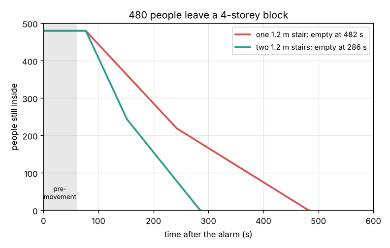
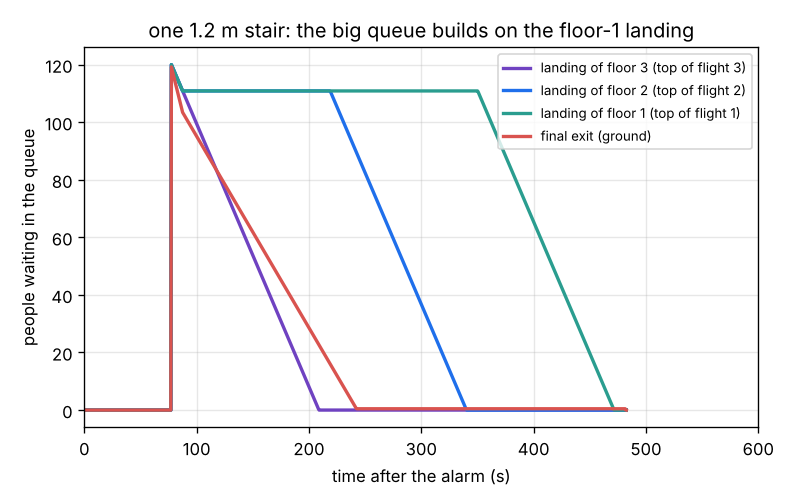
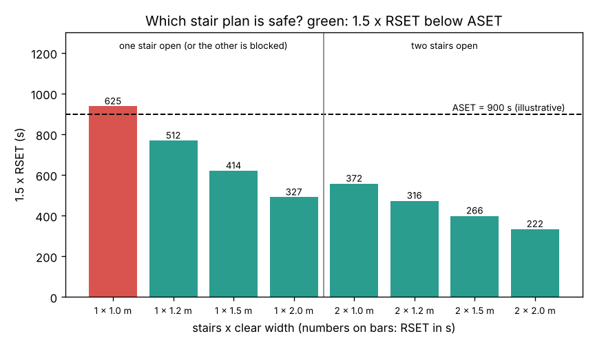

# Session 3: Simulate a building evacuation and plan it safely

*Level 3 (simulation and validation) · about 90 minutes · openevacuation*

> This is a simplified educational model. It is not a validated design tool and must not be used for real structures, electrical installations, vehicles, industrial processes or medical decisions. Real buildings must follow the fire code (in India, the National Building Code, Part 4: Fire and Life Safety) and be checked by a qualified fire engineer.

**Prerequisites**

- Session 1: evacuation time = pre-movement + walking + queueing.
- Session 2: maximum flow k / (4a), stairs, conservation of flow and queues.
- The idea of a time step (moving a clock forward in small pieces); explained in Section B.

**Learning objectives.** After this session you can:

- Describe a building as a network of links (doors, stair flights) with a capacity and a travel time.
- Step a queue-and-flow simulation forward in time and find where queues form.
- Validate the simulation: the Session 1 limit, conservation of people, a bottleneck bound and time-step convergence.
- Compare RSET with ASET using a safety factor and choose the number and width of stairs, including the case of a blocked stair.

## A. Real-world problem
A college block has a ground floor and three upper floors with 120 people on each, 480 in all. Everyone above the ground floor must use the stairs. How long does the block take to empty, where do the queues form, and how many stairs of what width are needed so that everyone is out well before smoke makes the stairs unsafe, even if smoke blocks one stair? (A simplified teaching model, not a design tool.)

## B. Concept and theory
Every door and every stair flight (one storey of stair) is a **link** with a **capacity** C (the largest flow, Fs_max x We from Session 2), a **travel time** tau (length divided by the free walking speed) and a **next** link. Each link has a queue at its entrance. The simulation moves a clock forward in steps of dt = 0.5 s. In each step at most C dt people leave the queue of a link; they walk for tau seconds and then join the queue of the next link, or reach the outside. Upper-floor people pass through their stair door onto the stair; the people coming down from above join the same queue, so the floors **merge**. Ground-floor people go straight to the final exit, which also takes everyone off the stair. A simulation is only useful once it is **validated**: (1) one room with one door must give the Session 1 formula; (2) no person is lost or created; (3) everyone above the ground floor must pass the lowest stair flight, so the evacuation cannot be faster than t_bound = t_pre + L / v + (floors x n) / C_stair + tau_stair; (4) a smaller time step must give nearly the same answer. Safety is judged by two times. **RSET** (required safe escape time) = detection + pre-movement + movement. **ASET** (available safe escape time) is how long until smoke or heat make the route untenable; it comes from a fire model and is given here. A plan is acceptable here when 1.5 x RSET <= ASET, both with all stairs open and with one stair blocked.

| Symbol | Meaning | Unit |
|---|---|---|
| C | capacity of a link: Fs_max x We | persons/s |
| tau | travel time through a link | s |
| dt | simulation time step | s |
| n | people per floor | persons |
| t_evac | time when the last person is outside | s |
| t_detect | time from the start of the fire to the alarm | s |
| RSET, ASET | required and available safe escape time | s |

**Assumptions**

- Everyone on a floor reacts after the same pre-movement time (60 s), walks 20 m at 1.19 m/s and queues at the stair door.
- Stairs: 178/279 mm steps, k = 1.08 m/s, 9 m of walking per flight (with landings) at the free speed 0.92 m/s.
- People choose the nearest stair; with several stairs each floor splits equally. Lifts are not used.
- Queues are first come, first served; merging floors share the stair without priority.
- ASET = 900 s, the detection time of 30 s and the safety factor of 1.5 are illustrative values, not code values.

$$ C = F_{s,\max}\,W_e = \frac{k}{4a}\,(W - 0.30\ \mathrm{m}),\qquad \tau = \frac{L}{0.85\,k} $$

$$ \text{each step: served} = \min(Q,\ C\,dt),\quad Q \leftarrow Q - \text{served} + \text{arrivals from upstream} $$

$$ t_{\mathrm{evac}} \ge t_{\mathrm{bound}} = t_{\mathrm{pre}} + \frac{L}{v} + \frac{n_{\mathrm{floors}}\,n}{C_{\mathrm{stair}}} + \tau_{\mathrm{stair}} $$

$$ \mathrm{RSET} = t_{\mathrm{detect}} + t_{\mathrm{evac}},\qquad \text{safe if } 1.5 \times \mathrm{RSET} \le \mathrm{ASET} $$

## C. Visual explanation
Figure 1 follows the 480 people in the block. With one 1.2 m stair the line of people inside falls steeply at first (the ground floor leaves through the exit) and then at the slow, steady rate of the stair, 0.91 persons/s, until 482.5 s. A second stair doubles the stair flow and the block is empty at 286 s. Figure 2 shows where people wait with one stair. All three upper floors queue on their landings at 77 s. The floor-3 landing drains at the stair capacity and clears at 208 s; the floor-2 landing stays full while floor-3 people keep arriving, then clears at 340 s. The longest wait is on the floor-1 landing, at the top of the lowest flight, which every upper-floor person must pass: it clears only at 472 s. Figure 3 is the plan: 1.5 x RSET for one stair (also the case of two stairs with one blocked) and two stairs, against ASET = 900 s.

*480 people leave a four-storey block with one or two 1.2 m stairs.*

*Queues with one 1.2 m stair: the longest wait is on the floor-1 landing, at the top of the lowest flight.*

*1.5 x RSET against ASET for one or two stairs of different widths; green designs are safe.*

## D. Interactive simulation
Run the lesson (`python start.py 3`), then open the live app: [Session 3: simulate a building evacuation](https://krunalpanchal1995.github.io/pan-iit-oss/openevacuation/session-03/) (or `app.html` in this folder). Move the time slider to watch people queue on each floor and stream down the stair. Change the number of floors, people per floor, stairs, stair width and pre-movement time, and read RSET against ASET. Tick "one stair blocked" to test the worst case.

**Challenge.** With 4 upper floors of 120 people and ASET = 900 s, find the fewest stairs and the narrowest width that stay safe (1.5 x RSET <= ASET) even with one stair blocked.

## E. Worked example and experiment
**Problem.** The block has 3 upper floors and a ground floor, 120 people each, one stair 1.2 m wide (178/279 mm steps, 9 m per flight), 1.2 m stair doors and a 1.5 m final exit. Pre-movement 60 s, corridor 20 m. Estimate the evacuation time by hand, compare with the simulation, and check the plan against ASET = 900 s.

1. Stair capacity: We = 1.2 - 0.3 = 0.9 m, Fs_max = 1.08 / (4 x 0.266) = 1.015, so C = 0.914 persons/s. The stair door (1.184 persons/s) and the exit (1.579 persons/s) are wider in flow, so the stair is the bottleneck.
2. First arrival at the stair: 60 + 20 / 1.19 = 76.8 s. Time for the 360 upper-floor people to pass the lowest flight: 360 / 0.914 = 394.1 s. Last person's walk down the flight: 9 / 0.918 = 9.8 s.
3. Hand bound: 76.8 + 394.1 + 9.8 = 480.7 s. The simulation gives 482.5 s, just above the bound (the stair is idle for a few seconds at the start while the first people walk down).
4. RSET = 30 + 482.5 = 512.5 s, and 1.5 x 512.5 = 769 s, below 900 s: safe with one 1.2 m stair, but no reserve if it is blocked.
5. Plan with two stairs: both open, RSET = 316 s; one blocked, everyone uses the other: RSET = 512 s, still safe. Two 1.0 m stairs fail the blocked case (RSET 625 s, 1.5 x 625 = 938 s > 900 s).

**Answer.** About 481 s by hand, 482.5 s simulated. Plan: two 1.2 m stairs (RSET 316 s, or 512 s with one blocked).

**Experiment.** During a planned fire drill (with your institution's permission), note the alarm time, the time the first person reaches each stair and the time the last person leaves the building. Compare with the model for your own building. Drills usually show longer pre-movement times and a wide spread of start times, which is one road to the Target.

## Real-world application and mini-project: Plan the stairs of a student hostel
A six-storey student hostel has a ground floor and five upper floors with 150 residents on each (900 in all). Use `stair_rset` and `plan_stairs` from Session 3 with the default corridor, stair flight and pre-movement values, a detection time of 30 s and an illustrative ASET of 1200 s with a safety factor of 1.5. The warden asks: how many stairs, how wide, and is the plan still safe at night if smoke fills one stair? These limits are illustrative numbers, not code requirements.

**Deliverable:** A script that prints RSET for one, two and three stairs of 1.0, 1.2, 1.5 and 2.0 m, picks the narrowest two-stair design that is safe with one stair blocked, and saves a bar chart of 1.5 x RSET against ASET.

**Success looks like:** Two 1.2 m stairs give RSET 529 s with both open but 939 s with one blocked (1.5 x 939 = 1409 s, unsafe); two 1.5 m stairs give 426 s and 734 s (1.5 x 734 = 1101 s, safe). The report explains that the blocked-stair case, not the normal case, sets the width.

## F. Assessment and design challenge
**Question type A: Conceptual.** With one stair, why do the people on the top floor not wait the longest, even though they are farthest from the exit?

Hint

Where do all upper-floor people have to pass, and who reaches it first?

Step-by-step solution

Nobody comes down to the top landing from above, so its queue drains at the full stair capacity from the start and is empty at 208 s. Every lower landing also receives people from the floors above, as fast as the flight below takes people away, so its queue stays flat until the floors above have emptied. The floor-1 landing, at the top of the lowest flight that everyone above the ground floor must pass, is the last to clear (472 s). In this simple model, without priority rules, people nearest the bottom wait the longest, and the total time is set by the bottleneck, not by the height. Real crowds merge differently (often close to taking turns), which changes who waits but not the total time through the bottleneck.

**Question type B: Numerical.** For the same block, find the hand bound with one 1.5 m stair, and the RSET. Is it safe for ASET = 900 s with the factor 1.5?

Hint

C = 1.015 x 1.2 persons/s.

Step-by-step solution

C = 1.015 x 1.2 = 1.218 persons/s. Bound: 76.8 + 360 / 1.218 + 9.8 = 76.8 + 295.6 + 9.8 = 382.2 s (simulation: 384 s with 1.5 m doors and a 1.8 m exit). RSET = 30 + 384 = 414 s, 1.5 x 414 = 621 s < 900 s: safe. Check: a wider stair gives a smaller time, and the queue part fell by the ratio of effective widths 0.9 / 1.2.

**Question type C: Graph and simulation interpretation.** In the queue figure, the stair-door queue on floor 2 stays flat at about 110 people from 90 s to 220 s and then falls in a straight line. Explain the flat part and the slope.

Hint

Who is using the stair while floor 2 waits?

Step-by-step solution

The landing queue holds both floor-2 people and floor-3 people who have walked down to it. While floor 3 is emptying, people arrive from above at 0.91 persons/s and the flight below takes 0.91 persons/s away, so the queue stays constant. When floor 3 has passed (about 210 s), nobody arrives from above and the queue drains at the stair capacity, about 0.91 persons/s (110 people in about 120 s), the straight line, until 340 s. The short drop from 120 to 111 at the start is the few seconds before the first floor-3 people arrive. Merging rules (who goes first on a landing) are a known weakness of simple models.

**Question type D: Design and optimisation challenge.** Design: the four-storey block (3 upper floors, 120 each) has ASET = 900 s. Using the safety factor 1.5, choose the number of stairs and the narrowest width (1.0, 1.2, 1.5 or 2.0 m) that is safe even with one stair blocked. Then say why a single 2.0 m stair, which is also "safe", is a poor plan.

Hint

Use plan_stairs(900) and compare stair_rset(1, w) for each width.

Step-by-step solution

RSET must be at most 600 s. Two 1.0 m stairs: one blocked gives 625 s: fails. Two 1.2 m stairs: 316 s both open, 512 s one blocked: safe. So two 1.2 m stairs. A single 2.0 m stair has RSET 327 s, but if smoke enters it there is no way out at all; fire codes require at least two independent escape routes from upper floors for that reason. Trade-off: two stairs cost more floor area, but they give a route that survives one failure.

Score yourself with [RUBRIC.md](../../RUBRIC.md). Print the [activity sheet](activity_sheet.md) to work on paper.

## Common misconceptions
| Common misconception | What is actually true |
|---|---|
| A simulation is right because it gives a number. | It must be validated: here against the Session 1 formula, conservation of people, a bottleneck bound and a smaller time step. |
| The top floor always takes the longest. | The queue at the bottleneck decides; floors merge on the stair and the lowest flight sets the pace. |
| If the evacuation time is below ASET, the building is safe. | A margin (safety factor) and the worst case (one route blocked, slow occupants, late alarm) must also be checked. |
| Lifts are part of the escape route. | Ordinary lifts must not be used in a fire; only specially protected evacuation lifts may be, and they are outside this model. |

## Glossary
- **network model**: a building described as linked doors, corridors and stair flights, each with a capacity and a travel time
- **merging**: people from a floor joining a stair already carrying people from above
- **RSET**: required safe escape time: detection + pre-movement + movement
- **ASET**: available safe escape time: time until conditions on the route become untenable
- **safety factor**: a multiplier on RSET that covers what the model leaves out

## Finish
1. Do the three coding tasks in [exercises.md](exercises.md).
2. Run `python start.py 3` again after your changes. It ends with the checkpoint; when it prints `PASS`, you are done. (Checkpoint only: `python start.py check 3`.)

Next: the [roadmap](../../promo/roadmap.md). Session 4 is yours to build.
