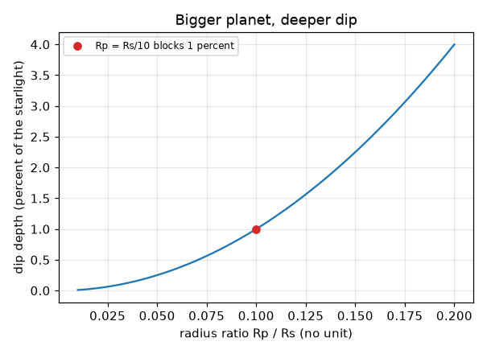
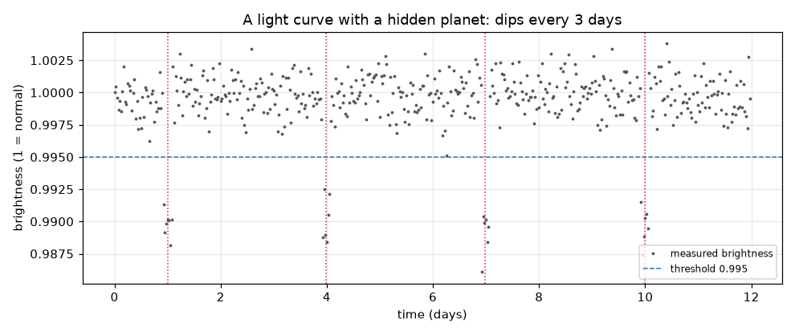

# सत्र 1: तारे के सामने आया ग्रह उसे मद्धम कर देता है

*स्तर 1 (संकल्पनात्मक इंटरैक्टिव मॉडल) · लगभग 60 मिनट · openexoplanet*

> यह एक सरलीकृत शैक्षिक मॉडल है। यह कोई प्रमाणित डिज़ाइन टूल नहीं है और इसका उपयोग वास्तविक संरचनाओं, विद्युत स्थापनाओं, वाहनों, औद्योगिक प्रक्रियाओं या चिकित्सा निर्णयों के लिए नहीं किया जाना चाहिए।

**पूर्व-आवश्यकताएँ (Prerequisites)**

- वृत्त का क्षेत्रफल, और अनुपात (ratio) क्या होता है।
- आपने PRIMER.md पढ़ लिया है और `python start.py 1` एक बार चला लिया है।

**सीखने के उद्देश्य (Learning objectives)।** इस सत्र के बाद आप:

- समझा सकेंगे कि अपने तारे के सामने से गुज़रता ग्रह तारे के प्रकाश में गिरावट (dip) क्यों लाता है।
- ग्रह-से-तारा त्रिज्या अनुपात (radius ratio) से गिरावट की गहराई (depth) निकाल सकेंगे।
- शोर (noise) भरे चमक रिकॉर्ड में गिरावटें ढूँढ़ सकेंगे और उनकी दूरी से कक्षीय आवर्तकाल (orbital period) पढ़ सकेंगे।
- प्रकाश वक्र (light curve) पढ़ सकेंगे: समय के विरुद्ध चमक।

## A. वास्तविक दुनिया की समस्या
तारे इतने दूर हैं कि सबसे अच्छी दूरबीनें भी उन्हें प्रकाश के एक बिंदु के रूप में देखती हैं, और तारे के पास का ग्रह उसकी चकाचौंध में खो जाता है। पर यदि ग्रह की कक्षा किनारे से (edge-on) दिखती है, तो ग्रह हर कक्षा में एक बार अपने तारे के सामने से गुज़रता है और थोड़ा प्रकाश रोक देता है। एक दूरबीन जो बार-बार तारे की चमक मापती है, एक छोटी, नियमित गिरावट देखती है। गिरावट कितनी गहरी है, कितनी बार दोहराई जाती है, और आप इसे यादृच्छिक शोर से कैसे अलग पहचानते हैं?

## B. संकल्पना और सिद्धांत
प्रकाश वक्र किसी तारे की चमक (1 = सामान्य) का समय के विरुद्ध ग्राफ़ है। पारगमन (transit) एक गिरावट है जो तब होती है जब ग्रह की काली चकती तारे की चमकती चकती के एक भाग को ढक लेती है। रोके गए प्रकाश का अंश तारे की चकती के ढके हुए अंश के बराबर होता है, जो दोनों चकतियों के क्षेत्रफलों का अनुपात है: (pi Rp^2) / (pi Rs^2) = (Rp/Rs)^2। ग्रह हर कक्षा में एक बार लौटता है, इसलिए पड़ोसी गिरावटों के केंद्रों के बीच का अंतर कक्षीय आवर्तकाल P है। वास्तविक माप शोर भरे होते हैं, इसलिए कोई बिंदु तभी गिरावट का भाग माना जाता है जब वह एक सीमा-मान (threshold) से नीचे हो, और हम लगातार कुछ निचले बिंदुओं की माँग करते हैं।

| प्रतीक | अर्थ | इकाई |
|---|---|---|
| Rp | ग्रह की त्रिज्या | km (कोई भी लंबाई इकाई) |
| Rs | तारे की त्रिज्या | Rp वाली ही इकाई |
| k = Rp/Rs | त्रिज्या अनुपात | कोई इकाई नहीं |
| depth | रोके गए तारे के प्रकाश का अंश | कोई इकाई नहीं (0.01 = 1 प्रतिशत) |
| P | कक्षीय आवर्तकाल = गिरावटों के बीच का समय | दिन |
| t | समय | दिन |

**मान्यताएँ (Assumptions)**

- ग्रह की कक्षा ठीक किनारे से दिखती है, इसलिए यह तारे के बीच से गुज़रता है।
- तारा समान रूप से चमकीला है (एक सपाट चकती); सत्र 2 इसे हटाता है।
- गिरावट तुरंत किनारों वाला एक सपाट तली का डिब्बा है (एक सरलीकरण)।
- शोर यादृच्छिक है और हर माप के लिए समान है।

$$ \text{depth}=\frac{\pi R_p^2}{\pi R_s^2}=\left(\frac{R_p}{R_s}\right)^2=k^2 $$

$$ t_n=t_0+nP\qquad\Rightarrow\qquad P=t_{n+1}-t_n $$

## C. दृश्य व्याख्या
पहला चित्र एक कृत्रिम (synthetic) प्रकाश वक्र है: 12 दिनों में 480 माप, जिनमें चार गिरावटें दिन 1, 4, 7 और 10 पर बिंदीदार रेखाओं से चिह्नित हैं, जो 3 दिन के अंतर पर हैं। डैश वाली रेखा सीमा-मान है। दूसरा चित्र त्रिज्या अनुपात k के विरुद्ध गहराई आलेखित करता है: एक वक्र जो ऊपर की ओर मुड़ता है, क्योंकि गहराई k के वर्ग के अनुसार चलती है। लाल बिंदु k = 0.1 को चिह्नित करता है, तारे की त्रिज्या के दसवें भाग वाला ग्रह, जो 1 प्रतिशत प्रकाश रोकता है।

*त्रिज्या अनुपात के विरुद्ध गहराई: तारे की त्रिज्या के दसवें भाग वाला ग्रह 1 प्रतिशत रोकता है।*

*एक कृत्रिम प्रकाश वक्र: तीन दिन के अंतर पर चार गिरावटें, डैश वाले सीमा-मान से नीचे पाई गईं।*

## D. इंटरैक्टिव सिमुलेशन
पाठ चलाइए (`python start.py 1`), फिर लाइव ऐप खोलिए: [सत्र 1: एक तारे को टिमटिमाते देखिए](https://krunalpanchal1995.github.io/pan-iit-oss/openexoplanet/session-01/) (या इसी फ़ोल्डर में `app.html`)। समय स्लाइडर खिसकाइए और चित्र में ग्रह को तारे के पार जाते देखिए जबकि एक लाल बिंदु ग्राफ़ पर चमक का अनुसरण करता है। फिर ग्रह का आकार और आवर्तकाल बदलिए।

**चुनौती।** गिरावटों को 1 प्रतिशत गहरा बनाइए और हर 4 दिन पर दोहराइए।

## E. हल किया गया उदाहरण और प्रयोग
**समस्या।** एक तारा 0.0025 (0.25 प्रतिशत) गिरता है और गिरावट के केंद्र दिन 2, 7 और 12 पर हैं। कक्षीय आवर्तकाल और ग्रह-से-तारा त्रिज्या अनुपात ज्ञात कीजिए।

1. गिरावट केंद्रों के बीच अंतर: 7 - 2 = 5 दिन और 12 - 7 = 5 दिन, इसलिए P = 5 दिन।
2. depth = k^2 = 0.0025, इसलिए k = sqrt(0.0025) = 0.05।
3. जाँच: तारे की त्रिज्या के 5 प्रतिशत वाला ग्रह उसकी चकती का 0.05 x 0.05 = 0.0025 भाग ढकता है।

**उत्तर।** आवर्तकाल 5 दिन; त्रिज्या अनुपात Rp/Rs = 0.05।

**प्रयोग।** एक सिक्के (ग्रह) को एक छोटे लैंप बल्ब (तारा) के कुछ सेंटीमीटर सामने पकड़िए, जो स्थिर एक्सपोज़र पर सेट फ़ोन कैमरे से एक मीटर दूर हो, और सिक्के को उसके पार खिसकाइए; चित्र की चमक में आई गिरावट की तुलना बल्ब के ढके हुए अंश से कीजिए। केवल मोटे मेल की अपेक्षा कीजिए: असली बल्ब सपाट चकती नहीं है, सिक्का तारे पर नहीं है, और कैमरे का अपना शोर है। मॉडल सपाट चकतियों के लिए सटीक है; असली तारे और कैमरे सपाट या शोर-रहित नहीं होते।

## F. मूल्यांकन और डिज़ाइन चुनौती
**प्रश्न प्रकार A: संकल्पनात्मक।** पारगमन केवल कुछ ग्रहों के लिए ही क्यों होता है? किसी ग्रह के बारे में निश्चित होने के लिए खगोलविदों को किसी तारे को एक कक्षा से अधिक समय तक क्यों देखना पड़ता है?

संकेत

कक्षा के झुकाव के बारे में सोचिए, और इस बारे में कि अकेली एक गिरावट आपको क्या बता सकती है और क्या नहीं।

चरण-दर-चरण हल

पारगमन के लिए कक्षा का लगभग किनारे से दिखना ज़रूरी है; अधिकांश कक्षाओं में ग्रह तारे के ऊपर या नीचे से गुज़रता है और कोई गिरावट नहीं होती। एक गिरावट कोई गड़बड़ी, ज्वाला (flare), धब्बा या शोर हो सकती है; समान गहराई और समान अंतर वाली दो या अधिक गिरावटें एक आवर्तकाल देती हैं और इसका ठोस प्रमाण देती हैं कि कोई ग्रह अपना गुज़रना दोहराता है।

**प्रश्न प्रकार B: संख्यात्मक।** एक ग्रह की त्रिज्या उसके तारे की आधी है। वह प्रकाश का कितना अंश रोकता है? क्या यह किसी ग्रह के लिए यथार्थवादी है?

संकेत

depth = k^2 जहाँ k = 0.5।

चरण-दर-चरण हल

depth = 0.5^2 = 0.25, इसलिए 25 प्रतिशत प्रकाश। यह सूर्य जैसे तारे के आसपास किसी भी वास्तविक ग्रह से कहीं अधिक है: बृहस्पति भी केवल लगभग 1 प्रतिशत रोकता है। इतनी गहरी गिरावट अधिक संभावना से एक दूसरा तारा (एक द्वितारा, binary) होगी।

**प्रश्न प्रकार C: ग्राफ़ और सिमुलेशन की व्याख्या।** स्लाइडर ऐप में ग्राफ़ 3 दिन के आवर्तकाल वाली गिरावटें दिखाता है। आप ग्रह का आकार वही रखते हुए आवर्तकाल 6 दिन कर देते हैं। ग्राफ़ पर क्या बदलता है, और क्या वही रहता है?

संकेत

गिरावटों की गहराई और उनके अंतर की तुलना कीजिए।

चरण-दर-चरण हल

गिरावटें दोगुनी दूरी पर हो जाती हैं (6 दिन) और 12 दिनों में कम समाती हैं (चार के बजाय दो); उनकी गहराई नहीं बदलती क्योंकि ग्रह का आकार नहीं बदला। गहराई केवल k पर निर्भर करती है; अंतर केवल P पर निर्भर करता है।

**प्रश्न प्रकार D: डिज़ाइन और इष्टतमीकरण (optimisation) चुनौती।** डिज़ाइन: आप एक तारे को 12 दिनों तक देख सकते हैं। एक ग्रह का आवर्तकाल 5 दिन है। आप कम से कम कितनी गिरावटें देखेंगे, और वह सबसे लंबा आवर्तकाल क्या है जिसके लिए आपको दो गिरावटें दिखने की गारंटी है?

संकेत

गिरावटें P के अंतर पर हैं। पहली गिरावट को पहले P दिनों में कहीं भी खिसकाइए।

चरण-दर-चरण हल

12 दिनों में P = 5 दिन के साथ आप कम से कम 2 गिरावटें देखते हैं (और पहली कहाँ पड़ती है इस पर निर्भर करते हुए 3 तक)। दो गिरावटों के बारे में निश्चित होने के लिए, 12 दिन के अवलोकन में दो गिरावटें होनी चाहिए चाहे पहली कहीं भी पड़े: पहली गिरावट दिन P तक देर से हो सकती है, और दूसरी दिन 2P पर, इसलिए हमें 2P <= 12 चाहिए, यानी P <= 6 दिन। लंबे आवर्तकाल केवल एक गिरावट दिखा सकते हैं। समझौता (trade-off): अधिक समय तक देखने से लंबे आवर्तकाल मिलते हैं।

[RUBRIC.md](../../RUBRIC.md) से स्वयं को अंक दीजिए। कागज़ पर काम करने के लिए [गतिविधि पत्रक](activity_sheet.md) प्रिंट कीजिए।

## सामान्य भ्रांतियाँ (Common misconceptions)
| सामान्य भ्रांति | वास्तव में क्या सच है |
|---|---|
| पारगमन के समय हम ग्रह का चित्र देख सकते हैं। | हम केवल तारे को एक बिंदु के रूप में देखते हैं; ग्रह केवल चमक में एक छोटी गिरावट के रूप में दिखता है। |
| गहरी गिरावट का अर्थ है लंबी गिरावट। | गहराई ग्रह का आकार बताती है; गिरावट की अवधि कक्षा से तय होती है (सत्र 2)। |
| चमक में कोई भी गिरावट एक ग्रह है। | शोर, तारकीय धब्बे (starspots) और ग्रहणकारी द्वितारे (eclipsing binary stars) भी गिरावटें बनाते हैं; सत्र 3 दिखाता है कि इन्हें कैसे पहचानें। |
| तारे की आधी त्रिज्या वाला ग्रह आधा प्रकाश रोकता है। | यह चकती के क्षेत्रफल का अंश रोकता है, (1/2)^2 = 1/4, क्योंकि क्षेत्रफल त्रिज्या के वर्ग के अनुसार बढ़ता है। |

## शब्दावली (Glossary)
- **प्रकाश वक्र (light curve)**: समय के विरुद्ध किसी तारे की चमक का ग्राफ़
- **पारगमन (transit)**: किसी ग्रह का अपने तारे के सामने से गुज़रना
- **त्रिज्या अनुपात (radius ratio)**: ग्रह की त्रिज्या बटा तारे की त्रिज्या, k लिखा जाता है
- **गहराई (depth)**: पारगमन के दौरान रोके गए तारे के प्रकाश का अंश
- **सीमा-मान (threshold)**: एक चमक स्तर जिसके नीचे कोई बिंदु गिरावट का भाग माना जाता है

## समापन
1. [exercises.md](exercises.md) में दिए गए तीन कोडिंग कार्य कीजिए।
2. अपने बदलावों के बाद `python start.py 1` फिर से चलाइए। यह checkpoint के साथ समाप्त होता है; जब यह `PASS` छापे, तो आपका काम पूरा है। (केवल checkpoint: `python start.py check 1`।)

अगला: [सत्र 2](../session-02/README.md)
