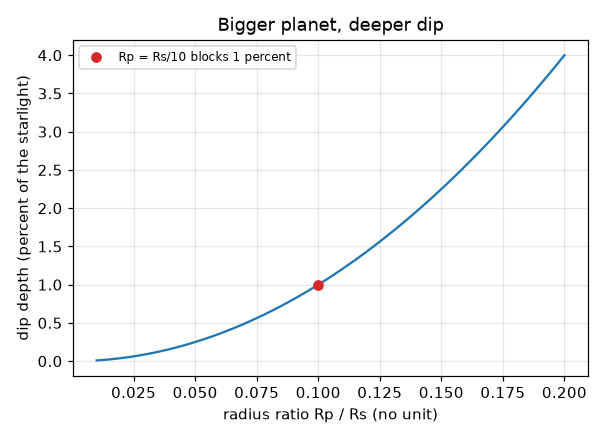
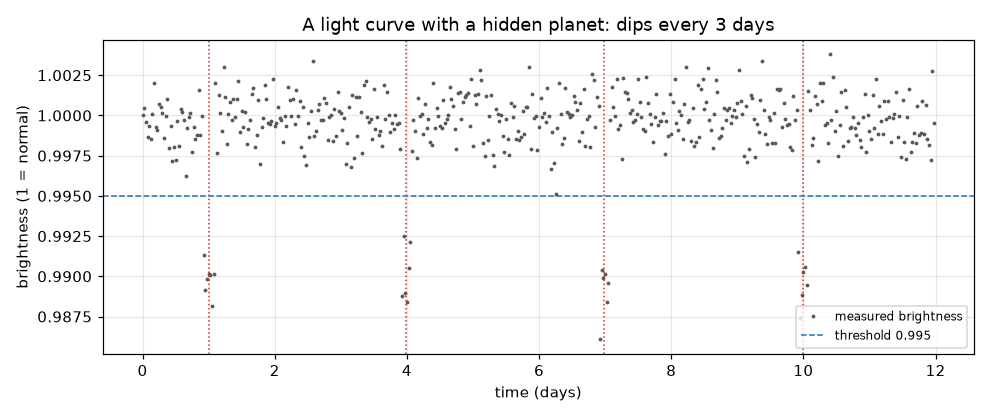

# സെഷൻ 1: ഒരു ഗ്രഹം നക്ഷത്രത്തിനു മുന്നിലൂടെ കടന്നുപോകുമ്പോൾ അതിന്റെ പ്രകാശം കുറയുന്നു

[Session 1 — हिन्दी](README.hi.md)

*ലെവൽ 1 (ആശയപരമായ ഇന്ററാക്ടീവ് മോഡൽ) · ഏകദേശം 60 മിനിറ്റ് · openexoplanet*

> ഇത് ലളിതമാക്കിയ ഒരു വിദ്യാഭ്യാസ മോഡലാണ്. ഇത് സാധൂകരിക്കപ്പെട്ട ഒരു ഡിസൈൻ ഉപകരണമല്ല; യഥാർത്ഥ നിർമ്മിതികൾ, വൈദ്യുത ഇൻസ്റ്റലേഷനുകൾ, വാഹനങ്ങൾ, വ്യാവസായിക പ്രക്രിയകൾ അല്ലെങ്കിൽ വൈദ്യശാസ്ത്രപരമായ തീരുമാനങ്ങൾ എന്നിവയ്ക്ക് ഇത് ഉപയോഗിക്കരുത്.

**മുൻ‌അറിവ് (Prerequisites)**

- വൃത്തത്തിന്റെ വിസ്തീർണ്ണം, അനുപാതം (ratio) എന്നാൽ എന്താണ്.
- നിങ്ങൾ PRIMER.md വായിക്കുകയും `python start.py 1` ഒരു തവണ റൺ ചെയ്യുകയും ചെയ്തിട്ടുണ്ട്.

**പഠന ലക്ഷ്യങ്ങൾ (Learning objectives).** ഈ സെഷനു ശേഷം നിങ്ങൾക്ക് കഴിയും:

- ഒരു ഗ്രഹം അതിന്റെ നക്ഷത്രത്തിനു മുന്നിലൂടെ കടന്നുപോകുമ്പോൾ നക്ഷത്രപ്രകാശം കുറയുന്നത് എന്തുകൊണ്ടെന്ന് വിശദീകരിക്കാൻ.
- ഗ്രഹ-നക്ഷത്ര ആരത്തിന്റെ അനുപാതത്തിൽ നിന്ന് ഈ കുറവ് എത്ര ആഴമുള്ളതാണെന്ന് കണക്കാക്കാൻ.
- ശബ്ദമുള്ള (noisy) തെളിച്ച രേഖയിൽ നിന്ന് കുറവുകൾ കണ്ടെത്താനും അവയുടെ അകലത്തിൽ നിന്ന് പരിക്രമണ കാലം വായിക്കാനും.
- ഒരു ലൈറ്റ് കർവ് (light curve) വായിക്കാൻ: സമയത്തിനെതിരെ തെളിച്ചം.

## A. യഥാർത്ഥ ലോക പ്രശ്നം
നക്ഷത്രങ്ങൾ വളരെ ദൂരെയായതിനാൽ ഏറ്റവും മികച്ച ടെലിസ്കോപ്പുകൾ പോലും അവയെ ഒറ്റ പ്രകാശബിന്ദുവായി കാണുന്നു, നക്ഷത്രത്തിനടുത്തുള്ള ഗ്രഹം അതിന്റെ പ്രഭയിൽ മറഞ്ഞുപോകുന്നു. പക്ഷേ ഗ്രഹത്തിന്റെ ഭ്രമണപഥം അരികിലൂടെ (edge-on) കാണുന്നുവെങ്കിൽ, ഗ്രഹം ഓരോ ചക്രത്തിലും ഒരിക്കൽ നക്ഷത്രത്തിന് മുന്നിലൂടെ കടന്നുപോകുകയും കുറച്ച് പ്രകാശം തടയുകയും ചെയ്യുന്നു. നക്ഷത്രത്തിന്റെ തെളിച്ചം വീണ്ടും വീണ്ടും അളക്കുന്ന ടെലിസ്കോപ്പ് ചെറിയ, ക്രമമായ ഒരു കുറവ് കാണുന്നു. കുറവ് എത്ര ആഴമുള്ളതാണ്, എത്ര തവണ ആവർത്തിക്കുന്നു, ക്രമരഹിതമായ ശബ്ദത്തിൽ നിന്ന് അതിനെ എങ്ങനെ തിരിച്ചറിയും?

## B. ആശയവും സിദ്ധാന്തവും
ലൈറ്റ് കർവ് എന്നത് ഒരു നക്ഷത്രത്തിന്റെ തെളിച്ചം (1 = സാധാരണ) സമയത്തിനെതിരെ കാണിക്കുന്ന ഗ്രാഫാണ്. ഒരു ഗ്രഹത്തിന്റെ ഇരുണ്ട തളിക നക്ഷത്രത്തിന്റെ തെളിഞ്ഞ തളികയുടെ ഒരു ഭാഗം മൂടുമ്പോൾ ഉണ്ടാകുന്ന കുറവാണ് ട്രാൻസിറ്റ് (transit). തടയപ്പെടുന്ന പ്രകാശത്തിന്റെ അംശം നക്ഷത്രത്തിന്റെ തളികയിൽ മൂടപ്പെടുന്ന അംശത്തിന് തുല്യമാണ്, അതായത് രണ്ട് തളികകളുടെ വിസ്തീർണ്ണങ്ങളുടെ അനുപാതം: (pi Rp^2) / (pi Rs^2) = (Rp/Rs)^2. ഗ്രഹം ഓരോ പരിക്രമണത്തിലും തിരിച്ചുവരുന്നു, അതിനാൽ അടുത്തടുത്ത കുറവുകളുടെ കേന്ദ്രങ്ങൾ തമ്മിലുള്ള അകലം പരിക്രമണ കാലം P ആണ്. യഥാർത്ഥ അളവുകളിൽ ശബ്ദമുണ്ട്, അതിനാൽ ഒരു ബിന്ദു ഒരു പരിധിക്ക് (threshold) താഴെയാണെങ്കിൽ മാത്രമേ ഒരു കുറവിന്റെ ഭാഗമായി കണക്കാക്കൂ, കൂടാതെ തുടർച്ചയായി കുറച്ച് താഴ്ന്ന ബിന്ദുക്കൾ വേണം.

| ചിഹ്നം | അർത്ഥം | യൂണിറ്റ് |
|---|---|---|
| Rp | ഗ്രഹത്തിന്റെ ആരം | km (ഏതെങ്കിലും നീളത്തിന്റെ യൂണിറ്റ്) |
| Rs | നക്ഷത്രത്തിന്റെ ആരം | Rp-യുടെ അതേ യൂണിറ്റ് |
| k = Rp/Rs | ആര അനുപാതം | യൂണിറ്റ് ഇല്ല |
| depth | തടയപ്പെടുന്ന നക്ഷത്രപ്രകാശത്തിന്റെ അംശം | യൂണിറ്റ് ഇല്ല (0.01 = 1 ശതമാനം) |
| P | പരിക്രമണ കാലം = കുറവുകൾ തമ്മിലുള്ള സമയം | ദിവസം |
| t | സമയം | ദിവസം |

**അനുമാനങ്ങൾ (Assumptions)**

- ഗ്രഹത്തിന്റെ ഭ്രമണപഥം കൃത്യമായി അരികിലൂടെ കാണുന്നു, അതിനാൽ അത് നക്ഷത്രത്തിന്റെ മധ്യത്തിലൂടെ കടന്നുപോകുന്നു.
- നക്ഷത്രം ഒരേപോലെ തെളിഞ്ഞതാണ് (പരന്ന തളിക); സെഷൻ 2 ഇത് ഒഴിവാക്കുന്നു.
- കുറവ് തൽക്ഷണ അരികുകളുള്ള പരന്ന അടിഭാഗമുള്ള ഒരു പെട്ടി ആകൃതിയാണ് (ലളിതവൽക്കരണം).
- ശബ്ദം ക്രമരഹിതമാണ്, ഓരോ അളവിനും ഒരുപോലെ.

$$ \text{depth}=\frac{\pi R_p^2}{\pi R_s^2}=\left(\frac{R_p}{R_s}\right)^2=k^2 $$

$$ t_n=t_0+nP\qquad\Rightarrow\qquad P=t_{n+1}-t_n $$

## C. ദൃശ്യ വിശദീകരണം
ആദ്യ ചിത്രം ഒരു കൃത്രിമ (synthetic) ലൈറ്റ് കർവ് ആണ്: 12 ദിവസത്തിൽ 480 അളവുകൾ, 1, 4, 7, 10 ദിവസങ്ങളിൽ കുത്തുവരകളാൽ അടയാളപ്പെടുത്തിയ നാല് കുറവുകൾ, അവ 3 ദിവസം അകലത്തിലാണ്. ഡാഷ് ചെയ്ത വര പരിധിയാണ് (threshold). രണ്ടാമത്തെ ചിത്രം ആര അനുപാതം k-യ്ക്കെതിരെ ആഴം വരയ്ക്കുന്നു: മുകളിലേക്ക് വളയുന്ന ഒരു വക്രം, കാരണം ആഴം k-യുടെ വർഗ്ഗത്തിന് അനുസൃതമാണ്. ചുവന്ന കുത്ത് k = 0.1 അടയാളപ്പെടുത്തുന്നു, നക്ഷത്രത്തിന്റെ ആരത്തിന്റെ പത്തിലൊന്ന് ആരമുള്ള ഗ്രഹം, അത് പ്രകാശത്തിന്റെ 1 ശതമാനം തടയുന്നു.

*ആര അനുപാതത്തിനെതിരെ ആഴം: നക്ഷത്രത്തിന്റെ ആരത്തിന്റെ പത്തിലൊന്ന് ആരമുള്ള ഗ്രഹം 1 ശതമാനം തടയുന്നു.*

*ഒരു കൃത്രിമ ലൈറ്റ് കർവ്: മൂന്ന് ദിവസം അകലത്തിലുള്ള നാല് കുറവുകൾ, ഡാഷ് ചെയ്ത പരിധിക്ക് താഴെ കണ്ടെത്തി.*

## D. ഇന്ററാക്ടീവ് സിമുലേഷൻ
പാഠം റൺ ചെയ്യുക (`python start.py 1`), തുടർന്ന് ലൈവ് ആപ്പ് തുറക്കുക: [സെഷൻ 1: ഒരു നക്ഷത്രം കണ്ണിമയ്ക്കുന്നത് കാണുക](https://krunalpanchal1995.github.io/pan-iit-oss/openexoplanet/session-01/) (അല്ലെങ്കിൽ ഈ ഫോൾഡറിലെ `app.html`). സമയ സ്ലൈഡർ നീക്കി ചിത്രത്തിൽ ഗ്രഹം നക്ഷത്രത്തെ കടന്നുപോകുന്നതും ഗ്രാഫിൽ ഒരു ചുവന്ന കുത്ത് തെളിച്ചത്തെ പിന്തുടരുന്നതും കാണുക. തുടർന്ന് ഗ്രഹത്തിന്റെ വലിപ്പവും പരിക്രമണ കാലവും മാറ്റുക.

**വെല്ലുവിളി.** കുറവുകൾ 1 ശതമാനം ആഴമുള്ളതും ഓരോ 4 ദിവസത്തിലും ആവർത്തിക്കുന്നതും ആക്കുക.

## E. പ്രവർത്തിച്ച ഉദാഹരണവും പരീക്ഷണവും
**പ്രശ്നം.** ഒരു നക്ഷത്രം 0.0025 (0.25 ശതമാനം) കുറയുന്നു, കുറവുകളുടെ കേന്ദ്രങ്ങൾ 2, 7, 12 ദിവസങ്ങളിൽ. പരിക്രമണ കാലവും ഗ്രഹ-നക്ഷത്ര ആര അനുപാതവും കണ്ടെത്തുക.

1. കുറവുകളുടെ കേന്ദ്രങ്ങൾ തമ്മിലുള്ള അകലം: 7 - 2 = 5 ദിവസം, 12 - 7 = 5 ദിവസം, അതിനാൽ P = 5 ദിവസം.
2. depth = k^2 = 0.0025, അതിനാൽ k = sqrt(0.0025) = 0.05.
3. പരിശോധന: നക്ഷത്രത്തിന്റെ ആരത്തിന്റെ 5 ശതമാനം ആരമുള്ള ഗ്രഹം അതിന്റെ തളികയുടെ 0.05 x 0.05 = 0.0025 മൂടുന്നു.

**ഉത്തരം.** പരിക്രമണ കാലം 5 ദിവസം; ആര അനുപാതം Rp/Rs = 0.05.

**പരീക്ഷണം.** ഒരു മീറ്റർ അകലെ സ്ഥിര എക്സ്പോഷറിൽ സജ്ജമാക്കിയ ഫോൺ ക്യാമറയ്ക്ക് മുന്നിൽ ഒരു ചെറിയ ലാമ്പ് ബൾബിന് (നക്ഷത്രം) ഏതാനും സെന്റിമീറ്റർ മുന്നിൽ ഒരു നാണയം (ഗ്രഹം) പിടിച്ച് അതിന് കുറുകെ നീക്കുക; ചിത്രത്തിന്റെ തെളിച്ചത്തിലെ കുറവിനെ ബൾബിൽ മൂടിയ അംശവുമായി താരതമ്യം ചെയ്യുക. ഏകദേശ പൊരുത്തം മാത്രം പ്രതീക്ഷിക്കുക: യഥാർത്ഥ ബൾബ് പരന്ന തളികയല്ല, നാണയം നക്ഷത്രത്തിലല്ല, ക്യാമറയ്ക്ക് സ്വന്തം ശബ്ദമുണ്ട്. പരന്ന തളികകൾക്ക് മോഡൽ കൃത്യമാണ്; യഥാർത്ഥ നക്ഷത്രങ്ങളും ക്യാമറകളും പരന്നതോ ശബ്ദരഹിതമോ അല്ല.

## F. മൂല്യനിർണ്ണയവും ഡിസൈൻ വെല്ലുവിളിയും
**ചോദ്യ തരം A: ആശയപരം.** ചില ഗ്രഹങ്ങൾക്ക് മാത്രം ട്രാൻസിറ്റ് സംഭവിക്കുന്നത് എന്തുകൊണ്ട്? ഒരു ഗ്രഹത്തെക്കുറിച്ച് ഉറപ്പാക്കാൻ ജ്യോതിശാസ്ത്രജ്ഞർ ഒരു പരിക്രമണത്തേക്കാൾ കൂടുതൽ കാലം നക്ഷത്രത്തെ നിരീക്ഷിക്കേണ്ടത് എന്തുകൊണ്ട്?

സൂചന

ഭ്രമണപഥത്തിന്റെ ചരിവിനെക്കുറിച്ചും ഒരൊറ്റ കുറവിന് എന്ത് പറയാൻ കഴിയും, കഴിയില്ല എന്നതിനെക്കുറിച്ചും ചിന്തിക്കുക.

ഘട്ടം ഘട്ടമായുള്ള പരിഹാരം

ട്രാൻസിറ്റിന് ഭ്രമണപഥം ഏതാണ്ട് അരികിലൂടെ കാണണം; മിക്ക ഭ്രമണപഥങ്ങൾക്കും ഗ്രഹം നക്ഷത്രത്തിന് മുകളിലൂടെയോ താഴെയോ കടന്നുപോകുന്നു, ഒന്നും കുറയുന്നില്ല. ഒരൊറ്റ കുറവ് ഒരു തകരാർ, ജ്വാല (flare), പുള്ളി (spot) അല്ലെങ്കിൽ ശബ്ദം ആകാം; ഒരേ ആഴവും തുല്യ അകലവുമുള്ള രണ്ടോ അതിലധികമോ കുറവുകൾ ഒരു പരിക്രമണ കാലവും ഗ്രഹം തന്റെ കടന്നുപോക്ക് ആവർത്തിക്കുന്നു എന്നതിന് ശക്തമായ തെളിവും നൽകുന്നു.

**ചോദ്യ തരം B: സംഖ്യാപരം.** ഒരു ഗ്രഹത്തിന് നക്ഷത്രത്തിന്റെ ആരത്തിന്റെ പകുതി ആരമുണ്ട്. അത് പ്രകാശത്തിന്റെ ഏത് അംശം തടയുന്നു? ഒരു ഗ്രഹത്തിന് ഇത് യാഥാർത്ഥ്യബോധമുള്ളതാണോ?

സൂചന

k = 0.5 ആയി depth = k^2.

ഘട്ടം ഘട്ടമായുള്ള പരിഹാരം

depth = 0.5^2 = 0.25, അതായത് പ്രകാശത്തിന്റെ 25 ശതമാനം. ഇത് സൂര്യസമാന നക്ഷത്രത്തിനു ചുറ്റുമുള്ള ഏതൊരു യഥാർത്ഥ ഗ്രഹത്തേക്കാളും വളരെ വലുതാണ്: വ്യാഴം പോലും ഏകദേശം 1 ശതമാനം മാത്രമേ തടയുന്നുള്ളൂ. അത്ര ആഴമുള്ള ഒരു കുറവ് ഒരു രണ്ടാം നക്ഷത്രം (ബൈനറി) ആകാനാണ് സാധ്യത.

**ചോദ്യ തരം C: ഗ്രാഫും സിമുലേഷനും വ്യാഖ്യാനിക്കൽ.** സ്ലൈഡർ ആപ്പിൽ ഗ്രാഫ് 3 ദിവസം പരിക്രമണ കാലമുള്ള കുറവുകൾ കാണിക്കുന്നു. ഗ്രഹത്തിന്റെ വലിപ്പം നിലനിർത്തി നിങ്ങൾ പരിക്രമണ കാലം 6 ദിവസമാക്കുന്നു. ഗ്രാഫിൽ എന്ത് മാറുന്നു, എന്ത് അതേപടി തുടരുന്നു?

സൂചന

കുറവുകളുടെ ആഴവും അകലവും താരതമ്യം ചെയ്യുക.

ഘട്ടം ഘട്ടമായുള്ള പരിഹാരം

കുറവുകൾ ഇരട്ടി അകലത്തിലാകുന്നു (6 ദിവസം), 12 ദിവസത്തിൽ കുറച്ചേ ഉൾക്കൊള്ളൂ (നാലിന് പകരം രണ്ട്); ഗ്രഹത്തിന്റെ വലിപ്പം മാറാത്തതിനാൽ അവയുടെ ആഴം മാറുന്നില്ല. ആഴം k-യെ മാത്രം ആശ്രയിക്കുന്നു; അകലം P-യെ മാത്രം ആശ്രയിക്കുന്നു.

**ചോദ്യ തരം D: ഡിസൈനും ഒപ്റ്റിമൈസേഷൻ വെല്ലുവിളിയും.** ഡിസൈൻ: നിങ്ങൾക്ക് 12 ദിവസം ഒരു നക്ഷത്രത്തെ നിരീക്ഷിക്കാം. ഒരു ഗ്രഹത്തിന്റെ പരിക്രമണ കാലം 5 ദിവസമാണ്. നിങ്ങൾ കാണുന്ന ഏറ്റവും കുറഞ്ഞ കുറവുകളുടെ എണ്ണം എത്ര, രണ്ട് കുറവുകൾ ഉറപ്പായും കാണാൻ കഴിയുന്ന ഏറ്റവും നീണ്ട പരിക്രമണ കാലം എത്ര?

സൂചന

കുറവുകൾ P അകലത്തിലാണ്. ആദ്യ കുറവിനെ ആദ്യ P ദിവസങ്ങളിൽ എവിടെയും നീക്കുക.

ഘട്ടം ഘട്ടമായുള്ള പരിഹാരം

12 ദിവസത്തിൽ P = 5 ദിവസത്തോടെ നിങ്ങൾ കുറഞ്ഞത് 2 കുറവുകൾ കാണും (ആദ്യത്തേത് എവിടെ വീഴുന്നു എന്നതനുസരിച്ച് 3 വരെ). രണ്ട് കുറവുകൾ ഉറപ്പാക്കാൻ, ആദ്യത്തേത് എവിടെ വീണാലും 12 ദിവസത്തെ നിരീക്ഷണത്തിൽ രണ്ട് കുറവുകൾ ഉണ്ടാകണം: ആദ്യ കുറവ് ദിവസം P വരെ വൈകി സംഭവിക്കാം, രണ്ടാമത്തേത് ദിവസം 2P-ൽ, അതിനാൽ 2P <= 12, അതായത് P <= 6 ദിവസം. നീണ്ട പരിക്രമണ കാലങ്ങളിൽ ഒരു കുറവ് മാത്രമേ കാണൂ. വിട്ടുവീഴ്ച (trade-off): കൂടുതൽ കാലം നിരീക്ഷിക്കുന്നത് നീണ്ട പരിക്രമണ കാലങ്ങൾ കണ്ടെത്തുന്നു.

[RUBRIC.md](../../RUBRIC.md) ഉപയോഗിച്ച് സ്വയം സ്കോർ ചെയ്യുക. പേപ്പറിൽ ചെയ്യാൻ [പ്രവർത്തന ഷീറ്റ്](activity_sheet.md) പ്രിന്റ് ചെയ്യുക.

## സാധാരണ തെറ്റിദ്ധാരണകൾ
| സാധാരണ തെറ്റിദ്ധാരണ | യഥാർത്ഥത്തിൽ ശരിയായത് |
|---|---|
| ട്രാൻസിറ്റ് ചെയ്യുമ്പോൾ നമുക്ക് ഗ്രഹത്തിന്റെ ചിത്രം കാണാം. | നാം നക്ഷത്രത്തെ ഒറ്റ ബിന്ദുവായി മാത്രമേ കാണുന്നുള്ളൂ; ഗ്രഹം തെളിച്ചത്തിലെ ചെറിയ കുറവായി മാത്രം പ്രത്യക്ഷപ്പെടുന്നു. |
| ആഴമുള്ള കുറവ് എന്നാൽ നീണ്ട കുറവ്. | ആഴം ഗ്രഹത്തിന്റെ വലിപ്പം പറയുന്നു; കുറവിന്റെ ദൈർഘ്യം നിശ്ചയിക്കുന്നത് ഭ്രമണപഥമാണ് (സെഷൻ 2). |
| തെളിച്ചത്തിലെ ഏതൊരു കുറവും ഒരു ഗ്രഹമാണ്. | ശബ്ദം, നക്ഷത്രപ്പുള്ളികൾ, ഗ്രഹണ ബൈനറി നക്ഷത്രങ്ങൾ എന്നിവയും കുറവുകൾ ഉണ്ടാക്കുന്നു; എങ്ങനെ വേർതിരിക്കാമെന്ന് സെഷൻ 3 കാണിക്കുന്നു. |
| നക്ഷത്രത്തിന്റെ പകുതി ആരമുള്ള ഗ്രഹം പകുതി പ്രകാശം തടയുന്നു. | അത് തളികയുടെ വിസ്തീർണ്ണത്തിന്റെ അംശം തടയുന്നു, (1/2)^2 = 1/4, കാരണം വിസ്തീർണ്ണം ആരത്തിന്റെ വർഗ്ഗമായി വളരുന്നു. |

## പദാവലി (Glossary)
- **ലൈറ്റ് കർവ് (light curve)**: സമയത്തിനെതിരെ ഒരു നക്ഷത്രത്തിന്റെ തെളിച്ചത്തിന്റെ ഗ്രാഫ്
- **ട്രാൻസിറ്റ് (transit)**: ഒരു ഗ്രഹം അതിന്റെ നക്ഷത്രത്തിന് മുന്നിലൂടെ കടന്നുപോകുന്നത്
- **ആര അനുപാതം (radius ratio)**: ഗ്രഹത്തിന്റെ ആരത്തെ നക്ഷത്രത്തിന്റെ ആരം കൊണ്ട് ഹരിച്ചത്, k എന്ന് എഴുതുന്നു
- **ആഴം (depth)**: ട്രാൻസിറ്റ് സമയത്ത് തടയപ്പെടുന്ന നക്ഷത്രപ്രകാശത്തിന്റെ അംശം
- **പരിധി (threshold)**: അതിന് താഴെയുള്ള ഒരു ബിന്ദു കുറവിന്റെ ഭാഗമായി കണക്കാക്കുന്ന തെളിച്ച നില

## പൂർത്തിയാക്കുക
1. [exercises.md](exercises.md)-ലെ മൂന്ന് കോഡിംഗ് ടാസ്കുകൾ ചെയ്യുക.
2. നിങ്ങളുടെ മാറ്റങ്ങൾക്ക് ശേഷം `python start.py 1` വീണ്ടും റൺ ചെയ്യുക. അത് ചെക്ക്‌പോയിന്റോടെ അവസാനിക്കുന്നു; അത് `PASS` പ്രിന്റ് ചെയ്യുമ്പോൾ, നിങ്ങൾ പൂർത്തിയാക്കി. (ചെക്ക്‌പോയിന്റ് മാത്രം: `python start.py check 1`.)

അടുത്തത്: [സെഷൻ 2](../session-02/README.md)
