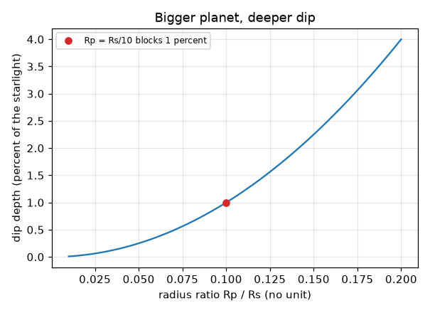
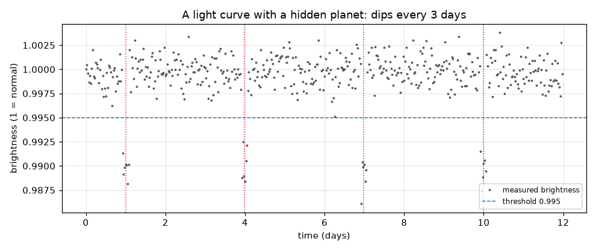

# அமர்வு 1: ஒரு கோள் நட்சத்திரத்தின் முன் கடக்கும்போது அதன் ஒளி மங்குகிறது

[Session 1 — हिन्दी](README.hi.md)

*நிலை 1 (கருத்தியல் ஊடாடும் மாதிரி) · சுமார் 60 நிமிடங்கள் · openexoplanet*

> இது எளிமைப்படுத்தப்பட்ட ஒரு கல்வி மாதிரி. இது சரிபார்க்கப்பட்ட வடிவமைப்புக் கருவி அல்ல; உண்மையான கட்டமைப்புகள், மின் நிறுவல்கள், வாகனங்கள், தொழில்துறை செயல்முறைகள் அல்லது மருத்துவ முடிவுகளுக்கு இதைப் பயன்படுத்தக் கூடாது.

**முன்தேவைகள் (Prerequisites)**

- வட்டத்தின் பரப்பளவு, விகிதம் (ratio) என்றால் என்ன.
- நீங்கள் PRIMER.md படித்து, `python start.py 1` ஐ ஒரு முறை இயக்கியிருக்க வேண்டும்.

**கற்றல் நோக்கங்கள் (Learning objectives).** இந்த அமர்வுக்குப் பிறகு நீங்கள்:

- ஒரு கோள் தன் நட்சத்திரத்தின் முன் கடக்கும்போது நட்சத்திர ஒளி மங்குவது ஏன் என்று விளக்க முடியும்.
- கோள்-நட்சத்திர ஆர விகிதத்திலிருந்து இந்த மங்கல் எவ்வளவு ஆழமானது என்று கணக்கிட முடியும்.
- இரைச்சலான (noisy) ஒளிர்வுப் பதிவில் மங்கல்களைக் கண்டறிந்து, அவற்றின் இடைவெளியிலிருந்து சுற்றுக் காலத்தைப் படிக்க முடியும்.
- ஒளி வளைவை (light curve) படிக்க முடியும்: நேரத்திற்கு எதிரான ஒளிர்வு.

## A. நிஜ உலகப் பிரச்சனை
நட்சத்திரங்கள் மிகத் தொலைவில் இருப்பதால் சிறந்த தொலைநோக்கிகளும் அவற்றை ஒற்றை ஒளிப் புள்ளிகளாகவே காண்கின்றன, நட்சத்திரத்தின் அருகிலுள்ள கோள் அதன் கண்ணைக் கூசும் ஒளியில் மறைந்துவிடுகிறது. ஆனால் கோளின் சுற்றுப்பாதை பக்கவாட்டில் (edge-on) தெரிந்தால், கோள் ஒவ்வொரு சுற்றிலும் ஒருமுறை நட்சத்திரத்தின் முன் கடந்து சிறிது ஒளியைத் தடுக்கிறது. நட்சத்திரத்தின் ஒளிர்வை மீண்டும் மீண்டும் அளக்கும் தொலைநோக்கி ஒரு சிறிய, ஒழுங்கான மங்கலைக் காண்கிறது. மங்கல் எவ்வளவு ஆழமானது, எத்தனை முறை திரும்பத் திரும்ப வருகிறது, அதை எப்படி சீரற்ற இரைச்சலிலிருந்து வேறுபடுத்துவது?

## B. கருத்தும் கோட்பாடும்
ஒளி வளைவு என்பது ஒரு நட்சத்திரத்தின் ஒளிர்வை (1 = இயல்பு) நேரத்திற்கு எதிராகக் காட்டும் வரைபடம். ஒரு கோளின் இருண்ட வட்டத்தட்டு நட்சத்திரத்தின் ஒளிரும் வட்டத்தட்டின் ஒரு பகுதியை மறைக்கும்போது ஏற்படும் மங்கலே கடப்பு (transit). தடுக்கப்படும் ஒளியின் பின்னம், நட்சத்திர வட்டத்தட்டில் மூடப்படும் பின்னத்திற்குச் சமம், அதாவது இரண்டு வட்டத்தட்டுகளின் பரப்பளவு விகிதம்: (pi Rp^2) / (pi Rs^2) = (Rp/Rs)^2. கோள் ஒவ்வொரு சுற்றிலும் திரும்பி வருகிறது, எனவே அடுத்தடுத்த மங்கல்களின் மையங்களுக்கு இடையிலான இடைவெளி சுற்றுக் காலம் P. உண்மையான அளவீடுகளில் இரைச்சல் உண்டு, எனவே ஒரு புள்ளி ஒரு வாசலுக்குக் (threshold) கீழே இருந்தால் மட்டுமே மங்கலின் பகுதியாகக் கருதப்படும், மேலும் தொடர்ச்சியாகச் சில தாழ்ந்த புள்ளிகள் தேவை.

| குறியீடு | பொருள் | அலகு |
|---|---|---|
| Rp | கோளின் ஆரம் | km (எந்த நீள அலகும்) |
| Rs | நட்சத்திரத்தின் ஆரம் | Rp-ன் அதே அலகு |
| k = Rp/Rs | ஆர விகிதம் | அலகு இல்லை |
| depth | தடுக்கப்படும் நட்சத்திர ஒளியின் பின்னம் | அலகு இல்லை (0.01 = 1 சதவீதம்) |
| P | சுற்றுக் காலம் = மங்கல்களுக்கு இடையிலான நேரம் | நாட்கள் |
| t | நேரம் | நாட்கள் |

**அனுமானங்கள் (Assumptions)**

- கோளின் சுற்றுப்பாதை சரியாகப் பக்கவாட்டில் தெரிகிறது, எனவே அது நட்சத்திரத்தின் நடுவைக் கடக்கிறது.
- நட்சத்திரம் சீராக ஒளிர்கிறது (தட்டையான வட்டத்தட்டு); அமர்வு 2 இதை நீக்குகிறது.
- மங்கல் உடனடி விளிம்புகளுடன் தட்டையான அடிப்பகுதி கொண்ட பெட்டி வடிவம் (எளிமைப்படுத்தல்).
- இரைச்சல் சீரற்றது, ஒவ்வொரு அளவீட்டிற்கும் ஒரே அளவு.

$$ \text{depth}=\frac{\pi R_p^2}{\pi R_s^2}=\left(\frac{R_p}{R_s}\right)^2=k^2 $$

$$ t_n=t_0+nP\qquad\Rightarrow\qquad P=t_{n+1}-t_n $$

## C. காட்சி விளக்கம்
முதல் படம் ஒரு செயற்கை (synthetic) ஒளி வளைவு: 12 நாட்களில் 480 அளவீடுகள், 1, 4, 7, 10 ஆகிய நாட்களில் புள்ளிக்கோடுகளால் குறிக்கப்பட்ட நான்கு மங்கல்கள், அவை 3 நாட்கள் இடைவெளியில் உள்ளன. கோடிட்ட கோடு வாசல் (threshold). இரண்டாவது படம் ஆர விகிதம் k-க்கு எதிராக ஆழத்தை வரைகிறது: மேல்நோக்கி வளையும் வளைவு, ஏனெனில் ஆழம் k-ன் வர்க்கமாக உள்ளது. சிவப்புப் புள்ளி k = 0.1 ஐக் குறிக்கிறது, நட்சத்திரத்தின் ஆரத்தில் பத்தில் ஒரு பங்கு ஆரமுள்ள கோள், அது ஒளியின் 1 சதவீதத்தைத் தடுக்கிறது.

*ஆர விகிதத்திற்கு எதிரான ஆழம்: நட்சத்திரத்தின் ஆரத்தில் பத்தில் ஒரு பங்கு ஆரமுள்ள கோள் 1 சதவீதத்தைத் தடுக்கிறது.*

*ஒரு செயற்கை ஒளி வளைவு: மூன்று நாட்கள் இடைவெளியில் நான்கு மங்கல்கள், கோடிட்ட வாசலுக்குக் கீழே கண்டறியப்பட்டன.*

## D. ஊடாடும் உருவகப்படுத்தல்
பாடத்தை இயக்கவும் (`python start.py 1`), பிறகு நேரடிச் செயலியைத் திறக்கவும்: [அமர்வு 1: ஒரு நட்சத்திரம் கண் சிமிட்டுவதைப் பாருங்கள்](https://krunalpanchal1995.github.io/pan-iit-oss/openexoplanet/session-01/) (அல்லது இந்தக் கோப்புறையில் உள்ள `app.html`). நேர ஸ்லைடரை நகர்த்தி, படத்தில் கோள் நட்சத்திரத்தைக் கடப்பதையும், வரைபடத்தில் ஒரு சிவப்புப் புள்ளி ஒளிர்வைப் பின்தொடர்வதையும் பாருங்கள். பிறகு கோளின் அளவையும் சுற்றுக் காலத்தையும் மாற்றுங்கள்.

**சவால்.** மங்கல்களை 1 சதவீதம் ஆழமாகவும் ஒவ்வொரு 4 நாட்களுக்கும் திரும்பவும் வருமாறு அமையுங்கள்.

## E. தீர்க்கப்பட்ட உதாரணமும் சோதனையும்
**பிரச்சனை.** ஒரு நட்சத்திரம் 0.0025 (0.25 சதவீதம்) மங்குகிறது, மங்கல் மையங்கள் நாள் 2, 7, 12-ல். சுற்றுக் காலத்தையும் கோள்-நட்சத்திர ஆர விகிதத்தையும் கண்டறியுங்கள்.

1. மங்கல் மையங்களுக்கு இடையிலான இடைவெளிகள்: 7 - 2 = 5 நாட்கள் மற்றும் 12 - 7 = 5 நாட்கள், எனவே P = 5 நாட்கள்.
2. depth = k^2 = 0.0025, எனவே k = sqrt(0.0025) = 0.05.
3. சரிபார்ப்பு: நட்சத்திரத்தின் ஆரத்தில் 5 சதவீதம் ஆரமுள்ள கோள் அதன் வட்டத்தட்டில் 0.05 x 0.05 = 0.0025 ஐ மூடுகிறது.

**விடை.** சுற்றுக் காலம் 5 நாட்கள்; ஆர விகிதம் Rp/Rs = 0.05.

**சோதனை.** ஒரு மீட்டர் தொலைவில் நிலையான வெளிப்பாட்டில் (exposure) அமைத்த தொலைபேசிக் கேமராவிற்கு முன், ஒரு சிறிய விளக்குக் குமிழின் (நட்சத்திரம்) முன் சில சென்டிமீட்டர் தொலைவில் ஒரு நாணயத்தை (கோள்) பிடித்து அதன் குறுக்கே நகர்த்துங்கள்; படத்தின் ஒளிர்வில் ஏற்படும் வீழ்ச்சியை மூடப்பட்ட குமிழின் பின்னத்துடன் ஒப்பிடுங்கள். தோராயமான பொருத்தம் மட்டுமே எதிர்பார்க்கலாம்: உண்மையான குமிழ் தட்டையான வட்டத்தட்டு அல்ல, நாணயம் நட்சத்திரத்தில் இல்லை, கேமராவுக்குச் சொந்த இரைச்சல் உண்டு. தட்டையான வட்டத்தட்டுகளுக்கு மாதிரி துல்லியமானது; உண்மையான நட்சத்திரங்களும் கேமராக்களும் தட்டையானவையோ இரைச்சலற்றவையோ அல்ல.

## F. மதிப்பீடும் வடிவமைப்புச் சவாலும்
**கேள்வி வகை A: கருத்தியல்.** சில கோள்களுக்கு மட்டுமே கடப்பு ஏற்படுவது ஏன்? ஒரு கோளை உறுதிப்படுத்த வானியலாளர்கள் ஒரு சுற்றை விட நீண்ட நேரம் நட்சத்திரத்தைக் கவனிக்க வேண்டியது ஏன்?

குறிப்பு

சுற்றுப்பாதையின் சாய்வைப் பற்றியும், ஒரு மங்கல் மட்டும் எதைச் சொல்ல முடியும், முடியாது என்பதைப் பற்றியும் சிந்தியுங்கள்.

படிப்படியான தீர்வு

கடப்புக்குச் சுற்றுப்பாதை கிட்டத்தட்டப் பக்கவாட்டில் தெரிய வேண்டும்; பெரும்பாலான சுற்றுப்பாதைகளுக்குக் கோள் நட்சத்திரத்திற்கு மேலே அல்லது கீழே கடக்கிறது, எதுவும் மங்குவதில்லை. ஒரு மங்கல் ஒரு கோளாறு, சுடர்வெடிப்பு (flare), புள்ளி (spot) அல்லது இரைச்சலாக இருக்கலாம்; ஒரே ஆழமும் சம இடைவெளியும் கொண்ட இரண்டு அல்லது அதற்கு மேற்பட்ட மங்கல்கள் ஒரு சுற்றுக் காலத்தையும், கோள் தன் கடப்பை மீண்டும் செய்கிறது என்பதற்கான வலுவான சான்றையும் தருகின்றன.

**கேள்வி வகை B: எண்ணியல்.** ஒரு கோளுக்கு அதன் நட்சத்திரத்தின் ஆரத்தில் பாதி ஆரம் உள்ளது. அது ஒளியின் எந்தப் பின்னத்தைத் தடுக்கிறது? ஒரு கோளுக்கு இது நடைமுறைக்கு ஒத்ததா?

குறிப்பு

k = 0.5 உடன் depth = k^2.

படிப்படியான தீர்வு

depth = 0.5^2 = 0.25, அதாவது ஒளியின் 25 சதவீதம். இது சூரியனைப் போன்ற நட்சத்திரத்தைச் சுற்றும் எந்த உண்மையான கோளையும் விட மிகப் பெரியது: வியாழன் கூட சுமார் 1 சதவீதம் மட்டுமே தடுக்கிறது. அவ்வளவு ஆழமான மங்கல் இரண்டாவது நட்சத்திரமாக (இரட்டை நட்சத்திரம்) இருக்கவே வாய்ப்பு அதிகம்.

**கேள்வி வகை C: வரைபடம் மற்றும் உருவகப்படுத்தல் விளக்கம்.** ஸ்லைடர் செயலியில் வரைபடம் 3 நாட்கள் சுற்றுக் காலத்துடன் மங்கல்களைக் காட்டுகிறது. கோளின் அளவை மாற்றாமல் சுற்றுக் காலத்தை 6 நாட்களாக உயர்த்துகிறீர்கள். வரைபடத்தில் என்ன மாறுகிறது, என்ன அப்படியே இருக்கிறது?

குறிப்பு

மங்கல்களின் ஆழத்தையும் இடைவெளியையும் ஒப்பிடுங்கள்.

படிப்படியான தீர்வு

மங்கல்கள் இரு மடங்கு இடைவெளியில் வருகின்றன (6 நாட்கள்), 12 நாட்களில் குறைவாகவே அடங்கும் (நான்குக்குப் பதில் இரண்டு); கோளின் அளவு மாறாததால் அவற்றின் ஆழம் மாறாது. ஆழம் k-யை மட்டுமே சார்ந்தது; இடைவெளி P-யை மட்டுமே சார்ந்தது.

**கேள்வி வகை D: வடிவமைப்பு மற்றும் உகப்பாக்கச் சவால்.** வடிவமைப்பு: நீங்கள் ஒரு நட்சத்திரத்தை 12 நாட்கள் கவனிக்கலாம். ஒரு கோளின் சுற்றுக் காலம் 5 நாட்கள். நீங்கள் காணும் மிகக் குறைந்த மங்கல்களின் எண்ணிக்கை என்ன, இரண்டு மங்கல்களை உறுதியாகக் காண முடியும் மிக நீண்ட சுற்றுக் காலம் என்ன?

குறிப்பு

மங்கல்கள் P இடைவெளியில் உள்ளன. முதல் மங்கலை முதல் P நாட்களில் எங்கு வேண்டுமானாலும் நகர்த்துங்கள்.

படிப்படியான தீர்வு

12 நாட்களில் P = 5 நாட்களுடன் நீங்கள் குறைந்தது 2 மங்கல்களைக் காண்பீர்கள் (முதலாவது எங்கு விழுகிறது என்பதைப் பொறுத்து 3 வரை). இரண்டு மங்கல்களை உறுதிப்படுத்த, முதலாவது எங்கு விழுந்தாலும் 12 நாள் பதிவில் இரண்டு மங்கல்கள் இருக்க வேண்டும்: முதல் மங்கல் நாள் P வரை தாமதமாக நிகழலாம், இரண்டாவது நாள் 2P-ல், எனவே 2P <= 12, அதாவது P <= 6 நாட்கள். அதைவிட நீண்ட காலங்களில் ஒரே மங்கல் மட்டுமே தெரியலாம். சமரசம் (trade-off): நீண்ட நேரம் கவனிப்பது நீண்ட சுற்றுக் காலங்களைக் கண்டறிகிறது.

[RUBRIC.md](../../RUBRIC.md) மூலம் உங்களை மதிப்பிட்டுக் கொள்ளுங்கள். காகிதத்தில் செய்ய [செயல்பாட்டுத் தாள்](activity_sheet.md) அச்சிடுங்கள்.

## பொதுவான தவறான கருத்துகள்
| பொதுவான தவறான கருத்து | உண்மையில் சரியானது |
|---|---|
| கடப்பின்போது கோளின் படத்தைக் காணலாம். | நாம் நட்சத்திரத்தை ஒற்றைப் புள்ளியாக மட்டுமே காண்கிறோம்; கோள் ஒளிர்வில் ஒரு சிறிய மங்கலாக மட்டுமே தோன்றுகிறது. |
| ஆழமான மங்கல் என்றால் நீண்ட மங்கல். | ஆழம் கோளின் அளவைச் சொல்கிறது; மங்கலின் நீளத்தைச் சுற்றுப்பாதை தீர்மானிக்கிறது (அமர்வு 2). |
| ஒளிர்வில் எந்த மங்கலும் ஒரு கோள். | இரைச்சல், நட்சத்திரப் புள்ளிகள், கிரகண இரட்டை நட்சத்திரங்களும் மங்கல்களை உண்டாக்குகின்றன; எப்படி வேறுபடுத்துவது என்று அமர்வு 3 காட்டுகிறது. |
| நட்சத்திரத்தின் பாதி ஆரமுள்ள கோள் பாதி ஒளியைத் தடுக்கிறது. | அது வட்டத்தட்டுப் பரப்பளவின் பின்னத்தைத் தடுக்கிறது, (1/2)^2 = 1/4, ஏனெனில் பரப்பளவு ஆரத்தின் வர்க்கமாக வளர்கிறது. |

## சொற்களஞ்சியம் (Glossary)
- **ஒளி வளைவு (light curve)**: நேரத்திற்கு எதிராக ஒரு நட்சத்திரத்தின் ஒளிர்வின் வரைபடம்
- **கடப்பு (transit)**: ஒரு கோள் தன் நட்சத்திரத்தின் முன் கடப்பது
- **ஆர விகிதம் (radius ratio)**: கோளின் ஆரத்தை நட்சத்திரத்தின் ஆரத்தால் வகுத்தது, k என எழுதப்படுகிறது
- **ஆழம் (depth)**: கடப்பின்போது தடுக்கப்படும் நட்சத்திர ஒளியின் பின்னம்
- **வாசல் (threshold)**: அதற்குக் கீழே உள்ள புள்ளி மங்கலின் பகுதியாகக் கருதப்படும் ஒளிர்வு நிலை

## நிறைவு
1. [exercises.md](exercises.md) இல் உள்ள மூன்று நிரலாக்கப் பணிகளைச் செய்யுங்கள்.
2. உங்கள் மாற்றங்களுக்குப் பிறகு `python start.py 1` ஐ மீண்டும் இயக்குங்கள். அது சோதனைச் சாவடியுடன் (checkpoint) முடிகிறது; அது `PASS` என அச்சிடும்போது, நீங்கள் முடித்துவிட்டீர்கள். (சோதனைச் சாவடி மட்டும்: `python start.py check 1`.)

அடுத்து: [அமர்வு 2](../session-02/README.md)
