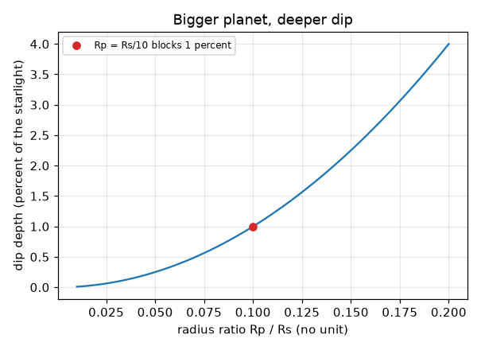
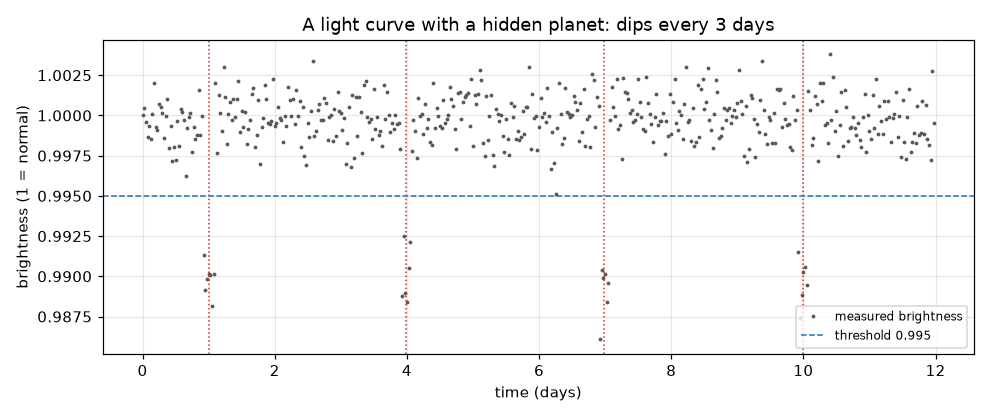

# సెషన్ 1: నక్షత్రం ముందు నుండి వెళ్ళే గ్రహం దాని కాంతిని తగ్గిస్తుంది

[Session 1 — हिन्दी](README.hi.md)

*స్థాయి 1 (భావనాత్మక ఇంటరాక్టివ్ మోడల్) · సుమారు 60 నిమిషాలు · openexoplanet*

> ఇది సరళీకరించిన విద్యా మోడల్. ఇది ధృవీకరించబడిన డిజైన్ సాధనం కాదు; నిజమైన నిర్మాణాలు, విద్యుత్ ఇన్‌స్టాలేషన్‌లు, వాహనాలు, పారిశ్రామిక ప్రక్రియలు లేదా వైద్య నిర్ణయాల కోసం దీనిని ఉపయోగించకూడదు.

**ముందస్తు అవసరాలు (Prerequisites)**

- వృత్తం వైశాల్యం, నిష్పత్తి (ratio) అంటే ఏమిటి.
- మీరు PRIMER.md చదివి, `python start.py 1` ను ఒకసారి రన్ చేసి ఉండాలి.

**అభ్యాస లక్ష్యాలు (Learning objectives).** ఈ సెషన్ తర్వాత మీరు:

- ఒక గ్రహం తన నక్షత్రం ముందు నుండి వెళ్ళినప్పుడు నక్షత్ర కాంతి ఎందుకు తగ్గుతుందో వివరించగలరు.
- గ్రహం-నక్షత్రం వ్యాసార్థ నిష్పత్తి నుండి ఆ తగ్గుదల ఎంత లోతుగా ఉంటుందో లెక్కించగలరు.
- శబ్దంతో కూడిన (noisy) ప్రకాశ రికార్డులో తగ్గుదలలను కనుగొని, వాటి మధ్య దూరం నుండి పరిభ్రమణ కాలాన్ని చదవగలరు.
- లైట్ కర్వ్ (light curve) చదవగలరు: కాలానికి వ్యతిరేకంగా ప్రకాశం.

## A. నిజ జీవిత సమస్య
నక్షత్రాలు చాలా దూరంలో ఉండటం వల్ల అత్యుత్తమ టెలిస్కోపులు కూడా వాటిని ఒకే కాంతి బిందువులుగా చూస్తాయి, నక్షత్రం పక్కన ఉన్న గ్రహం దాని మిరుమిట్లలో కలిసిపోతుంది. కానీ గ్రహం కక్ష్య పక్క నుండి (edge-on) కనిపిస్తే, గ్రహం ప్రతి పరిభ్రమణంలో ఒకసారి తన నక్షత్రం ముందు నుండి వెళ్ళి కొంచెం కాంతిని అడ్డుకుంటుంది. నక్షత్రం ప్రకాశాన్ని మళ్ళీ మళ్ళీ కొలిచే టెలిస్కోప్ ఒక చిన్న, క్రమబద్ధమైన తగ్గుదలను చూస్తుంది. ఆ తగ్గుదల ఎంత లోతుగా ఉంది, ఎంత తరచుగా పునరావృతమవుతుంది, యాదృచ్ఛిక శబ్దం నుండి దానిని ఎలా వేరు చేయాలి?

## B. భావన మరియు సిద్ధాంతం
లైట్ కర్వ్ అనేది ఒక నక్షత్రం ప్రకాశాన్ని (1 = సాధారణం) కాలానికి వ్యతిరేకంగా చూపే గ్రాఫ్. ఒక గ్రహం యొక్క చీకటి బిళ్ళ నక్షత్రం యొక్క ప్రకాశవంతమైన బిళ్ళలో కొంత భాగాన్ని కప్పినప్పుడు జరిగే తగ్గుదలే ట్రాన్సిట్ (transit). అడ్డుకోబడిన కాంతి భాగం, నక్షత్రం బిళ్ళలో కప్పబడిన భాగానికి సమానం, అంటే రెండు బిళ్ళల వైశాల్యాల నిష్పత్తి: (pi Rp^2) / (pi Rs^2) = (Rp/Rs)^2. గ్రహం ప్రతి పరిభ్రమణంలో తిరిగి వస్తుంది, కాబట్టి పక్కపక్కన ఉన్న తగ్గుదలల కేంద్రాల మధ్య ఖాళీ పరిభ్రమణ కాలం P. నిజమైన కొలతల్లో శబ్దం ఉంటుంది, కాబట్టి ఒక బిందువు ఒక పరిమితికి (threshold) కింద ఉంటేనే తగ్గుదలలో భాగంగా పరిగణించబడుతుంది, మరియు వరుసగా కొన్ని తక్కువ బిందువులు అవసరం.

| చిహ్నం | అర్థం | యూనిట్ |
|---|---|---|
| Rp | గ్రహం వ్యాసార్థం | km (ఏ పొడవు యూనిట్ అయినా) |
| Rs | నక్షత్రం వ్యాసార్థం | Rp కు సమాన యూనిట్ |
| k = Rp/Rs | వ్యాసార్థ నిష్పత్తి | యూనిట్ లేదు |
| depth | అడ్డుకోబడిన నక్షత్ర కాంతి భాగం | యూనిట్ లేదు (0.01 = 1 శాతం) |
| P | పరిభ్రమణ కాలం = తగ్గుదలల మధ్య సమయం | రోజులు |
| t | సమయం | రోజులు |

**ఊహలు (Assumptions)**

- గ్రహం కక్ష్య సరిగ్గా పక్క నుండి కనిపిస్తుంది, కాబట్టి అది నక్షత్రం మధ్యను దాటుతుంది.
- నక్షత్రం సమానంగా ప్రకాశిస్తుంది (చదునైన బిళ్ళ); సెషన్ 2 దీనిని తొలగిస్తుంది.
- తగ్గుదల తక్షణ అంచులతో చదునైన అడుగు గల పెట్టె ఆకారం (సరళీకరణ).
- శబ్దం యాదృచ్ఛికం, ప్రతి కొలతకూ సమానం.

$$ \text{depth}=\frac{\pi R_p^2}{\pi R_s^2}=\left(\frac{R_p}{R_s}\right)^2=k^2 $$

$$ t_n=t_0+nP\qquad\Rightarrow\qquad P=t_{n+1}-t_n $$

## C. దృశ్య వివరణ
మొదటి చిత్రం ఒక కృత్రిమ (synthetic) లైట్ కర్వ్: 12 రోజుల్లో 480 కొలతలు, 1, 4, 7, 10 రోజుల్లో చుక్కల రేఖలతో గుర్తించిన నాలుగు తగ్గుదలలు, అవి 3 రోజుల దూరంలో ఉన్నాయి. చుక్కల గీత పరిమితి (threshold). రెండవ చిత్రం వ్యాసార్థ నిష్పత్తి k కు వ్యతిరేకంగా లోతును గీస్తుంది: పైకి వంగే వక్రం, ఎందుకంటే లోతు k వర్గంగా ఉంటుంది. ఎరుపు చుక్క k = 0.1 ను గుర్తిస్తుంది, నక్షత్రం వ్యాసార్థంలో పదో వంతు గల గ్రహం, అది కాంతిలో 1 శాతాన్ని అడ్డుకుంటుంది.

*వ్యాసార్థ నిష్పత్తికి వ్యతిరేకంగా లోతు: నక్షత్రం వ్యాసార్థంలో పదో వంతు గల గ్రహం 1 శాతాన్ని అడ్డుకుంటుంది.*

*ఒక కృత్రిమ లైట్ కర్వ్: మూడు రోజుల దూరంలో నాలుగు తగ్గుదలలు, చుక్కల పరిమితి కింద కనుగొనబడ్డాయి.*

## D. ఇంటరాక్టివ్ సిమ్యులేషన్
పాఠాన్ని రన్ చేయండి (`python start.py 1`), తర్వాత లైవ్ యాప్‌ను తెరవండి: [సెషన్ 1: నక్షత్రం కన్ను గీటడం చూడండి](https://krunalpanchal1995.github.io/pan-iit-oss/openexoplanet/session-01/) (లేదా ఈ ఫోల్డర్‌లోని `app.html`). సమయ స్లయిడర్‌ను కదిలించి, చిత్రంలో గ్రహం నక్షత్రాన్ని దాటడం, గ్రాఫ్‌పై ఎరుపు చుక్క ప్రకాశాన్ని అనుసరించడం చూడండి. తర్వాత గ్రహం పరిమాణాన్ని మరియు పరిభ్రమణ కాలాన్ని మార్చండి.

**సవాలు.** తగ్గుదలలను 1 శాతం లోతుగా చేసి ప్రతి 4 రోజులకు పునరావృతమయ్యేలా చేయండి.

## E. సాధించిన ఉదాహరణ మరియు ప్రయోగం
**సమస్య.** ఒక నక్షత్రం 0.0025 (0.25 శాతం) తగ్గుతుంది, తగ్గుదల కేంద్రాలు 2, 7, 12 రోజుల్లో. పరిభ్రమణ కాలాన్ని మరియు గ్రహం-నక్షత్రం వ్యాసార్థ నిష్పత్తిని కనుగొనండి.

1. తగ్గుదల కేంద్రాల మధ్య ఖాళీలు: 7 - 2 = 5 రోజులు మరియు 12 - 7 = 5 రోజులు, కాబట్టి P = 5 రోజులు.
2. depth = k^2 = 0.0025, కాబట్టి k = sqrt(0.0025) = 0.05.
3. సరిచూపు: నక్షత్రం వ్యాసార్థంలో 5 శాతం గల గ్రహం దాని బిళ్ళలో 0.05 x 0.05 = 0.0025 ను కప్పుతుంది.

**సమాధానం.** పరిభ్రమణ కాలం 5 రోజులు; వ్యాసార్థ నిష్పత్తి Rp/Rs = 0.05.

**ప్రయోగం.** ఒక మీటరు దూరంలో స్థిర ఎక్స్‌పోజర్‌కు సెట్ చేసిన ఫోన్ కెమెరా ముందు, ఒక చిన్న దీపపు బల్బు (నక్షత్రం) ముందు కొన్ని సెంటీమీటర్ల దూరంలో ఒక నాణెం (గ్రహం) పట్టుకుని దాని మీదుగా జరపండి; చిత్రం ప్రకాశంలో తగ్గుదలను బల్బులో కప్పబడిన భాగంతో పోల్చండి. సుమారు సరిపోలిక మాత్రమే ఆశించండి: నిజమైన బల్బు చదునైన బిళ్ళ కాదు, నాణెం నక్షత్రం వద్ద లేదు, కెమెరాకు సొంత శబ్దం ఉంది. చదునైన బిళ్ళలకు మోడల్ ఖచ్చితమైనది; నిజమైన నక్షత్రాలు, కెమెరాలు చదునైనవి లేదా శబ్దరహితమైనవి కావు.

## F. మూల్యాంకనం మరియు డిజైన్ సవాలు
**ప్రశ్న రకం A: భావనాత్మక.** కొన్ని గ్రహాలకు మాత్రమే ట్రాన్సిట్ ఎందుకు జరుగుతుంది? ఒక గ్రహం గురించి ఖచ్చితంగా చెప్పడానికి ఖగోళ శాస్త్రవేత్తలు ఒక పరిభ్రమణం కంటే ఎక్కువ కాలం నక్షత్రాన్ని ఎందుకు గమనించాలి?

సూచన

కక్ష్య వాలు గురించి, మరియు ఒక్క తగ్గుదల ఏమి చెప్పగలదో, చెప్పలేదో ఆలోచించండి.

దశలవారీ పరిష్కారం

ట్రాన్సిట్‌కు కక్ష్య దాదాపు పక్క నుండి కనిపించాలి; చాలా కక్ష్యలకు గ్రహం నక్షత్రం పైనుంచి లేదా కిందనుంచి వెళ్తుంది, ఏదీ తగ్గదు. ఒక్క తగ్గుదల ఒక లోపం, జ్వాల (flare), మచ్చ (spot) లేదా శబ్దం కావచ్చు; అదే లోతు మరియు సమాన దూరం గల రెండు లేదా అంతకంటే ఎక్కువ తగ్గుదలలు ఒక పరిభ్రమణ కాలాన్ని మరియు గ్రహం తన ప్రయాణాన్ని పునరావృతం చేస్తుందనే బలమైన సాక్ష్యాన్ని ఇస్తాయి.

**ప్రశ్న రకం B: సంఖ్యాత్మక.** ఒక గ్రహానికి దాని నక్షత్రం వ్యాసార్థంలో సగం వ్యాసార్థం ఉంది. అది కాంతిలో ఎంత భాగాన్ని అడ్డుకుంటుంది? ఒక గ్రహానికి ఇది వాస్తవికమేనా?

సూచన

k = 0.5 తో depth = k^2.

దశలవారీ పరిష్కారం

depth = 0.5^2 = 0.25, అంటే కాంతిలో 25 శాతం. ఇది సూర్యుని వంటి నక్షత్రం చుట్టూ ఉన్న ఏ నిజమైన గ్రహం కంటే చాలా పెద్దది: గురుడు కూడా సుమారు 1 శాతం మాత్రమే అడ్డుకుంటాడు. అంత లోతైన తగ్గుదల రెండవ నక్షత్రం (ద్వంద్వ నక్షత్రం) అయ్యే అవకాశం ఎక్కువ.

**ప్రశ్న రకం C: గ్రాఫ్ మరియు సిమ్యులేషన్ వ్యాఖ్యానం.** స్లయిడర్ యాప్‌లో గ్రాఫ్ 3 రోజుల పరిభ్రమణ కాలంతో తగ్గుదలలను చూపుతుంది. గ్రహం పరిమాణాన్ని అలాగే ఉంచి మీరు పరిభ్రమణ కాలాన్ని 6 రోజులకు పెంచుతారు. గ్రాఫ్‌లో ఏది మారుతుంది, ఏది అలాగే ఉంటుంది?

సూచన

తగ్గుదలల లోతు మరియు దూరాన్ని పోల్చండి.

దశలవారీ పరిష్కారం

తగ్గుదలలు రెట్టింపు దూరంలో వస్తాయి (6 రోజులు), 12 రోజుల్లో తక్కువ ఇమడతాయి (నాలుగుకు బదులు రెండు); గ్రహం పరిమాణం మారలేదు కాబట్టి వాటి లోతు మారదు. లోతు k పైనే ఆధారపడుతుంది; దూరం P పైనే ఆధారపడుతుంది.

**ప్రశ్న రకం D: డిజైన్ మరియు ఆప్టిమైజేషన్ సవాలు.** డిజైన్: మీరు ఒక నక్షత్రాన్ని 12 రోజులు గమనించవచ్చు. ఒక గ్రహం పరిభ్రమణ కాలం 5 రోజులు. మీరు చూసే అతి తక్కువ తగ్గుదలల సంఖ్య ఎంత, మరియు రెండు తగ్గుదలలు తప్పక కనిపించే అత్యంత పొడవైన పరిభ్రమణ కాలం ఎంత?

సూచన

తగ్గుదలలు P దూరంలో ఉంటాయి. మొదటి తగ్గుదలను మొదటి P రోజుల్లో ఎక్కడైనా జరపండి.

దశలవారీ పరిష్కారం

12 రోజుల్లో P = 5 రోజులతో మీరు కనీసం 2 తగ్గుదలలు చూస్తారు (మొదటిది ఎక్కడ పడుతుందో బట్టి 3 వరకు). రెండు తగ్గుదలలు నిర్ధారించడానికి, మొదటిది ఎక్కడ పడినా 12 రోజుల పరిశీలనలో రెండు తగ్గుదలలు ఉండాలి: మొదటి తగ్గుదల రోజు P వరకు ఆలస్యంగా జరగవచ్చు, రెండవది రోజు 2P లో, కాబట్టి 2P <= 12, అంటే P <= 6 రోజులు. అంతకంటే పొడవైన కాలాల్లో ఒక్క తగ్గుదలే కనిపించవచ్చు. రాజీ (trade-off): ఎక్కువ కాలం గమనించడం పొడవైన పరిభ్రమణ కాలాలను కనుగొంటుంది.

[RUBRIC.md](../../RUBRIC.md) తో మిమ్మల్ని మీరు స్కోర్ చేసుకోండి. కాగితంపై పని చేయడానికి [కార్యాచరణ షీట్](activity_sheet.md) ప్రింట్ చేయండి.

## సాధారణ అపోహలు
| సాధారణ అపోహ | వాస్తవంగా నిజమైనది |
|---|---|
| ట్రాన్సిట్ సమయంలో మనం గ్రహం చిత్రాన్ని చూడగలం. | మనం నక్షత్రాన్ని ఒకే బిందువుగా మాత్రమే చూస్తాము; గ్రహం ప్రకాశంలో చిన్న తగ్గుదలగా మాత్రమే కనిపిస్తుంది. |
| లోతైన తగ్గుదల అంటే పొడవైన తగ్గుదల. | లోతు గ్రహం పరిమాణాన్ని చెబుతుంది; తగ్గుదల పొడవును కక్ష్య నిర్ణయిస్తుంది (సెషన్ 2). |
| ప్రకాశంలో ఏ తగ్గుదల అయినా గ్రహమే. | శబ్దం, నక్షత్ర మచ్చలు, గ్రహణ ద్వంద్వ నక్షత్రాలు కూడా తగ్గుదలలను చేస్తాయి; ఎలా వేరు చేయాలో సెషన్ 3 చూపిస్తుంది. |
| నక్షత్రం సగం వ్యాసార్థం గల గ్రహం సగం కాంతిని అడ్డుకుంటుంది. | అది బిళ్ళ వైశాల్యంలో భాగాన్ని అడ్డుకుంటుంది, (1/2)^2 = 1/4, ఎందుకంటే వైశాల్యం వ్యాసార్థం వర్గంగా పెరుగుతుంది. |

## పదకోశం (Glossary)
- **లైట్ కర్వ్ (light curve)**: కాలానికి వ్యతిరేకంగా ఒక నక్షత్రం ప్రకాశం యొక్క గ్రాఫ్
- **ట్రాన్సిట్ (transit)**: ఒక గ్రహం తన నక్షత్రం ముందు నుండి వెళ్ళడం
- **వ్యాసార్థ నిష్పత్తి (radius ratio)**: గ్రహం వ్యాసార్థాన్ని నక్షత్రం వ్యాసార్థంతో భాగించినది, k గా రాస్తారు
- **లోతు (depth)**: ట్రాన్సిట్ సమయంలో అడ్డుకోబడిన నక్షత్ర కాంతి భాగం
- **పరిమితి (threshold)**: దాని కింద ఉన్న బిందువు తగ్గుదలలో భాగంగా పరిగణించబడే ప్రకాశ స్థాయి

## ముగింపు
1. [exercises.md](exercises.md) లోని మూడు కోడింగ్ పనులు చేయండి.
2. మీ మార్పుల తర్వాత `python start.py 1` ను మళ్ళీ రన్ చేయండి. అది చెక్‌పాయింట్‌తో ముగుస్తుంది; అది `PASS` అని ప్రింట్ చేసినప్పుడు, మీరు పూర్తి చేసినట్లు. (చెక్‌పాయింట్ మాత్రమే: `python start.py check 1`.)

తదుపరి: [సెషన్ 2](../session-02/README.md)
