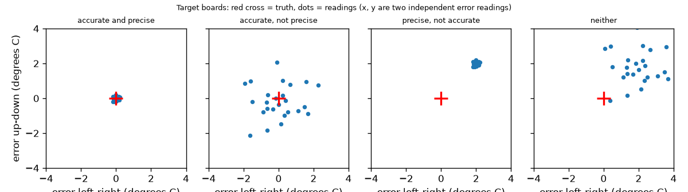
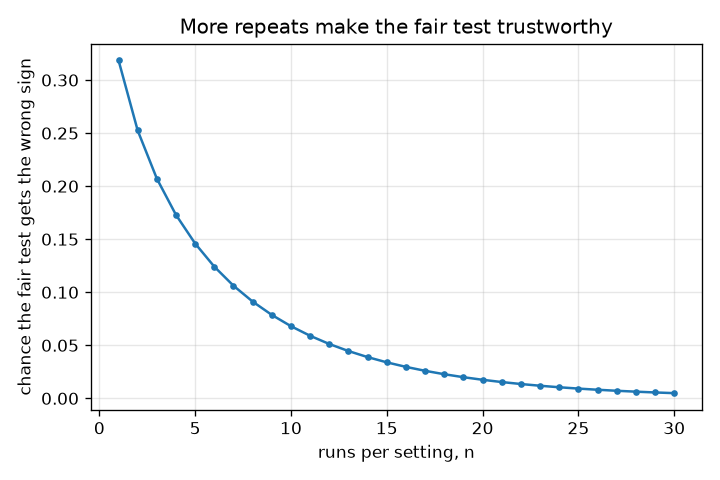

# सत्र 1: एक निष्पक्ष परीक्षण: एक बदलाव, दोहराया गया, और यथार्थ बनाम परिशुद्ध

*स्तर 1 (वैचारिक इंटरैक्टिव मॉडल) · लगभग 60 मिनट · openexperiment*

> यह एक सरलीकृत शैक्षिक मॉडल (simplified educational model) है। यह कोई सत्यापित डिज़ाइन टूल नहीं है और इसका उपयोग वास्तविक संरचनाओं, बिजली की स्थापनाओं, वाहनों, औद्योगिक प्रक्रियाओं या चिकित्सा निर्णयों के लिए नहीं किया जाना चाहिए।

**पूर्व-आवश्यकताएँ (Prerequisites)**

- स्कूल का अंकगणित: औसत और अंतर।
- आपने PRIMER.md पढ़ लिया है और `python start.py 1` एक बार चला लिया है।

**सीखने के उद्देश्य (Learning objectives).** इस सत्र के बाद आप:

- समझा सकेंगे कि निष्पक्ष परीक्षण (fair test) एक समय में केवल एक चीज़ क्यों बदलता है।
- संख्याओं से दिखा सकेंगे कि एक साथ दो चीज़ें बदलने से गलत उत्तर कैसे मिलता है।
- समझा सकेंगे कि परीक्षण को दोहराना क्यों ज़रूरी है और दोहरावों (repeats) के औसत का उपयोग कर सकेंगे।
- चार उदाहरण थर्मामीटरों की सहायता से यथार्थ (accurate, कम पूर्वाग्रह) और परिशुद्ध (precise, कम बिखराव) में अंतर कर सकेंगे।

## A. वास्तविक दुनिया की समस्या
आप जानना चाहते हैं कि क्या ढक्कन गरम पानी के कप को अधिक गरम रखता है। आप एक बड़े कप पर ढक्कन लगाते हैं और एक छोटे कप को खुला छोड़ देते हैं। ढका हुआ कप कम ठंडा होता है, तो ढक्कन काम करता है, है ना? ज़रूरी नहीं: बड़ा कप वैसे भी कम ठंडा होता। और अगर आपने परीक्षण केवल एक बार किया, तो कोई भाग्यशाली या दुर्भाग्यशाली प्रयास आपको धोखा दे सकता है। यह सत्र एक काल्पनिक दुनिया बनाता है जहाँ सही उत्तर ज्ञात है, ताकि आप ठीक-ठीक देख सकें कि अनुचित और एक बार के परीक्षण कैसे गलत होते हैं। यह प्रयोगों के बारे में सामान्य शिक्षा है।

## B. अवधारणा और सिद्धांत
निष्पक्ष परीक्षण एक चीज़ (ढक्कन) बदलता है और बाकी सब कुछ समान रखता है (वही कप, वही पानी, वही समय, वही थर्मामीटर, उसे पढ़ने का वही तरीका)। हर माप में बिखराव (scatter) भी होता है, इसलिए हम परीक्षण दोहराते हैं और n दोहरावों के माध्य (mean) का उपयोग करते हैं: माध्य का बिखराव sd / sqrt(n) है। ढक्कन का प्रभाव ढक्कन वाले माध्य में से बिना ढक्कन वाला माध्य घटाकर मिलता है। दो शब्द किसी मापक यंत्र का वर्णन करते हैं। यथार्थ का अर्थ है कि उसके पाठ्यांकों (readings) का औसत सत्य के निकट होता है: उसका पूर्वाग्रह (bias, औसत त्रुटि) छोटा है। परिशुद्ध का अर्थ है कि दोहराए गए पाठ्यांक आपस में मेल खाते हैं: उनका बिखराव (मानक विचलन / standard deviation) छोटा है। पूर्वाग्रह और बिखराव स्वतंत्र हैं: चारों संयोजन मौजूद होते हैं।

| प्रतीक | अर्थ | इकाई |
|---|---|---|
| lid effect | ढक्कन के कारण ठंडा होने की गिरावट में वास्तविक बदलाव (-1.0) | degrees C |
| cup effect | बड़े कप के कारण वास्तविक बदलाव (-3.0) | degrees C |
| sd | एक माप का बिखराव (ठंडा होने के परीक्षण के लिए 1.5) | degrees C |
| n | प्रति सेटिंग दोहराव | कोई इकाई नहीं |
| bias | औसत पाठ्यांक घटा सत्य | degrees C |

**मान्यताएँ (Assumptions)**

- दुनिया काल्पनिक है: वास्तविक प्रभाव ज्ञात हैं (ढक्कन -1.0, बड़ा कप -3.0, आधार गिरावट 20.0 degrees C)।
- एक प्रयास से दूसरे प्रयास का बिखराव यादृच्छिक, घंटी के आकार का और हर प्रयास के लिए समान है।
- प्रयास एक-दूसरे से स्वतंत्र हैं।

$$ \text{effect}=\bar y_{\text{lid}}-\bar y_{\text{bare}},\qquad \mathrm{sd}(\bar y)=\frac{\sigma}{\sqrt n} $$

$$ \mathrm{sd}(\bar y_1-\bar y_2)=\sigma\sqrt{\frac{2}{n}} $$

$$ P(\text{wrong sign})=P\!\left(Z>\frac{|\text{effect}|}{\sigma\sqrt{2/n}}\right) $$

$$ \text{typical error}=\sqrt{\text{bias}^2+\left(\frac{\sigma}{\sqrt n}\right)^2} $$

## C. दृश्य व्याख्या
पहला चित्र चार थर्मामीटरों को निशाना-पट (target boards) के रूप में दिखाता है: लाल क्रॉस सत्य है और हर बिंदु एक पाठ्यांक है। यथार्थ और परिशुद्ध होने पर क्रॉस पर एक घना गुच्छा मिलता है; यथार्थ पर परिशुद्ध नहीं होने पर क्रॉस पर केंद्रित एक चौड़ा बादल मिलता है; परिशुद्ध पर यथार्थ नहीं होने पर क्रॉस से दूर एक घना गुच्छा मिलता है; दोनों न होने पर उससे दूर एक चौड़ा बादल मिलता है। दूसरा चित्र प्रति सेटिंग प्रयासों की संख्या के सापेक्ष यह संभावना दिखाता है कि एक निष्पक्ष ढक्कन परीक्षण गलत चिह्न (wrong sign) दे: यह एक प्रयास पर 0.32 से घटकर 25 प्रयासों पर 0.01 से नीचे आ जाती है।

*चार थर्मामीटर निशाना-पट के रूप में: पूर्वाग्रह गुच्छे को खिसकाता है, बिखराव उसे चौड़ा करता है।*

*प्रति सेटिंग प्रयासों की संख्या बढ़ने पर निष्पक्ष परीक्षण के गलत चिह्न देने की संभावना घटती है।*

## D. इंटरैक्टिव सिमुलेशन
पाठ चलाइए (`python start.py 1`), फिर लाइव ऐप खोलिए: [सत्र 1: यथार्थ बनाम परिशुद्ध](https://krunalpanchal1995.github.io/pan-iit-oss/openexperiment/session-01/) (या इस फ़ोल्डर में `app.html`)। bias, scatter और n स्लाइडरों को खिसकाइए। पाठ्यांक दृश्य में देखिए कि बिंदु कैसे फैलते हैं (बिखराव), खिसकते हैं (पूर्वाग्रह) और n बढ़ने पर काला त्रिभुज (उनका माध्य) कैसा व्यवहार करता है। ग्राफ़ दृश्य में देखिए कि n बढ़ने पर लाल पूर्वाग्रह रेखा कभी नीचे नहीं जाती।

**चुनौती (Challenge).** औसत की सामान्य त्रुटि (typical error) को 0.5 degrees C से नीचे लाइए।

## E. हल किया गया उदाहरण और प्रयोग
**समस्या.** काल्पनिक ठंडा होने के परीक्षण में ढक्कन का प्रभाव -1.0 degrees C है और बिखराव प्रति प्रयास 1.5 degrees C है। (a) अनुचित परीक्षण (बड़े कप पर ढक्कन बनाम खुला छोटा कप) क्या बताता है? (b) निष्पक्ष परीक्षण में प्रति सेटिंग एक प्रयास के साथ, गलत चिह्न की संभावना क्या है?

1. अनुचित परीक्षण, बिना बिखराव: (20 - 1 - 3) - 20 = -4 degrees C। यह -4 बताता है, पर ढक्कन केवल -1 है; अतिरिक्त -3 कप के आकार से है।
2. निष्पक्ष परीक्षण, बिना बिखराव: (20 - 1) - 20 = -1 degrees C: ढक्कन का वास्तविक प्रभाव।
3. n = 1 के साथ दो प्रयासों के अंतर का बिखराव 1.5 * sqrt(2) = 2.12 degrees C है।
4. गलत चिह्न के लिए अंतर का 0 से अधिक होना ज़रूरी है, अर्थात 1 / 2.12 = 0.471 मानक विचलन का खिसकाव: 0.471 के आगे सामान्य वितरण की पूँछ (normal tail) 0.319 है।

**उत्तर.** अनुचित परीक्षण -4 देता है (कप प्रभाव, -3, जितना गलत)। एक प्रयास वाला निष्पक्ष परीक्षण 0.319 मामलों में, यानी लगभग तीन में से एक बार, बताता है कि ढक्कन चीज़ों को और खराब करता है। प्रति सेटिंग 9 प्रयासों के साथ यह घटकर 0.079 रह जाता है।

**प्रयोग (Experiment).** इसे वास्तव में कीजिए: दो एक जैसे मग, एक ही प्रारंभिक तापमान का पानी, एक पर ढक्कन, थर्मामीटर को हर बार एक ही समय पर (मान लीजिए 10 मिनट) और एक ही तरीके से पढ़िए। 5 बार दोहराइए, बारी-बारी से बदलते हुए कि किस मग पर ढक्कन लगे। औसत अंतर की तुलना एक प्रयास से कीजिए। वास्तविक पानी में अतिरिक्त बिखराव होता है जो मॉडल में नहीं है (हवा के झोंके, थर्मामीटर कैसे पकड़ा गया), और वास्तविक ढक्कन प्रभाव मग पर निर्भर करता है; सिमुलेशन सटीक सत्य जानता है, रसोई नहीं।

## F. मूल्यांकन और डिज़ाइन चुनौती
**प्रश्न प्रकार A: वैचारिक (Conceptual).** एक मित्र कहता है: 'मेरा पौधा-भोजन काम करता है: धूप वाली खिड़की में जिन पौधों को मैंने खिलाया वे शेल्फ़ पर रखे बिना खिलाए पौधों से अधिक लंबे हुए।' इस परीक्षण में क्या गलत है, और आप इसे कैसे सुधारेंगे?

संकेत

दोनों समूहों के बीच जो कुछ भी अलग है, उसकी सूची बनाइए, केवल भोजन की नहीं।

चरण-दर-चरण हल

दो चीज़ें बदलीं: भोजन और स्थान (धूप)। अतिरिक्त वृद्धि धूप से आ सकती है। एक निष्पक्ष परीक्षण सभी पौधों को एक ही जगह रखता है, केवल भोजन बदलता है, प्रति समूह कई पौधों का उपयोग करता है (दोहराव) और उन्हें एक ही तरीके से मापता है। बड़े कप पर ढक्कन की तरह, जब दोनों एक साथ बदलते हैं तो भोजन के प्रभाव को धूप से अलग नहीं किया जा सकता।

**प्रश्न प्रकार B: संख्यात्मक (Numerical).** ठंडा होने के परीक्षण (ढक्कन प्रभाव -1.0 degrees C, बिखराव प्रति प्रयास 1.5 degrees C) में आप प्रति सेटिंग n = 9 प्रयास उपयोग करते हैं। दोनों माध्यों के अंतर का बिखराव क्या है, और गलत चिह्न मिलने की संभावना क्या है?

संकेत

अंतर का बिखराव = 1.5 * sqrt(2 / n)। फिर z = 1 / वह, और सामान्य वितरण की पूँछ का उपयोग कीजिए।

चरण-दर-चरण हल

बिखराव = 1.5 * sqrt(2 / 9) = 0.707 degrees C। z = 1 / 0.707 = 1.414, और 1.414 के आगे सामान्य पूँछ 0.079 है। इकाइयाँ: degrees C। तर्कसंगतता जाँच (sanity check): यह एक प्रयास वाले 0.319 से छोटा है, जैसा होना चाहिए, क्योंकि अधिक दोहराव बिखराव को घटाते हैं।

**प्रश्न प्रकार C: ग्राफ़ और सिमुलेशन की व्याख्या.** ऐप के ग्राफ़ दृश्य में, bias 2.0 है, sd 1.0 है और आप n को 1 से 100 तक ले जाते हैं। काले वक्र का वर्णन कीजिए और बताइए कि उसे क्या सीमित करता है।

संकेत

नीले वक्र (यादृच्छिक भाग) और लाल रेखा (पूर्वाग्रह) की तुलना कीजिए।

चरण-दर-चरण हल

काला वक्र (सामान्य कुल त्रुटि) n = 1 पर sqrt(2^2 + 1^2) = 2.24 से शुरू होकर घटता है, पर n चाहे जितना बड़ा हो, यह 2.0 (लाल रेखा) पर सपाट हो जाता है, क्योंकि औसत निकालना केवल यादृच्छिक भाग sd / sqrt(n) को घटाता है। और नीचे जाने के लिए आपको पूर्वाग्रह हटाना होगा (अंशांकन / calibrate), अधिक पाठ्यांक लेना नहीं।

**प्रश्न प्रकार D: डिज़ाइन और अनुकूलन (optimisation) चुनौती.** डिज़ाइन: आपके पास एक थर्मामीटर है जिसका bias 2.0 degrees C और sd 0.1 degrees C है, और दूसरा जिसका bias 0 और sd 1.0 degrees C है। आप कुल मिलाकर अधिकतम 25 पाठ्यांक ले सकते हैं। किसी तापमान को 0.5 degrees C के भीतर मापने के लिए आप कौन-सा चुनेंगे, और पहले वाले के साथ क्या करेंगे?

संकेत

हर एक के लिए सामान्य त्रुटि sqrt(bias^2 + sd^2/n) निकालिए।

चरण-दर-चरण हल

दूसरा: 25 पाठ्यांकों के साथ इसकी सामान्य त्रुटि 1.0 / sqrt(25) = 0.2 degrees C (0.5 से कम) है। पहला n चाहे जो हो, लगभग 2.0 पर ही रहता है। पहले को किसी संदर्भ (reference) के विरुद्ध अंशांकित करके (उसका पूर्वाग्रह घटाकर) ठीक किया जा सकता है, जिसके बाद उसका 0.1 degrees C का बिखराव उसे बेहतर यंत्र बना देता है। समझौता (trade-off) संदर्भ माप की लागत और समय है। मान्यता: पूर्वाग्रह स्थिर है।

[RUBRIC.md](../../RUBRIC.md) से स्वयं को अंक दीजिए। कागज़ पर काम करने के लिए [गतिविधि पत्रक](activity_sheet.md) प्रिंट कीजिए।

## सामान्य भ्रांतियाँ
| सामान्य भ्रांति (misconception) | वास्तव में क्या सच है |
|---|---|
| परिशुद्ध का अर्थ यथार्थ है। | परिशुद्ध का अर्थ है दोहराने योग्य; यथार्थ का अर्थ है सत्य के निकट। एक थर्मामीटर हर बार 52.0 पढ़ सकता है जबकि सत्य 50.0 है: परिशुद्ध, यथार्थ नहीं। |
| अगर मैं परीक्षण दोहराऊँ तो मुझे वही संख्या मिलेगी। | वास्तविक मापों में बिखराव होता है। दोहराव आपको बिखराव का अनुमान लगाने और 1 / sqrt(n) के अनुसार औसत निकालकर उसे घटाने देते हैं। |
| कई पाठ्यांकों का औसत हमेशा आपको सत्य तक पहुँचा देता है। | औसत निकालना केवल यादृच्छिक त्रुटि हटाता है; पूर्वाग्रह बना रहता है चाहे आप कितने भी पाठ्यांक लें। |
| मेरे परीक्षण में बड़ा प्रभाव का अर्थ है कि चीज़ काम करती है। | अगर दूसरी चीज़ें भी बदलीं (कप का आकार, स्थान), तो अंतर उनके प्रभावों को उस प्रभाव के साथ मिला देता है जो आप चाहते हैं। |

## शब्दावली
- **निष्पक्ष परीक्षण (fair test)**: एक तुलना जिसमें केवल एक चीज़ बदली जाती है
- **दोहराव (repeat)**: उसी माप को फिर से करना, उसका बिखराव देखने के लिए
- **पूर्वाग्रह (bias)**: पाठ्यांकों की औसत त्रुटि; यंत्र को अयथार्थ बनाती है
- **बिखराव (मानक विचलन / standard deviation)**: दोहराए गए पाठ्यांकों का उनके माध्य के आसपास सामान्य फैलाव; छोटा होने का अर्थ परिशुद्ध
- **यथार्थ (accurate)**: पाठ्यांकों का औसत वास्तविक मान के निकट होता है
- **परिशुद्ध (precise)**: दोहराए गए पाठ्यांक आपस में निकटता से मेल खाते हैं

## समापन
1. [exercises.md](exercises.md) में दिए तीन कोडिंग कार्य कीजिए।
2. अपने बदलावों के बाद `python start.py 1` फिर से चलाइए। यह चेकपॉइंट (checkpoint) के साथ समाप्त होता है; जब यह `PASS` छापे, तो आपका काम पूरा है। (केवल चेकपॉइंट: `python start.py check 1`।)

आगे: [सत्र 2](../session-02/README.md)
