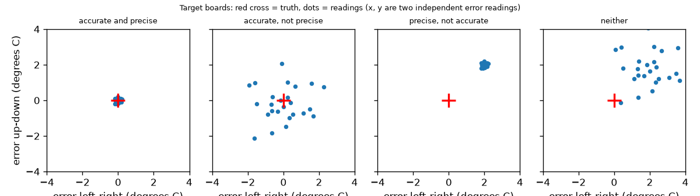
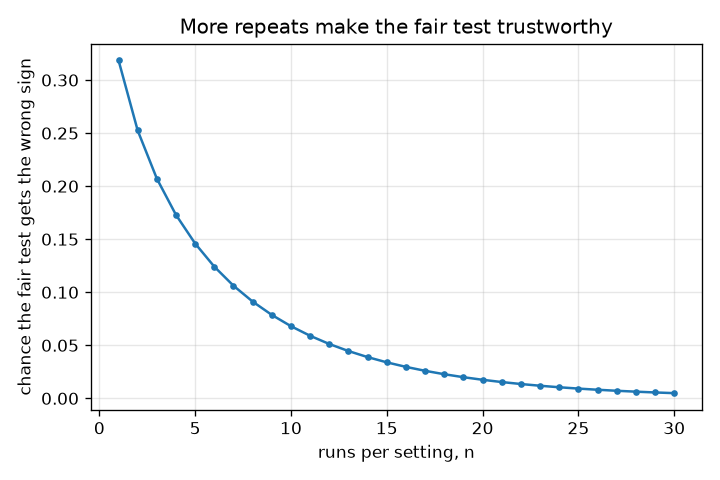

# സെഷൻ 1: ഒരു ന്യായമായ പരീക്ഷണം: ഒരു മാറ്റം, ആവർത്തനം, കൃത്യത (accurate) vs സൂക്ഷ്മത (precise)

[Session 1 — हिन्दी](README.hi.md) · [Session 1 — മലയാളം](README.ml.md)

*ലെവൽ 1 (ആശയപരമായ ഇന്ററാക്ടീവ് മോഡൽ) · ഏകദേശം 60 മിനിറ്റ് · openexperiment*

> ഇത് ലളിതമാക്കിയ ഒരു വിദ്യാഭ്യാസ മോഡലാണ്. ഇത് സാധൂകരിക്കപ്പെട്ട (validated) ഒരു ഡിസൈൻ ഉപകരണമല്ല; യഥാർത്ഥ നിർമ്മിതികൾ, ഇലക്ട്രിക്കൽ ഇൻസ്റ്റലേഷനുകൾ, വാഹനങ്ങൾ, വ്യാവസായിക പ്രക്രിയകൾ അല്ലെങ്കിൽ മെഡിക്കൽ തീരുമാനങ്ങൾ എന്നിവയ്ക്ക് ഇത് ഉപയോഗിക്കരുത്.

**മുൻ‌വ്യവസ്ഥകൾ (Prerequisites)**

- സ്കൂൾ ഗണിതം: ശരാശരികളും വ്യത്യാസങ്ങളും.
- നിങ്ങൾ PRIMER.md വായിക്കുകയും `python start.py 1` ഒരിക്കൽ റൺ ചെയ്യുകയും ചെയ്തിട്ടുണ്ട്.

**പഠന ലക്ഷ്യങ്ങൾ (Learning objectives).** ഈ സെഷനു ശേഷം നിങ്ങൾക്ക് കഴിയും:

- ഒരു ന്യായമായ പരീക്ഷണം (fair test) ഒരു സമയം ഒരു കാര്യം മാത്രം മാറ്റുന്നത് എന്തുകൊണ്ടെന്ന് വിശദീകരിക്കാൻ.
- രണ്ട് കാര്യങ്ങൾ ഒരേസമയം മാറ്റുന്നത് തെറ്റായ ഉത്തരം നൽകുന്നത് സംഖ്യകൾ ഉപയോഗിച്ച് കാണിക്കാൻ.
- ഒരു പരീക്ഷണം എന്തുകൊണ്ട് ആവർത്തിക്കണമെന്ന് വിശദീകരിക്കാനും ആവർത്തനങ്ങളുടെ ശരാശരി ഉപയോഗിക്കാനും.
- നാല് ഉദാഹരണ തെർമോമീറ്ററുകൾ ഉപയോഗിച്ച് കൃത്യമായത് (accurate - ചെറിയ ബയസ്) സൂക്ഷ്മമായതിൽ (precise - ചെറിയ വിസരണം) നിന്ന് വേർതിരിച്ചറിയാൻ.

## A. യഥാർത്ഥ ലോക പ്രശ്നം
ഒരു അടപ്പ് ഒരു കപ്പ് ചൂടുവെള്ളത്തെ കൂടുതൽ നേരം ചൂടോടെ നിലനിർത്തുമോ എന്ന് നിങ്ങൾക്ക് അറിയണം. ഒരു വലിയ കപ്പിൽ അടപ്പ് വയ്ക്കുകയും ഒരു ചെറിയ കപ്പ് തുറന്നു വിടുകയും ചെയ്യുന്നു. അടച്ച കപ്പ് കുറച്ച് മാത്രം തണുക്കുന്നു, അതിനാൽ അടപ്പ് ഫലിക്കുന്നു, ശരിയല്ലേ? അത്ര ഉറപ്പില്ല: വലിയ കപ്പ് അടപ്പില്ലെങ്കിലും കുറച്ചേ തണുക്കുമായിരുന്നുള്ളൂ. പരീക്ഷണം ഒരു തവണ മാത്രം നടത്തിയാൽ, ഭാഗ്യമോ നിർഭാഗ്യമോ ആയ ഒരു ഓട്ടം നിങ്ങളെ കബളിപ്പിച്ചേക്കാം. യഥാർത്ഥ ഉത്തരം അറിയാവുന്ന ഒരു സാങ്കല്പിക ലോകം ഈ സെഷൻ നിർമ്മിക്കുന്നു, അതിനാൽ അന്യായമായ പരീക്ഷണങ്ങളും ഒറ്റത്തവണ പരീക്ഷണങ്ങളും എങ്ങനെ തെറ്റുന്നുവെന്ന് നിങ്ങൾക്ക് കൃത്യമായി കാണാം. ഇത് പരീക്ഷണങ്ങളെക്കുറിച്ചുള്ള പൊതു വിദ്യാഭ്യാസമാണ്.

## B. ആശയവും സിദ്ധാന്തവും
ഒരു ന്യായമായ പരീക്ഷണം ഒരു കാര്യം (അടപ്പ്) മാറ്റുകയും മറ്റെല്ലാം ഒരുപോലെ നിലനിർത്തുകയും ചെയ്യുന്നു (ഒരേ കപ്പ്, ഒരേ വെള്ളം, ഒരേ സമയം, ഒരേ തെർമോമീറ്റർ, വായിക്കുന്ന ഒരേ രീതി). ഓരോ അളവിനും വിസരണവും (scatter) ഉണ്ട്, അതിനാൽ നാം പരീക്ഷണം ആവർത്തിക്കുകയും n ആവർത്തനങ്ങളുടെ മാധ്യം (mean) ഉപയോഗിക്കുകയും ചെയ്യുന്നു: മാധ്യത്തിന്റെ വിസരണം sd / sqrt(n) ആണ്. അടപ്പിന്റെ പ്രഭാവം എന്നത് അടപ്പുള്ളപ്പോഴത്തെ മാധ്യത്തിൽ നിന്ന് അടപ്പില്ലാത്തപ്പോഴത്തെ മാധ്യം കുറച്ചതാണ്. ഒരു അളവുപകരണത്തെ രണ്ട് വാക്കുകൾ വിവരിക്കുന്നു. കൃത്യം (accurate) എന്നാൽ അതിന്റെ റീഡിംഗുകളുടെ ശരാശരി സത്യത്തോട് അടുത്താണ്: അതിന്റെ ബയസ് (bias - ശരാശരി പിശക്) ചെറുതാണ്. സൂക്ഷ്മം (precise) എന്നാൽ ആവർത്തിച്ചുള്ള റീഡിംഗുകൾ പരസ്പരം യോജിക്കുന്നു: അവയുടെ വിസരണം (സ്റ്റാൻഡേർഡ് ഡീവിയേഷൻ) ചെറുതാണ്. ബയസും വിസരണവും പരസ്പര സ്വതന്ത്രമാണ്: നാല് സംയോജനങ്ങളും നിലനിൽക്കുന്നു.

| ചിഹ്നം | അർത്ഥം | യൂണിറ്റ് |
|---|---|---|
| lid effect | അടപ്പ് മൂലമുണ്ടാകുന്ന തണുക്കൽ കുറവിലെ യഥാർത്ഥ മാറ്റം (-1.0: അടപ്പുള്ളപ്പോൾ വെള്ളം 1.0 ഡിഗ്രി C കുറച്ച് തണുക്കുന്നു) | ഡിഗ്രി C |
| cup effect | വലിയ കപ്പ് മൂലമുണ്ടാകുന്ന തണുക്കൽ കുറവിലെ യഥാർത്ഥ മാറ്റം (-3.0) | ഡിഗ്രി C |
| sd | ഒരു അളവിന്റെ വിസരണം (തണുക്കൽ പരീക്ഷണത്തിന് 1.5) | ഡിഗ്രി C |
| n | ഓരോ ക്രമീകരണത്തിനുമുള്ള ആവർത്തനങ്ങൾ | യൂണിറ്റ് ഇല്ല |
| bias | ശരാശരി റീഡിംഗ് കുറയ്ക്കുക സത്യം | ഡിഗ്രി C |

**അനുമാനങ്ങൾ (Assumptions)**

- ലോകം സാങ്കല്പികമാണ്: യഥാർത്ഥ പ്രഭാവങ്ങൾ അറിയാം (അടപ്പ് -1.0, വലിയ കപ്പ് -3.0, അടിസ്ഥാന കുറവ് 20.0 ഡിഗ്രി C).
- ഓരോ ഓട്ടത്തിനിടയിലെയും വിസരണം ക്രമരഹിതവും മണിയാകൃതിയിലുള്ളതും ഓരോ ഓട്ടത്തിനും ഒരുപോലെയുമാണ്.
- ഓട്ടങ്ങൾ പരസ്പരം സ്വതന്ത്രമാണ്.

$$ \text{effect}=\bar y_{\text{lid}}-\bar y_{\text{bare}},\qquad \mathrm{sd}(\bar y)=\frac{\sigma}{\sqrt n} $$

$$ \mathrm{sd}(\bar y_1-\bar y_2)=\sigma\sqrt{\frac{2}{n}} $$

$$ P(\text{wrong sign})=P\!\left(Z>\frac{|\text{effect}|}{\sigma\sqrt{2/n}}\right) $$

$$ \text{typical error}=\sqrt{\text{bias}^2+\left(\frac{\sigma}{\sqrt n}\right)^2} $$

## C. ദൃശ്യ വിശദീകരണം
ആദ്യ ചിത്രം നാല് തെർമോമീറ്ററുകളെ ലക്ഷ്യ ബോർഡുകളായി കാണിക്കുന്നു: ചുവന്ന കുരിശ് സത്യമാണ്, ഓരോ ബിന്ദുവും ഒരു റീഡിംഗ്. കൃത്യവും സൂക്ഷ്മവും കുരിശിൽ ഒരു ഇറുകിയ കൂട്ടം നൽകുന്നു; കൃത്യമായതും എന്നാൽ സൂക്ഷ്മമല്ലാത്തതും കുരിശിനെ കേന്ദ്രമാക്കിയ ഒരു വിശാല മേഘം നൽകുന്നു; സൂക്ഷ്മമായതും എന്നാൽ കൃത്യമല്ലാത്തതും കുരിശിൽ നിന്ന് മാറി ഒരു ഇറുകിയ കൂട്ടം നൽകുന്നു; രണ്ടുമല്ലാത്തത് കുരിശിൽ നിന്ന് മാറി ഒരു വിശാല മേഘം നൽകുന്നു. ഓരോ ക്രമീകരണത്തിനുമുള്ള ഓട്ടങ്ങളുടെ എണ്ണത്തിനെതിരെ ഒരു ന്യായമായ അടപ്പ് പരീക്ഷണത്തിന് തെറ്റായ ചിഹ്നം ലഭിക്കാനുള്ള സാധ്യത രണ്ടാമത്തെ ചിത്രം പ്ലോട്ട് ചെയ്യുന്നു: ഒരു ഓട്ടത്തിൽ 0.32-ൽ നിന്ന് 25 ഓട്ടങ്ങളിൽ 0.01-ൽ താഴേക്ക് അത് കുറയുന്നു.

*നാല് തെർമോമീറ്ററുകൾ ലക്ഷ്യ ബോർഡുകളായി: ബയസ് കൂട്ടത്തെ നീക്കുന്നു, വിസരണം അതിനെ വിശാലമാക്കുന്നു.*

*ഓരോ ക്രമീകരണത്തിനുമുള്ള ഓട്ടങ്ങളുടെ എണ്ണം കൂടുമ്പോൾ ഒരു ന്യായമായ പരീക്ഷണത്തിന് തെറ്റായ ചിഹ്നം ലഭിക്കാനുള്ള സാധ്യത കുറയുന്നു.*

## D. ഇന്ററാക്ടീവ് സിമുലേഷൻ
പാഠം റൺ ചെയ്യുക (`python start.py 1`), തുടർന്ന് ലൈവ് ആപ്പ് തുറക്കുക: [സെഷൻ 1: കൃത്യം vs സൂക്ഷ്മം](https://krunalpanchal1995.github.io/pan-iit-oss/openexperiment/session-01/) (അല്ലെങ്കിൽ ഈ ഫോൾഡറിലെ `app.html`). ബയസ്, വിസരണം, n സ്ലൈഡറുകൾ നീക്കുക. റീഡിംഗ് വ്യൂവിൽ, ബിന്ദുക്കൾ പരക്കുന്നതും (വിസരണം), മാറുന്നതും (ബയസ്), n കൂടുമ്പോൾ കറുത്ത ത്രികോണം (അവയുടെ മാധ്യം) എങ്ങനെ പെരുമാറുന്നുവെന്നും നിരീക്ഷിക്കുക. ഗ്രാഫ് വ്യൂവിൽ, n എത്ര വലുതായാലും ചുവന്ന ബയസ് രേഖ അതേ ഉയരത്തിൽ തുടരുന്നത് ശ്രദ്ധിക്കുക: ശരാശരി എടുക്കുന്നത് ബയസിനെ ഇല്ലാതാക്കില്ല.

**വെല്ലുവിളി (Challenge).** ശരാശരിയുടെ സാധാരണ പിശക് (typical error) 0.5 ഡിഗ്രി C-ൽ താഴെയാക്കുക.

## E. പരിഹരിച്ച ഉദാഹരണവും പരീക്ഷണവും
**പ്രശ്നം.** സാങ്കല്പിക തണുക്കൽ പരീക്ഷണത്തിൽ അടപ്പിന്റെ പ്രഭാവം -1.0 ഡിഗ്രി C ആണ്, ഒരു ഓട്ടത്തിനുള്ള വിസരണം 1.5 ഡിഗ്രി C ആണ്. (a) അന്യായമായ പരീക്ഷണം (വലിയ കപ്പിൽ അടപ്പ്, തുറന്ന ചെറിയ കപ്പിനെതിരെ) എന്ത് റിപ്പോർട്ട് ചെയ്യുന്നു? (b) ഒരു ന്യായമായ പരീക്ഷണത്തിൽ ഓരോ ക്രമീകരണത്തിനും ഒരു ഓട്ടം വീതമാകുമ്പോൾ തെറ്റായ ചിഹ്നം ലഭിക്കാനുള്ള സാധ്യത എത്രയാണ്?

1. അന്യായമായ പരീക്ഷണം, വിസരണം ഇല്ലാതെ: (20 - 1 - 3) - 20 = -4 ഡിഗ്രി C. അത് -4 റിപ്പോർട്ട് ചെയ്യുന്നു, പക്ഷേ അടപ്പ് -1 മാത്രമാണ്; അധികമായ -3 കപ്പിന്റെ വലിപ്പമാണ്.
2. ന്യായമായ പരീക്ഷണം, വിസരണം ഇല്ലാതെ: (20 - 1) - 20 = -1 ഡിഗ്രി C: യഥാർത്ഥ അടപ്പ് പ്രഭാവം.
3. n = 1 ആകുമ്പോൾ രണ്ട് ഓട്ടങ്ങളുടെ വ്യത്യാസത്തിന്റെ വിസരണം 1.5 * sqrt(2) = 2.12 ഡിഗ്രി C ആണ്.
4. യഥാർത്ഥ വ്യത്യാസം -1.0 ആണ്. തെറ്റായ ചിഹ്നം എന്നാൽ അളന്ന വ്യത്യാസം 0-ന് മുകളിൽ വരുന്നു, അതായത് അതിന്റെ യഥാർത്ഥ മൂല്യത്തിന് മുകളിൽ കുറഞ്ഞത് 1.0 / 2.12 = 0.471 സ്റ്റാൻഡേർഡ് ഡീവിയേഷൻ. അതിനുള്ള സാധ്യത 0.471-ന് അപ്പുറമുള്ള സാധാരണ വിതരണ വാൽ (normal tail) ആണ്, അത് 0.319 ആണ്.

**ഉത്തരം.** അന്യായമായ പരീക്ഷണം -4 നൽകുന്നു (കപ്പ് പ്രഭാവമായ -3 കൊണ്ട് തെറ്റ്). ഒരു ഓട്ടമുള്ള ന്യായമായ പരീക്ഷണം 0.319 കേസുകളിൽ, ഏകദേശം മൂന്നിൽ ഒരിക്കൽ, അടപ്പ് കാര്യങ്ങളെ മോശമാക്കുന്നു എന്ന് പറയുന്നു. ഓരോ ക്രമീകരണത്തിനും 9 ഓട്ടങ്ങളാകുമ്പോൾ ഇത് 0.079 ആയി കുറയുന്നു.

**പരീക്ഷണം.** യഥാർത്ഥത്തിൽ ചെയ്തുനോക്കുക: ഒരേപോലുള്ള രണ്ട് മഗ്ഗുകൾ, ഒരേ ആരംഭ താപനിലയിലുള്ള വെള്ളം, ഒന്നിൽ അടപ്പ്, ഒരേ സമയത്ത് (ഉദാഹരണം 10 മിനിറ്റ്) ഓരോ തവണയും ഒരേ രീതിയിൽ വായിക്കുന്ന ഒരു തെർമോമീറ്റർ. ഏത് മഗ്ഗിന് അടപ്പ് എന്നത് മാറ്റിക്കൊണ്ട് 5 തവണ ആവർത്തിക്കുക. ശരാശരി വ്യത്യാസത്തെ ഒരൊറ്റ ഓട്ടവുമായി താരതമ്യം ചെയ്യുക. യഥാർത്ഥ വെള്ളത്തിന് മോഡലിൽ ഇല്ലാത്ത അധിക വിസരണമുണ്ട് (കാറ്റ്, തെർമോമീറ്റർ പിടിക്കുന്ന രീതി), യഥാർത്ഥ അടപ്പ് പ്രഭാവം മഗ്ഗിനെ ആശ്രയിക്കുന്നു; സിമുലേഷന് കൃത്യമായ സത്യം അറിയാം, അടുക്കളയ്ക്ക് അറിയില്ല.

## F. വിലയിരുത്തലും ഡിസൈൻ വെല്ലുവിളിയും
**ചോദ്യ തരം A: ആശയപരം.** ഒരു സുഹൃത്ത് പറയുന്നു: 'എന്റെ ചെടി വളം ഫലിക്കുന്നു: വെയിലുള്ള ജനലിൽ വളം നൽകിയ ചെടികൾ ഷെൽഫിലെ വളം നൽകാത്തവയെക്കാൾ ഉയരത്തിൽ വളർന്നു.' ഈ പരീക്ഷണത്തിലെ തെറ്റ് എന്താണ്, നിങ്ങൾ അത് എങ്ങനെ പരിഹരിക്കും?

സൂചന

വളം മാത്രമല്ല, രണ്ട് കൂട്ടങ്ങൾക്കിടയിൽ വ്യത്യാസമുള്ള എല്ലാ കാര്യങ്ങളും പട്ടികപ്പെടുത്തുക.

ഘട്ടം ഘട്ടമായുള്ള പരിഹാരം

രണ്ട് കാര്യങ്ങൾ മാറി: വളവും സ്ഥാനവും (സൂര്യപ്രകാശം). അധിക വളർച്ച സൂര്യനിൽ നിന്നായിരിക്കാം. ഒരു ന്യായമായ പരീക്ഷണം എല്ലാ ചെടികളെയും ഒരേ സ്ഥലത്ത് വയ്ക്കുന്നു, വളം മാത്രം മാറ്റുന്നു, ഓരോ കൂട്ടത്തിലും നിരവധി ചെടികൾ (ആവർത്തനങ്ങൾ) ഉപയോഗിക്കുന്നു, അവയെ ഒരേ രീതിയിൽ അളക്കുന്നു. വലിയ കപ്പിലെ അടപ്പ് പോലെ, രണ്ടും ഒരുമിച്ച് മാറുമ്പോൾ വളത്തിന്റെ പ്രഭാവം സൂര്യപ്രകാശത്തിൽ നിന്ന് വേർതിരിക്കാൻ കഴിയില്ല.

**ചോദ്യ തരം B: സംഖ്യാപരം.** തണുക്കൽ പരീക്ഷണത്തിൽ (അടപ്പ് പ്രഭാവം -1.0 ഡിഗ്രി C, ഒരു ഓട്ടത്തിനുള്ള വിസരണം 1.5 ഡിഗ്രി C) നിങ്ങൾ ഓരോ ക്രമീകരണത്തിനും n = 9 ഓട്ടങ്ങൾ ഉപയോഗിക്കുന്നു. രണ്ട് മാധ്യങ്ങളുടെ വ്യത്യാസത്തിന്റെ വിസരണവും തെറ്റായ ചിഹ്നം ലഭിക്കാനുള്ള സാധ്യതയും എത്രയാണ്?

സൂചന

വ്യത്യാസത്തിന്റെ വിസരണം = 1.5 * sqrt(2 / n). പിന്നെ z = 1 / അത്, സാധാരണ വിതരണ വാൽ ഉപയോഗിക്കുക.

ഘട്ടം ഘട്ടമായുള്ള പരിഹാരം

വിസരണം = 1.5 * sqrt(2 / 9) = 0.707 ഡിഗ്രി C. z = 1 / 0.707 = 1.414, 1.414-ന് അപ്പുറമുള്ള സാധാരണ വിതരണ വാൽ 0.079 ആണ്. യൂണിറ്റുകൾ: ഡിഗ്രി C. യുക്തിപരിശോധന (sanity check): ഒരു ഓട്ടത്തിനുള്ള 0.319-നേക്കാൾ ചെറുതാണ്, അങ്ങനെ തന്നെ വേണം, കാരണം കൂടുതൽ ആവർത്തനങ്ങൾ വിസരണം കുറയ്ക്കുന്നു.

**ചോദ്യ തരം C: ഗ്രാഫ്, സിമുലേഷൻ വ്യാഖ്യാനം.** ആപ്പ് ഗ്രാഫ് വ്യൂവിൽ, ബയസ് 2.0, sd 1.0 ആണ്, നിങ്ങൾ n 1-ൽ നിന്ന് 100 വരെ നീക്കുന്നു. കറുത്ത വക്രത്തെ വിവരിക്കുക, അതിനെ പരിമിതപ്പെടുത്തുന്നത് എന്താണ്?

സൂചന

നീല വക്രത്തെ (ക്രമരഹിത ഭാഗം, n-നൊപ്പം ചുരുങ്ങുന്നു) ചുവന്ന രേഖയുമായി (ബയസ്, ചുരുങ്ങുന്നില്ല) താരതമ്യം ചെയ്യുക.

ഘട്ടം ഘട്ടമായുള്ള പരിഹാരം

കറുത്ത വക്രം (സാധാരണ ആകെ പിശക്) n = 1-ൽ sqrt(2^2 + 1^2) = 2.24-ൽ തുടങ്ങി താഴുന്നു, പക്ഷേ n എത്ര വലുതായാലും അത് 2.0-ൽ (ചുവന്ന രേഖ) പരന്നുപോകുന്നു, കാരണം ശരാശരി എടുക്കുന്നത് ക്രമരഹിത ഭാഗമായ sd / sqrt(n) മാത്രമേ ചുരുക്കുന്നുള്ളൂ. കൂടുതൽ താഴാൻ നിങ്ങൾ ബയസ് ഒഴിവാക്കണം (കാലിബ്രേറ്റ് ചെയ്യുക), കൂടുതൽ റീഡിംഗുകൾ എടുക്കുകയല്ല.

**ചോദ്യ തരം D: ഡിസൈൻ, ഒപ്റ്റിമൈസേഷൻ വെല്ലുവിളി.** ഡിസൈൻ: നിങ്ങൾക്ക് ബയസ് 2.0 ഡിഗ്രി C, sd 0.1 ഡിഗ്രി C ഉള്ള ഒരു തെർമോമീറ്ററും, ബയസ് 0, sd 1.0 ഡിഗ്രി C ഉള്ള മറ്റൊന്നുമുണ്ട്. ആകെ പരമാവധി 25 റീഡിംഗുകൾ മാത്രമേ താങ്ങാനാകൂ. ഒരു താപനില 0.5 ഡിഗ്രി C-ന് ഉള്ളിൽ അളക്കാൻ നിങ്ങൾ ഏതാണ് തിരഞ്ഞെടുക്കുന്നത്, ആദ്യത്തേതിനെ എന്ത് ചെയ്യും?

സൂചന

ഓരോന്നിനും സാധാരണ പിശക് sqrt(bias^2 + sd^2/n) കണക്കാക്കുക.

ഘട്ടം ഘട്ടമായുള്ള പരിഹാരം

രണ്ടാമത്തേത്: 25 റീഡിംഗുകളോടെ അതിന്റെ സാധാരണ പിശക് 1.0 / sqrt(25) = 0.2 ഡിഗ്രി C ആണ് (0.5-ന് താഴെ). ആദ്യത്തേത് n എത്രയായാലും ഏകദേശം 2.0-ൽ തുടരും. ആദ്യത്തേതിനെ ഒരു റഫറൻസിനെതിരെ കാലിബ്രേറ്റ് ചെയ്ത് (അതിന്റെ ബയസ് കുറച്ച്) ശരിയാക്കാം, അതിനുശേഷം അതിന്റെ വിസരണം 0.1 ഡിഗ്രി C അതിനെ മികച്ച ഉപകരണമാക്കുന്നു. വിട്ടുവീഴ്ച (trade-off): റഫറൻസ് അളവിന്റെ ചെലവും സമയവും. അനുമാനം: ബയസ് സ്ഥിരമാണ്.

[RUBRIC.md](../../RUBRIC.md) ഉപയോഗിച്ച് സ്വയം സ്കോർ ചെയ്യുക. കടലാസിൽ പ്രവർത്തിക്കാൻ [ആക്ടിവിറ്റി ഷീറ്റ്](activity_sheet.md) പ്രിന്റ് ചെയ്യുക.

## സാധാരണ തെറ്റിദ്ധാരണകൾ
| സാധാരണ തെറ്റിദ്ധാരണ | യഥാർത്ഥത്തിൽ സത്യം എന്താണ് |
|---|---|
| സൂക്ഷ്മം എന്നാൽ കൃത്യം. | സൂക്ഷ്മം എന്നാൽ ആവർത്തിക്കാവുന്നത്; കൃത്യം എന്നാൽ സത്യത്തോട് അടുത്തത്. സത്യം 50.0 ആയിരിക്കുമ്പോൾ ഒരു തെർമോമീറ്റർ ഓരോ തവണയും 52.0 വായിക്കാം: സൂക്ഷ്മം, കൃത്യമല്ല. |
| ഞാൻ പരീക്ഷണം ആവർത്തിച്ചാൽ എനിക്ക് അതേ സംഖ്യ ലഭിക്കും. | യഥാർത്ഥ അളവുകൾ ചിതറുന്നു. ആവർത്തനങ്ങൾ വിസരണം കണക്കാക്കാനും 1 / sqrt(n) കൊണ്ട് ശരാശരിയിലൂടെ കുറയ്ക്കാനും സഹായിക്കുന്നു. |
| ധാരാളം റീഡിംഗുകളുടെ ശരാശരി എടുക്കുന്നത് എപ്പോഴും നിങ്ങളെ സത്യത്തിലെത്തിക്കുന്നു. | ശരാശരി എടുക്കുന്നത് ക്രമരഹിത പിശക് മാത്രമേ ഇല്ലാതാക്കൂ; എത്ര റീഡിംഗുകൾ എടുത്താലും ബയസ് നിലനിൽക്കും. |
| എന്റെ പരീക്ഷണത്തിലെ വലിയ പ്രഭാവം ആ കാര്യം ഫലിക്കുന്നു എന്നാണ് അർത്ഥമാക്കുന്നത്. | മറ്റ് കാര്യങ്ങളും (കപ്പിന്റെ വലിപ്പം, സ്ഥാനം) മാറിയാൽ, വ്യത്യാസം അവയുടെ പ്രഭാവങ്ങളെ നിങ്ങൾക്ക് വേണ്ടതിനോട് കലർത്തുന്നു. |

## പദാവലി (Glossary)
- **ന്യായമായ പരീക്ഷണം (fair test)**: ഒരു കാര്യം മാത്രം മാറ്റുന്ന താരതമ്യം
- **ആവർത്തനം (repeat)**: വിസരണം കാണാൻ അതേ അളവ് വീണ്ടും ചെയ്യുക
- **ബയസ് (bias)**: റീഡിംഗുകളുടെ ശരാശരി പിശക്; ഒരു ഉപകരണത്തെ കൃത്യമല്ലാതാക്കുന്നു
- **വിസരണം (സ്റ്റാൻഡേർഡ് ഡീവിയേഷൻ - scatter)**: ആവർത്തിച്ചുള്ള റീഡിംഗുകൾ അവയുടെ മാധ്യത്തിന് ചുറ്റുമുള്ള സാധാരണ വ്യാപനം; ചെറുത് എന്നാൽ സൂക്ഷ്മം
- **കൃത്യം (accurate)**: റീഡിംഗുകളുടെ ശരാശരി യഥാർത്ഥ മൂല്യത്തോട് അടുത്താണ്
- **സൂക്ഷ്മം (precise)**: ആവർത്തിച്ചുള്ള റീഡിംഗുകൾ പരസ്പരം അടുത്തു യോജിക്കുന്നു

## പൂർത്തിയാക്കുക
1. [exercises.md](exercises.md)-ലെ മൂന്ന് കോഡിംഗ് ടാസ്കുകൾ ചെയ്യുക.
2. നിങ്ങളുടെ മാറ്റങ്ങൾക്കു ശേഷം `python start.py 1` വീണ്ടും റൺ ചെയ്യുക. അത് ചെക്ക്‌പോയിന്റോടെ അവസാനിക്കുന്നു; അത് `PASS` പ്രിന്റ് ചെയ്യുമ്പോൾ, നിങ്ങൾ പൂർത്തിയാക്കി. (ചെക്ക്‌പോയിന്റ് മാത്രം: `python start.py check 1`.)

അടുത്തത്: [സെഷൻ 2](../session-02/README.md)
