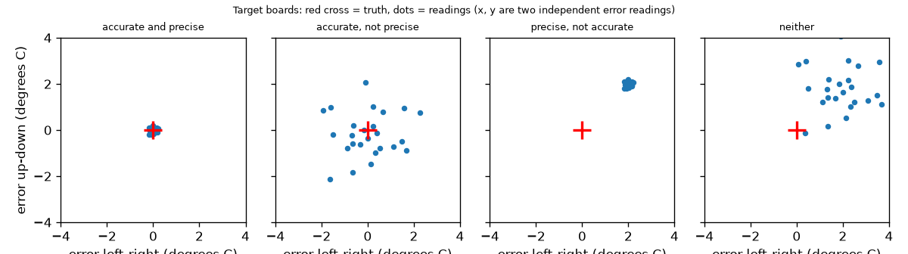
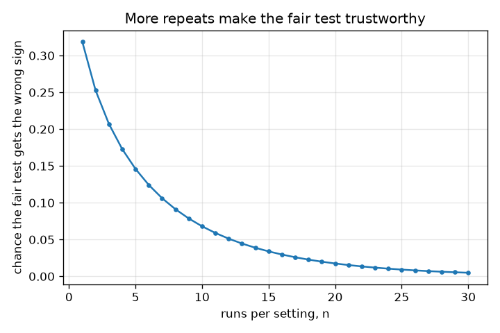

# அமர்வு 1: ஒரு நியாயமான சோதனை: ஒரு மாற்றம், மீண்டும் மீண்டும், துல்லியம் (accurate) vs நுட்பம் (precise)

[Session 1 — हिन्दी](README.hi.md) · [Session 1 — മലയാളം](README.ml.md) · [Session 1 — தமிழ்](README.ta.md)

*நிலை 1 (கருத்தியல் ஊடாடும் மாதிரி) · சுமார் 60 நிமிடங்கள் · openexperiment*

> இது ஒரு எளிமைப்படுத்தப்பட்ட கல்வி மாதிரி. இது சரிபார்க்கப்பட்ட (validated) வடிவமைப்புக் கருவி அல்ல; உண்மையான கட்டமைப்புகள், மின் நிறுவல்கள், வாகனங்கள், தொழில்துறை செயல்முறைகள் அல்லது மருத்துவ முடிவுகளுக்கு இதைப் பயன்படுத்தக் கூடாது.

**முன்தேவைகள் (Prerequisites)**

- பள்ளிக் கணிதம்: சராசரிகளும் வித்தியாசங்களும்.
- நீங்கள் PRIMER.md படித்து, `python start.py 1` ஐ ஒருமுறை இயக்கியிருக்கிறீர்கள்.

**கற்றல் நோக்கங்கள் (Learning objectives).** இந்த அமர்வுக்குப் பிறகு உங்களால் முடியும்:

- ஒரு நியாயமான சோதனை (fair test) ஒரு நேரத்தில் ஒரே ஒரு விஷயத்தை மட்டும் ஏன் மாற்றுகிறது என்பதை விளக்க.
- இரண்டு விஷயங்களை ஒரே நேரத்தில் மாற்றுவது எப்படித் தவறான விடையைத் தருகிறது என்பதை எண்களால் காட்ட.
- ஒரு சோதனை ஏன் மீண்டும் செய்யப்பட வேண்டும் என்பதை விளக்கி, மறு செய்கைகளின் சராசரியைப் பயன்படுத்த.
- நான்கு எடுத்துக்காட்டு வெப்பமானிகளைக் கொண்டு துல்லியமானதை (accurate - சிறிய சார்பு) நுட்பமானதிலிருந்து (precise - சிறிய சிதறல்) வேறுபடுத்த.

## A. நிஜ உலகப் பிரச்சினை
ஒரு மூடி ஒரு கோப்பை வெந்நீரை நீண்ட நேரம் சூடாக வைத்திருக்குமா என்று நீங்கள் அறிய விரும்புகிறீர்கள். ஒரு பெரிய கோப்பையில் மூடியை வைத்து, ஒரு சிறிய கோப்பையைத் திறந்தபடி விடுகிறீர்கள். மூடிய கோப்பை குறைவாகக் குளிர்கிறது, எனவே மூடி வேலை செய்கிறது, சரிதானே? அவசியமில்லை: பெரிய கோப்பை மூடி இல்லாவிட்டாலும் குறைவாகவே குளிர்ந்திருக்கும். மேலும் சோதனையை ஒருமுறை மட்டுமே செய்தால், அதிர்ஷ்டமான அல்லது துரதிர்ஷ்டமான ஒரு ஓட்டம் உங்களை ஏமாற்றலாம். உண்மையான விடை தெரிந்த ஒரு கற்பனை உலகத்தை இந்த அமர்வு உருவாக்குகிறது, எனவே நியாயமற்ற மற்றும் ஒருமுறை மட்டுமான சோதனைகள் எப்படித் தவறாகப் போகின்றன என்பதை நீங்கள் சரியாகப் பார்க்கலாம். இது சோதனைகள் பற்றிய பொதுக் கல்வி.

## B. கருத்தும் கோட்பாடும்
ஒரு நியாயமான சோதனை ஒரு விஷயத்தை (மூடி) மாற்றி, மற்ற அனைத்தையும் ஒரே மாதிரி வைத்திருக்கிறது (அதே கோப்பை, அதே நீர், அதே நேரம், அதே வெப்பமானி, அதைப் படிக்கும் அதே முறை). ஒவ்வொரு அளவீட்டுக்கும் சிதறலும் (scatter) உள்ளது, எனவே சோதனையை மீண்டும் செய்து n மறு செய்கைகளின் சராசரியைப் (mean) பயன்படுத்துகிறோம்: சராசரியின் சிதறல் sd / sqrt(n). மூடியின் விளைவு என்பது மூடியுடன் உள்ள சராசரியிலிருந்து மூடி இல்லாத சராசரியைக் கழித்தது. ஒரு அளவிடும் கருவியை இரண்டு சொற்கள் விவரிக்கின்றன. துல்லியமான (accurate) என்றால் அதன் அளவீடுகளின் சராசரி உண்மைக்கு அருகில் உள்ளது: அதன் சார்பு (bias - சராசரிப் பிழை) சிறியது. நுட்பமான (precise) என்றால் மீண்டும் மீண்டும் எடுத்த அளவீடுகள் ஒன்றோடொன்று ஒத்துப்போகின்றன: அவற்றின் சிதறல் (திட்ட விலக்கம்) சிறியது. சார்பும் சிதறலும் ஒன்றையொன்று சாராதவை: நான்கு சேர்க்கைகளும் உள்ளன.

| குறியீடு | பொருள் | அலகு |
|---|---|---|
| lid effect | மூடியால் ஏற்படும் குளிர்ச்சி இறக்கத்தில் உண்மை மாற்றம் (-1.0: மூடியுடன் நீர் 1.0 டிகிரி C குறைவாகக் குளிர்கிறது) | டிகிரி C |
| cup effect | பெரிய கோப்பையால் ஏற்படும் குளிர்ச்சி இறக்கத்தில் உண்மை மாற்றம் (-3.0) | டிகிரி C |
| sd | ஒரு அளவீட்டின் சிதறல் (குளிர்ச்சிச் சோதனைக்கு 1.5) | டிகிரி C |
| n | ஒவ்வொரு அமைப்புக்கும் மறு செய்கைகள் | அலகு இல்லை |
| bias | சராசரி அளவீடு கழித்தல் உண்மை | டிகிரி C |

**அனுமானங்கள் (Assumptions)**

- உலகம் கற்பனையானது: உண்மை விளைவுகள் தெரியும் (மூடி -1.0, பெரிய கோப்பை -3.0, அடிப்படை இறக்கம் 20.0 டிகிரி C).
- ஓட்டத்துக்கு ஓட்டம் சிதறல் சீரற்றது, மணி வடிவம் கொண்டது, ஒவ்வொரு ஓட்டத்துக்கும் ஒன்றே.
- ஓட்டங்கள் ஒன்றையொன்று சாராதவை.

$$ \text{effect}=\bar y_{\text{lid}}-\bar y_{\text{bare}},\qquad \mathrm{sd}(\bar y)=\frac{\sigma}{\sqrt n} $$

$$ \mathrm{sd}(\bar y_1-\bar y_2)=\sigma\sqrt{\frac{2}{n}} $$

$$ P(\text{wrong sign})=P\!\left(Z>\frac{|\text{effect}|}{\sigma\sqrt{2/n}}\right) $$

$$ \text{typical error}=\sqrt{\text{bias}^2+\left(\frac{\sigma}{\sqrt n}\right)^2} $$

## C. காட்சி விளக்கம்
முதல் படம் நான்கு வெப்பமானிகளை இலக்குப் பலகைகளாகக் காட்டுகிறது: சிவப்பு குறுக்கு உண்மை, ஒவ்வொரு புள்ளியும் ஓர் அளவீடு. துல்லியமும் நுட்பமும் குறுக்கின் மீது இறுக்கமான கொத்தைத் தருகிறது; துல்லியமானது ஆனால் நுட்பமற்றது குறுக்கை மையமாகக் கொண்ட பரந்த மேகத்தைத் தருகிறது; நுட்பமானது ஆனால் துல்லியமற்றது குறுக்கிலிருந்து விலகிய இறுக்கமான கொத்தைத் தருகிறது; இரண்டுமற்றது குறுக்கிலிருந்து விலகிய பரந்த மேகத்தைத் தருகிறது. ஒவ்வொரு அமைப்புக்குமான ஓட்டங்களின் எண்ணிக்கைக்கு எதிராக ஒரு நியாயமான மூடிச் சோதனை தவறான குறியைப் பெறுவதற்கான வாய்ப்பை இரண்டாவது படம் வரைகிறது: ஒரு ஓட்டத்தில் 0.32 இலிருந்து 25 ஓட்டங்களில் 0.01 க்குக் கீழே அது குறைகிறது.

*நான்கு வெப்பமானிகள் இலக்குப் பலகைகளாக: சார்பு கொத்தை நகர்த்துகிறது, சிதறல் அதை விரிக்கிறது.*

*ஒவ்வொரு அமைப்புக்குமான ஓட்டங்களின் எண்ணிக்கை அதிகரிக்கும்போது ஒரு நியாயமான சோதனை தவறான குறியைப் பெறுவதற்கான வாய்ப்பு குறைகிறது.*

## D. ஊடாடும் உருவகப்படுத்தல் (Interactive simulation)
பாடத்தை இயக்குங்கள் (`python start.py 1`), பின்னர் நேரடிச் செயலியைத் திறங்கள்: [அமர்வு 1: துல்லியம் vs நுட்பம்](https://krunalpanchal1995.github.io/pan-iit-oss/openexperiment/session-01/) (அல்லது இந்தக் கோப்புறையில் உள்ள `app.html`). சார்பு, சிதறல், n ஸ்லைடர்களை நகர்த்துங்கள். அளவீடுகள் காட்சியில், புள்ளிகள் பரவுவதையும் (சிதறல்), இடம்பெயர்வதையும் (சார்பு), n அதிகரிக்கும்போது கருப்பு முக்கோணம் (அவற்றின் சராசரி) எப்படி நடந்துகொள்கிறது என்பதையும் கவனியுங்கள். வரைபடக் காட்சியில், n எவ்வளவு பெரிதானாலும் சிவப்பு சார்புக் கோடு அதே உயரத்தில் இருப்பதைக் கவனியுங்கள்: சராசரி எடுப்பது சார்பை நீக்க முடியாது.

**சவால் (Challenge).** சராசரியின் வழக்கமான பிழையை (typical error) 0.5 டிகிரி C க்குக் கீழே கொண்டு வாருங்கள்.

## E. தீர்க்கப்பட்ட எடுத்துக்காட்டும் சோதனையும்
**பிரச்சினை.** கற்பனைக் குளிர்ச்சிச் சோதனையில் மூடியின் விளைவு -1.0 டிகிரி C, ஓர் ஓட்டத்துக்கான சிதறல் 1.5 டிகிரி C. (a) நியாயமற்ற சோதனை (பெரிய கோப்பையில் மூடி, திறந்த சிறிய கோப்பைக்கு எதிராக) எதைத் தெரிவிக்கிறது? (b) ஒரு நியாயமான சோதனையில் ஒவ்வொரு அமைப்புக்கும் ஓர் ஓட்டம் என்றால், தவறான குறி வருவதற்கான வாய்ப்பு என்ன?

1. நியாயமற்ற சோதனை, சிதறல் இல்லாமல்: (20 - 1 - 3) - 20 = -4 டிகிரி C. அது -4 எனத் தெரிவிக்கிறது, ஆனால் மூடி -1 மட்டுமே; கூடுதல் -3 கோப்பையின் அளவு.
2. நியாயமான சோதனை, சிதறல் இல்லாமல்: (20 - 1) - 20 = -1 டிகிரி C: உண்மையான மூடி விளைவு.
3. n = 1 இல், இரண்டு ஓட்டங்களின் வித்தியாசத்தின் சிதறல் 1.5 * sqrt(2) = 2.12 டிகிரி C.
4. உண்மை வித்தியாசம் -1.0. தவறான குறி என்றால் அளவிடப்பட்ட வித்தியாசம் 0 க்கு மேல் வருகிறது, அதாவது அதன் உண்மை மதிப்புக்கு மேல் குறைந்தது 1.0 / 2.12 = 0.471 திட்ட விலக்கங்கள். அதற்கான வாய்ப்பு 0.471 க்கு அப்பால் உள்ள இயல் பரவல் வால் (normal tail), அது 0.319.

**விடை.** நியாயமற்ற சோதனை -4 தருகிறது (கோப்பை விளைவு -3 ஆல் தவறு). ஓர் ஓட்டம் கொண்ட நியாயமான சோதனை 0.319 சந்தர்ப்பங்களில், ஏறத்தாழ மூன்றில் ஒரு முறை, மூடி நிலைமையை மோசமாக்குகிறது என்று சொல்கிறது. ஒவ்வொரு அமைப்புக்கும் 9 ஓட்டங்கள் என்றால் இது 0.079 ஆகக் குறைகிறது.

**சோதனை.** உண்மையில் செய்து பாருங்கள்: ஒரே மாதிரியான இரண்டு குவளைகள், ஒரே தொடக்க வெப்பநிலையில் நீர், ஒன்றில் மூடி, ஒரே நேரத்தில் (எடுத்துக்காட்டாக 10 நிமிடங்கள்) ஒவ்வொரு முறையும் ஒரே விதமாகப் படிக்கப்படும் வெப்பமானி. எந்தக் குவளைக்கு மூடி என்பதை மாற்றிக்கொண்டு 5 முறை மீண்டும் செய்யுங்கள். சராசரி வித்தியாசத்தை ஒற்றை ஓட்டத்துடன் ஒப்பிடுங்கள். உண்மை நீருக்கு மாதிரியில் இல்லாத கூடுதல் சிதறல் உள்ளது (காற்று, வெப்பமானியைப் பிடிக்கும் விதம்), உண்மை மூடி விளைவு குவளையைப் பொறுத்தது; உருவகப்படுத்தலுக்குச் சரியான உண்மை தெரியும், சமையலறைக்குத் தெரியாது.

## F. மதிப்பீடும் வடிவமைப்புச் சவாலும்
**கேள்வி வகை A: கருத்தியல்.** ஒரு நண்பர் சொல்கிறார்: 'என் தாவர உரம் வேலை செய்கிறது: வெயில் படும் ஜன்னலில் உரமிட்ட தாவரங்கள் அலமாரியில் உரமிடாதவற்றை விட உயரமாக வளர்ந்தன.' இந்தச் சோதனையில் என்ன தவறு, அதை எப்படிச் சரிசெய்வீர்கள்?

குறிப்பு

உரம் மட்டுமல்ல, இரண்டு குழுக்களுக்கு இடையே வேறுபடும் அனைத்தையும் பட்டியலிடுங்கள்.

படிப்படியான தீர்வு

இரண்டு விஷயங்கள் மாறின: உரமும் இடமும் (சூரிய ஒளி). கூடுதல் வளர்ச்சி சூரியனிலிருந்து வந்திருக்கலாம். ஒரு நியாயமான சோதனை எல்லாத் தாவரங்களையும் ஒரே இடத்தில் வைக்கிறது, உரத்தை மட்டும் மாற்றுகிறது, ஒவ்வொரு குழுவிலும் பல தாவரங்களைப் (மறு செய்கைகள்) பயன்படுத்துகிறது, அவற்றை ஒரே விதமாக அளக்கிறது. பெரிய கோப்பையில் உள்ள மூடியைப் போல, இரண்டும் சேர்ந்து மாறும்போது உரத்தின் விளைவைச் சூரிய ஒளியிலிருந்து பிரிக்க முடியாது.

**கேள்வி வகை B: எண்ணியல்.** குளிர்ச்சிச் சோதனையில் (மூடி விளைவு -1.0 டிகிரி C, ஓர் ஓட்டத்துக்கான சிதறல் 1.5 டிகிரி C) நீங்கள் ஒவ்வொரு அமைப்புக்கும் n = 9 ஓட்டங்களைப் பயன்படுத்துகிறீர்கள். இரண்டு சராசரிகளின் வித்தியாசத்தின் சிதறலும் தவறான குறி வருவதற்கான வாய்ப்பும் என்ன?

குறிப்பு

வித்தியாசத்தின் சிதறல் = 1.5 * sqrt(2 / n). பின்னர் z = 1 / அது, இயல் பரவல் வாலைப் பயன்படுத்துங்கள்.

படிப்படியான தீர்வு

சிதறல் = 1.5 * sqrt(2 / 9) = 0.707 டிகிரி C. z = 1 / 0.707 = 1.414, 1.414 க்கு அப்பால் உள்ள இயல் பரவல் வால் 0.079. அலகுகள்: டிகிரி C. நம்பகத்தன்மைச் சோதனை (sanity check): இது ஓர் ஓட்டத்துக்கான 0.319 ஐ விடச் சிறியது, அப்படித்தான் இருக்க வேண்டும், ஏனெனில் அதிக மறு செய்கைகள் சிதறலைக் குறைக்கின்றன.

**கேள்வி வகை C: வரைபடம் மற்றும் உருவகப்படுத்தல் விளக்கம்.** செயலியின் வரைபடக் காட்சியில், சார்பு 2.0, sd 1.0, நீங்கள் n ஐ 1 இலிருந்து 100 வரை நகர்த்துகிறீர்கள். கருப்பு வளைவை விவரியுங்கள், அதை வரம்புக்குட்படுத்துவது எது?

குறிப்பு

நீல வளைவை (சீரற்ற பகுதி, n உடன் சுருங்குகிறது) சிவப்புக் கோட்டுடன் (சார்பு, சுருங்குவதில்லை) ஒப்பிடுங்கள்.

படிப்படியான தீர்வு

கருப்பு வளைவு (வழக்கமான மொத்தப் பிழை) n = 1 இல் sqrt(2^2 + 1^2) = 2.24 இல் தொடங்கி இறங்குகிறது, ஆனால் n எவ்வளவு பெரிதானாலும் 2.0 இல் (சிவப்புக் கோடு) தட்டையாகிறது, ஏனெனில் சராசரி எடுப்பது சீரற்ற பகுதியான sd / sqrt(n) ஐ மட்டுமே சுருக்குகிறது. மேலும் குறைக்க நீங்கள் சார்பை நீக்க வேண்டும் (அளவீடு செய்தல் - calibrate), கூடுதல் அளவீடுகள் எடுப்பது அல்ல.

**கேள்வி வகை D: வடிவமைப்பு மற்றும் உகப்பாக்கச் சவால்.** வடிவமைப்பு: உங்களிடம் சார்பு 2.0 டிகிரி C, sd 0.1 டிகிரி C கொண்ட ஒரு வெப்பமானியும், சார்பு 0, sd 1.0 டிகிரி C கொண்ட மற்றொன்றும் உள்ளன. மொத்தம் அதிகபட்சம் 25 அளவீடுகளுக்கே செலவு செய்ய முடியும். ஒரு வெப்பநிலையை 0.5 டிகிரி C க்குள் அளக்க எதைத் தேர்ந்தெடுப்பீர்கள், முதலாவதை என்ன செய்வீர்கள்?

குறிப்பு

ஒவ்வொன்றுக்கும் வழக்கமான பிழை sqrt(bias^2 + sd^2/n) ஐக் கணக்கிடுங்கள்.

படிப்படியான தீர்வு

இரண்டாவது: 25 அளவீடுகளுடன் அதன் வழக்கமான பிழை 1.0 / sqrt(25) = 0.2 டிகிரி C (0.5 க்குக் கீழே). முதலாவது n எதுவாக இருந்தாலும் சுமார் 2.0 இலேயே இருக்கும். முதலாவதை ஒரு குறிப்புக் கருவிக்கு எதிராக அளவீடு செய்து (அதன் சார்பைக் கழித்து) சரிசெய்யலாம், அதன் பிறகு அதன் சிதறல் 0.1 டிகிரி C அதை மேலான கருவியாக்குகிறது. சமரசம் (trade-off): குறிப்பு அளவீட்டின் செலவும் நேரமும். அனுமானம்: சார்பு மாறாதது.

[RUBRIC.md](../../RUBRIC.md) கொண்டு உங்களுக்கு நீங்களே மதிப்பெண் இடுங்கள். தாளில் வேலை செய்ய [செயல்பாட்டுத் தாளை](activity_sheet.md) அச்சிடுங்கள்.

## பொதுவான தவறான கருத்துகள்
| பொதுவான தவறான கருத்து | உண்மையில் சரியானது என்ன |
|---|---|
| நுட்பம் என்றால் துல்லியம். | நுட்பம் என்றால் மீண்டும் செய்யக்கூடியது; துல்லியம் என்றால் உண்மைக்கு அருகில் இருப்பது. உண்மை 50.0 ஆக இருக்கும்போது ஒரு வெப்பமானி ஒவ்வொரு முறையும் 52.0 காட்டலாம்: நுட்பமானது, துல்லியமற்றது. |
| சோதனையை மீண்டும் செய்தால் அதே எண் கிடைக்கும். | உண்மை அளவீடுகள் சிதறுகின்றன. மறு செய்கைகள் சிதறலை மதிப்பிடவும் 1 / sqrt(n) மூலம் சராசரியால் குறைக்கவும் உதவுகின்றன. |
| பல அளவீடுகளின் சராசரி எப்போதும் உங்களை உண்மைக்குக் கொண்டுசேர்க்கும். | சராசரி எடுப்பது சீரற்றப் பிழையை மட்டுமே நீக்குகிறது; எத்தனை அளவீடுகள் எடுத்தாலும் சார்பு நிலைத்திருக்கும். |
| என் சோதனையில் பெரிய விளைவு என்றால் அந்த விஷயம் வேலை செய்கிறது. | மற்றவையும் (கோப்பை அளவு, இடம்) மாறியிருந்தால், வித்தியாசம் அவற்றின் விளைவுகளை நீங்கள் விரும்பியதுடன் கலக்கிறது. |

## சொற்களஞ்சியம் (Glossary)
- **நியாயமான சோதனை (fair test)**: ஒரே ஒரு விஷயம் மட்டும் மாற்றப்படும் ஒப்பீடு
- **மறு செய்கை (repeat)**: சிதறலைப் பார்க்க அதே அளவீட்டை மீண்டும் செய்தல்
- **சார்பு (bias)**: அளவீடுகளின் சராசரிப் பிழை; ஒரு கருவியைத் துல்லியமற்றதாக்குகிறது
- **சிதறல் (திட்ட விலக்கம் - scatter)**: மீண்டும் மீண்டும் எடுத்த அளவீடுகள் அவற்றின் சராசரியைச் சுற்றிப் பரவும் வழக்கமான அளவு; சிறியது என்றால் நுட்பமானது
- **துல்லியமான (accurate)**: அளவீடுகளின் சராசரி உண்மை மதிப்புக்கு அருகில் உள்ளது
- **நுட்பமான (precise)**: மீண்டும் மீண்டும் எடுத்த அளவீடுகள் ஒன்றோடொன்று நெருக்கமாக ஒத்துப்போகின்றன

## முடிக்க
1. [exercises.md](exercises.md) இல் உள்ள மூன்று நிரலாக்கப் பணிகளைச் செய்யுங்கள்.
2. உங்கள் மாற்றங்களுக்குப் பிறகு `python start.py 1` ஐ மீண்டும் இயக்குங்கள். அது சோதனைச் சாவடியுடன் (checkpoint) முடிகிறது; அது `PASS` என அச்சிடும்போது, நீங்கள் முடித்துவிட்டீர்கள். (சோதனைச் சாவடி மட்டும்: `python start.py check 1`.)

அடுத்து: [அமர்வு 2](../session-02/README.md)
