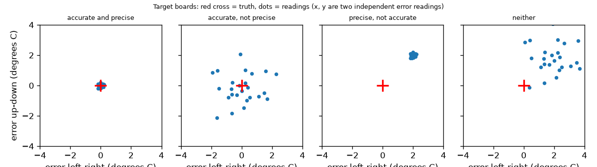
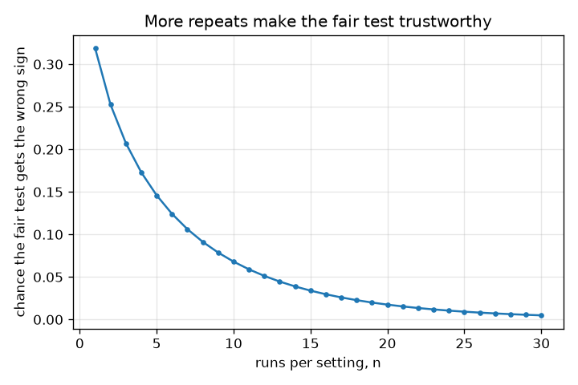

# సెషన్ 1: ఒక న్యాయమైన పరీక్ష: ఒక మార్పు, పునరావృతం, ఖచ్చితత్వం (accurate) vs సూక్ష్మత (precise)

[Session 1 — हिन्दी](README.hi.md) · [Session 1 — മലയാളം](README.ml.md) · [Session 1 — தமிழ்](README.ta.md) · [Session 1 — తెలుగు](README.te.md)

*స్థాయి 1 (భావనాత్మక ఇంటరాక్టివ్ మోడల్) · సుమారు 60 నిమిషాలు · openexperiment*

> ఇది సరళీకరించిన ఒక విద్యా మోడల్. ఇది ధృవీకరించబడిన (validated) డిజైన్ సాధనం కాదు; నిజమైన నిర్మాణాలు, విద్యుత్ ఇన్‌స్టలేషన్‌లు, వాహనాలు, పారిశ్రామిక ప్రక్రియలు లేదా వైద్య నిర్ణయాల కోసం దీనిని ఉపయోగించకూడదు.

**ముందస్తు అవసరాలు (Prerequisites)**

- పాఠశాల అంకగణితం: సగటులు మరియు తేడాలు.
- మీరు PRIMER.md చదివి, `python start.py 1` ను ఒకసారి రన్ చేశారు.

**అభ్యాస లక్ష్యాలు (Learning objectives).** ఈ సెషన్ తర్వాత మీరు చేయగలరు:

- న్యాయమైన పరీక్ష (fair test) ఒకసారికి ఒక్క విషయాన్ని మాత్రమే ఎందుకు మారుస్తుందో వివరించడం.
- రెండు విషయాలను ఒకేసారి మార్చడం తప్పు సమాధానాన్ని ఎలా ఇస్తుందో సంఖ్యలతో చూపించడం.
- పరీక్షను ఎందుకు పునరావృతం చేయాలో వివరించి, పునరావృతాల సగటును ఉపయోగించడం.
- నాలుగు ఉదాహరణ థర్మామీటర్లతో ఖచ్చితమైనదాన్ని (accurate - చిన్న బయాస్) సూక్ష్మమైనదాని (precise - చిన్న విక్షేపణ) నుండి వేరుచేయడం.

## A. నిజ జీవిత సమస్య
ఒక మూత ఒక కప్పు వేడి నీటిని ఎక్కువసేపు వెచ్చగా ఉంచుతుందో లేదో మీరు తెలుసుకోవాలనుకుంటారు. ఒక పెద్ద కప్పుపై మూత పెట్టి, ఒక చిన్న కప్పును తెరిచి వదిలేస్తారు. మూత పెట్టిన కప్పు తక్కువగా చల్లబడుతుంది, కాబట్టి మూత పనిచేస్తుంది, సరైనదేనా? తప్పనిసరిగా కాదు: పెద్ద కప్పు మూత లేకపోయినా తక్కువగానే చల్లబడేది. పరీక్షను ఒక్కసారే చేస్తే, అదృష్టకరమైన లేదా దురదృష్టకరమైన ఒక రన్ మిమ్మల్ని మోసం చేయవచ్చు. నిజమైన సమాధానం తెలిసిన ఒక కల్పిత ప్రపంచాన్ని ఈ సెషన్ నిర్మిస్తుంది, కాబట్టి అన్యాయమైన మరియు ఒక్కసారి మాత్రమే చేసిన పరీక్షలు ఎలా తప్పుతాయో మీరు ఖచ్చితంగా చూడవచ్చు. ఇది ప్రయోగాల గురించిన సాధారణ విద్య.

## B. భావన మరియు సిద్ధాంతం
న్యాయమైన పరీక్ష ఒక విషయాన్ని (మూత) మారుస్తుంది, మిగతావన్నీ ఒకేలా ఉంచుతుంది (అదే కప్పు, అదే నీరు, అదే సమయం, అదే థర్మామీటర్, దానిని చదివే అదే పద్ధతి). ప్రతి కొలతకూ విక్షేపణ (scatter) ఉంటుంది, కాబట్టి మనం పరీక్షను పునరావృతం చేసి n పునరావృతాల సగటు (mean) ఉపయోగిస్తాము: సగటు విక్షేపణ sd / sqrt(n). మూత ప్రభావం అంటే మూతతో ఉన్న సగటు నుండి మూత లేని సగటును తీసివేయడం. కొలత పరికరాన్ని రెండు పదాలు వర్ణిస్తాయి. ఖచ్చితమైన (accurate) అంటే దాని రీడింగుల సగటు సత్యానికి దగ్గరగా ఉంటుంది: దాని బయాస్ (bias - సగటు దోషం) చిన్నది. సూక్ష్మమైన (precise) అంటే పునరావృత రీడింగులు ఒకదానితో ఒకటి ఏకీభవిస్తాయి: వాటి విక్షేపణ (ప్రామాణిక విచలనం) చిన్నది. బయాస్ మరియు విక్షేపణ స్వతంత్రమైనవి: నాలుగు కలయికలూ ఉంటాయి.

| గుర్తు | అర్థం | యూనిట్ |
|---|---|---|
| lid effect | మూత వల్ల చల్లబడే తగ్గుదలలో నిజమైన మార్పు (-1.0: మూతతో నీరు 1.0 డిగ్రీల C తక్కువగా చల్లబడుతుంది) | డిగ్రీల C |
| cup effect | పెద్ద కప్పు వల్ల చల్లబడే తగ్గుదలలో నిజమైన మార్పు (-3.0) | డిగ్రీల C |
| sd | ఒక కొలత విక్షేపణ (చల్లబడే పరీక్షకు 1.5) | డిగ్రీల C |
| n | ప్రతి సెట్టింగ్‌కు పునరావృతాలు | యూనిట్ లేదు |
| bias | సగటు రీడింగ్ మైనస్ సత్యం | డిగ్రీల C |

**ఊహలు (Assumptions)**

- ప్రపంచం కల్పితం: నిజమైన ప్రభావాలు తెలుసు (మూత -1.0, పెద్ద కప్పు -3.0, ఆధార తగ్గుదల 20.0 డిగ్రీల C).
- రన్ నుండి రన్‌కు విక్షేపణ యాదృచ్ఛికం, గంట ఆకారంలో, ప్రతి రన్‌కూ ఒకేలా ఉంటుంది.
- రన్‌లు ఒకదానికొకటి స్వతంత్రంగా ఉంటాయి.

$$ \text{effect}=\bar y_{\text{lid}}-\bar y_{\text{bare}},\qquad \mathrm{sd}(\bar y)=\frac{\sigma}{\sqrt n} $$

$$ \mathrm{sd}(\bar y_1-\bar y_2)=\sigma\sqrt{\frac{2}{n}} $$

$$ P(\text{wrong sign})=P\!\left(Z>\frac{|\text{effect}|}{\sigma\sqrt{2/n}}\right) $$

$$ \text{typical error}=\sqrt{\text{bias}^2+\left(\frac{\sigma}{\sqrt n}\right)^2} $$

## C. దృశ్య వివరణ
మొదటి చిత్రం నాలుగు థర్మామీటర్లను లక్ష్య బోర్డులుగా చూపిస్తుంది: ఎరుపు శిలువ సత్యం, ప్రతి చుక్క ఒక రీడింగ్. ఖచ్చితమైనది మరియు సూక్ష్మమైనది శిలువపై బిగుతైన గుంపును ఇస్తుంది; ఖచ్చితమైనది కానీ సూక్ష్మం కానిది శిలువను కేంద్రంగా చేసుకున్న విశాలమైన మేఘాన్ని ఇస్తుంది; సూక్ష్మమైనది కానీ ఖచ్చితం కానిది శిలువ నుండి దూరంగా బిగుతైన గుంపును ఇస్తుంది; రెండూ కానిది శిలువ నుండి దూరంగా విశాలమైన మేఘాన్ని ఇస్తుంది. ప్రతి సెట్టింగ్‌కు రన్‌ల సంఖ్యకు వ్యతిరేకంగా న్యాయమైన మూత పరీక్షకు తప్పు గుర్తు వచ్చే అవకాశాన్ని రెండవ చిత్రం ప్లాట్ చేస్తుంది: ఒక రన్‌లో 0.32 నుండి 25 రన్‌లలో 0.01 కంటే తక్కువకు తగ్గుతుంది.

*లక్ష్య బోర్డులుగా నాలుగు థర్మామీటర్లు: బయాస్ గుంపును కదిలిస్తుంది, విక్షేపణ దానిని విశాలం చేస్తుంది.*

*ప్రతి సెట్టింగ్‌కు రన్‌ల సంఖ్య పెరిగేకొద్దీ న్యాయమైన పరీక్షకు తప్పు గుర్తు వచ్చే అవకాశం తగ్గుతుంది.*

## D. ఇంటరాక్టివ్ సిమ్యులేషన్
పాఠాన్ని రన్ చేయండి (`python start.py 1`), ఆపై లైవ్ యాప్ తెరవండి: [సెషన్ 1: ఖచ్చితమైనది vs సూక్ష్మమైనది](https://krunalpanchal1995.github.io/pan-iit-oss/openexperiment/session-01/) (లేదా ఈ ఫోల్డర్‌లోని `app.html`). బయాస్, విక్షేపణ, n స్లైడర్‌లను కదపండి. రీడింగ్‌ల వ్యూలో, చుక్కలు వ్యాపించడం (విక్షేపణ), జరగడం (బయాస్), n పెరిగేకొద్దీ నల్ల త్రిభుజం (వాటి సగటు) ఎలా ప్రవర్తిస్తుందో గమనించండి. గ్రాఫ్ వ్యూలో, n ఎంత పెద్దదైనా ఎరుపు బయాస్ రేఖ అదే ఎత్తులో ఉండటం గమనించండి: సగటు తీసుకోవడం బయాస్‌ను తొలగించలేదు.

**సవాలు (Challenge).** సగటు యొక్క సాధారణ దోషాన్ని (typical error) 0.5 డిగ్రీల C కంటే తక్కువకు తీసుకురండి.

## E. సాధించిన ఉదాహరణ మరియు ప్రయోగం
**సమస్య.** కల్పిత చల్లబడే పరీక్షలో మూత ప్రభావం -1.0 డిగ్రీల C, ప్రతి రన్‌కు విక్షేపణ 1.5 డిగ్రీల C. (a) అన్యాయమైన పరీక్ష (పెద్ద కప్పుపై మూత, తెరిచిన చిన్న కప్పుకు వ్యతిరేకంగా) ఏమి నివేదిస్తుంది? (b) న్యాయమైన పరీక్షలో ప్రతి సెట్టింగ్‌కు ఒక రన్ ఉన్నప్పుడు తప్పు గుర్తు వచ్చే అవకాశం ఎంత?

1. అన్యాయమైన పరీక్ష, విక్షేపణ లేకుండా: (20 - 1 - 3) - 20 = -4 డిగ్రీల C. అది -4 నివేదిస్తుంది, కానీ మూత -1 మాత్రమే; అదనపు -3 కప్పు పరిమాణం.
2. న్యాయమైన పరీక్ష, విక్షేపణ లేకుండా: (20 - 1) - 20 = -1 డిగ్రీల C: నిజమైన మూత ప్రభావం.
3. n = 1 తో రెండు రన్‌ల తేడా విక్షేపణ 1.5 * sqrt(2) = 2.12 డిగ్రీల C.
4. నిజమైన తేడా -1.0. తప్పు గుర్తు అంటే కొలిచిన తేడా 0 కంటే పైన వస్తుంది, అంటే దాని నిజమైన విలువ కంటే కనీసం 1.0 / 2.12 = 0.471 ప్రామాణిక విచలనాలు పైన. దాని అవకాశం 0.471 దాటిన సాధారణ విభజన తోక (normal tail), అది 0.319.

**సమాధానం.** అన్యాయమైన పరీక్ష -4 ఇస్తుంది (కప్పు ప్రభావం -3 వల్ల తప్పు). ఒక రన్ ఉన్న న్యాయమైన పరీక్ష 0.319 సందర్భాలలో, సుమారు మూడింటిలో ఒకసారి, మూత పరిస్థితిని మరింత చెడగొడుతుందని చెబుతుంది. ప్రతి సెట్టింగ్‌కు 9 రన్‌లతో ఇది 0.079 కు తగ్గుతుంది.

**ప్రయోగం.** నిజంగా చేసి చూడండి: ఒకేలాంటి రెండు మగ్గులు, ఒకే ప్రారంభ ఉష్ణోగ్రత వద్ద నీరు, ఒకదానిపై మూత, ఒకే సమయంలో (ఉదాహరణకు 10 నిమిషాలు) ప్రతిసారీ ఒకే విధంగా చదివే థర్మామీటర్. ఏ మగ్గుకు మూత అనేది మార్చుకుంటూ 5 సార్లు పునరావృతం చేయండి. సగటు తేడాను ఒకే రన్‌తో పోల్చండి. నిజమైన నీటికి మోడల్‌లో లేని అదనపు విక్షేపణ ఉంటుంది (గాలి, థర్మామీటర్‌ను పట్టుకునే విధానం), నిజమైన మూత ప్రభావం మగ్గుపై ఆధారపడుతుంది; సిమ్యులేషన్‌కు ఖచ్చితమైన సత్యం తెలుసు, వంటగదికి తెలియదు.

## F. మూల్యాంకనం మరియు డిజైన్ సవాలు
**ప్రశ్న రకం A: భావనాత్మకం.** ఒక స్నేహితుడు అంటాడు: 'నా మొక్కల ఎరువు పనిచేస్తుంది: ఎండ ఉన్న కిటికీలో ఎరువు వేసిన మొక్కలు అరలో ఎరువు వేయని వాటికంటే ఎత్తుగా పెరిగాయి.' ఈ పరీక్షలో తప్పు ఏమిటి, దానిని ఎలా సరిచేస్తారు?

సూచన

ఎరువు మాత్రమే కాకుండా, రెండు సమూహాల మధ్య తేడా ఉన్న ప్రతిదాన్ని జాబితా చేయండి.

దశలవారీ పరిష్కారం

రెండు విషయాలు మారాయి: ఎరువు మరియు స్థానం (సూర్యకాంతి). అదనపు పెరుగుదల ఎండ నుండి వచ్చి ఉండవచ్చు. న్యాయమైన పరీక్ష అన్ని మొక్కలను ఒకే చోట ఉంచుతుంది, ఎరువును మాత్రమే మారుస్తుంది, ప్రతి సమూహంలో అనేక మొక్కలను (పునరావృతాలు) ఉపయోగిస్తుంది, వాటిని ఒకే విధంగా కొలుస్తుంది. పెద్ద కప్పుపై మూత లాగా, రెండూ కలిసి మారినప్పుడు ఎరువు ప్రభావాన్ని సూర్యకాంతి నుండి వేరు చేయలేము.

**ప్రశ్న రకం B: సంఖ్యాత్మకం.** చల్లబడే పరీక్షలో (మూత ప్రభావం -1.0 డిగ్రీల C, ప్రతి రన్‌కు విక్షేపణ 1.5 డిగ్రీల C) మీరు ప్రతి సెట్టింగ్‌కు n = 9 రన్‌లు ఉపయోగిస్తారు. రెండు సగటుల తేడా విక్షేపణ మరియు తప్పు గుర్తు వచ్చే అవకాశం ఎంత?

సూచన

తేడా విక్షేపణ = 1.5 * sqrt(2 / n). ఆపై z = 1 / అది, సాధారణ విభజన తోకను ఉపయోగించండి.

దశలవారీ పరిష్కారం

విక్షేపణ = 1.5 * sqrt(2 / 9) = 0.707 డిగ్రీల C. z = 1 / 0.707 = 1.414, 1.414 దాటిన సాధారణ విభజన తోక 0.079. యూనిట్లు: డిగ్రీల C. సహేతుకత తనిఖీ (sanity check): ఇది ఒక రన్‌కు 0.319 కంటే తక్కువ, అలాగే ఉండాలి, ఎందుకంటే ఎక్కువ పునరావృతాలు విక్షేపణను తగ్గిస్తాయి.

**ప్రశ్న రకం C: గ్రాఫ్ మరియు సిమ్యులేషన్ వ్యాఖ్యానం.** యాప్ గ్రాఫ్ వ్యూలో, బయాస్ 2.0, sd 1.0, మీరు n ను 1 నుండి 100 వరకు కదుపుతారు. నల్ల వక్రాన్ని వర్ణించండి, దానిని పరిమితం చేసేది ఏమిటి?

సూచన

నీలం వక్రాన్ని (యాదృచ్ఛిక భాగం, n తో కుంచించుకుంటుంది) ఎరుపు రేఖతో (బయాస్, కుంచించుకోదు) పోల్చండి.

దశలవారీ పరిష్కారం

నల్ల వక్రం (సాధారణ మొత్తం దోషం) n = 1 వద్ద sqrt(2^2 + 1^2) = 2.24 తో మొదలై పడిపోతుంది, కానీ n ఎంత పెద్దదైనా 2.0 వద్ద (ఎరుపు రేఖ) చదునవుతుంది, ఎందుకంటే సగటు తీసుకోవడం యాదృచ్ఛిక భాగమైన sd / sqrt(n) ను మాత్రమే కుదిస్తుంది. ఇంకా తగ్గాలంటే మీరు బయాస్‌ను తొలగించాలి (కాలిబ్రేట్ చేయండి), మరిన్ని రీడింగులు తీసుకోవడం కాదు.

**ప్రశ్న రకం D: డిజైన్ మరియు ఆప్టిమైజేషన్ సవాలు.** డిజైన్: మీ దగ్గర బయాస్ 2.0 డిగ్రీల C, sd 0.1 డిగ్రీల C ఉన్న థర్మామీటర్, మరియు బయాస్ 0, sd 1.0 డిగ్రీల C ఉన్న మరొకటి ఉన్నాయి. మొత్తం గరిష్టంగా 25 రీడింగులు మాత్రమే భరించగలరు. ఒక ఉష్ణోగ్రతను 0.5 డిగ్రీల C లోపు కొలవడానికి ఏది ఎంచుకుంటారు, మొదటిదాన్ని ఏమి చేస్తారు?

సూచన

ప్రతిదానికి సాధారణ దోషం sqrt(bias^2 + sd^2/n) లెక్కించండి.

దశలవారీ పరిష్కారం

రెండవది: 25 రీడింగులతో దాని సాధారణ దోషం 1.0 / sqrt(25) = 0.2 డిగ్రీల C (0.5 కంటే తక్కువ). మొదటిది n ఎంతైనా సుమారు 2.0 వద్దే ఉంటుంది. మొదటిదాన్ని ఒక రిఫరెన్స్‌తో కాలిబ్రేట్ చేసి (దాని బయాస్‌ను తీసివేసి) సరిచేయవచ్చు, ఆ తర్వాత దాని విక్షేపణ 0.1 డిగ్రీల C దానిని మెరుగైన పరికరం చేస్తుంది. రాజీ (trade-off): రిఫరెన్స్ కొలత ఖర్చు మరియు సమయం. ఊహ: బయాస్ స్థిరమైనది.

[RUBRIC.md](../../RUBRIC.md) తో మీకు మీరే స్కోర్ ఇచ్చుకోండి. కాగితంపై పని చేయడానికి [కార్యాచరణ పత్రాన్ని](activity_sheet.md) ప్రింట్ చేయండి.

## సాధారణ అపోహలు
| సాధారణ అపోహ | వాస్తవంగా నిజం ఏమిటి |
|---|---|
| సూక్ష్మత్వం అంటే ఖచ్చితత్వం. | సూక్ష్మత్వం అంటే పునరావృతం చేయగలగడం; ఖచ్చితత్వం అంటే సత్యానికి దగ్గరగా ఉండటం. సత్యం 50.0 అయినప్పుడు థర్మామీటర్ ప్రతిసారీ 52.0 చూపవచ్చు: సూక్ష్మమైనది, ఖచ్చితమైనది కాదు. |
| నేను పరీక్షను పునరావృతం చేస్తే అదే సంఖ్య వస్తుంది. | నిజమైన కొలతలు చెల్లాచెదురవుతాయి. పునరావృతాలు విక్షేపణను అంచనా వేయడానికి మరియు 1 / sqrt(n) ద్వారా సగటుతో తగ్గించడానికి సహాయపడతాయి. |
| చాలా రీడింగుల సగటు తీసుకోవడం ఎల్లప్పుడూ మిమ్మల్ని సత్యానికి చేరుస్తుంది. | సగటు తీసుకోవడం యాదృచ్ఛిక దోషాన్ని మాత్రమే తొలగిస్తుంది; ఎన్ని రీడింగులు తీసుకున్నా బయాస్ అలాగే ఉంటుంది. |
| నా పరీక్షలో పెద్ద ప్రభావం అంటే ఆ విషయం పనిచేస్తుందని అర్థం. | ఇతర విషయాలు కూడా (కప్పు పరిమాణం, స్థానం) మారితే, తేడా వాటి ప్రభావాలను మీకు కావలసినదానితో కలుపుతుంది. |

## పదకోశం (Glossary)
- **న్యాయమైన పరీక్ష (fair test)**: ఒకే ఒక్క విషయం మారే పోలిక
- **పునరావృతం (repeat)**: విక్షేపణ చూడటానికి అదే కొలతను మళ్ళీ చేయడం
- **బయాస్ (bias)**: రీడింగుల సగటు దోషం; పరికరాన్ని ఖచ్చితం కానిదిగా చేస్తుంది
- **విక్షేపణ (ప్రామాణిక విచలనం - scatter)**: పునరావృత రీడింగులు వాటి సగటు చుట్టూ వ్యాపించే సాధారణ పరిమాణం; చిన్నది అంటే సూక్ష్మమైనది
- **ఖచ్చితమైన (accurate)**: రీడింగుల సగటు నిజమైన విలువకు దగ్గరగా ఉంటుంది
- **సూక్ష్మమైన (precise)**: పునరావృత రీడింగులు ఒకదానితో ఒకటి దగ్గరగా ఏకీభవిస్తాయి

## ముగించండి
1. [exercises.md](exercises.md) లోని మూడు కోడింగ్ పనులు చేయండి.
2. మీ మార్పుల తర్వాత `python start.py 1` ను మళ్ళీ రన్ చేయండి. అది చెక్‌పాయింట్‌తో ముగుస్తుంది; అది `PASS` అని ప్రింట్ చేసినప్పుడు, మీరు పూర్తి చేశారు. (చెక్‌పాయింట్ మాత్రమే: `python start.py check 1`.)

తదుపరి: [సెషన్ 2](../session-02/README.md)
