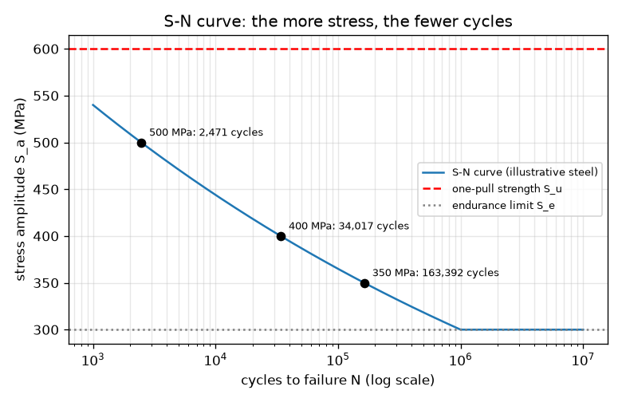
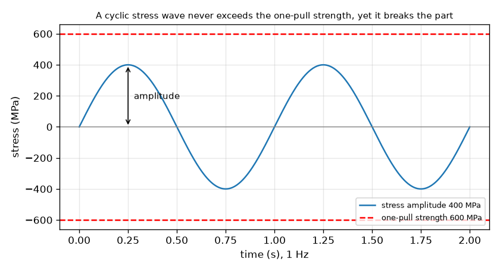

# सत्र 1: बार-बार के भार वह तोड़ देते हैं जो एक भार नहीं तोड़ सकता

*स्तर 1 (वैचारिक इंटरैक्टिव मॉडल) · लगभग 60 मिनट · openfatigue*

> यह एक सरलीकृत शैक्षिक मॉडल है। यह कोई प्रमाणित डिज़ाइन उपकरण नहीं है और इसका उपयोग वास्तविक संरचनाओं, विद्युत संस्थापनों, वाहनों, औद्योगिक प्रक्रियाओं या चिकित्सा निर्णयों के लिए नहीं किया जाना चाहिए।

**पूर्व-आवश्यकताएँ (Prerequisites)**

- स्कूल का बीजगणित: घात (powers) और लघुगणक (logarithms)।
- आपने PRIMER.md पढ़ लिया है और एक बार `python start.py 1` चला लिया है।

**सीखने के उद्देश्य (Learning objectives)।** इस सत्र के बाद आप:

- समझा सकेंगे कि कोई पुर्ज़ा अपनी एक-खिंचाव सामर्थ्य (one-pull strength) से कम बार-बार के प्रतिबल (stress) में भी क्यों विफल हो सकता है।
- एक चक्रीय प्रतिबल तरंग (cyclic stress wave) पढ़ सकेंगे: आयाम (amplitude), परास (range), माध्य (mean) और चक्र (cycle)।
- S-N संबंध S_a = A N^b का उपयोग करके प्रतिबल आयाम को चक्रों की संख्या और चलने के समय में बदल सकेंगे।
- बता सकेंगे कि स्टील के पुर्ज़े के लिए सहनशीलता सीमा (endurance limit) का क्या अर्थ है।

## A. वास्तविक जीवन की समस्या
एक पेपर क्लिप को एक बार मोड़िए तो वह वापस आ जाती है। उसे आगे-पीछे मोड़ते रहिए तो वह टूट जाती है, भले ही कोई भी एक मोड़ पहले मोड़ से कठिन नहीं था। पुल, धुरियाँ (axles), स्प्रिंग और विमान की बाहरी परतें इसी चुपचाप तरीक़े से विफल होती हैं: क्षति (damage) चक्र-दर-चक्र जमा होती जाती है। इंजीनियरों को एक व्यावहारिक प्रश्न का उत्तर देना होता है: यदि कोई पुर्ज़ा एक दिए गए प्रतिबल को बार-बार झेलता है, तो वह कितने चक्र टिकेगा? (उदाहरणात्मक संख्याओं वाला शैक्षिक मॉडल; इसका उपयोग कभी किसी वास्तविक पुर्ज़े को डिज़ाइन करने के लिए न करें।)

## B. अवधारणा और सिद्धांत
एक घूमता हुआ शाफ़्ट जो मुड़ा हुआ है, उसकी सतह का हर बिंदु खिंचाव से दबाव और वापस जाता है: प्रतिबल एक तरंग है, stress = S_m + S_a sin(2 pi f t), जिसमें माध्य S_m, आयाम S_a और आवृत्ति (frequency) f है। एक पूरी तरंग एक चक्र है। परास आयाम का दोगुना है। यदि कई एक जैसी छड़ों में से हर एक का अलग आयाम पर परीक्षण किया जाए और टूटने तक के चक्र N गिने जाएँ, तो जब दोनों अक्ष लघुगणकीय पैमानों पर खींचे जाते हैं, तब बिंदु एक सीधी रेखा के क़रीब आते हैं। वह रेखा बास्क्विन संबंध (Basquin's relation) S_a = A N^b है। घातांक b ऋणात्मक है (अधिक प्रतिबल, कम चक्र) और सामान्य स्टील के लिए लगभग -0.1 है; हमारे उदाहरणात्मक स्टील में b = -0.085 है, क्योंकि रेखा 1000 चक्रों पर 0.9 S_u से और दस लाख चक्रों पर सहनशीलता सीमा S_e से होकर खींची गई है। कई स्टील एक सहनशीलता सीमा दिखाते हैं, S_u का लगभग आधा, जिसके नीचे परीक्षण छड़ें बहुत लंबे समय तक टिकती हैं।

| प्रतीक | अर्थ | इकाई |
|---|---|---|
| S_a | प्रतिबल आयाम (परास का आधा) | MPa |
| S_u | चरम (एक-खिंचाव) सामर्थ्य, यहाँ 600 | MPa |
| S_e | सहनशीलता सीमा, यहाँ 300 (0.5 S_u) | MPa |
| N | विफलता तक चक्र | चक्र |
| A, b | S-N रेखा के स्थिरांक; यहाँ A = 972 MPa, b = -0.085 | MPa, कोई इकाई नहीं |
| f | भारण आवृत्ति | Hz (चक्र प्रति सेकंड) |

**मान्यताएँ (Assumptions)**

- एक छोटी चिकनी (polished) छड़ पर पूर्णतः प्रत्यावर्ती (fully reversed) प्रतिबल (माध्य शून्य)।
- संख्याएँ एक सामान्य उदाहरणात्मक स्टील का वर्णन करती हैं, किसी वास्तविक मिश्रधातु का नहीं।
- S_e से नीचे हम कोई विफलता नहीं मानते (कई स्टील के लिए सत्य, एल्युमिनियम के लिए नहीं)।
- सरलीकृत शिक्षण मॉडल: वास्तविक पुर्ज़ों के लिए कभी डिज़ाइन विधि नहीं।

$$ S(t)=S_m+S_a\sin(2\pi f t),\qquad \Delta S = 2S_a $$

$$ S_a=A\,N^{\,b},\qquad N=\left(\frac{S_a}{A}\right)^{1/b} $$

$$ b=-\frac{1}{3}\log_{10}\frac{0.9\,S_u}{S_e},\qquad A=\frac{(0.9\,S_u)^2}{S_e} $$

$$ t_{\mathrm{fail}}=\frac{N}{f} $$

## C. दृश्य व्याख्या
पहला चित्र 400 MPa आयाम की एक प्रतिबल तरंग दिखाता है। इसके शिखर 600 MPa एक-खिंचाव सामर्थ्य की लाल डैश रेखा से नीचे रहते हैं, फिर भी पर्याप्त चक्रों के बाद पुर्ज़ा विफल हो जाता है। दूसरा चित्र लघुगणकीय चक्र अक्ष पर S-N वक्र है: यह 1000 चक्रों पर 540 MPa से दस लाख चक्रों पर 300 MPa की सहनशीलता सीमा तक गिरता है, फिर सपाट चलता है। तीन चिह्नित बिंदु दिखाते हैं कि 500 MPa लगभग 2,500 चक्र, 400 MPa लगभग 34,000 और 350 MPa लगभग 163,000 चक्र चलता है।

*तीन चिह्नित संचालन बिंदुओं और सहनशीलता सीमा के साथ उदाहरणात्मक स्टील का S-N वक्र।*

*400 MPa आयाम की तरंग 600 MPa एक-खिंचाव सामर्थ्य से काफ़ी नीचे रहती है, फिर भी पर्याप्त चक्रों के बाद पुर्ज़े को तोड़ देती है।*

## D. इंटरैक्टिव सिमुलेशन
पाठ चलाएँ (`python start.py 1`), फिर लाइव ऐप खोलें: [सत्र 1: प्रतिबल तरंग और S-N वक्र](https://krunalpanchal1995.github.io/pan-iit-oss/openfatigue/session-01/) (या इसी फ़ोल्डर में `app.html`)। आयाम स्लाइडर हिलाएँ और तरंग को बढ़ते देखें, फिर S-N दृश्य खोलें और संचालन बिंदु को वक्र पर खिसकते देखें। आवृत्ति बदलें और देखें कि विफलता तक चलने का समय कैसे बदलता है जबकि चक्रों की संख्या नहीं बदलती।

**चुनौती।** ऐसा प्रतिबल आयाम चुनें जिस पर मॉडल कोई थकान विफलता (fatigue failure) नहीं बताता।

## E. हल किया गया उदाहरण और प्रयोग
**समस्या।** एक स्टील छड़ (S_u = 600 MPa, S_e = 300 MPa, इसलिए A = 972 MPa और b = -0.085) पर 10 Hz पर 400 MPa का पूर्णतः प्रत्यावर्ती आयाम लगाया जाता है। यह कितने चक्र टिकती है और कितनी देर चलती है?

1. जाँचें कि मॉडल लागू होता है: 400 MPa, S_e = 300 MPa से ऊपर है, इसलिए आयु सीमित है, और S_u = 600 MPa से नीचे है, इसलिए एक खिंचाव इसे नहीं तोड़ेगा।
2. N = (S_a / A)^(1/b) = (400 / 972)^(1 / -0.0851)। यहाँ 400 / 972 = 0.4115, log10(0.4115) = -0.3856, और 1/b = -11.75।
3. log10 N = -0.3856 x -11.75 = 4.53, इसलिए N = 10^4.53 = 34,000 चक्र (अधिक अंकों के साथ 34,017)।
4. चलने का समय = N / f = 34,017 / 10 = 3,402 s = 56.7 मिनट।
5. जाँच (sanity check): 400 MPa, 1000 चक्रों पर 540 MPa और दस लाख चक्रों पर 300 MPa के बीच है, इसलिए 1,000 और 1,000,000 चक्रों के बीच की आयु सही है।

**उत्तर।** लगभग 34,000 चक्र, जो 10 Hz पर लगभग 57 मिनट है।

**प्रयोग।** एक पेपर क्लिप को एक ही कोण (मान लीजिए 90 डिग्री) से आगे-पीछे मोड़ें और टूटने तक के मोड़ गिनें; पाँच क्लिपों के साथ दोहराएँ और अपनी गिनतियों की तुलना करें। आपको एक संख्या नहीं, एक परास मिलेगा, और यह यहाँ के किसी भी सूत्र से भिन्न होगा क्योंकि क्लिप अपनी प्रत्यास्थ सीमा (elastic range) से बहुत आगे मोड़ी जाती है, इसलिए वह हमारी रेखा द्वारा बताए गए हज़ारों चक्रों से बहुत पहले विफल हो जाती है: यह निम्न-चक्र (low-cycle) क्षेत्र है जहाँ हमारी उच्च-चक्र S-N रेखा लागू नहीं होती। मॉडल एक आदर्श छड़ के लिए सीधी रेखा है; वास्तविक पुर्ज़े उसके आसपास बिखरे होते हैं।

## F. मूल्यांकन और डिज़ाइन चुनौती
**प्रश्न प्रकार A: वैचारिक।** कोई पुर्ज़ा ऐसे बार-बार के प्रतिबल में क्यों टूट सकता है जो उसे एक खिंचाव में तोड़ने के लिए आवश्यक प्रतिबल से छोटा है? पुर्ज़ा एक चक्र से अगले चक्र तक क्या 'याद रखता' है?

संकेत

पेपर क्लिप के बारे में सोचें: हर मोड़ के साथ उसके अंदर क्या बदलता है?

चरण-दर-चरण हल

हर चक्र थोड़ी-सी स्थायी क्षति करता है, ज़्यादातर सूक्ष्म जगहों पर जहाँ प्रतिबल सबसे अधिक होता है (एक खरोंच, एक कोना, एक कण सीमा (grain boundary))। भार हटाने पर क्षति मिटती नहीं, इसलिए यह तब तक जमा होती है जब तक एक दरार (crack) नहीं बनती और बढ़ती। S_u से नीचे एक खिंचाव ऐसी कोई जमा होने वाली क्षति नहीं करता, पर कई पुनरावृत्तियाँ करती हैं। पुर्ज़ा अपनी जमा हुई क्षति को 'याद रखता' है, स्वयं भार को नहीं।

**प्रश्न प्रकार B: संख्यात्मक।** उसी स्टील पर 350 MPa आयाम और 20 Hz पर भार लगाया जाता है। विफलता तक चक्रों की संख्या और घंटों में चलने का समय ज्ञात करें। जाँचें कि उत्तर समझदारी भरा है।

संकेत

N = (S_a / A)^(1/b), जहाँ A = 972 MPa और b = -0.0851; समय = N / f।

चरण-दर-चरण हल

N = (350 / 972)^(-11.75) = 163,392 चक्र (लगभग 163,000)। समय = 163,392 / 20 = 8,170 s = 2.27 घंटे। जाँच: 350 MPa, 300 MPa (दस लाख चक्र) और 400 MPa (34,000 चक्र) के बीच है, इसलिए आयु इन दो मानों के बीच होनी चाहिए: है।

**प्रश्न प्रकार C: ग्राफ़ और सिमुलेशन की व्याख्या।** S-N ग्राफ़ पर आयाम 400 MPa से 500 MPa बढ़ाया जाता है, 25 प्रतिशत की वृद्धि। आयु कितने गुना घटती है? खड़ा वक्र डिज़ाइनर को क्या बताता है?

संकेत

दोनों प्रतिबलों पर N पढ़ें (या गणना करें) और भाग दें।

चरण-दर-चरण हल

N, 34,017 से 2,471 चक्र तक गिरता है, 13.8 का गुणांक (लगभग 14 गुना छोटा)। प्रतिबल में 25 प्रतिशत वृद्धि की क़ीमत आयु में एक कोटि (order of magnitude) से अधिक है: थकान आयु प्रतिबल के प्रति बहुत संवेदनशील है, इसलिए प्रतिबल में छोटी कमी (बड़ी त्रिज्या, थोड़ा मोटा खंड) बहुत आयु दिलाती है।

**प्रश्न प्रकार D: डिज़ाइन और अनुकूलन (optimisation) चुनौती।** एक घूमती छड़ 450 MPa का आयाम झेलती है। इसे 30 दिनों तक प्रतिदिन 8 घंटे 10 Hz पर चलना है। (a) यह कितने चक्र हैं? (b) 450 MPa पर यह कितनी देर टिकती है? (c) बंकन (bending) में प्रतिबल 1/d^3 के अनुसार चलता है (d = व्यास)। प्रतिबल को सहनशीलता सीमा तक लाने के लिए व्यास कितने गुना बढ़ना चाहिए?

संकेत

(a) चक्र = घंटे x 3600 x आवृत्ति। (b) S-N संबंध का उपयोग करें। (c) 450 / 300 = (d_new / d_old)^3।

चरण-दर-चरण हल

(a) 8 x 3600 x 10 x 30 = 8,640,000 चक्र। (b) 450 MPa पर N = 8,522 चक्र, 10 Hz पर केवल 14.2 मिनट। इसलिए छड़ पहले ही दिन विफल हो जाती है। (c) प्रतिबल को 450 / 300 = 1.5 गुना घटना चाहिए, इसलिए d_new / d_old = 1.5^(1/3) = 1.145: 14.5 प्रतिशत बड़ा व्यास आयाम को 300 MPa, यानी सहनशीलता सीमा तक ले आता है। मान्यताएँ: आदर्श छड़, कोई खाँचे (notches) नहीं, कोई सुरक्षा मार्जिन नहीं। एक वास्तविक डिज़ाइन मार्जिन जोड़ेगा (सत्र 2)।

[RUBRIC.md](../../RUBRIC.md) से स्वयं को अंक दें। काग़ज़ पर काम करने के लिए [गतिविधि पत्रक (activity sheet)](activity_sheet.md) प्रिंट करें।

## सामान्य भ्रांतियाँ (Common misconceptions)
| सामान्य भ्रांति | वास्तव में क्या सच है |
|---|---|
| यदि भार सामर्थ्य से नीचे है, तो पुर्ज़ा सुरक्षित है। | एक-खिंचाव सामर्थ्य से नीचे होना केवल एक खिंचाव के लिए सुरक्षित है। बार-बार के भार कई चक्रों के बाद पुर्ज़े को तोड़ सकते हैं। |
| पुर्ज़ा बिना चेतावनी के अचानक विफल होता है, इसलिए पहले कुछ नहीं होता। | क्षति कई चक्रों में जमा होती है; अंत में विफलता अचानक होती है, पर दरार लंबे समय से बढ़ रही होती है। |
| प्रतिबल को दोगुना करने से आयु आधी हो जाती है। | आयु प्रतिबल की ऊँची घात के साथ बदलती है: यहाँ N, S_a^(1/b) के अनुसार, लगभग S_a^-11.75 के अनुसार चलता है, इसलिए प्रतिबल में 25 प्रतिशत वृद्धि ने आयु को 13.8 गुना घटा दिया। |
| विफलता तक चक्र और विफलता तक समय एक ही चीज़ हैं। | समय, चक्र भाग आवृत्ति है; वही पुर्ज़ा 10 Hz की तुलना में 1 Hz पर समय में 10 गुना अधिक चलता है (इस सरल मॉडल में)। |

## शब्दावली (Glossary)
- **थकान (fatigue)**: बार-बार (चक्रीय) भारण से होने वाली विफलता, तब भी जब हर भार एक-खिंचाव सामर्थ्य से नीचे हो
- **प्रतिबल आयाम (stress amplitude)**: एक चक्र के उच्चतम और निम्नतम प्रतिबल के अंतर का आधा, MPa में
- **चक्र (cycle)**: भार की एक पूरी पुनरावृत्ति: ऊपर, नीचे और वापस
- **S-N वक्र (S-N curve)**: विफलता तक चक्रों के विरुद्ध प्रतिबल आयाम का ग्राफ़, आमतौर पर लघुगणकीय चक्र अक्ष के साथ
- **सहनशीलता सीमा (endurance limit)**: वह प्रतिबल आयाम जिसके नीचे स्टील का पुर्ज़ा बहुत लंबे समय तक चल सकता है
- **MPa**: मेगापास्कल, दस लाख न्यूटन प्रति वर्ग मीटर; प्रतिबल की इकाई

## समापन
1. [exercises.md](exercises.md) में दिए गए तीन कोडिंग कार्य करें।
2. अपने बदलावों के बाद `python start.py 1` फिर से चलाएँ। यह चेकपॉइंट के साथ समाप्त होता है; जब यह `PASS` छापे, तो आपका काम पूरा हो गया। (केवल चेकपॉइंट: `python start.py check 1`।)

आगे: [सत्र 2](../session-02/README.md)
