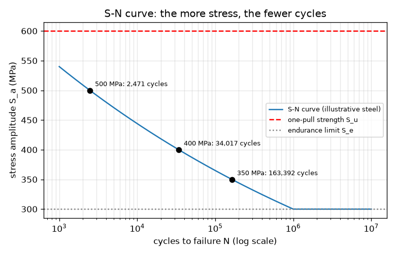
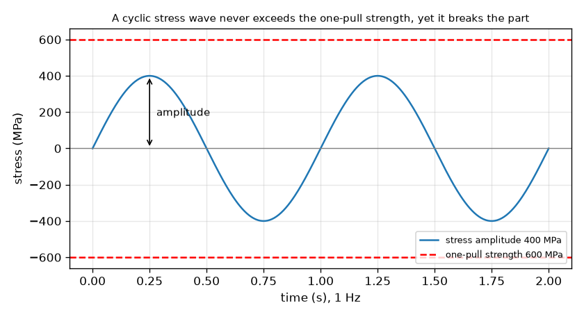

# സെഷൻ 1: ഒരു ലോഡിന് തകർക്കാൻ കഴിയാത്തത് ആവർത്തിച്ചുള്ള ലോഡുകൾ തകർക്കുന്നു

[Session 1 — हिन्दी](README.hi.md) · [Session 1 — മലയാളം](README.ml.md)

*ലെവൽ 1 (ആശയപരമായ ഇന്ററാക്ടീവ് മോഡൽ) · ഏകദേശം 60 മിനിറ്റ് · openfatigue*

> ഇത് ലളിതമാക്കിയ ഒരു വിദ്യാഭ്യാസ മോഡലാണ്. ഇത് സാധൂകരിക്കപ്പെട്ട (validated) ഡിസൈൻ ഉപകരണമല്ല; യഥാർത്ഥ ഘടനകൾ, വൈദ്യുത സംവിധാനങ്ങൾ, വാഹനങ്ങൾ, വ്യാവസായിക പ്രക്രിയകൾ അല്ലെങ്കിൽ വൈദ്യശാസ്ത്ര തീരുമാനങ്ങൾ എന്നിവയ്ക്ക് ഇത് ഉപയോഗിക്കരുത്.

**മുൻ‌അറിവ് (Prerequisites)**

- സ്കൂൾ ബീജഗണിതം: ഘാതങ്ങളും ലോഗരിതങ്ങളും.
- നിങ്ങൾ PRIMER.md വായിക്കുകയും `python start.py 1` ഒരിക്കൽ പ്രവർത്തിപ്പിക്കുകയും ചെയ്തിട്ടുണ്ട്.

**പഠന ലക്ഷ്യങ്ങൾ (Learning objectives).** ഈ സെഷനു ശേഷം നിങ്ങൾക്ക് കഴിയും:

- ഒരു ഭാഗം അതിന്റെ ഒറ്റ-വലി ബലത്തേക്കാൾ (one-pull strength) താഴെയുള്ള ആവർത്തിച്ചുള്ള പ്രതിബലത്തിൽ (stress) എന്തുകൊണ്ട് പരാജയപ്പെടാം എന്ന് വിശദീകരിക്കാൻ.
- ഒരു ചാക്രിക പ്രതിബല തരംഗം വായിക്കാൻ: ആയാമം (amplitude), പരിധി (range), ശരാശരി (mean), ചക്രം (cycle).
- S-N ബന്ധം S_a = A N^b ഉപയോഗിച്ച് ഒരു പ്രതിബല ആയാമത്തെ ചക്രങ്ങളുടെ എണ്ണമായും പ്രവർത്തന സമയമായും മാറ്റാൻ.
- ഒരു സ്റ്റീൽ ഭാഗത്തിന് എൻഡുറൻസ് പരിധി (endurance limit) എന്താണ് അർത്ഥമാക്കുന്നതെന്ന് പറയാൻ.

## A. യഥാർത്ഥ ലോക പ്രശ്നം
ഒരു പേപ്പർ ക്ലിപ്പ് ഒരു തവണ വളച്ചാൽ അത് തിരികെ വരുന്നു. അത് മുന്നോട്ടും പിന്നോട്ടും വളച്ചാൽ ഒടിയുന്നു, ഒരു വളവും ആദ്യത്തേതിനേക്കാൾ കഠിനമായിരുന്നില്ലെങ്കിലും. പാലങ്ങൾ, ആക്സിലുകൾ, സ്പ്രിംഗുകൾ, വിമാനത്തിന്റെ പുറംതൊലി എന്നിവ ഇതേ നിശബ്ദ രീതിയിൽ പരാജയപ്പെടുന്നു: കേടുപാട് ചക്രം ചക്രമായി കൂടിക്കൂടി വരുന്നു. എൻജിനീയർമാർ ഒരു പ്രായോഗിക ചോദ്യത്തിന് ഉത്തരം നൽകണം: ഒരു ഭാഗം ഒരു നിശ്ചിത പ്രതിബലം വീണ്ടും വീണ്ടും കാണുന്നുവെങ്കിൽ, അത് എത്ര ചക്രങ്ങൾ അതിജീവിക്കും? (ചിത്രീകരണ സംഖ്യകളുള്ള വിദ്യാഭ്യാസ മോഡൽ; ഒരു യഥാർത്ഥ ഭാഗം രൂപകൽപ്പന ചെയ്യാൻ ഒരിക്കലും ഇത് ഉപയോഗിക്കരുത്.)

## B. ആശയവും സിദ്ധാന്തവും
വളയ്ക്കപ്പെടുന്ന ഒരു കറങ്ങുന്ന ഷാഫ്റ്റിൽ ഓരോ ഉപരിതല ബിന്ദുവും വലിവിൽ നിന്ന് തള്ളലിലേക്കും തിരികെയും പോകുന്നു: പ്രതിബലം ഒരു തരംഗമാണ്, stress = S_m + S_a sin(2 pi f t), ശരാശരി S_m, ആയാമം S_a, ആവൃത്തി f എന്നിവയോടെ. ഒരു പൂർണ്ണ തരംഗം ഒരു ചക്രമാണ്. പരിധി ആയാമത്തിന്റെ ഇരട്ടിയാണ്. പല സമാന ദണ്ഡുകൾ ഓരോന്നും വ്യത്യസ്ത ആയാമത്തിൽ പരീക്ഷിക്കുകയും അവ പൊട്ടുന്നതുവരെയുള്ള ചക്രങ്ങൾ N എണ്ണുകയും ചെയ്താൽ, രണ്ട് അക്ഷങ്ങളും ലോഗരിതമിക് സ്കെയിലിൽ വരയ്ക്കുമ്പോൾ ബിന്ദുക്കൾ ഒരു നേർരേഖയോട് അടുത്ത് വീഴുന്നു. ആ രേഖയാണ് ബാസ്ക്വിന്റെ ബന്ധം (Basquin's relation) S_a = A N^b. എക്സ്പോണന്റ് b നെഗറ്റീവ് ആണ് (കൂടുതൽ പ്രതിബലം, കുറഞ്ഞ ചക്രങ്ങൾ), സാധാരണ സ്റ്റീലുകൾക്ക് അത് ഏകദേശം -0.1 ആണ്; നമ്മുടെ ചിത്രീകരണ സ്റ്റീലിന് b = -0.085 ആണ്, കാരണം രേഖ 1000 ചക്രങ്ങളിൽ 0.9 S_u-ലൂടെയും ഒരു ദശലക്ഷം ചക്രങ്ങളിൽ എൻഡുറൻസ് പരിധി S_e-ലൂടെയും വരയ്ക്കുന്നു. പല സ്റ്റീലുകളും ഒരു എൻഡുറൻസ് പരിധി കാണിക്കുന്നു, ഏകദേശം S_u-ന്റെ പകുതി, അതിനു താഴെ പരീക്ഷണ ദണ്ഡുകൾ വളരെ നീണ്ട കാലം അതിജീവിക്കുന്നു.

| ചിഹ്നം | അർത്ഥം | യൂണിറ്റ് |
|---|---|---|
| S_a | പ്രതിബല ആയാമം (പരിധിയുടെ പകുതി) | MPa |
| S_u | പരമ (ഒറ്റ-വലി) ബലം, ഇവിടെ 600 | MPa |
| S_e | എൻഡുറൻസ് പരിധി, ഇവിടെ 300 (0.5 S_u) | MPa |
| N | പരാജയം വരെയുള്ള ചക്രങ്ങൾ | ചക്രങ്ങൾ |
| A, b | S-N രേഖയുടെ സ്ഥിരാങ്കങ്ങൾ; ഇവിടെ A = 972 MPa, b = -0.085 | MPa, യൂണിറ്റില്ല |
| f | ലോഡിംഗ് ആവൃത്തി | Hz (സെക്കൻഡിൽ ചക്രങ്ങൾ) |

**അനുമാനങ്ങൾ (Assumptions)**

- ഒരു ചെറിയ മിനുക്കിയ ദണ്ഡിൽ പൂർണ്ണമായും വിപരീതമാകുന്ന പ്രതിബലം (ശരാശരി പൂജ്യം).
- സംഖ്യകൾ ഒരു യഥാർത്ഥ ലോഹസങ്കരത്തെയല്ല, ഒരു പൊതു ചിത്രീകരണ സ്റ്റീലിനെയാണ് വിവരിക്കുന്നത്.
- S_e-ക്ക് താഴെ പരാജയം പ്രവചിക്കുന്നില്ല (പല സ്റ്റീലുകൾക്കും ശരി, അലുമിനിയത്തിന് അല്ല).
- ലളിതമാക്കിയ പഠന മോഡൽ: യഥാർത്ഥ ഭാഗങ്ങൾക്കുള്ള ഡിസൈൻ രീതിയല്ല.

$$ S(t)=S_m+S_a\sin(2\pi f t),\qquad \Delta S = 2S_a $$

$$ S_a=A\,N^{\,b},\qquad N=\left(\frac{S_a}{A}\right)^{1/b} $$

$$ b=-\frac{1}{3}\log_{10}\frac{0.9\,S_u}{S_e},\qquad A=\frac{(0.9\,S_u)^2}{S_e} $$

$$ t_{\mathrm{fail}}=\frac{N}{f} $$

## C. ദൃശ്യ വിശദീകരണം
ആദ്യ ചിത്രം 400 MPa ആയാമമുള്ള ഒരു പ്രതിബല തരംഗം കാണിക്കുന്നു. അതിന്റെ ശിഖരങ്ങൾ 600 MPa ഒറ്റ-വലി ബലത്തിന്റെ ചുവന്ന ഡാഷ് രേഖയ്ക്ക് താഴെ നിൽക്കുന്നു, എങ്കിലും ആവശ്യത്തിന് ചക്രങ്ങൾക്കു ശേഷം ഭാഗം പരാജയപ്പെടുന്നു. രണ്ടാമത്തെ ചിത്രം ലോഗരിതമിക് ചക്ര അക്ഷത്തിലുള്ള S-N വക്രമാണ്: അത് 1000 ചക്രങ്ങളിലെ 540 MPa-ൽ നിന്ന് ഒരു ദശലക്ഷം ചക്രങ്ങളിലെ 300 MPa എൻഡുറൻസ് പരിധിയിലേക്ക് താഴുന്നു, പിന്നീട് പരന്നു പോകുന്നു. അടയാളപ്പെടുത്തിയ മൂന്ന് ബിന്ദുക്കൾ കാണിക്കുന്നത് 500 MPa ഏകദേശം 2,500 ചക്രങ്ങളും 400 MPa ഏകദേശം 34,000-ഉം 350 MPa ഏകദേശം 163,000-ഉം നിലനിൽക്കുമെന്നാണ്.

*മൂന്ന് അടയാളപ്പെടുത്തിയ പ്രവർത്തന ബിന്ദുക്കളും എൻഡുറൻസ് പരിധിയുമുള്ള ചിത്രീകരണ സ്റ്റീലിന്റെ S-N വക്രം.*

*400 MPa ആയാമ തരംഗം 600 MPa ഒറ്റ-വലി ബലത്തിന് വളരെ താഴെ നിൽക്കുന്നു, എങ്കിലും ആവശ്യത്തിന് ചക്രങ്ങൾക്കു ശേഷം അത് ഭാഗം തകർക്കുന്നു.*

## D. ഇന്ററാക്ടീവ് സിമുലേഷൻ
പാഠം പ്രവർത്തിപ്പിക്കുക (`python start.py 1`), തുടർന്ന് ലൈവ് ആപ്പ് തുറക്കുക: [സെഷൻ 1: പ്രതിബല തരംഗവും S-N വക്രവും](https://krunalpanchal1995.github.io/pan-iit-oss/openfatigue/session-01/) (അല്ലെങ്കിൽ ഈ ഫോൾഡറിലെ `app.html`). ആയാമ സ്ലൈഡർ നീക്കി തരംഗം വളരുന്നത് നിരീക്ഷിക്കുക, തുടർന്ന് S-N കാഴ്ച തുറന്ന് പ്രവർത്തന ബിന്ദു വക്രത്തിലൂടെ നീങ്ങുന്നത് കാണുക. ആവൃത്തി മാറ്റി ചക്രങ്ങളുടെ എണ്ണം മാറാതിരിക്കെ പരാജയം വരെയുള്ള പ്രവർത്തന സമയം എങ്ങനെ മാറുന്നു എന്ന് കാണുക.

**വെല്ലുവിളി.** ഫെറ്റിഗ് പരാജയം മോഡൽ പ്രവചിക്കാത്ത ഒരു പ്രതിബല ആയാമം തിരഞ്ഞെടുക്കുക.

## E. ഉദാഹരണ പ്രശ്നവും പരീക്ഷണവും
**പ്രശ്നം.** ഒരു സ്റ്റീൽ ദണ്ഡിൽ (S_u = 600 MPa, S_e = 300 MPa, അതിനാൽ A = 972 MPa, b = -0.085) 10 Hz-ൽ 400 MPa പൂർണ്ണ വിപരീത ആയാമം പ്രയോഗിക്കുന്നു. അത് എത്ര ചക്രങ്ങൾ അതിജീവിക്കുന്നു, എത്ര നേരം പ്രവർത്തിക്കുന്നു?

1. മോഡൽ ബാധകമാണോ എന്ന് പരിശോധിക്കുക: 400 MPa, S_e = 300 MPa-ന് മുകളിലാണ്, അതിനാൽ ആയുസ്സ് പരിമിതമാണ്; S_u = 600 MPa-ന് താഴെയാണ്, അതിനാൽ ഒരു വലി അതിനെ തകർക്കില്ല.
2. N = (S_a / A)^(1/b) = (400 / 972)^(1 / -0.0851). ഇവിടെ 400 / 972 = 0.4115, log10(0.4115) = -0.3856, 1/b = -11.75.
3. log10 N = -0.3856 x -11.75 = 4.53, അതിനാൽ N = 10^4.53 = 34,000 ചക്രങ്ങൾ (കൂടുതൽ അക്കങ്ങളോടെ 34,017).
4. പ്രവർത്തന സമയം = N / f = 34,017 / 10 = 3,402 s = 56.7 മിനിറ്റ്.
5. യുക്തിപരിശോധന (sanity check): 400 MPa, 1000 ചക്രങ്ങളിലെ 540 MPa-നും ഒരു ദശലക്ഷം ചക്രങ്ങളിലെ 300 MPa-നും ഇടയിലാണ്, അതിനാൽ 1,000-നും 1,000,000-നും ഇടയിലുള്ള ആയുസ്സ് ശരിയാണ്.

**ഉത്തരം.** ഏകദേശം 34,000 ചക്രങ്ങൾ, അതായത് 10 Hz-ൽ ഏകദേശം 57 മിനിറ്റ്.

**പരീക്ഷണം.** ഒരു പേപ്പർ ക്ലിപ്പ് ഒരേ കോണിൽ (ഉദാ. 90 ഡിഗ്രി) മുന്നോട്ടും പിന്നോട്ടും വളച്ച് ഒടിയുന്നതുവരെയുള്ള വളവുകൾ എണ്ണുക; അഞ്ച് ക്ലിപ്പുകൾ കൊണ്ട് ആവർത്തിച്ച് എണ്ണങ്ങൾ താരതമ്യം ചെയ്യുക. നിങ്ങൾക്ക് ഒരു പരിധി കിട്ടും, ഒറ്റ സംഖ്യയല്ല, ഇവിടത്തെ ഏത് സൂത്രവാക്യത്തിൽ നിന്നും അത് വ്യത്യസ്തമായിരിക്കും, കാരണം ക്ലിപ്പ് അതിന്റെ ഇലാസ്തിക പരിധിക്ക് വളരെ അപ്പുറം വളയ്ക്കപ്പെടുന്നു, അതിനാൽ നമ്മുടെ രേഖ പ്രവചിക്കുന്ന ആയിരക്കണക്കിന് ചക്രങ്ങളേക്കാൾ വളരെ കുറച്ച് ചക്രങ്ങൾക്കു ശേഷം അത് പരാജയപ്പെടുന്നു: ഇത് നമ്മുടെ ഉയർന്ന-ചക്ര S-N രേഖ ബാധകമല്ലാത്ത താഴ്ന്ന-ചക്ര വ്യവസ്ഥയാണ്. മോഡൽ ഒരു പൂർണ്ണ ദണ്ഡിനുള്ള നേർരേഖയാണ്; യഥാർത്ഥ ഭാഗങ്ങൾ അതിനു ചുറ്റും ചിതറുന്നു.

## F. മൂല്യനിർണ്ണയവും ഡിസൈൻ വെല്ലുവിളിയും
**ചോദ്യ തരം A: ആശയപരം.** ഒറ്റ വലിയിൽ പൊട്ടാൻ വേണ്ട പ്രതിബലത്തേക്കാൾ ചെറിയ ആവർത്തിച്ചുള്ള പ്രതിബലത്തിൽ ഒരു ഭാഗം എന്തുകൊണ്ട് പൊട്ടാം? ഒരു ചക്രത്തിൽ നിന്ന് അടുത്തതിലേക്ക് ഭാഗം എന്താണ് 'ഓർമ്മിക്കുന്നത്'?

സൂചന

പേപ്പർ ക്ലിപ്പിനെക്കുറിച്ച് ചിന്തിക്കുക: ഓരോ വളവിലും അതിനുള്ളിൽ എന്താണ് മാറുന്നത്?

ഘട്ടം ഘട്ടമായുള്ള പരിഹാരം

ഓരോ ചക്രവും സൂക്ഷ്മമായ ഒരു സ്ഥിരമായ കേടുപാട് ഉണ്ടാക്കുന്നു, കൂടുതലും പ്രതിബലം ഏറ്റവും ഉയർന്ന സൂക്ഷ്മ സ്ഥലങ്ങളിൽ (ഒരു പോറൽ, ഒരു മൂല, ഒരു ഗ്രെയിൻ അതിർത്തി). ലോഡ് നീക്കുമ്പോൾ കേടുപാട് പഴയപടിയാകുന്നില്ല, അതിനാൽ ഒരു വിള്ളൽ രൂപപ്പെട്ട് വളരുന്നതുവരെ അത് കൂടിക്കൂടി വരുന്നു. S_u-ന് താഴെയുള്ള ഒരു വലി അത്തരം കൂടിവരുന്ന കേടുപാട് ഉണ്ടാക്കുന്നില്ല, പക്ഷേ നിരവധി ആവർത്തനങ്ങൾ ഉണ്ടാക്കുന്നു. ഭാഗം ലോഡിനെയല്ല, അതിന്റെ കൂടിവന്ന കേടുപാടിനെയാണ് 'ഓർമ്മിക്കുന്നത്'.

**ചോദ്യ തരം B: സംഖ്യാപരം.** അതേ സ്റ്റീലിൽ 350 MPa ആയാമവും 20 Hz-ഉം പ്രയോഗിക്കുന്നു. പരാജയം വരെയുള്ള ചക്രങ്ങളുടെ എണ്ണവും മണിക്കൂറിലെ പ്രവർത്തന സമയവും കണ്ടെത്തുക. ഉത്തരം യുക്തിസഹമാണോ എന്ന് പരിശോധിക്കുക.

സൂചന

A = 972 MPa, b = -0.0851 ഉപയോഗിച്ച് N = (S_a / A)^(1/b); സമയം = N / f.

ഘട്ടം ഘട്ടമായുള്ള പരിഹാരം

N = (350 / 972)^(-11.75) = 163,392 ചക്രങ്ങൾ (ഏകദേശം 163,000). സമയം = 163,392 / 20 = 8,170 s = 2.27 മണിക്കൂർ. യുക്തിപരിശോധന: 350 MPa, 300 MPa (ഒരു ദശലക്ഷം ചക്രങ്ങൾ), 400 MPa (34,000 ചക്രങ്ങൾ) എന്നിവയ്ക്കിടയിലാണ്, അതിനാൽ ആയുസ്സ് ആ രണ്ട് മൂല്യങ്ങൾക്കിടയിലായിരിക്കണം: അങ്ങനെതന്നെയാണ്.

**ചോദ്യ തരം C: ഗ്രാഫ്, സിമുലേഷൻ വ്യാഖ്യാനം.** S-N ഗ്രാഫിൽ ആയാമം 400 MPa-ൽ നിന്ന് 500 MPa-ലേക്ക്, 25 ശതമാനം, ഉയർത്തുന്നു. ആയുസ്സ് എത്ര ഘടകത്താൽ കുറയുന്നു? കുത്തനെയുള്ള വക്രം ഒരു ഡിസൈനറോട് എന്തു പറയുന്നു?

സൂചന

രണ്ട് പ്രതിബലങ്ങളിലും N വായിക്കുക (അല്ലെങ്കിൽ കണക്കാക്കുക) ഹരിക്കുക.

ഘട്ടം ഘട്ടമായുള്ള പരിഹാരം

N 34,017-ൽ നിന്ന് 2,471 ചക്രങ്ങളായി കുറയുന്നു, 13.8 ഘടകം (ഏകദേശം 14 മടങ്ങ് കുറവ്). പ്രതിബലത്തിലെ 25 ശതമാനം വർദ്ധന ആയുസ്സിന്റെ ഒരു ക്രമത്തിലധികം (order of magnitude) നഷ്ടപ്പെടുത്തുന്നു: ഫെറ്റിഗ് ആയുസ്സ് പ്രതിബലത്തോട് വളരെ സംവേദനക്ഷമമാണ്, അതിനാൽ ചെറിയ പ്രതിബല കുറവുകൾ (വലിയ ആരം, അല്പം കട്ടിയുള്ള ഭാഗം) ധാരാളം ആയുസ്സ് നേടിത്തരുന്നു.

**ചോദ്യ തരം D: ഡിസൈൻ, ഒപ്റ്റിമൈസേഷൻ വെല്ലുവിളി.** ഒരു കറങ്ങുന്ന ദണ്ഡ് 450 MPa ആയാമം കാണുന്നു. അത് 30 ദിവസം പ്രതിദിനം 8 മണിക്കൂർ 10 Hz-ൽ പ്രവർത്തിക്കണം. (a) അത് എത്ര ചക്രങ്ങളാണ്? (b) 450 MPa-ൽ അത് എത്ര നേരം നിലനിൽക്കും? (c) വളയലിൽ പ്രതിബലം 1/d^3 ആയി മാറുന്നു (d = വ്യാസം). പ്രതിബലത്തെ എൻഡുറൻസ് പരിധിയിലേക്ക് താഴ്ത്താൻ വ്യാസം എത്ര ഘടകത്താൽ വളരണം?

സൂചന

(a) ചക്രങ്ങൾ = മണിക്കൂർ x 3600 x ആവൃത്തി. (b) S-N ബന്ധം ഉപയോഗിക്കുക. (c) 450 / 300 = (d_new / d_old)^3.

ഘട്ടം ഘട്ടമായുള്ള പരിഹാരം

(a) 8 x 3600 x 10 x 30 = 8,640,000 ചക്രങ്ങൾ. (b) 450 MPa-ൽ N = 8,522 ചക്രങ്ങൾ, 10 Hz-ൽ വെറും 14.2 മിനിറ്റ്. അതിനാൽ ദണ്ഡ് ആദ്യ ദിവസം തന്നെ പരാജയപ്പെടുന്നു. (c) പ്രതിബലം 450 / 300 = 1.5 ആയി കുറയണം, അതിനാൽ d_new / d_old = 1.5^(1/3) = 1.145: 14.5 ശതമാനം വലിയ വ്യാസം ആയാമത്തെ 300 MPa-ലേക്ക്, എൻഡുറൻസ് പരിധിയിലേക്ക്, കൊണ്ടുവരുന്നു. അനുമാനങ്ങൾ: പൂർണ്ണ ദണ്ഡ്, നോച്ചുകൾ ഇല്ല, സുരക്ഷാ മാർജിൻ ഇല്ല. യഥാർത്ഥ ഡിസൈൻ ഒരു മാർജിൻ ചേർക്കും (സെഷൻ 2).

[RUBRIC.md](../../RUBRIC.md) ഉപയോഗിച്ച് സ്വയം സ്കോർ ചെയ്യുക. പേപ്പറിൽ ചെയ്യാൻ [പ്രവർത്തന ഷീറ്റ്](activity_sheet.md) പ്രിന്റ് ചെയ്യുക.

## സാധാരണ തെറ്റിദ്ധാരണകൾ
| സാധാരണ തെറ്റിദ്ധാരണ | യഥാർത്ഥത്തിൽ ശരിയായത് |
|---|---|
| ലോഡ് ബലത്തിന് താഴെയാണെങ്കിൽ ഭാഗം സുരക്ഷിതമാണ്. | ഒറ്റ-വലി ബലത്തിന് താഴെ എന്നത് ഒരു വലിക്ക് മാത്രം സുരക്ഷിതമാണ്. ആവർത്തിച്ചുള്ള ലോഡുകൾ നിരവധി ചക്രങ്ങൾക്കു ശേഷം ഭാഗം തകർക്കാം. |
| ഒരു ഭാഗം മുന്നറിയിപ്പില്ലാതെ പെട്ടെന്ന് പരാജയപ്പെടുന്നു, അതിനാൽ മുമ്പ് ഒന്നും സംഭവിക്കുന്നില്ല. | കേടുപാട് നിരവധി ചക്രങ്ങളിൽ കൂടിവരുന്നു; അവസാനത്തെ പരാജയം പെട്ടെന്നാണ്, പക്ഷേ വിള്ളൽ വളരെക്കാലമായി വളരുകയായിരുന്നു. |
| പ്രതിബലം ഇരട്ടിയാക്കിയാൽ ആയുസ്സ് പകുതിയാകുന്നു. | ആയുസ്സ് പ്രതിബലത്തിന്റെ ഉയർന്ന ഘാതത്തിനനുസരിച്ച് മാറുന്നു: ഇവിടെ N ~ S_a^(1/b), ഏകദേശം S_a^-11.75, അതിനാൽ പ്രതിബലത്തിലെ 25 ശതമാനം വർദ്ധന ആയുസ്സിനെ 13.8 ഘടകത്താൽ കുറച്ചു. |
| പരാജയം വരെയുള്ള ചക്രങ്ങളും പരാജയം വരെയുള്ള സമയവും ഒന്നുതന്നെയാണ്. | സമയം എന്നത് ചക്രങ്ങൾ ഹരണം ആവൃത്തിയാണ്; ഈ ലളിത മോഡലിൽ അതേ ഭാഗം 10 Hz-നേക്കാൾ 1 Hz-ൽ സമയത്തിൽ 10 മടങ്ങ് കൂടുതൽ നിലനിൽക്കുന്നു. |

## പദാവലി (Glossary)
- **ഫെറ്റിഗ് (fatigue)**: ഓരോ ലോഡും ഒറ്റ-വലി ബലത്തിന് താഴെയാണെങ്കിലും ആവർത്തിച്ചുള്ള (ചാക്രിക) ലോഡിംഗ് മൂലമുണ്ടാകുന്ന പരാജയം
- **പ്രതിബല ആയാമം (stress amplitude)**: ഒരു ചക്രത്തിലെ ഏറ്റവും ഉയർന്നതും താഴ്ന്നതുമായ പ്രതിബലത്തിന്റെ വ്യത്യാസത്തിന്റെ പകുതി, MPa-ൽ
- **ചക്രം (cycle)**: ലോഡിന്റെ ഒരു പൂർണ്ണ ആവർത്തനം: മുകളിലേക്ക്, താഴേക്ക്, തിരികെ
- **S-N വക്രം (S-N curve)**: പരാജയം വരെയുള്ള ചക്രങ്ങൾക്കെതിരെ പ്രതിബല ആയാമത്തിന്റെ ഗ്രാഫ്, സാധാരണയായി ലോഗരിതമിക് ചക്ര അക്ഷത്തോടെ
- **എൻഡുറൻസ് പരിധി (endurance limit)**: ഒരു സ്റ്റീൽ ഭാഗം വളരെക്കാലം നിലനിൽക്കാവുന്ന പ്രതിബല ആയാമത്തിന് താഴെയുള്ള പരിധി
- **MPa**: മെഗാപാസ്കൽ, ചതുരശ്ര മീറ്ററിന് ഒരു ദശലക്ഷം ന്യൂട്ടൺ; പ്രതിബലത്തിന്റെ യൂണിറ്റ്

## പൂർത്തിയാക്കുക
1. [exercises.md](exercises.md)-ലെ മൂന്ന് കോഡിംഗ് ടാസ്കുകൾ ചെയ്യുക.
2. നിങ്ങളുടെ മാറ്റങ്ങൾക്ക് ശേഷം `python start.py 1` വീണ്ടും പ്രവർത്തിപ്പിക്കുക. അത് ചെക്ക്പോയിന്റോടെ അവസാനിക്കുന്നു; അത് `PASS` പ്രിന്റ് ചെയ്യുമ്പോൾ നിങ്ങൾ പൂർത്തിയാക്കി. (ചെക്ക്പോയിന്റ് മാത്രം: `python start.py check 1`.)

അടുത്തത്: [സെഷൻ 2](../session-02/README.md)
