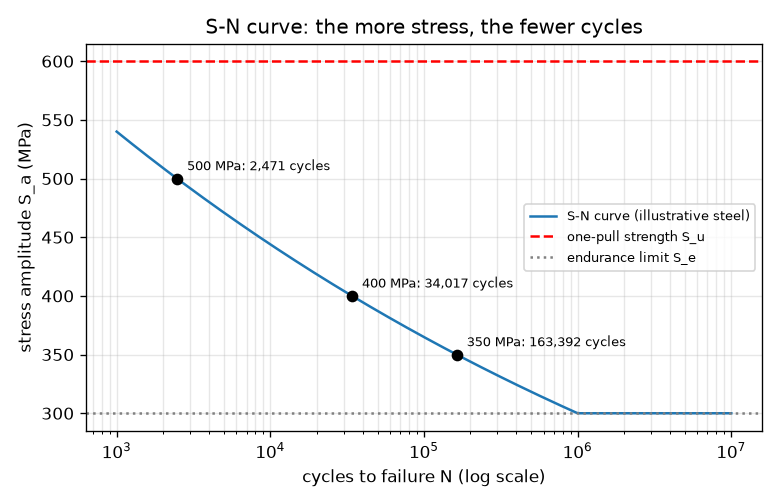
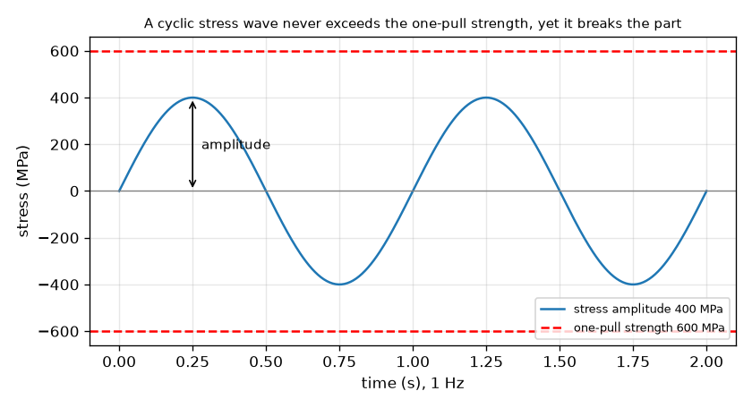

# அமர்வு 1: ஒரு சுமையால் உடைக்க முடியாததை மீண்டும் மீண்டும் வரும் சுமைகள் உடைக்கின்றன

[Session 1 — हिन्दी](README.hi.md) · [Session 1 — മലയാളം](README.ml.md) · [Session 1 — தமிழ்](README.ta.md)

*நிலை 1 (கருத்தியல் ஊடாடும் மாதிரி) · சுமார் 60 நிமிடங்கள் · openfatigue*

> இது எளிமைப்படுத்தப்பட்ட ஒரு கல்வி மாதிரி. இது சரிபார்க்கப்பட்ட (validated) வடிவமைப்புக் கருவி அல்ல; உண்மையான கட்டமைப்புகள், மின் நிறுவல்கள், வாகனங்கள், தொழில்துறை செயல்முறைகள் அல்லது மருத்துவ முடிவுகளுக்கு இதைப் பயன்படுத்தக் கூடாது.

**முன்தேவைகள் (Prerequisites)**

- பள்ளி இயற்கணிதம்: அடுக்குகளும் மடக்கைகளும்.
- நீங்கள் PRIMER.md-ஐப் படித்து `python start.py 1`-ஐ ஒருமுறை இயக்கியிருக்கிறீர்கள்.

**கற்றல் நோக்கங்கள் (Learning objectives).** இந்த அமர்வுக்குப் பிறகு நீங்கள்:

- ஒரு பாகம் அதன் ஒற்றை-இழுப்பு வலிமையை (one-pull strength) விடக் குறைவான, மீண்டும் மீண்டும் வரும் தகைவில் (stress) ஏன் தோல்வியடையக்கூடும் என்பதை விளக்க முடியும்.
- ஒரு சுழற்சித் தகைவு அலையைப் படிக்க முடியும்: வீச்சு (amplitude), வரம்பு (range), சராசரி (mean), சுழற்சி (cycle).
- S-N தொடர்பு S_a = A N^b-ஐப் பயன்படுத்தி ஒரு தகைவு வீச்சை சுழற்சிகளின் எண்ணிக்கையாகவும் இயங்கு நேரமாகவும் மாற்ற முடியும்.
- ஒரு எஃகுப் பாகத்திற்குத் தாங்குதிறன் வரம்பு (endurance limit) என்றால் என்ன என்பதைச் சொல்ல முடியும்.

## A. நிஜ உலகச் சிக்கல்
ஒரு காகிதக் கிளிப்பை ஒருமுறை வளைத்தால் அது திரும்ப வந்துவிடுகிறது. அதை முன்னும் பின்னும் வளைத்தால் அது முறிகிறது, எந்த ஒரு வளைவும் முதல் வளைவை விடக் கடுமையாக இல்லாவிட்டாலும். பாலங்கள், அச்சுகள், சுருள்வில்கள், விமானத் தோல்கள் இதே அமைதியான வழியில் தோல்வியடைகின்றன: சேதம் சுழற்சிக்குச் சுழற்சி சேர்ந்துகொண்டே போகிறது. பொறியாளர்கள் ஒரு நடைமுறைக் கேள்விக்கு விடையளிக்க வேண்டும்: ஒரு பாகம் ஒரு குறிப்பிட்ட தகைவை மீண்டும் மீண்டும் சந்தித்தால், அது எத்தனை சுழற்சிகளைத் தாங்கும்? (விளக்க எண்களுடன் கூடிய கல்வி மாதிரி; ஒரு உண்மையான பாகத்தை வடிவமைக்க இதை ஒருபோதும் பயன்படுத்தாதீர்கள்.)

## B. கருத்தும் கோட்பாடும்
வளைக்கப்படும் சுழலும் தண்டில் ஒவ்வொரு மேற்பரப்புப் புள்ளியும் இழுவையிலிருந்து தள்ளலுக்கும் மீண்டும் இழுவைக்கும் செல்கிறது: தகைவு ஒரு அலை, stress = S_m + S_a sin(2 pi f t), சராசரி S_m, வீச்சு S_a, அதிர்வெண் f உடன். ஒரு முழு அலை ஒரு சுழற்சி. வரம்பு வீச்சின் இரு மடங்கு. பல ஒத்த கம்பிகளை ஒவ்வொன்றையும் வெவ்வேறு வீச்சில் சோதித்து, அவை உடையும் வரையிலான சுழற்சிகள் N-ஐ எண்ணினால், இரு அச்சுகளையும் மடக்கை அளவுகோலில் வரையும்போது புள்ளிகள் ஒரு நேர்கோட்டுக்கு அருகில் விழுகின்றன. அந்தக் கோடு பாஸ்க்வினின் தொடர்பு (Basquin's relation) S_a = A N^b. அடுக்கு b எதிர்மறை (அதிகத் தகைவு, குறைந்த சுழற்சிகள்), வழக்கமான எஃகுகளுக்கு அது சுமார் -0.1; நம் விளக்க எஃகுக்கு b = -0.085, ஏனெனில் கோடு 1000 சுழற்சிகளில் 0.9 S_u வழியாகவும், ஒரு மில்லியன் சுழற்சிகளில் தாங்குதிறன் வரம்பு S_e வழியாகவும் வரையப்படுகிறது. பல எஃகுகள் ஒரு தாங்குதிறன் வரம்பைக் காட்டுகின்றன, S_u-இன் சுமார் பாதி, அதற்குக் கீழே சோதனைக் கம்பிகள் மிக நீண்ட காலம் தாங்குகின்றன.

| குறியீடு | பொருள் | அலகு |
|---|---|---|
| S_a | தகைவு வீச்சு (வரம்பின் பாதி) | MPa |
| S_u | இறுதி (ஒற்றை-இழுப்பு) வலிமை, இங்கு 600 | MPa |
| S_e | தாங்குதிறன் வரம்பு, இங்கு 300 (0.5 S_u) | MPa |
| N | தோல்வி வரையிலான சுழற்சிகள் | சுழற்சிகள் |
| A, b | S-N கோட்டின் மாறிலிகள்; இங்கு A = 972 MPa, b = -0.085 | MPa, அலகு இல்லை |
| f | சுமையேற்ற அதிர்வெண் | Hz (வினாடிக்குச் சுழற்சிகள்) |

**அனுமானங்கள் (Assumptions)**

- ஒரு சிறிய பளபளப்பான கம்பியின் மீது முழுமையாகத் தலைகீழாகும் தகைவு (சராசரி பூஜ்யம்).
- எண்கள் ஒரு உண்மையான உலோகக் கலவையை அல்ல, ஒரு பொதுவான விளக்க எஃகை விவரிக்கின்றன.
- S_e-க்குக் கீழே தோல்வியை நாம் கணிக்கவில்லை (பல எஃகுகளுக்கு உண்மை, அலுமினியத்துக்கு அல்ல).
- எளிமைப்படுத்தப்பட்ட கற்பித்தல் மாதிரி: உண்மையான பாகங்களுக்கான வடிவமைப்பு முறை அல்ல.

$$ S(t)=S_m+S_a\sin(2\pi f t),\qquad \Delta S = 2S_a $$

$$ S_a=A\,N^{\,b},\qquad N=\left(\frac{S_a}{A}\right)^{1/b} $$

$$ b=-\frac{1}{3}\log_{10}\frac{0.9\,S_u}{S_e},\qquad A=\frac{(0.9\,S_u)^2}{S_e} $$

$$ t_{\mathrm{fail}}=\frac{N}{f} $$

## C. காட்சி விளக்கம்
முதல் படம் 400 MPa வீச்சுள்ள ஒரு தகைவு அலையைக் காட்டுகிறது. அதன் உச்சங்கள் 600 MPa ஒற்றை-இழுப்பு வலிமையின் சிவப்புக் கோட்டிற்குக் கீழே இருக்கின்றன, ஆயினும் போதுமான சுழற்சிகளுக்குப் பிறகு பாகம் தோல்வியடைகிறது. இரண்டாவது படம் மடக்கைச் சுழற்சி அச்சில் உள்ள S-N வளைவு: அது 1000 சுழற்சிகளில் 540 MPa-இலிருந்து ஒரு மில்லியன் சுழற்சிகளில் 300 MPa தாங்குதிறன் வரம்பு வரை இறங்கி, பிறகு தட்டையாகச் செல்கிறது. குறிக்கப்பட்ட மூன்று புள்ளிகள் 500 MPa சுமார் 2,500 சுழற்சிகளும், 400 MPa சுமார் 34,000-உம், 350 MPa சுமார் 163,000-உம் தாங்கும் என்பதைக் காட்டுகின்றன.

*மூன்று குறிக்கப்பட்ட இயக்கப் புள்ளிகளுடனும் தாங்குதிறன் வரம்புடனும் விளக்க எஃகின் S-N வளைவு.*

*400 MPa வீச்சு அலை 600 MPa ஒற்றை-இழுப்பு வலிமைக்கு மிகக் கீழே இருக்கிறது, ஆயினும் போதுமான சுழற்சிகளுக்குப் பிறகு பாகத்தை உடைக்கிறது.*

## D. ஊடாடும் உருவகப்படுத்தல்
பாடத்தை இயக்கவும் (`python start.py 1`), பிறகு நேரடி செயலியைத் திறக்கவும்: [அமர்வு 1: தகைவு அலையும் S-N வளைவும்](https://krunalpanchal1995.github.io/pan-iit-oss/openfatigue/session-01/) (அல்லது இந்தக் கோப்புறையில் உள்ள `app.html`). வீச்சு நழுவியை (slider) நகர்த்தி அலை வளர்வதைக் கவனிக்கவும், பிறகு S-N காட்சியைத் திறந்து இயக்கப் புள்ளி வளைவின் வழியே நகர்வதைப் பார்க்கவும். அதிர்வெண்ணை மாற்றி, சுழற்சிகளின் எண்ணிக்கை மாறாதபோது தோல்வி வரையிலான இயங்கு நேரம் எப்படி மாறுகிறது என்பதைப் பார்க்கவும்.

**சவால்.** மாதிரி எந்த அலுப்புத் (fatigue) தோல்வியையும் கணிக்காத ஒரு தகைவு வீச்சைத் தேர்ந்தெடுக்கவும்.

## E. தீர்க்கப்பட்ட உதாரணமும் சோதனையும்
**சிக்கல்.** ஒரு எஃகுக் கம்பிக்கு (S_u = 600 MPa, S_e = 300 MPa, எனவே A = 972 MPa, b = -0.085) 10 Hz-இல் 400 MPa முழுத் தலைகீழ் வீச்சு அளிக்கப்படுகிறது. அது எத்தனை சுழற்சிகள் தாங்கும், எவ்வளவு நேரம் இயங்கும்?

1. மாதிரி பொருந்துமா எனச் சரிபார்க்கவும்: 400 MPa என்பது S_e = 300 MPa-ஐ விட அதிகம், எனவே ஆயுள் வரையறுக்கப்பட்டது; S_u = 600 MPa-ஐ விடக் குறைவு, எனவே ஒரு இழுப்பு அதை உடைக்காது.
2. N = (S_a / A)^(1/b) = (400 / 972)^(1 / -0.0851). இங்கு 400 / 972 = 0.4115, log10(0.4115) = -0.3856, 1/b = -11.75.
3. log10 N = -0.3856 x -11.75 = 4.53, எனவே N = 10^4.53 = 34,000 சுழற்சிகள் (கூடுதல் இலக்கங்களுடன் 34,017).
4. இயங்கு நேரம் = N / f = 34,017 / 10 = 3,402 s = 56.7 நிமிடங்கள்.
5. நியாயச் சோதனை (sanity check): 400 MPa என்பது 1000 சுழற்சிகளில் 540 MPa-க்கும் ஒரு மில்லியன் சுழற்சிகளில் 300 MPa-க்கும் இடையில் உள்ளது, எனவே 1,000-க்கும் 1,000,000-க்கும் இடையிலான ஆயுள் சரியானது.

**விடை.** சுமார் 34,000 சுழற்சிகள், அதாவது 10 Hz-இல் சுமார் 57 நிமிடங்கள்.

**சோதனை.** ஒரு காகிதக் கிளிப்பை ஒரே கோணத்தில் (எ.கா. 90 டிகிரி) முன்னும் பின்னும் வளைத்து, அது முறியும் வரையிலான வளைவுகளை எண்ணவும்; ஐந்து கிளிப்புகளுடன் மீண்டும் செய்து எண்ணிக்கைகளை ஒப்பிடவும். உங்களுக்கு ஒரு வரம்பு கிடைக்கும், ஒற்றை எண் அல்ல, இங்குள்ள எந்தச் சூத்திரத்திலிருந்தும் அது வேறுபடும், ஏனெனில் கிளிப் அதன் மீள்தன்மை வரம்பைக் கடந்து வளைக்கப்படுகிறது, எனவே நம் கோடு கணிக்கும் ஆயிரக்கணக்கான சுழற்சிகளை விட மிகக் குறைவான சுழற்சிகளுக்குப் பிறகு அது தோல்வியடைகிறது: இது நம் உயர்-சுழற்சி S-N கோடு பொருந்தாத தாழ்-சுழற்சி ஆட்சி. மாதிரி ஒரு சரியான கம்பிக்கான நேர்கோடு; உண்மையான பாகங்கள் அதைச் சுற்றிச் சிதறுகின்றன.

## F. மதிப்பீடும் வடிவமைப்புச் சவாலும்
**கேள்வி வகை A: கருத்தியல்.** ஒரே இழுப்பில் உடைக்கத் தேவையான தகைவை விடச் சிறிய, மீண்டும் மீண்டும் வரும் தகைவில் ஒரு பாகம் ஏன் உடையக்கூடும்? ஒரு சுழற்சியிலிருந்து அடுத்த சுழற்சிக்குப் பாகம் எதை 'நினைவில் வைத்திருக்கிறது'?

குறிப்பு

காகிதக் கிளிப்பைப் பற்றி யோசியுங்கள்: ஒவ்வொரு வளைவிலும் அதன் உள்ளே என்ன மாறுகிறது?

படிப்படியான தீர்வு

ஒவ்வொரு சுழற்சியும் நுண்ணிய அளவு நிரந்தரச் சேதத்தை ஏற்படுத்துகிறது, பெரும்பாலும் தகைவு மிக அதிகமாக உள்ள நுண்ணிய இடங்களில் (ஒரு கீறல், ஒரு மூலை, ஒரு தானிய எல்லை). சுமை நீக்கப்படும்போது சேதம் மீளாது, எனவே ஒரு விரிசல் உருவாகி வளரும் வரை அது சேர்கிறது. S_u-க்குக் கீழே ஒரு இழுப்பு அப்படிச் சேரும் சேதத்தை ஏற்படுத்தாது, ஆனால் பல மறுசெயல்கள் ஏற்படுத்தும். பாகம் சுமையை அல்ல, தான் சேர்த்த சேதத்தையே 'நினைவில் வைத்திருக்கிறது'.

**கேள்வி வகை B: எண்ணியல்.** அதே எஃகுக்கு 350 MPa வீச்சும் 20 Hz-உம் அளிக்கப்படுகிறது. தோல்வி வரையிலான சுழற்சிகளின் எண்ணிக்கையையும் மணிநேரத்தில் இயங்கு நேரத்தையும் கண்டறியவும். விடை நியாயமானதா எனச் சரிபார்க்கவும்.

குறிப்பு

A = 972 MPa, b = -0.0851 உடன் N = (S_a / A)^(1/b); நேரம் = N / f.

படிப்படியான தீர்வு

N = (350 / 972)^(-11.75) = 163,392 சுழற்சிகள் (சுமார் 163,000). நேரம் = 163,392 / 20 = 8,170 s = 2.27 மணிநேரம். நியாயச் சோதனை: 350 MPa என்பது 300 MPa (ஒரு மில்லியன் சுழற்சிகள்) மற்றும் 400 MPa (34,000 சுழற்சிகள்) ஆகியவற்றுக்கு இடையில் உள்ளது, எனவே ஆயுள் அந்த இரு மதிப்புகளுக்கு இடையில் இருக்க வேண்டும்: அப்படியே உள்ளது.

**கேள்வி வகை C: வரைபடம் மற்றும் உருவகப்படுத்தல் விளக்கம்.** S-N வரைபடத்தில் வீச்சு 400 MPa-இலிருந்து 500 MPa-க்கு, 25 சதவீதம், உயர்த்தப்படுகிறது. ஆயுள் எந்தக் காரணியால் குறைகிறது? செங்குத்தான வளைவு ஒரு வடிவமைப்பாளருக்கு என்ன சொல்கிறது?

குறிப்பு

இரு தகைவுகளிலும் N-ஐப் படிக்கவும் (அல்லது கணக்கிடவும்) வகுக்கவும்.

படிப்படியான தீர்வு

N 34,017-இலிருந்து 2,471 சுழற்சிகளாகக் குறைகிறது, 13.8 காரணி (சுமார் 14 மடங்கு குறைவு). தகைவில் 25 சதவீத உயர்வு ஆயுளில் ஒரு படிமுறைக்கும் (order of magnitude) மேல் இழப்பை ஏற்படுத்துகிறது: அலுப்பு ஆயுள் தகைவுக்கு மிக உணர்திறன் கொண்டது, எனவே சிறிய தகைவுக் குறைப்புகள் (பெரிய ஆரம், சற்றுத் தடிமனான பகுதி) நிறைய ஆயுளைப் பெற்றுத் தருகின்றன.

**கேள்வி வகை D: வடிவமைப்பு மற்றும் உகப்பாக்கச் சவால்.** ஒரு சுழலும் கம்பி 450 MPa வீச்சைச் சந்திக்கிறது. அது 30 நாட்களுக்கு நாளொன்றுக்கு 8 மணிநேரம் 10 Hz-இல் இயங்க வேண்டும். (a) அது எத்தனை சுழற்சிகள்? (b) 450 MPa-இல் அது எவ்வளவு காலம் தாங்கும்? (c) வளைவில் தகைவு 1/d^3 என மாறுகிறது (d = விட்டம்). தகைவைத் தாங்குதிறன் வரம்புக்குக் கொண்டுவர விட்டம் எந்தக் காரணியால் அதிகரிக்க வேண்டும்?

குறிப்பு

(a) சுழற்சிகள் = மணிநேரம் x 3600 x அதிர்வெண். (b) S-N தொடர்பைப் பயன்படுத்தவும். (c) 450 / 300 = (d_new / d_old)^3.

படிப்படியான தீர்வு

(a) 8 x 3600 x 10 x 30 = 8,640,000 சுழற்சிகள். (b) 450 MPa-இல் N = 8,522 சுழற்சிகள், 10 Hz-இல் வெறும் 14.2 நிமிடங்கள். எனவே கம்பி முதல் நாளிலேயே தோல்வியடைகிறது. (c) தகைவு 450 / 300 = 1.5 ஆகக் குறைய வேண்டும், எனவே d_new / d_old = 1.5^(1/3) = 1.145: 14.5 சதவீதம் பெரிய விட்டம் வீச்சை 300 MPa-க்கு, தாங்குதிறன் வரம்புக்கு, கொண்டுவருகிறது. அனுமானங்கள்: சரியான கம்பி, குழிவுகள் இல்லை, பாதுகாப்பு இடைவெளி இல்லை. உண்மையான வடிவமைப்பு ஒரு இடைவெளியைச் சேர்க்கும் (அமர்வு 2).

[RUBRIC.md](../../RUBRIC.md) கொண்டு உங்களை நீங்களே மதிப்பிடுங்கள். தாளில் செய்ய [செயல்பாட்டுத் தாளை](activity_sheet.md) அச்சிடுங்கள்.

## பொதுவான தவறான கருத்துகள்
| பொதுவான தவறான கருத்து | உண்மையில் சரியானது |
|---|---|
| சுமை வலிமைக்குக் கீழே இருந்தால் பாகம் பாதுகாப்பானது. | ஒற்றை-இழுப்பு வலிமைக்குக் கீழே என்பது ஒரு இழுப்புக்கு மட்டுமே பாதுகாப்பானது. மீண்டும் மீண்டும் வரும் சுமைகள் பல சுழற்சிகளுக்குப் பிறகு பாகத்தை உடைக்கலாம். |
| ஒரு பாகம் எச்சரிக்கையின்றித் திடீரெனத் தோல்வியடைகிறது, எனவே அதற்கு முன் எதுவும் நடப்பதில்லை. | சேதம் பல சுழற்சிகளில் சேர்கிறது; இறுதியில் தோல்வி திடீரென்றது, ஆனால் விரிசல் நீண்ட காலமாக வளர்ந்துகொண்டிருந்தது. |
| தகைவை இரட்டிப்பாக்கினால் ஆயுள் பாதியாகும். | ஆயுள் தகைவின் உயர் அடுக்குடன் மாறுகிறது: இங்கு N ~ S_a^(1/b), சுமார் S_a^-11.75, எனவே தகைவில் 25 சதவீத உயர்வு ஆயுளை 13.8 காரணியால் குறைத்தது. |
| தோல்வி வரையிலான சுழற்சிகளும் தோல்வி வரையிலான நேரமும் ஒன்றே. | நேரம் என்பது சுழற்சிகள் வகுத்தல் அதிர்வெண்; இந்த எளிய மாதிரியில் அதே பாகம் 10 Hz-ஐ விட 1 Hz-இல் நேரத்தில் 10 மடங்கு அதிக காலம் தாங்கும். |

## சொற்களஞ்சியம் (Glossary)
- **அலுப்பு (fatigue)**: ஒவ்வொரு சுமையும் ஒற்றை-இழுப்பு வலிமைக்குக் கீழே இருந்தாலும், மீண்டும் மீண்டும் (சுழற்சி) சுமையேற்றத்தால் ஏற்படும் தோல்வி
- **தகைவு வீச்சு (stress amplitude)**: ஒரு சுழற்சியின் அதிகபட்ச மற்றும் குறைந்தபட்சத் தகைவுகளின் வேறுபாட்டின் பாதி, MPa-இல்
- **சுழற்சி (cycle)**: சுமையின் ஒரு முழு மறுசெயல்: மேலே, கீழே, மீண்டும்
- **S-N வளைவு (S-N curve)**: தோல்வி வரையிலான சுழற்சிகளுக்கு எதிராகத் தகைவு வீச்சின் வரைபடம், பொதுவாக மடக்கைச் சுழற்சி அச்சுடன்
- **தாங்குதிறன் வரம்பு (endurance limit)**: ஓர் எஃகுப் பாகம் மிக நீண்ட காலம் தாங்கக்கூடிய தகைவு வீச்சுக்குக் கீழுள்ள வரம்பு
- **MPa**: மெகாபாஸ்கல், சதுர மீட்டருக்கு ஒரு மில்லியன் நியூட்டன்; தகைவின் அலகு

## நிறைவு
1. [exercises.md](exercises.md)-இல் உள்ள மூன்று நிரலாக்கப் பணிகளைச் செய்யவும்.
2. உங்கள் மாற்றங்களுக்குப் பிறகு `python start.py 1`-ஐ மீண்டும் இயக்கவும். அது சோதனைச்சாவடியுடன் (checkpoint) முடிகிறது; அது `PASS` என அச்சிடும்போது நீங்கள் முடித்துவிட்டீர்கள். (சோதனைச்சாவடி மட்டும்: `python start.py check 1`.)

அடுத்து: [அமர்வு 2](../session-02/README.md)
