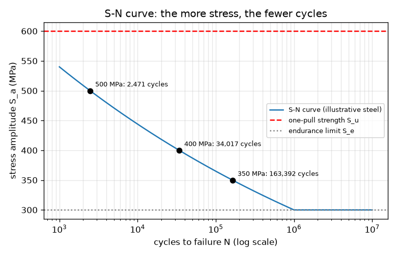
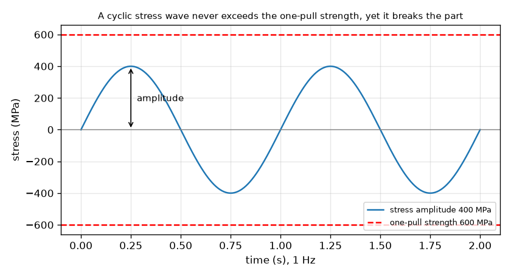

# సెషన్ 1: ఒక లోడ్ విరగ్గొట్టలేనిదాన్ని పునరావృత లోడ్లు విరగ్గొడతాయి

[Session 1 — हिन्दी](README.hi.md) · [Session 1 — മലയാളം](README.ml.md) · [Session 1 — தமிழ்](README.ta.md) · [Session 1 — తెలుగు](README.te.md)

*స్థాయి 1 (భావనాత్మక ఇంటరాక్టివ్ నమూనా) · సుమారు 60 నిమిషాలు · openfatigue*

> ఇది సరళీకరించిన విద్యా నమూనా. ఇది ధృవీకరించబడిన (validated) డిజైన్ సాధనం కాదు; నిజమైన నిర్మాణాలు, విద్యుత్ సంస్థాపనలు, వాహనాలు, పారిశ్రామిక ప్రక్రియలు లేదా వైద్య నిర్ణయాల కోసం దీన్ని ఉపయోగించకూడదు.

**ముందస్తు జ్ఞానం (Prerequisites)**

- పాఠశాల బీజగణితం: ఘాతాలు మరియు సంవర్గమానాలు.
- మీరు PRIMER.md చదివి `python start.py 1` ఒకసారి నడిపారు.

**అభ్యసన లక్ష్యాలు (Learning objectives).** ఈ సెషన్ తర్వాత మీరు:

- ఒక భాగం తన ఒక్క-లాగుడు బలం (one-pull strength) కంటే తక్కువ ఉన్న పునరావృత ఒత్తిడిలో (stress) ఎందుకు విఫలం కావచ్చో వివరించగలరు.
- ఒక చక్రీయ ఒత్తిడి తరంగాన్ని చదవగలరు: కంపనపరిమితి (amplitude), వ్యాప్తి (range), సగటు (mean), చక్రం (cycle).
- S-N సంబంధం S_a = A N^b వాడి ఒక ఒత్తిడి కంపనపరిమితిని చక్రాల సంఖ్యగా, నడిచే సమయంగా మార్చగలరు.
- ఒక ఉక్కు భాగానికి సహన పరిమితి (endurance limit) అంటే ఏమిటో చెప్పగలరు.

## A. వాస్తవ ప్రపంచ సమస్య
ఒక పేపర్ క్లిప్‌ను ఒకసారి వంచితే అది తిరిగి వచ్చేస్తుంది. దాన్ని ముందుకూ వెనక్కూ వంచితే అది విరిగిపోతుంది, ఏ ఒక్క వంపూ మొదటిదాని కంటే గట్టిగా లేకపోయినా. వంతెనలు, ఇరుసులు, స్ప్రింగ్‌లు, విమాన చర్మాలు ఇదే నిశ్శబ్ద పద్ధతిలో విఫలమవుతాయి: నష్టం చక్రం తర్వాత చక్రం పేరుకుపోతుంది. ఇంజనీర్లు ఒక ఆచరణాత్మక ప్రశ్నకు సమాధానం చెప్పాలి: ఒక భాగం ఇచ్చిన ఒత్తిడిని మళ్ళీ మళ్ళీ చూస్తే, అది ఎన్ని చక్రాలు తట్టుకుంటుంది? (ఉదాహరణ సంఖ్యలతో విద్యా నమూనా; నిజమైన భాగాన్ని డిజైన్ చేయడానికి దీన్ని ఎప్పుడూ ఉపయోగించకండి.)

## B. భావన మరియు సిద్ధాంతం
వంచబడే తిరిగే షాఫ్ట్‌లో ప్రతి ఉపరితల బిందువు లాగుడు నుండి నెట్టుడుకు, మళ్ళీ వెనక్కి వెళ్తుంది: ఒత్తిడి ఒక తరంగం, stress = S_m + S_a sin(2 pi f t), సగటు S_m, కంపనపరిమితి S_a, పౌనఃపున్యం f తో. ఒక పూర్తి తరంగం ఒక చక్రం. వ్యాప్తి కంపనపరిమితికి రెట్టింపు. చాలా ఒకేలాంటి కడ్డీలను ఒక్కొక్కటి వేర్వేరు కంపనపరిమితి వద్ద పరీక్షించి, అవి విరిగే వరకు చక్రాలు N లెక్కిస్తే, రెండు అక్షాలనూ సంవర్గమాన స్కేల్‌పై గీసినప్పుడు బిందువులు సరళ రేఖకు దగ్గరగా పడతాయి. ఆ రేఖే బాస్క్విన్ సంబంధం (Basquin's relation) S_a = A N^b. ఘాతాంకం b రుణాత్మకం (ఎక్కువ ఒత్తిడి, తక్కువ చక్రాలు), సాధారణ ఉక్కులకు అది సుమారు -0.1; మన ఉదాహరణ ఉక్కుకు b = -0.085, ఎందుకంటే రేఖ 1000 చక్రాల వద్ద 0.9 S_u గుండా, పది లక్షల చక్రాల వద్ద సహన పరిమితి S_e గుండా గీయబడింది. చాలా ఉక్కులు S_u లో సుమారు సగం ఉన్న సహన పరిమితిని చూపిస్తాయి, దాని కింద పరీక్ష కడ్డీలు చాలా కాలం నిలుస్తాయి.

| గుర్తు | అర్థం | యూనిట్ |
|---|---|---|
| S_a | ఒత్తిడి కంపనపరిమితి (వ్యాప్తిలో సగం) | MPa |
| S_u | అంతిమ (ఒక్క-లాగుడు) బలం, ఇక్కడ 600 | MPa |
| S_e | సహన పరిమితి, ఇక్కడ 300 (0.5 S_u) | MPa |
| N | విఫలమయ్యే వరకు చక్రాలు | చక్రాలు |
| A, b | S-N రేఖ స్థిరాంకాలు; ఇక్కడ A = 972 MPa, b = -0.085 | MPa, యూనిట్ లేదు |
| f | లోడింగ్ పౌనఃపున్యం | Hz (సెకనుకు చక్రాలు) |

**ఊహలు (Assumptions)**

- ఒక చిన్న మెరుగుపెట్టిన కడ్డీపై పూర్తిగా తిరగబడే ఒత్తిడి (సగటు సున్నా).
- సంఖ్యలు నిజమైన మిశ్రమలోహాన్ని కాదు, ఒక సాధారణ ఉదాహరణ ఉక్కును వివరిస్తాయి.
- S_e కంటే కింద వైఫల్యాన్ని మనం అంచనా వేయం (చాలా ఉక్కులకు నిజం, అల్యూమినియంకు కాదు).
- సరళీకరించిన బోధనా నమూనా: నిజమైన భాగాలకు డిజైన్ పద్ధతి కాదు.

$$ S(t)=S_m+S_a\sin(2\pi f t),\qquad \Delta S = 2S_a $$

$$ S_a=A\,N^{\,b},\qquad N=\left(\frac{S_a}{A}\right)^{1/b} $$

$$ b=-\frac{1}{3}\log_{10}\frac{0.9\,S_u}{S_e},\qquad A=\frac{(0.9\,S_u)^2}{S_e} $$

$$ t_{\mathrm{fail}}=\frac{N}{f} $$

## C. దృశ్య వివరణ
మొదటి చిత్రం 400 MPa కంపనపరిమితి ఉన్న ఒత్తిడి తరంగాన్ని చూపిస్తుంది. దాని శిఖరాలు 600 MPa ఒక్క-లాగుడు బలం యొక్క ఎరుపు చుక్కల రేఖ కంటే కింద ఉంటాయి, అయినా తగినన్ని చక్రాల తర్వాత భాగం విఫలమవుతుంది. రెండో చిత్రం సంవర్గమాన చక్ర అక్షంపై S-N వక్రం: అది 1000 చక్రాల వద్ద 540 MPa నుండి పది లక్షల చక్రాల వద్ద 300 MPa సహన పరిమితి వరకు దిగి, తర్వాత చదునుగా సాగుతుంది. గుర్తించిన మూడు బిందువులు 500 MPa సుమారు 2,500 చక్రాలు, 400 MPa సుమారు 34,000, 350 MPa సుమారు 163,000 నిలుస్తాయని చూపిస్తాయి.

*మూడు గుర్తించిన ఆపరేటింగ్ బిందువులు మరియు సహన పరిమితితో ఉదాహరణ ఉక్కు S-N వక్రం.*

*400 MPa కంపనపరిమితి తరంగం 600 MPa ఒక్క-లాగుడు బలం కంటే చాలా కిందే ఉంటుంది, అయినా తగినన్ని చక్రాల తర్వాత భాగాన్ని విరగ్గొడుతుంది.*

## D. ఇంటరాక్టివ్ సిమ్యులేషన్
పాఠాన్ని నడపండి (`python start.py 1`), తర్వాత లైవ్ యాప్‌ను తెరవండి: [సెషన్ 1: ఒత్తిడి తరంగం మరియు S-N వక్రం](https://krunalpanchal1995.github.io/pan-iit-oss/openfatigue/session-01/) (లేదా ఈ ఫోల్డర్‌లోని `app.html`). కంపనపరిమితి స్లైడర్‌ను కదిపి తరంగం పెరగడం గమనించండి, తర్వాత S-N వీక్షణను తెరిచి ఆపరేటింగ్ బిందువు వక్రం వెంబడి జారడం చూడండి. పౌనఃపున్యాన్ని మార్చి, చక్రాల సంఖ్య మారకుండానే విఫలమయ్యే వరకు నడిచే సమయం ఎలా మారుతుందో చూడండి.

**సవాలు.** నమూనా ఏ ఫెటీగ్ వైఫల్యాన్నీ అంచనా వేయని ఒక ఒత్తిడి కంపనపరిమితిని ఎంచుకోండి.

## E. సాధించిన ఉదాహరణ మరియు ప్రయోగం
**సమస్య.** ఒక ఉక్కు కడ్డీపై (S_u = 600 MPa, S_e = 300 MPa, కాబట్టి A = 972 MPa, b = -0.085) 10 Hz వద్ద 400 MPa పూర్తిగా తిరగబడే కంపనపరిమితి ప్రయోగించబడింది. అది ఎన్ని చక్రాలు తట్టుకుంటుంది, ఎంతసేపు నడుస్తుంది?

1. నమూనా వర్తిస్తుందో తనిఖీ చేయండి: 400 MPa అనేది S_e = 300 MPa కంటే ఎక్కువ, కాబట్టి ఆయుర్దాయం పరిమితం; S_u = 600 MPa కంటే తక్కువ, కాబట్టి ఒక్క లాగుడు దాన్ని విరగ్గొట్టదు.
2. N = (S_a / A)^(1/b) = (400 / 972)^(1 / -0.0851). ఇక్కడ 400 / 972 = 0.4115, log10(0.4115) = -0.3856, 1/b = -11.75.
3. log10 N = -0.3856 x -11.75 = 4.53, కాబట్టి N = 10^4.53 = 34,000 చక్రాలు (మరిన్ని అంకెలతో 34,017).
4. నడిచే సమయం = N / f = 34,017 / 10 = 3,402 s = 56.7 నిమిషాలు.
5. సహేతుకత తనిఖీ (sanity check): 400 MPa అనేది 1000 చక్రాల వద్ద 540 MPa మరియు పది లక్షల చక్రాల వద్ద 300 MPa మధ్య ఉంది, కాబట్టి 1,000 మరియు 1,000,000 మధ్య ఆయుర్దాయం సరైనది.

**సమాధానం.** సుమారు 34,000 చక్రాలు, అంటే 10 Hz వద్ద సుమారు 57 నిమిషాలు.

**ప్రయోగం.** ఒక పేపర్ క్లిప్‌ను అదే కోణంలో (ఉదా. 90 డిగ్రీలు) ముందుకూ వెనక్కూ వంచి, అది విరిగే వరకు వంపులను లెక్కించండి; ఐదు క్లిప్‌లతో మళ్ళీ చేసి లెక్కలను పోల్చండి. మీకు ఒక శ్రేణి వస్తుంది, ఒకే సంఖ్య కాదు, ఇక్కడి ఏ సూత్రం నుండైనా అది భిన్నంగా ఉంటుంది, ఎందుకంటే క్లిప్ దాని స్థితిస్థాపక పరిధిని మించి వంచబడుతుంది, కాబట్టి మన రేఖ అంచనా వేసే వేల చక్రాల కంటే చాలా తక్కువ చక్రాలకే విఫలమవుతుంది: ఇది మన అధిక-చక్ర S-N రేఖ వర్తించని అల్ప-చక్ర పాలన. నమూనా ఒక పరిపూర్ణ కడ్డీకి సరళ రేఖ; నిజమైన భాగాలు దాని చుట్టూ చెదురుతాయి.

## F. మూల్యాంకనం మరియు డిజైన్ సవాలు
**ప్రశ్న రకం A: భావనాత్మక.** ఒక్క లాగుడులో విరగడానికి కావలసిన ఒత్తిడి కంటే చిన్నదైన పునరావృత ఒత్తిడిలో ఒక భాగం ఎందుకు విరగవచ్చు? ఒక చక్రం నుండి తర్వాతి దానికి ఆ భాగం ఏమి 'గుర్తుంచుకుంటుంది'?

సూచన

పేపర్ క్లిప్ గురించి ఆలోచించండి: ప్రతి వంపుతో దాని లోపల ఏమి మారుతుంది?

దశలవారీ పరిష్కారం

ప్రతి చక్రం సూక్ష్మమైన శాశ్వత నష్టాన్ని కలిగిస్తుంది, ఎక్కువగా ఒత్తిడి అత్యధికంగా ఉన్న సూక్ష్మ ప్రదేశాల్లో (ఒక గీత, ఒక మూల, ఒక ధాన్య సరిహద్దు). లోడ్ తొలగించినప్పుడు నష్టం రద్దు కాదు, కాబట్టి ఒక పగులు ఏర్పడి పెరిగే వరకు అది పేరుకుపోతుంది. S_u కంటే తక్కువ ఒక్క లాగుడు అలా పేరుకునే నష్టాన్ని కలిగించదు, కానీ అనేక పునరావృతాలు కలిగిస్తాయి. భాగం లోడ్‌ను కాదు, పేరుకున్న నష్టాన్ని 'గుర్తుంచుకుంటుంది'.

**ప్రశ్న రకం B: సంఖ్యాత్మక.** అదే ఉక్కుపై 350 MPa కంపనపరిమితి, 20 Hz ప్రయోగిస్తారు. విఫలమయ్యే వరకు చక్రాల సంఖ్యను, గంటల్లో నడిచే సమయాన్ని కనుగొనండి. సమాధానం సహేతుకంగా ఉందో తనిఖీ చేయండి.

సూచన

A = 972 MPa, b = -0.0851 తో N = (S_a / A)^(1/b); సమయం = N / f.

దశలవారీ పరిష్కారం

N = (350 / 972)^(-11.75) = 163,392 చక్రాలు (సుమారు 163,000). సమయం = 163,392 / 20 = 8,170 s = 2.27 గంటలు. సహేతుకత తనిఖీ: 350 MPa అనేది 300 MPa (పది లక్షల చక్రాలు) మరియు 400 MPa (34,000 చక్రాలు) మధ్య ఉంది, కాబట్టి ఆయుర్దాయం ఆ రెండు విలువల మధ్య ఉండాలి: ఉంది.

**ప్రశ్న రకం C: గ్రాఫ్ మరియు సిమ్యులేషన్ వ్యాఖ్యానం.** S-N గ్రాఫ్‌లో కంపనపరిమితి 400 MPa నుండి 500 MPa కి, 25 శాతం, పెంచబడింది. ఆయుర్దాయం ఏ కారకంతో తగ్గుతుంది? నిటారు వక్రం డిజైనర్‌కు ఏమి చెబుతుంది?

సూచన

రెండు ఒత్తిళ్ల వద్ద N చదవండి (లేదా లెక్కించండి) భాగించండి.

దశలవారీ పరిష్కారం

N 34,017 నుండి 2,471 చక్రాలకు తగ్గుతుంది, 13.8 కారకం (సుమారు 14 రెట్లు తక్కువ). ఒత్తిడిలో 25 శాతం పెరుగుదల ఆయుర్దాయంలో ఒక పరిమాణ క్రమం (order of magnitude) కంటే ఎక్కువ నష్టం కలిగిస్తుంది: ఫెటీగ్ ఆయుర్దాయం ఒత్తిడికి చాలా సున్నితం, కాబట్టి చిన్న ఒత్తిడి తగ్గింపులు (పెద్ద వ్యాసార్థం, కొంచెం మందమైన భాగం) చాలా ఆయుర్దాయాన్ని కొనిపెడతాయి.

**ప్రశ్న రకం D: డిజైన్ మరియు ఆప్టిమైజేషన్ సవాలు.** ఒక తిరిగే కడ్డీ 450 MPa కంపనపరిమితిని చూస్తుంది. అది 30 రోజులు రోజుకు 8 గంటలు 10 Hz వద్ద నడవాలి. (a) అది ఎన్ని చక్రాలు? (b) 450 MPa వద్ద అది ఎంతకాలం నిలుస్తుంది? (c) వంపులో ఒత్తిడి 1/d^3 గా మారుతుంది (d = వ్యాసం). ఒత్తిడిని సహన పరిమితికి తగ్గించడానికి వ్యాసం ఏ కారకంతో పెరగాలి?

సూచన

(a) చక్రాలు = గంటలు x 3600 x పౌనఃపున్యం. (b) S-N సంబంధం వాడండి. (c) 450 / 300 = (d_new / d_old)^3.

దశలవారీ పరిష్కారం

(a) 8 x 3600 x 10 x 30 = 8,640,000 చక్రాలు. (b) 450 MPa వద్ద N = 8,522 చక్రాలు, 10 Hz వద్ద కేవలం 14.2 నిమిషాలు. కాబట్టి కడ్డీ మొదటి రోజే విఫలమవుతుంది. (c) ఒత్తిడి 450 / 300 = 1.5 తగ్గాలి, కాబట్టి d_new / d_old = 1.5^(1/3) = 1.145: 14.5 శాతం పెద్ద వ్యాసం కంపనపరిమితిని 300 MPa కి, సహన పరిమితికి, తెస్తుంది. ఊహలు: పరిపూర్ణ కడ్డీ, గాడులు లేవు, భద్రతా మార్జిన్ లేదు. నిజమైన డిజైన్ ఒక మార్జిన్ జోడిస్తుంది (సెషన్ 2).

[RUBRIC.md](../../RUBRIC.md) తో మిమ్మల్ని మీరు అంచనా వేసుకోండి. కాగితంపై పని చేయడానికి [కార్యాచరణ పత్రాన్ని](activity_sheet.md) ప్రింట్ చేయండి.

## సాధారణ అపోహలు
| సాధారణ అపోహ | నిజానికి సరైనది |
|---|---|
| లోడ్ బలం కంటే తక్కువగా ఉంటే భాగం సురక్షితం. | ఒక్క-లాగుడు బలం కంటే తక్కువ అంటే ఒక్క లాగుడుకు మాత్రమే సురక్షితం. పునరావృత లోడ్లు చాలా చక్రాల తర్వాత భాగాన్ని విరగ్గొట్టగలవు. |
| భాగం హెచ్చరిక లేకుండా అకస్మాత్తుగా విఫలమవుతుంది, కాబట్టి ముందు ఏమీ జరగదు. | నష్టం చాలా చక్రాల్లో పేరుకుపోతుంది; చివరి వైఫల్యం అకస్మాత్తు, కానీ పగులు చాలా కాలంగా పెరుగుతూ ఉంది. |
| ఒత్తిడిని రెట్టింపు చేస్తే ఆయుర్దాయం సగమవుతుంది. | ఆయుర్దాయం ఒత్తిడి యొక్క అధిక ఘాతంతో మారుతుంది: ఇక్కడ N ~ S_a^(1/b), సుమారు S_a^-11.75, కాబట్టి ఒత్తిడిలో 25 శాతం పెరుగుదల ఆయుర్దాయాన్ని 13.8 కారకంతో తగ్గించింది. |
| విఫలమయ్యే వరకు చక్రాలు, విఫలమయ్యే వరకు సమయం ఒకటే. | సమయం అంటే చక్రాలు భాగహారం పౌనఃపున్యం; ఈ సరళ నమూనాలో అదే భాగం 10 Hz కంటే 1 Hz వద్ద సమయంలో 10 రెట్లు ఎక్కువ నిలుస్తుంది. |

## పదకోశం (Glossary)
- **ఫెటీగ్ (fatigue)**: ప్రతి లోడ్ ఒక్క-లాగుడు బలం కంటే తక్కువగా ఉన్నా, పునరావృత (చక్రీయ) లోడింగ్ వల్ల కలిగే వైఫల్యం
- **ఒత్తిడి కంపనపరిమితి (stress amplitude)**: ఒక చక్రంలో అత్యధిక, అత్యల్ప ఒత్తిళ్ల భేదంలో సగం, MPa లో
- **చక్రం (cycle)**: లోడ్ యొక్క ఒక పూర్తి పునరావృతం: పైకి, కిందికి, వెనక్కి
- **S-N వక్రం (S-N curve)**: విఫలమయ్యే వరకు చక్రాలకు వ్యతిరేకంగా ఒత్తిడి కంపనపరిమితి గ్రాఫ్, సాధారణంగా సంవర్గమాన చక్ర అక్షంతో
- **సహన పరిమితి (endurance limit)**: ఒక ఉక్కు భాగం చాలా కాలం నిలవగల ఒత్తిడి కంపనపరిమితి కంటే కింది పరిమితి
- **MPa**: మెగాపాస్కల్, చదరపు మీటరుకు పది లక్షల న్యూటన్లు; ఒత్తిడి యూనిట్

## ముగింపు
1. [exercises.md](exercises.md) లోని మూడు కోడింగ్ పనులు చేయండి.
2. మీ మార్పుల తర్వాత `python start.py 1` ను మళ్ళీ నడపండి. అది చెక్‌పాయింట్‌తో ముగుస్తుంది; అది `PASS` అని ప్రింట్ చేసినప్పుడు మీరు పూర్తి చేశారు. (చెక్‌పాయింట్ మాత్రమే: `python start.py check 1`.)

తదుపరి: [సెషన్ 2](../session-02/README.md)
