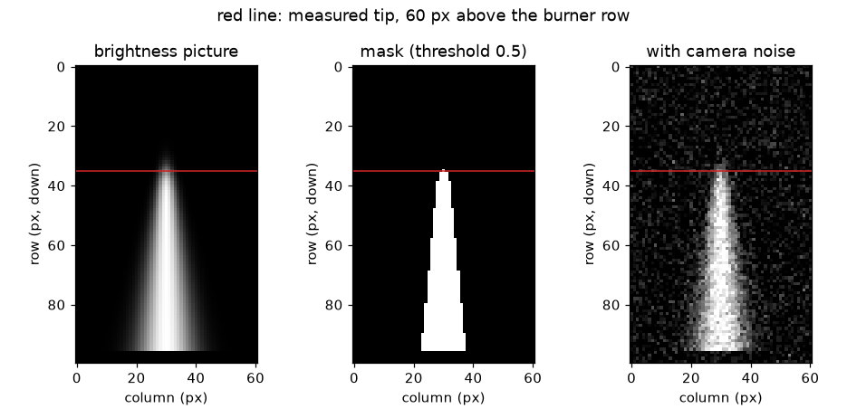
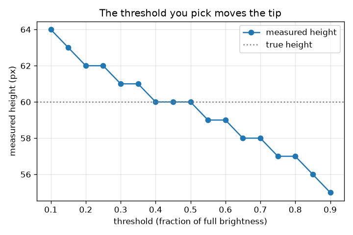

# सत्र 1: ज्वाला का वीडियो चित्रों का एक ढेर है

*स्तर 1 (वैचारिक इंटरैक्टिव मॉडल) · लगभग 60 मिनट · openflame*

> यह एक सरलीकृत शैक्षिक मॉडल है। यह कोई प्रमाणित डिज़ाइन उपकरण नहीं है और इसका उपयोग वास्तविक संरचनाओं, बिजली की स्थापनाओं, वाहनों, औद्योगिक प्रक्रियाओं या चिकित्सा निर्णयों के लिए नहीं किया जाना चाहिए।

**पूर्वापेक्षाएँ (Prerequisites)**

- रूलर से और ग्राफ़ से कोई संख्या पढ़ना।
- आपने PRIMER.md पढ़ लिया है और `python start.py 1` एक बार चला लिया है।

**सीखने के उद्देश्य।** इस सत्र के बाद आप:

- समझा सकेंगे कि वीडियो फ़्रेमों (frames) का एक ढेर है और हर फ़्रेम चमक (brightness) की संख्याओं का एक ग्रिड है।
- चमक की एक देहली (threshold) से किसी फ़्रेम को ज्वाला मास्क (flame mask) में बदल सकेंगे।
- ज्वाला की ऊँचाई पिक्सेल में माप सकेंगे और एक पैमाने (scale) से उसे मिलीमीटर में बदल सकेंगे।
- समझा सकेंगे कि चुनी गई देहली मापी गई ऊँचाई को क्यों बदलती है।

## A. वास्तविक दुनिया की समस्या
आप फ़ोन से मोमबत्ती जितनी या अलाव जितनी ज्वाला का वीडियो बनाते हैं और पूछते हैं: यह कितनी ऊँची है? ज्वाला कभी स्थिर नहीं रहती, इसलिए रूलर और स्टॉपवॉच किसी काम के नहीं। पर वीडियो केवल बहुत सारे स्थिर चित्र है, और कंप्यूटर हर एक चित्र में उसी ज्वाला को माप सकता है। कंप्यूटर कैसे तय करता है कि कौन-से पिक्सेल ज्वाला हैं, और वह पिक्सेल को मिलीमीटर में कैसे बदलता है? (यह repo चित्र-मापन के बारे में सामान्य शिक्षा है। प्रयोग के लिए आग तब तक न जलाएँ जब तक कोई वयस्क मौजूद न हो और यह सुरक्षित न हो।)

## B. अवधारणा और सिद्धांत
एक ग्रे-स्केल चित्र संख्याओं का एक ग्रिड है, हर पिक्सेल के लिए एक, 0 (काला) से 1 (सफ़ेद) तक। वीडियो ऐसे ग्रिडों का ढेर है, हर फ़्रेम के लिए एक, इसलिए उसके ऐरे (array) का आकार (frames, rows, columns) होता है। ज्वाला का सिरा कोई तीखा किनारा नहीं है: चमक कुछ पिक्सेलों में धीरे-धीरे घटती है। इसलिए ऊँचाई मापने के लिए हमें एक देहली चुननी पड़ती है: कोई पिक्सेल ज्वाला का हिस्सा है यदि उसकी चमक कम से कम देहली के बराबर हो। बर्नर से ज्वाला के अक्ष पर ऊपर चलते हुए, मापी गई ऊँचाई वह अंतिम पिक्सेल है जो पास होता है। यदि अक्ष पर चमक एक चिकनी गिरावट है जिसका आधी-चमक बिंदु ऊँचाई h पर है और कोमलता (softness) s है, तो देहली thr सिरे को h + s ln((1 - thr)/thr) पर रखती है: thr = 0.5 पर ठीक h, कम देहली पर ऊपर, अधिक देहली पर नीचे। ज्वाला के बगल में रखा रूलर मिलीमीटर प्रति पिक्सेल में पैमाना देता है, जो पिक्सेल को मिलीमीटर में बदलता है।

| प्रतीक | अर्थ | इकाई |
|---|---|---|
| h | ज्वाला की वास्तविक ऊँचाई: वह ऊँचाई जहाँ अक्ष पर चमक आधी है | px |
| z | बर्नर की पंक्ति से ऊपर की ऊँचाई, पिक्सेल में गिनी गई | px |
| s | सिरे की कोमलता (जितने पिक्सेलों में चमक घटती है) | px |
| thr | चमक की देहली, पूर्ण चमक के अंश के रूप में | कोई इकाई नहीं |
| scale | मिलीमीटर प्रति पिक्सेल (रूलर की mm में लंबाई को px में लंबाई से भाग) | mm/px |
| H | मापी गई ज्वाला की ऊँचाई | px या mm |

**मान्यताएँ (Assumptions)**

- कैमरा हिलता नहीं है, और चित्र इतना साफ़ है कि सिरा कुछ पिक्सेलों में धुँधला होता है।
- पृष्ठभूमि अँधेरी है (सत्र 1 में चमक 0; सत्र 3 यह मान्यता हटाता है)।
- ज्वाला एक सरल सूत्र से बनाई गई है: चित्र कृत्रिम (synthetic) है, इसलिए हमें सही उत्तर पता है।
- रूलर और ज्वाला कैमरे से एक ही दूरी पर हैं (कोई परिप्रेक्ष्य त्रुटि नहीं)।

$$ I(z)=\frac{1}{1+e^{(z-h)/s}}\qquad I(h)=\tfrac12 $$

$$ \text{flame pixel}\iff I\ge \mathrm{thr} $$

$$ z_{\mathrm{tip}}=h+s\ln\frac{1-\mathrm{thr}}{\mathrm{thr}} $$

$$ \mathrm{scale}=\frac{L_{\mathrm{ruler}}\ (\mathrm{mm})}{L_{\mathrm{ruler}}\ (\mathrm{px})},\qquad H_{\mathrm{mm}}=H_{\mathrm{px}}\times\mathrm{scale} $$

## C. दृश्य व्याख्या
पहला चित्र एक कृत्रिम फ़्रेम, 0.5 देहली पर उसका मास्क, और फ़्रेम का एक शोरयुक्त (noisy) संस्करण दिखाता है; एक लाल रेखा मापे गए सिरे को चिह्नित करती है, जो बर्नर की पंक्ति से 60 पिक्सेल ऊपर है। दूसरा चित्र उसी 60 px ज्वाला की मापी गई ऊँचाई को देहली के सापेक्ष दिखाता है: देहली 0.2 पर यह 62 px, 0.5 पर ठीक 60 px और 0.8 पर 57 px है। वक्र नीचे गिरता है क्योंकि अधिक देहली ज्वाला के धुँधले, घटते ऊपरी भाग को फेंक देती है।

*एक कृत्रिम फ़्रेम, 0.5 देहली पर उसका मास्क और एक शोरयुक्त फ़्रेम; लाल रेखा मापा गया सिरा है।*

*देहली के सापेक्ष 60 px ज्वाला की मापी गई ऊँचाई: 0.5 पर सटीक, उससे नीचे ऊँची और ऊपर छोटी।*

## D. इंटरैक्टिव सिमुलेशन
पाठ चलाइए (`python start.py 1`), फिर लाइव ऐप खोलिए: [सत्र 1: चित्र से ज्वाला मापिए](https://krunalpanchal1995.github.io/pan-iit-oss/openflame/session-01/) (या इसी फ़ोल्डर में `app.html`)। चित्र दृश्य और चमक प्रोफ़ाइल के बीच बदलिए। देहली खिसकाइए और देखिए कि मास्क कैसे सिकुड़ता या बढ़ता है और लाल रेखा कैसे खिसकती है। फिर वास्तविक ऊँचाई, कोमलता और पैमाना बदलिए, और देखिए कि इनमें से कौन पिक्सेल की संख्या बदलता है और कौन केवल मिलीमीटर।

**चुनौती।** रूलर पैमाने पर मापी गई ऊँचाई को 40 mm (0.3 mm के भीतर) बनाइए।

## E. हल किया गया उदाहरण और प्रयोग
**समस्या।** ज्वाला के बगल में रखा रूलर चित्र में 100 px लंबा है और वास्तव में 50 mm लंबा है। एक फ़्रेम में ज्वाला का आधी-चमक वाला सिरा बर्नर की पंक्ति से 60 px ऊपर है। देहली 0.5 पर आप पिक्सेल और मिलीमीटर में कितनी ऊँचाई मापते हैं? देहली 0.2 क्या देती?

1. पैमाना = 50 mm / 100 px = 0.5 mm प्रति पिक्सेल।
2. देहली 0.5 पर सिरा z = h + s ln(1) = 60 px पर है, इसलिए मास्क बर्नर की पंक्ति से 60 px ऊपर तक पहुँचता है।
3. ऊँचाई = 60 px x 0.5 mm/px = 30 mm।
4. देहली 0.2 पर (s = 2 px) सिरा 60 + 2 ln 4 = 60 + 2.77 = 62.77 px पर है, और पास होने वाला अंतिम पूरा पिक्सेल 62 px = 31 mm है।
5. समझदारी जाँच: मोमबत्ती की ज्वाला कुछ सेंटीमीटर ऊँची होती है, इसलिए 30 mm उचित है; दोनों देहलियों में 1 mm का अंतर है, जो लगभग सिरे के अपने धुँधलेपन जितना है।

**उत्तर।** देहली 0.5 पर ऊँचाई 60 px = 30 mm है; देहली 0.2 पर 62 px = 31 mm मिलता।

**प्रयोग।** एक स्थिर मोमबत्ती की ज्वाला की रूलर के बगल में फ़ोटो लीजिए (केवल किसी वयस्क की उपस्थिति में)। किसी इमेज एडिटर में दो चमक देहलियों पर बत्ती के ऊपरी सिरे से ज्वाला के सिरे तक पिक्सेल गिनिए, और रूलर से रूपांतरित कीजिए। आपको एक-दो पिक्सेल के अंतर वाली दो संख्याएँ मिलेंगी। मॉडल सटीक है क्योंकि हमने ज्वाला एक सूत्र से बनाई; वास्तविक सिरा चमकता भी है, एक्सपोज़र के दौरान टिमटिमाता है, और लेंस के कारण उसके चारों ओर प्रभामंडल (halo) होता है, इसलिए वास्तविक माप के साथ प्रयुक्त देहली का ईमानदार उल्लेख ज़रूरी है।

## F. मूल्यांकन और डिज़ाइन चुनौती
**प्रश्न प्रकार A: वैचारिक।** कम देहली ज्वाला को ऊँचा क्यों दिखाती है? क्या कोई 'सही' देहली है?

संकेत

ऊपर जाने पर सिरे की चमक का क्या होता है?

चरण-दर-चरण हल

ज्वाला के ऊपर चमक धीरे-धीरे घटती है, इसलिए देहली कम करने पर धुँधले, ऊँचे पिक्सेल भी ज्वाला में गिने जाते हैं। कोई एक सही देहली नहीं है: ज्वाला का कोई तीखा किनारा नहीं होता। देहली एक परिभाषा है। एक अच्छी आदत है सिरे को आधी-चमक बिंदु (पृष्ठभूमि और ज्वाला के बीच देहली 0.5) के रूप में परिभाषित करना, और ऊँचाई के साथ हमेशा देहली बताना।

**प्रश्न प्रकार B: संख्यात्मक।** एक रूलर चित्र में 150 px लंबा है और वास्तव में 60 mm लंबा। देहली 0.5 पर एक ज्वाला 72 px ऊँची है। यह mm में कितनी ऊँची है, और यदि सिरा +-1 px अनिश्चित है तो अनिश्चितता (uncertainty) कितनी है?

संकेत

scale = रूलर की mm में लंबाई को रूलर की px में लंबाई से भाग।

चरण-दर-चरण हल

scale = 60 / 150 = 0.40 mm/px। ऊँचाई = 72 x 0.40 = 28.8 mm। +-1 px की अनिश्चितता +-0.40 mm है, इसलिए H = 28.8 +- 0.4 mm। समझदारी जाँच: परिणाम कुछ सेंटीमीटर है, मोमबत्ती की ज्वाला का आकार।

**प्रश्न प्रकार C: ग्राफ़ और सिमुलेशन की व्याख्या।** देहली वाले चित्र में देहली 0.2 और 0.8 पर कितनी ऊँचाई मापी गई है, और 0.5 mm/px पर वे कितने मिलीमीटर अलग हैं?

संकेत

वक्र से दोनों ऊँचाइयाँ पढ़िए और घटाइए।

चरण-दर-चरण हल

0.2 पर ऊँचाई 62 px और 0.8 पर 57 px है। अंतर 5 px है, जो 5 x 0.5 = 2.5 mm है। वक्र देहली बढ़ने के साथ गिरता है और देहली 0.5 पर वास्तविक ऊँचाई (60 px) को काटता है।

**प्रश्न प्रकार D: डिज़ाइन और अनुकूलन (optimisation) चुनौती।** डिज़ाइन: वास्तविक ऊँचाई 60 px और कोमलता 2 px वाली ज्वाला के लिए कौन-सी देहलियाँ ऊँचाई को सत्य के +-1 px के भीतर मापती हैं? शोर को ध्यान में रखते हुए एक चुनिए और अपने चुनाव का औचित्य बताइए।

संकेत

predicted_height_px का उपयोग करके 59 <= floor(60 + 2 ln((1 - thr)/thr)) <= 61 हल कीजिए, या मान आज़माइए।

चरण-दर-चरण हल

लगभग 0.27 से 0.62 तक की देहलियाँ 59 से 61 px देती हैं (0.27 देती है 61, 0.62 देती है 59, 0.63 देती है 58)। लगभग 0.5 चुनिए: यह बनावट से ही पक्षपात-रहित (unbiased) है, और अँधेरी पृष्ठभूमि से दूर है, इसलिए शोर के धब्बे (जो 0.2 जैसी कम देहली तक पहले पहुँचते हैं) गिनती को धोखा नहीं देते। समझौता (trade-off): अधिक देहली ज्वाला को छोटा करती है और उसका धुँधला सिरा खो देती है; कम देहली शोर और चकाचौंध से आसानी से धोखा खाती है।

[RUBRIC.md](../../RUBRIC.md) से स्वयं को अंक दीजिए। काग़ज़ पर काम करने के लिए [गतिविधि पत्रक](activity_sheet.md) प्रिंट कीजिए।

## सामान्य भ्रांतियाँ
| सामान्य भ्रांति | वास्तव में क्या सच है |
|---|---|
| ज्वाला की एक वास्तविक ऊँचाई होती है जिसे प्रोग्राम बस ढूँढ लेता है। | सिरा धीरे-धीरे धुँधला होता है; ऊँचाई देहली पर निर्भर है। उसे परिभाषित कीजिए (उदाहरण के लिए, आधी चमक) और बताइए। |
| पिक्सेल ही मिलीमीटर हैं। | जब तक चित्र में रूलर न रखें, पिक्सेल का कोई आकार नहीं होता। mm प्रति पिक्सेल वाला पैमाना पिक्सेल को मिलीमीटर में बदलता है। |
| अधिक पिक्सेल का अर्थ हमेशा अधिक सटीक ऊँचाई है। | सटीकता सिरे के धुँधलेपन, देहली के चुनाव और पैमाने से सीमित होती है, केवल पिक्सेल की संख्या से नहीं। |
| कैमरे का शोर यादृच्छिक है इसलिए वह गिनती को नुक़सान नहीं पहुँचा सकता। | ज्वाला के ऊपर कुछ चमकीले शोर-पिक्सेल कम देहली पर एक भोली गिनती में कई पंक्तियाँ जोड़ सकते हैं; पाठ केवल अटूट पंक्तियाँ गिनता है और प्रति पंक्ति एक से अधिक पिक्सेल की माँग कर सकता है। |

## शब्दावली
- **फ़्रेम (frame)**: वीडियो का एक स्थिर चित्र
- **पिक्सेल (pixel)**: चित्र ग्रिड की एक संख्या: उसकी चमक
- **देहली (threshold)**: वह चमक जिसके ऊपर कोई पिक्सेल ज्वाला गिना जाता है
- **मास्क (mask)**: हाँ/ना मानों का चित्र: ज्वाला या ज्वाला नहीं
- **पैमाना (scale)**: एक पिक्सेल कितने मिलीमीटर घेरता है, चित्र में रखे रूलर से ज्ञात
- **ऊँचाई अनुरेख (height trace)**: हर फ़्रेम की ज्वाला ऊँचाई, समय के सापेक्ष आलेखित

## समापन
1. [exercises.md](exercises.md) में दिए तीन कोडिंग कार्य कीजिए।
2. अपने बदलावों के बाद `python start.py 1` फिर से चलाइए। यह चेकपॉइंट (checkpoint) पर समाप्त होता है; जब यह `PASS` छापे, तो आपका काम पूरा है। (केवल चेकपॉइंट: `python start.py check 1`।)

अगला: [सत्र 2](../session-02/README.md)
